# Certify-Round-Improve for the PPMSP: experimental report

**Contents**

- [Overview](#overview)
- [Headline results of every block](#headline-results-of-every-block)
- [Instances](#instances)
- [Exact references and lower bounds](#exact-references-and-lower-bounds)
- [Validity checks](#validity-checks)
- [Faithfulness of the re-implemented earlier methods](#faithfulness-of-the-re-implemented-earlier-methods)
- [Numerical verification of the theory](#numerical-verification-of-the-theory)
- [E0_sanity](#e0_sanity)
- [E1_certificates](#e1_certificates)
- [E8a_tuning_faithful](#e8a_tuning_faithful)
- [E8b_tuning_budget](#e8b_tuning_budget)
- [E2_head_to_head](#e2_head_to_head)
- [E2b_head_to_head_budgets](#e2b_head_to_head_budgets)
- [E4a_equal_budgets](#e4a_equal_budgets)
- [E4b_equal_budgets_60s](#e4b_equal_budgets_60s)
- [E3_long_runs](#e3_long_runs)
- [E3x_long_runs_xlarge](#e3x_long_runs_xlarge)
- [E5_ablation](#e5_ablation)
- [E5b_ablation_60s](#e5b_ablation_60s)
- [E6_scalability](#e6_scalability)
- [E7_gurobi_threads](#e7_gurobi_threads)
- [E9_managerial](#e9_managerial)
- [E10a_state_of_the_art](#e10a_state_of_the_art)
- [E10b_state_of_the_art_60s](#e10b_state_of_the_art_60s)
- [Budget ladders across blocks](#budget-ladders-across-blocks)

## Overview

- generated 2026-10-26 12:36, configuration `report_config.yaml`
- campaign run on STRECHERCHE-14A (32 physical / 32 logical cores, 28.5 of 32.0 GB RAM available); processor and software versions not recorded (no 05_logs/environment.jsonl)
- report built on AKHIAR: Intel(R) Core(TM) i5-8350U CPU @ 1.70GHz, 4 physical / 8 logical cores, 8 GB RAM, Windows 10; python 3.10.0, numpy 2.2.6, scipy 1.15.3, numba 0.61.2, pandas 2.3.3, gurobi 13.0.2
- auto parallel workers; Gurobi threads per run as configured per method; wall-clock budgets
- **time accounting:** the time of a method includes the time of every Certify artifact it uses (LP, lower bounds, certificates), computed once per instance and charged to every method that uses it; methods built on such artifacts start their clock with that time already spent.
- **metric:** `gap_lb` = 100 (peak - LB*) / LB*, where LB* is the best valid lower bound known for the instance (certified LB, Gurobi dual bounds, exact reference). Lower is better.
- **statistics:** tests use per-instance means over seeds (blocks = instances); Friedman with the Iman-Davenport correction, Nemenyi critical difference, Wilcoxon signed-rank with Holm correction (alpha = 0.05), Cliff's delta, Vargha-Delaney A12, bootstrap 95% CIs.

*Runs per experiment and status*  (`00_campaign_overview/tables/campaign_status.csv`, `.tex`, `.md`)

| experiment | not_available | ok |
|---|---|---|
| E0_sanity | 0 | 168 |
| E10a_state_of_the_art | 0 | 2240 |
| E10b_state_of_the_art_60s | 0 | 288 |
| E1_certificates | 0 | 172 |
| E2_head_to_head | 65 | 14235 |
| E2b_head_to_head_budgets | 10 | 3950 |
| E3_long_runs | 0 | 72 |
| E3x_long_runs_xlarge | 0 | 20 |
| E4a_equal_budgets | 0 | 6720 |
| E4b_equal_budgets_60s | 0 | 1152 |
| E5_ablation | 0 | 2295 |
| E5b_ablation_60s | 0 | 180 |
| E6_scalability | 5 | 149 |
| E7_gurobi_threads | 0 | 108 |
| E8a_tuning_faithful | 0 | 8748 |
| E8b_tuning_budget | 0 | 1008 |
| E9_managerial | 0 | 216 |

*Runs per experiment and machine (time comparisons are meaningful only between runs of the same machine)*  (`00_campaign_overview/tables/campaign_hosts.csv`, `.tex`, `.md`)

| experiment | STRECHERCHE-14A |
|---|---|
| E0_sanity | 168 |
| E10a_state_of_the_art | 2240 |
| E10b_state_of_the_art_60s | 288 |
| E1_certificates | 172 |
| E2_head_to_head | 14300 |
| E2b_head_to_head_budgets | 3960 |
| E3_long_runs | 72 |
| E3x_long_runs_xlarge | 20 |
| E4a_equal_budgets | 6720 |
| E4b_equal_budgets_60s | 1152 |
| E5_ablation | 2295 |
| E5b_ablation_60s | 180 |
| E6_scalability | 154 |
| E7_gurobi_threads | 108 |
| E8a_tuning_faithful | 8748 |
| E8b_tuning_budget | 1008 |
| E9_managerial | 216 |

*Method library (explicit parameters; the class defaults of the configuration apply otherwise)*  (`00_campaign_overview/tables/method_library.csv`, `.tex`, `.md`)

| id | class | params |
|---|---|---|
| G | G | {} |
| RR | RR | {"N": 10000, "stop": "iterations"} |
| RLP | RLP | {"stop": "trials", "trials": 50} |
| SA | SA | {"L": 50, "N": 10000, "T0": 100.0, "Tmin": 0.01, "alpha_c": 0.95, "alpha_p": 0.3, "stop": "iterations"} |
| HSG | SA | {"L": 50, "N": 10000, "T0": 100.0, "Tmin": 0.01, "alpha_c": 0.95, "alpha_p": 0.3, "init": "G", "stop": "iterations"} |
| HSR | SA | {"L": 50, "N": 10000, "T0": 100.0, "Tmin": 0.01, "alpha_c": 0.95, "alpha_p": 0.3, "init": "RR", "init_spec": {"class": "RR", "params": {"N": 1000, "stop": "iterations"}}, "stop": "iterations"} |
| HSL | SA | {"L": 50, "N": 10000, "T0": 100.0, "Tmin": 0.01, "alpha_c": 0.95, "alpha_p": 0.3, "init": "RLP", "init_spec": {"class": "RLP", "params": {"stop": "trials", "trials": 5}}, "stop": "iterations"} |
| G-b | G | {"mode": "budget"} |
| RR-b | RR | {"stop": "budget"} |
| RLP-b | RLP | {"stop": "budget"} |
| SA-b | SA | {"stop": "budget"} |
| HSG-b | SA | {"init": "G", "stop": "budget"} |
| HSR-b | SA | {"init": "RR", "init_spec": {"class": "RR", "params": {"N": 1000, "stop": "iterations"}}, "stop": "budget"} |
| HSL-b | SA | {"init": "RLP", "init_spec": {"class": "RLP", "params": {"stop": "trials", "trials": 5}}, "stop": "budget"} |
| HSC-b | SA | {"init": "CRI", "init_spec": {"class": "CRI", "params": {"improve": []}}, "stop": "budget"} |
| CE-lp-excess | CE | {"estimator": "excess", "matrix": "lp"} |
| CE-lp-union | CE | {"estimator": "union", "matrix": "lp"} |
| CE-lp-comp | CE | {"estimator": "component", "matrix": "lp"} |
| CE-cut-excess | CE | {"estimator": "excess", "matrix": "cut"} |
| CE-cut-union | CE | {"estimator": "union", "matrix": "cut"} |
| CE-cut-comp | CE | {"estimator": "component", "matrix": "cut"} |
| CE-conf-excess | CE | {"estimator": "excess", "matrix": "conf"} |
| CE-conf-union | CE | {"estimator": "union", "matrix": "conf"} |
| CE-conf-comp | CE | {"estimator": "component", "matrix": "conf"} |
| IR | IR | {} |
| MT-lp | MT | {"matrix": "lp"} |
| MT-cut | MT | {"matrix": "cut"} |
| MT-conf | MT | {"matrix": "conf"} |
| MT-lp-b | MT | {"matrix": "lp", "mode": "budget"} |
| MT-cut-b | MT | {"matrix": "cut", "mode": "budget"} |
| LLS | LLS | {} |
| WLNS | WLNS | {} |
| CRI | CRI | {} |
| CRI+C | CRI | {"complete": true} |
| CRI-R | CRI | {"improve": []} |
| CRI-R+LLS | CRI | {"improve": [{"class": "LLS"}]} |
| CRI-R+WLNS | CRI | {"improve": [{"class": "WLNS"}]} |
| CRI-R+SA | CRI | {"improve": [{"class": "SA", "params": {"stop": "budget"}}]} |
| CRI-lp | CRI | {"round": [{"class": "CE", "params": {"estimator": "excess", "matrix": "lp"}}, {"class": "CE", "params": {"estimator": "union", "matrix": "lp"}}, {"class": "CE", "params": {"estimator": "component", "matrix": "lp"}}, {"class": "MT", "params": {"matrix": "lp"}}, {"class": "G"}]} |
| CRI-cut | CRI | {"round": [{"class": "CE", "params": {"estimator": "excess", "matrix": "cut"}}, {"class": "CE", "params": {"estimator": "union", "matrix": "cut"}}, {"class": "CE", "params": {"estimator": "component", "matrix": "cut"}}, {"class": "MT", "params": {"matrix": "cut"}}, {"class": "G"}]} |
| CRI-noconf | CRI | {"certify": {"conf": false}, "round": [{"class": "CE", "params": {"estimator": "excess", "matrix": "lp"}}, {"class": "CE", "params": {"estimator": "excess", "matrix": "cut"}}, {"class": "CE", "params": {"estimator": "component", "matrix": "lp"}}, {"class": "CE", "params": {"estimator": "component", "matrix": "cut"}}, {"class": "MT", "params": {"matrix": "lp"}}, {"class": "IR"}, {"class": "G"}]} |
| CRI-CE | CRI | {"round": [{"class": "CE", "params": {"estimator": "excess", "matrix": "lp"}}, {"class": "CE", "params": {"estimator": "excess", "matrix": "cut"}}, {"class": "CE", "params": {"estimator": "excess", "matrix": "conf"}}]} |
| CRI-MT | CRI | {"round": [{"class": "MT", "params": {"matrix": "lp"}}, {"class": "MT", "params": {"matrix": "cut"}}, {"class": "MT", "params": {"matrix": "conf"}}]} |
| CRI-IR | CRI | {"round": [{"class": "IR"}]} |
| CRI-G | CRI | {"round": [{"class": "G"}]} |
| GUROBI-std | GUROBI | {"model": "standard", "threads": 1} |
| GUROBI-agg | GUROBI | {"model": "aggregated", "threads": 1} |
| GUROBI-std-4t | GUROBI | {"model": "standard", "threads": 4} |
| GUROBI-agg-4t | GUROBI | {"model": "aggregated", "threads": 4} |
| ASAP | ASAP | {} |
| GNP | GNP | {} |
| BK | BK | {} |
| NFDH | NFDH | {} |
| ZAIDI_H | ZAIDI_H | {} |
| ZAIDI_ILS | ZAIDI_ILS | {} |
| ZAIDI_ILS-b | ZAIDI_ILS | {"restart": true} |
| HUNSAKER | HUNSAKER | {} |
| AFSHAR_BB | AFSHAR_BB | {} |
| AN_HYBRID | AN_HYBRID | {} |
| AN-PAR | AN_HYBRID | {"ls": "LS2", "variant": "PAR"} |
| AN-dev | AN_HYBRID | {"ls": "LS2", "objective": "dev", "variant": "SER"} |
| CERTIFY | CERTIFY | {} |

Tuned defaults applied to the later blocks: `{"classes": {"LLS": {"kick_size": 2}, "SA": {"L": 200, "T0": 10.0, "alpha_c": 0.99, "alpha_p": 0.1}, "WLNS": {"sub_time_limit": 1.0, "width": 24}}, "ids": {"LLS": {"kick_size": 2}, "SA": {"L": 50, "T0": 50.0, "Tmin": 0.01, "alpha_c": 0.95, "alpha_p": 0.3}, "SA-b": {"L": 200, "T0": 10.0, "alpha_c": 0.99, "alpha_p": 0.1}, "WLNS": {"sub_time_limit": 1.0, "width": 24}}}`

*Default parameters per method class*  (`00_campaign_overview/tables/class_defaults.csv`, `.tex`, `.md`)

| class | defaults |
|---|---|
| G | {"mode": "single"} |
| RR | {"N": 10000, "chunk": 2000, "stop": "iterations"} |
| RLP | {"stop": "trials", "trials": 50} |
| SA | {"L": 50, "N": 10000, "T0": 100.0, "Tmin": 0.01, "alpha_c": 0.95, "alpha_p": 0.3, "chunk": 5000, "eps": 0.0, "stop": "iterations"} |
| CE | {"passes": 3} |
| MT | {"max_steps": 1000000, "mode": "single"} |
| LLS | {"chunk": 20, "kick_size": 3, "max_checks": 200000} |
| WLNS | {"adaptive": true, "min_width": 6, "sub_time_limit": 2.0, "threads": 1, "width": 12} |
| CRI | {"complete": false, "complete_model": "aggregated", "complete_share": 0.25, "improve_slice": 5.0, "threads": 1} |
| GUROBI | {"model": "standard", "threads": 1} |

## Headline results of every block

*Per block and budget: best method by the mean gap over instances, the control's mean gap and average rank, and the Friedman p-value (details in each block's statistics/)*  (`00_campaign_overview/tables/headline_results.csv`, `.tex`, `.md`)

| block | budget | instances | methods | best mean gap_lb | best method | Friedman p | control | control mean gap_lb | control average rank |
|---|---|---|---|---|---|---|---|---|---|
| E0_sanity | 5 s | 6 | 27 | 0.000 | AFSHAR_BB | 1.868e-10 | n/a | n/a | n/a |
| E2_head_to_head | single run | 130 | 20 | 3.368 | CE-cut-union | 7.593e-285 | CE-cut-excess | 3.374 | 4.556 |
| E2b_head_to_head_budgets | 1 s | 90 | 10 | 2.448 | CRI-R | 1.843e-84 | CRI-R | 2.448 | 2.794 |
| E2b_head_to_head_budgets | 10 s | 90 | 10 | 1.899 | CRI-R | 2.562e-85 | CRI-R | 1.899 | 2.676 |
| E4a_equal_budgets | 1 s | 112 | 12 | 0.411 | LLS | 4.745e-156 | CRI | 0.425 | 2.674 |
| E4a_equal_budgets | 10 s | 112 | 12 | 0.219 | CRI | 2.514e-180 | CRI | 0.219 | 2.701 |
| E4b_equal_budgets_60s | 60 s | 72 | 9 | 0.093 | CRI | 1.587e-92 | CRI | 0.093 | 2.278 |
| E3_long_runs | 600 s | 18 | 4 | 0.019 | CRI+C | 2.476e-07 | CRI | 0.104 | 1.944 |
| E3x_long_runs_xlarge | 600 s | 5 | 4 | 0.016 | CRI | 0.003 | CRI | 0.016 | 1.400 |
| E5_ablation | 10 s | 45 | 17 | 0.244 | CRI-MT | 3.231e-103 | CRI | 0.249 | 5.667 |
| E5b_ablation_60s | 60 s | 45 | 4 | 0.161 | CRI | 5.289e-19 | CRI | 0.161 | 1.778 |
| E6_scalability | 120 s | 14 | 11 | 0.046 | CRI | 7.068e-14 | CRI | 0.046 | 1.389 |
| E7_gurobi_threads | 10 s | 18 | 3 | 0.254 | CRI | 8.500e-05 | CRI | 0.254 | 1.333 |
| E7_gurobi_threads | 60 s | 18 | 3 | 0.141 | CRI | 3.412e-05 | CRI | 0.141 | 1.333 |
| E10a_state_of_the_art | 10 s | 112 | 13 | 0.219 | CRI | 1.060e-216 | CRI | 0.219 | 1.933 |
| E10b_state_of_the_art_60s | 60 s | 72 | 7 | 0.093 | CRI | 3.580e-52 | CRI | 0.093 | 1.535 |

## Instances

*Instance sets (means over the instances of each group)*  (`01_instances/tables/instance_sets.csv`, `.tex`, `.md`)

| set | family | n | T | count | K | mean_window | load_factor | n_vars |
|---|---|---|---|---|---|---|---|---|
| large | omega | 500 | 96 | 3 | 9.00 | 14.13 | 0.53 | 7066.00 |
| large | omega | 1000 | 96 | 3 | 9.00 | 14.28 | 0.52 | 14281.33 |
| large | omega | 2000 | 96 | 3 | 9.00 | 14.34 | 0.53 | 28688.33 |
| large | overnight | 500 | 96 | 3 | 9.00 | 72.66 | 0.20 | 36328.33 |
| large | overnight | 1000 | 96 | 3 | 9.00 | 72.39 | 0.20 | 72393.00 |
| large | overnight | 2000 | 96 | 3 | 9.00 | 72.49 | 0.20 | 144986.33 |
| large | staggered | 500 | 96 | 3 | 9.00 | 6.50 | 0.47 | 3252.33 |
| large | staggered | 1000 | 96 | 3 | 9.00 | 6.50 | 0.46 | 6495.67 |
| large | staggered | 2000 | 96 | 3 | 9.00 | 6.52 | 0.46 | 13030.67 |
| medium | omega | 50 | 96 | 5 | 7.60 | 15.25 | 0.53 | 762.40 |
| medium | omega | 100 | 96 | 5 | 8.60 | 14.36 | 0.53 | 1436.00 |
| medium | omega | 200 | 96 | 5 | 9.00 | 14.15 | 0.53 | 2830.20 |
| medium | overnight | 50 | 96 | 5 | 9.00 | 73.36 | 0.21 | 3667.80 |
| medium | overnight | 100 | 96 | 5 | 9.00 | 72.90 | 0.20 | 7290.00 |
| medium | overnight | 200 | 96 | 5 | 9.00 | 72.22 | 0.20 | 14444.40 |
| medium | staggered | 50 | 96 | 5 | 9.00 | 6.32 | 0.46 | 316.20 |
| medium | staggered | 100 | 96 | 5 | 9.00 | 6.37 | 0.46 | 636.60 |
| medium | staggered | 200 | 96 | 5 | 9.00 | 6.47 | 0.46 | 1293.80 |
| omega_published | omega | 20 | 48 | 5 | 5.40 | 8.16 | 0.54 | 163.20 |
| omega_published | omega | 30 | 48 | 5 | 6.00 | 7.05 | 0.51 | 211.60 |
| omega_published | omega | 40 | 72 | 5 | 7.20 | 11.28 | 0.54 | 451.20 |
| omega_published | omega | 50 | 72 | 5 | 8.00 | 10.78 | 0.52 | 539.00 |
| omega_published | omega | 75 | 96 | 5 | 8.40 | 14.07 | 0.55 | 1055.40 |
| omega_published | omega | 100 | 96 | 5 | 9.00 | 14.90 | 0.53 | 1489.80 |
| omega_published | omega | 150 | 120 | 5 | 9.00 | 17.32 | 0.54 | 2597.80 |
| omega_published | omega | 200 | 120 | 5 | 9.00 | 18.02 | 0.53 | 3604.00 |
| small | omega | 10 | 48 | 5 | 3.40 | 10.64 | 0.46 | 106.40 |
| small | omega | 20 | 48 | 5 | 5.20 | 8.20 | 0.51 | 164.00 |
| small | omega | 30 | 48 | 5 | 6.00 | 7.77 | 0.50 | 233.00 |
| small | overnight | 10 | 48 | 5 | 7.00 | 37.16 | 0.18 | 371.60 |
| small | overnight | 20 | 48 | 5 | 8.00 | 36.52 | 0.23 | 730.40 |
| small | overnight | 30 | 48 | 5 | 8.60 | 36.43 | 0.21 | 1092.80 |
| small | staggered | 10 | 48 | 5 | 6.60 | 6.72 | 0.46 | 67.20 |
| small | staggered | 20 | 48 | 5 | 8.80 | 6.70 | 0.46 | 134.00 |
| small | staggered | 30 | 48 | 5 | 9.00 | 6.62 | 0.46 | 198.60 |
| special | pcmax | 20 | 8 | 3 | 8.33 | 8.00 | 0.12 | 160.00 |
| special | pcmax | 50 | 8 | 3 | 9.00 | 8.00 | 0.12 | 400.00 |
| special | pcmax | 100 | 8 | 3 | 9.00 | 8.00 | 0.12 | 800.00 |
| special | single | 50 | 96 | 3 | 1.00 | 7.88 | 0.55 | 394.00 |
| special | single | 200 | 96 | 3 | 1.00 | 7.62 | 0.60 | 1523.33 |
| tune | omega | 50 | 96 | 3 | 7.33 | 14.73 | 0.53 | 736.33 |
| tune | omega | 100 | 96 | 3 | 9.00 | 15.33 | 0.52 | 1533.33 |
| tune | overnight | 50 | 96 | 3 | 9.00 | 72.15 | 0.20 | 3607.67 |
| tune | overnight | 100 | 96 | 3 | 9.00 | 72.81 | 0.20 | 7281.33 |
| tune | staggered | 50 | 96 | 3 | 9.00 | 6.45 | 0.46 | 322.33 |
| tune | staggered | 100 | 96 | 3 | 9.00 | 6.33 | 0.48 | 633.33 |
| xlarge | omega | 5000 | 96 | 1 | 9.00 | 14.45 | 0.53 | 72230.00 |
| xlarge | omega | 10000 | 96 | 1 | 9.00 | 14.54 | 0.53 | 145380.00 |
| xlarge | overnight | 5000 | 96 | 1 | 9.00 | 72.44 | 0.20 | 362217.00 |
| xlarge | staggered | 5000 | 288 | 1 | 9.00 | 19.43 | 0.42 | 97147.00 |
| xlarge | staggered | 10000 | 288 | 1 | 9.00 | 19.51 | 0.42 | 195136.00 |

## Exact references and lower bounds

*Exact references (aggregated model, time limit 300 s)*  (`02_exact_references_and_bounds/tables/exact_references_summary.csv`, `.tex`, `.md`)

| set | instances | proven | mean_time | max_time | mean_gap_pct |
|---|---|---|---|---|---|
| medium | 45 | 19 | 180.13 | 300.22 | 0.66 |
| omega_published | 40 | 20 | 156.32 | 300.09 | 0.72 |
| small | 45 | 39 | 44.11 | 300.03 | 0.13 |

On the 78 instances with a proven optimum, the certified lower bound equals the optimum on **78** (100.0%).

Instances closed (best known = best lower bound): **103 of 195**.

*Median computing time (s) of the Certify artifacts*  (`02_exact_references_and_bounds/tables/certify_costs_by_family_and_n.csv`, `.tex`, `.md`)

| family | n | cost_lp | cost_cert_lp | cost_attainable | cost_lb_cut | cost_lb_conf | cost_cert_cut | cost_cert_conf | cost_ir | cost_bounds | cost_lb |
|---|---|---|---|---|---|---|---|---|---|---|---|
| omega | 10 | 0.000 | 0.000 | 0.000 | 0.016 | 0.031 | 0.000 | 0.000 | 0.219 | 0.078 | 0.000 |
| omega | 20 | 0.008 | 0.000 | 0.000 | 0.047 | 0.062 | 0.000 | 0.000 | 0.273 | 0.187 | 0.000 |
| omega | 30 | 0.016 | 0.000 | 0.000 | 0.062 | 0.117 | 0.000 | 0.000 | 0.266 | 0.227 | 0.000 |
| omega | 40 | 0.016 | 0.000 | 0.000 | 0.125 | 0.234 | 0.000 | 0.000 | 0.422 | 0.406 | 0.000 |
| omega | 50 | 0.016 | 0.000 | 0.000 | 0.172 | 0.344 | 0.008 | 0.000 | 0.547 | 0.508 | 0.000 |
| omega | 75 | 0.031 | 0.000 | 0.000 | 0.281 | 0.844 | 0.000 | 0.016 | 0.734 | 0.859 | 0.000 |
| omega | 100 | 0.047 | 0.000 | 0.000 | 0.328 | 1.437 | 0.000 | 0.008 | 0.789 | 1.328 | 0.000 |
| omega | 150 | 0.078 | 0.000 | 0.000 | 0.266 | 3.750 | 0.016 | 0.016 | 1.016 | 1.219 | 0.000 |
| omega | 200 | 0.109 | 0.000 | 0.000 | 0.227 | 5.742 | 0.000 | 0.031 | 1.016 | 1.578 | 0.000 |
| omega | 500 | 0.234 | 0.016 | 0.000 | 0.344 | 60.000 | 0.016 | 0.000 | 1.141 | 0.156 | 0.000 |
| omega | 1000 | 0.516 | 0.016 | 0.031 | 0.687 | 0.000 | 0.016 | 0.000 | 1.531 | 0.203 | 0.000 |
| omega | 2000 | 1.125 | 0.031 | 0.094 | 1.250 | 0.000 | 0.016 | 0.000 | 2.375 | 0.281 | 0.000 |
| omega | 5000 | 3.625 | 0.063 | 0.437 | 3.031 | 0.000 | 0.063 | 0.000 | 0.000 | n/a | 0.000 |
| omega | 10000 | 7.078 | 0.109 | 1.875 | 6.953 | 0.000 | 0.109 | 0.000 | 0.000 | n/a | 0.000 |
| overnight | 10 | 0.016 | 0.000 | 0.000 | 0.078 | 0.094 | 0.000 | 0.000 | 0.250 | 0.484 | 0.000 |
| overnight | 20 | 0.016 | 0.000 | 0.000 | 0.141 | 0.469 | 0.000 | 0.000 | 0.328 | 0.578 | 0.000 |
| overnight | 30 | 0.031 | 0.000 | 0.000 | 0.156 | 0.766 | 0.000 | 0.000 | 0.313 | 0.875 | 0.000 |
| overnight | 50 | 0.062 | 0.008 | 0.000 | 0.281 | 4.164 | 0.000 | 0.016 | 0.766 | 1.031 | 0.000 |
| overnight | 100 | 0.141 | 0.000 | 0.016 | 0.234 | 14.734 | 0.016 | 0.016 | 0.953 | 1.266 | 0.000 |
| overnight | 200 | 0.250 | 0.016 | 0.031 | 0.437 | 60.016 | 0.016 | 0.000 | 1.109 | 1.469 | 0.000 |
| overnight | 500 | 1.703 | 0.016 | 0.172 | 1.891 | 60.031 | 0.016 | 0.000 | 1.937 | 0.234 | 0.000 |
| overnight | 1000 | 1.500 | 0.031 | 0.609 | 2.797 | 0.000 | 0.031 | 0.000 | 3.141 | 0.391 | 0.000 |
| overnight | 2000 | 2.844 | 0.078 | 2.187 | 5.984 | 0.000 | 0.078 | 0.000 | 5.734 | 0.750 | 0.000 |
| overnight | 5000 | 7.297 | 0.172 | 13.125 | 14.672 | 0.000 | 0.172 | 0.000 | 0.000 | n/a | 0.000 |
| pcmax | 20 | 0.000 | 0.000 | 0.000 | 0.047 | 0.328 | 0.000 | 0.000 | 0.047 | 0.156 | 0.000 |
| pcmax | 50 | 0.016 | 0.000 | 0.000 | 0.062 | 1.641 | 0.000 | 0.000 | 0.062 | 0.234 | 0.000 |
| pcmax | 100 | 0.016 | 0.000 | 0.016 | 0.063 | 7.250 | 0.000 | 0.016 | 0.047 | 0.484 | 0.000 |
| single | 50 | 0.016 | 0.000 | 0.000 | 0.016 | 0.062 | 0.000 | 0.000 | 0.094 | 0.063 | 0.000 |
| single | 200 | 0.031 | 0.000 | 0.000 | 0.031 | 0.187 | 0.000 | 0.000 | 0.469 | 0.172 | 0.000 |
| staggered | 10 | 0.000 | 0.000 | 0.000 | 0.031 | 0.031 | 0.000 | 0.000 | 0.141 | 0.094 | 0.000 |
| staggered | 20 | 0.016 | 0.000 | 0.000 | 0.047 | 0.094 | 0.000 | 0.000 | 0.188 | 0.094 | 0.000 |
| staggered | 30 | 0.016 | 0.000 | 0.000 | 0.047 | 0.125 | 0.000 | 0.000 | 0.219 | 0.125 | 0.000 |
| staggered | 50 | 0.016 | 0.000 | 0.000 | 0.070 | 0.141 | 0.000 | 0.000 | 0.437 | 0.219 | 0.000 |
| staggered | 100 | 0.016 | 0.000 | 0.000 | 0.148 | 0.375 | 0.000 | 0.016 | 0.422 | 0.234 | 0.000 |
| staggered | 200 | 0.031 | 0.000 | 0.000 | 0.219 | 1.094 | 0.000 | 0.016 | 0.578 | 0.781 | 0.000 |
| staggered | 500 | 0.078 | 0.016 | 0.000 | 0.125 | 20.844 | 0.016 | 0.016 | 0.781 | 0.484 | 0.000 |
| staggered | 1000 | 0.187 | 0.000 | 0.016 | 0.312 | 0.000 | 0.016 | 0.000 | 1.109 | 0.188 | 0.000 |
| staggered | 2000 | 0.391 | 0.016 | 0.016 | 0.625 | 0.000 | 0.016 | 0.000 | 1.406 | 0.141 | 0.000 |
| staggered | 5000 | 4.938 | 0.078 | 0.187 | 6.953 | 0.000 | 0.078 | 0.000 | 0.000 | n/a | 0.000 |
| staggered | 10000 | 20.016 | 0.156 | 0.656 | 30.000 | 0.000 | 0.156 | 0.000 | 0.000 | n/a | 0.000 |

## Validity checks

*Runs whose charged time exceeds the budget by more than 10% (+0.05 s), per block, method and budget: number of runs, worst and mean ratio charged time / budget, range of n, runs whose credited result still comes after the budget, runs with no schedule by the budget, runs evaluated at the budget, and the reason (budget = budget + 10% + 0.05 s)*  (`03_validity_checks/tables/budget_overruns.csv`, `.tex`, `.md`)

| experiment | method | budget | runs | worst | mean | n | improved_after_budget | no_schedule_by_budget | evaluated_at_budget | reason |
|---|---|---|---|---|---|---|---|---|---|---|
| E2b_head_to_head_budgets | CE-conf-comp | 1.00 | 24 | 18.92 | 5.90 | 50-200 | 24 | 24 | 0 | single-shot method: its certificate artifacts alone exceed the budget |
| E2b_head_to_head_budgets | CE-conf-comp | 10.00 | 5 | 1.89 | 1.55 | 100-100 | 5 | 5 | 0 | single-shot method: its certificate artifacts alone exceed the budget |
| E2b_head_to_head_budgets | IR | 1.00 | 5 | 1.47 | 1.39 | 200-200 | 5 | 5 | 0 | single-shot method: its certificate artifacts alone exceed the budget |
| E2b_head_to_head_budgets | MT-lp-b | 1.00 | 3 | 1.48 | 1.47 | 10-10 | 0 | 0 | 0 | single-shot method: its certificate artifacts alone exceed the budget |
| E4a_equal_budgets | CRI | 1.00 | 2 | 1.17 | 1.16 | 1000-2000 | 0 | 0 | 2 | 2 run(s) improved only after the budget: evaluated at the budget, the later improvements are not counted; the others gained nothing after the budget |
| E4a_equal_budgets | GUROBI-agg | 1.00 | 24 | 3.05 | 1.64 | 200-2000 | 0 | 0 | 0 | no improvement after the budget (anytime trace): the extra time changed no result |
| E4a_equal_budgets | GUROBI-agg | 10.00 | 6 | 1.23 | 1.16 | 1000-2000 | 0 | 0 | 0 | no improvement after the budget (anytime trace): the extra time changed no result |
| E4a_equal_budgets | GUROBI-std | 1.00 | 6 | 1.36 | 1.27 | 1000-2000 | 0 | 0 | 0 | no improvement after the budget (anytime trace): the extra time changed no result |
| E4a_equal_budgets | HSC-b | 1.00 | 9 | 1.23 | 1.20 | 40-200 | 0 | 0 | 0 | no improvement after the budget (anytime trace): the extra time changed no result |
| E4a_equal_budgets | LLS | 1.00 | 2 | 1.22 | 1.19 | 2000-2000 | 0 | 0 | 0 | no improvement after the budget (anytime trace): the extra time changed no result |
| E4a_equal_budgets | RLP-b | 1.00 | 30 | 2.89 | 1.92 | 500-2000 | 30 | 30 | 0 | its LP relaxation is solved once before the first rounding trial; on n >= 500 that LP alone takes 1.5-2.9 s, longer than the 1 s budget |
| E4a_equal_budgets | WLNS | 1.00 | 10 | 1.41 | 1.26 | 1000-2000 | 0 | 0 | 2 | 2 run(s) improved only after the budget: evaluated at the budget, the later improvements are not counted; the others gained nothing after the budget |
| E7_gurobi_threads | GUROBI-agg-4t | 10.00 | 2 | 1.19 | 1.15 | 1000-2000 | 0 | 0 | 0 | no improvement after the budget (anytime trace): the extra time changed no result |

- runs with a schedule: 41543; infeasible schedules: **0**
- a priori guarantees checked: 10891; violated: **0**
- certified lower bounds above a feasible value (impossible if correct): **0**
- runs whose charged time exceeds the budget by more than 10% (+0.05 s): 128 (single-shot methods: 37; no improvement after the budget: 61; documented: 30; unexplained: **0**)
- runs evaluated at their budget (improved only after the budget + 10% + 0.05 s; the incumbent they had then is used): 4 ({'WLNS': 2, 'CRI': 2})
- runs with another status: 0 

*Validity checks of the whole campaign*  (`03_validity_checks/tables/validity_summary.csv`, `.tex`, `.md`)

| check | result |
|---|---|
| runs with a schedule | 41543; infeasible schedules: 0 |
| a priori guarantees checked | 10891; violated: 0 |
| certified lower bounds above a feasible value (impossible if correct) | 0 |
| runs whose charged time exceeds the budget by more than 10% (+0.05 s) | 128 (single-shot methods: 37; no improvement after the budget: 61; documented: 30; unexplained: 0) |
| runs evaluated at their budget (improved only after the budget + 10% + 0.05 s; the incumbent they had then is used) | 4 ({'WLNS': 2, 'CRI': 2}) |
| runs with another status | 0 |

## Faithfulness of the re-implemented earlier methods

Original code (verbatim copy, tests/reference_old) against the Numba re-implementation: Mann-Whitney U on the peaks of R runs per instance and method, Holm-adjusted. RLP-sameLP feeds both with the same LP solution (isolates the rounding and repair logic from the choice of the optimal LP vertex).

*Faithfulness per method*  (`04_faithfulness_of_earlier_methods/tables/faithfulness_summary.csv`, `.tex`, `.md`)

| method | pairs | mean_rel_diff_pct | max_abs_rel_diff_pct | min_p_holm | significant |
|---|---|---|---|---|---|
| G | 6 | -1.473 | 3.384 | 0.100 | 0 |
| HSG | 6 | -0.948 | 3.384 | 0.100 | 0 |
| HSL | 6 | 0.175 | 2.386 | 0.018 | 0 |
| HSR | 6 | 0.165 | 0.385 | 1.000 | 0 |
| RLP | 6 | 2.325 | 14.197 | 1.280e-04 | 1 |
| RLP-sameLP | 6 | 1.271 | 5.509 | 1.000 | 0 |
| RR | 6 | 0.050 | 0.624 | 1.000 | 0 |
| SA | 6 | 0.464 | 1.327 | 1.000 | 0 |

*Faithfulness per instance and method*  (`04_faithfulness_of_earlier_methods/tables/faithfulness_detail.csv`, `.tex`, `.md`)

(none)

## Numerical verification of the theory

Every result of Sections 3-4 checked numerically (theory/verify_theory.py): **12,758,086 tests, 0 failures**.

*Verification of each statement*  (`05_theory_verification/tables/theory_verification.csv`, `.tex`, `.md`)

| result | statement | tests | failures | detail |
|---|---|---|---|---|
| Prop 3.1 | P_LP <= P* | 44 | 0 | n/a |
| Prop 3.2 | PPMSP with p_i=1, common window = P\|\|Cmax (brute force) | 30 | 0 | n/a |
| Thm 3.3 | aggregated MILP = binary MILP; recovered schedule integral, feasible, optimal | 42 | 0 | n/a |
| Cor 3.4 | single power class: P* = w ceil(P_LP / w) | 48 | 0 | n/a |
| Lem 4.2 | systematic sampling: exact sizes, exact marginals (outcome law), sampler frequencies | 459 | 0 | max \|z\| = 2.95 |
| Lem 4.3 | exact slot laws vs Monte Carlo | 180 | 0 | max \|z\| = 3.00 |
| Lem 4.6 | sub-Gaussian proxy valid on the grid and optimal (sup_lambda 2 psi / lambda^2 = sigma^2) | 199 | 0 | max relative gap to optimality 2.3e-07 |
| Lem 4.8 | independence across components and of non-adjacent slots (correlation z-tests) | 3318 | 0 | max \|z\| independent pairs 3.26; max \|z\| adjacent pairs 141.4 (detection check) |
| Lem 4.9 | LP vertex: \|J\| <= \|T=\| - 1 and sum_t \|V_t\| <= 2\|T=\| - 2 | 60 | 0 | n/a |
| Lem 4.10 | LP vertex: every component of the fractional support has #edges <= #vertices | 60 | 0 | n/a |
| Thm 4.11 | closed forms (a), (b), (c) x (sub-Gaussian, Bernstein) >= P* at 5 matrices | 1122 | 0 | n/a |
| Cor 4.12 | distribution-free forms >= localized forms (same alpha) and >= P* | 748 | 0 | n/a |
| Rem 4.13 | local lemma closed form beats union bound iff e d_alpha < m_alpha | 187 | 0 | n/a |
| Eq (22) | P* - P_LP <= w_max sqrt(k* ln T / 2) | 44 | 0 | n/a |
| Thm 4.14 | union, componentwise, LLL certificates >= P*; U_Gamma <= U_union | 176 | 0 | n/a |
| Thm 4.14 | least fixed point of the LLL iteration satisfies condition (iii) | 176 | 0 | n/a |
| Thm 4.14 | success probability bound <= Monte Carlo success frequency | 88 | 0 | n/a |
| Thm 4.15 | P* <= E[max] (MC) <= U_EGamma <= U_E | 80 | 0 | n/a |
| Thm 4.15 | U_E = min_u {u + sum_t E[(S_t - u)^+]} (identity, exact) | 80 | 0 | n/a |
| Thm 4.17 | dependent-rounding certificates and class ceiling >= P* | 60 | 0 | n/a |
| Thm 4.17 | dependent rounding meets u with probability >= 1 - sum_t P(S~_t > u) (MC) | 60 | 0 | n/a |
| Thm 4.18 | P* <= U_R <= U_exists <= U_Gamma, U_LLL;  U_exists <= E[max] <= U_EGamma | 127 | 0 | n/a |
| Thm 4.18 | optimal rounding by dynamic programming = brute-force optimal rounding | 57 | 0 | n/a |
| Thm 4.18 | exact P(max <= u) and exact E[max] vs Monte Carlo | 304 | 0 | max \|z\| probability 3.04, expectation 2.33 |
| Thm 4.19 | every load-feasible slot configuration satisfies every cover inequality (brute force) | 12749740 | 0 | n/a |
| Thm 4.19 | max(ceil P_LP, w_max) <= LB_cut <= P* | 44 | 0 | n/a |
| Thm 4.19 | feasibility of the cut LP is monotone in the level P | 44 | 0 | n/a |
| Rem (Sec 4.6) | P\|\|Cmax special case: LB_cut >= max_k (w_(kT-k+1) + ... + w_(kT+1)) | 25 | 0 | n/a |
| Thm 4.20 | LB_cut <= LB_conf <= P* | 44 | 0 | n/a |
| Thm 4.20 | column generation decides feasibility exactly (vs explicit enumeration of configurations) | 97 | 0 | n/a |
| Thm 4.21 | iterative rounding: rule applies, schedule feasible, peak <= P_LP + w_max, #LP within bound | 44 | 0 | n/a |
| Ex 4.22 | P_LP = L + w/2, P* = L + w, LB_cut = P* on the gap family | 3 | 0 | n/a |
| Thm 4.23 | LB_conf <= P* <= U (rounded) | 44 | 0 | n/a |
| Cor 4.24 | U / P_LP <= 1 + min(w_max, w_max sqrt(k* ln T / 2)) / P_LP; trend with n at fixed T | 12 | 0 | overnight n=50: U/P_LP = 1.1317 (bound 1.2201); overnight n=100: U/P_LP = 1.0822 (bound 1.1071); overnight n=200: U/P_LP = 1.0557 (bound 1.0668); overnight n=400: U/P_LP = 1.0209 (bound 1.0282); overnight n=800: U/P_LP = 1.0097 (bound 1.0145); overnight n=1600: U/P_LP = 1.0059 (bound 1.0070); staggered n=50: U/P_LP = 1.1707 (bound 1.4293); staggered n=100: U/P_LP = 1.0923 (bound 1.2435); staggered n=200: U/P_LP = 1.0739 (bound 1.1392); staggered n=400: U/P_LP = 1.0498 (bound 1.0763); staggered n=800: U/P_LP = 1.0265 (bound 1.0363); staggered n=1600: U/P_LP = 1.0142 (bound 1.0190) |
| Thm 4.25(a) | Moser-Tardos: peak <= u, mean resamplings <= sum xi/(1-xi) (+3 SE) | 80 | 0 | n/a |
| Thm 4.25(b) | conditional expectations: peaks within their guarantees | 80 | 0 | n/a |
| Thm 4.25(c) | repeated dependent rounding: mean rounds <= 1/(1 - sum_t P(S~_t > u)) (+3 SE) | 80 | 0 | n/a |

## E0_sanity

Files: `10_E0_sanity/`

Every method once on a few small instances (feasibility, statuses, timing).

*Addresses:* Section 6.1 of the paper (sanity checks of every method)

### Budget 5 s

*E0_sanity, budget 5 s: gap_lb (per-instance mean over seeds)*  (`10_E0_sanity/budget_5s/tables/summary.csv`, `.tex`, `.md`)

| method | instances | runs | mean gap_lb | sd | CI95 lo | CI95 hi | median | max | #hit LB* | #best | mean time (s) | infeasible/failed |
|---|---|---|---|---|---|---|---|---|---|---|---|---|
| G | 6 | 6 | 13.92 | 20.75 | 0.39 | 28.46 | 1.18 | 43.64 | 3 | 3 | 0.00 | 0 |
| RR | 6 | 6 | 6.25 | 15.31 | 0.00 | 18.75 | 0.00 | 37.50 | 5 | 5 | 5.21e-03 | 0 |
| HSG | 6 | 6 | 9.14 | 15.07 | 0.39 | 21.26 | 1.18 | 37.50 | 3 | 3 | 5.21e-03 | 0 |
| SA | 6 | 6 | 11.71 | 14.50 | 2.57 | 23.82 | 8.68 | 37.50 | 2 | 2 | 0.00 | 0 |
| RLP | 6 | 6 | 9.14 | 15.07 | 0.39 | 21.26 | 1.18 | 37.50 | 3 | 3 | 5.21e-03 | 0 |
| HSL | 6 | 6 | 11.71 | 14.50 | 2.57 | 23.82 | 8.68 | 37.50 | 2 | 2 | 7.81e-03 | 0 |
| HSR | 6 | 6 | 6.25 | 15.31 | 0.00 | 18.75 | 0.00 | 37.50 | 5 | 5 | 7.81e-03 | 0 |
| CE-lp-excess | 6 | 6 | 5.38 | 13.18 | 0.00 | 16.15 | 0.00 | 32.29 | 5 | 5 | 5.21e-03 | 0 |
| CE-cut-union | 6 | 6 | **0.00** | 0.00 | 0.00 | 0.00 | 0.00 | 0.00 | 6 | 6 | 0.03 | 0 |
| IR | 6 | 6 | 31.64 | 29.83 | 10.63 | 53.30 | 29.53 | 69.79 | 1 | 1 | 0.23 | 0 |
| CE-conf-comp | 6 | 6 | **0.00** | 0.00 | 0.00 | 0.00 | 0.00 | 0.00 | 6 | 6 | 0.08 | 0 |
| MT-lp | 6 | 6 | 18.66 | 20.18 | 5.14 | 33.30 | 15.41 | 43.64 | 2 | 2 | 0.01 | 0 |
| LLS | 6 | 6 | **0.00** | 0.00 | 0.00 | 0.00 | 0.00 | 0.00 | 6 | 6 | 5.00 | 0 |
| WLNS | 6 | 6 | **0.00** | 0.00 | 0.00 | 0.00 | 0.00 | 0.00 | 6 | 6 | 5.01 | 0 |
| CRI | 6 | 6 | **0.00** | 0.00 | 0.00 | 0.00 | 0.00 | 0.00 | 6 | 6 | 0.29 | 0 |
| CRI+C | 6 | 6 | **0.00** | 0.00 | 0.00 | 0.00 | 0.00 | 0.00 | 6 | 6 | 0.29 | 0 |
| GUROBI-agg | 6 | 6 | **0.00** | 0.00 | 0.00 | 0.00 | 0.00 | 0.00 | 6 | 6 | 0.02 | 0 |
| GUROBI-std | 6 | 6 | **0.00** | 0.00 | 0.00 | 0.00 | 0.00 | 0.00 | 6 | 6 | 0.01 | 0 |
| BK | 6 | 6 | 8.28 | 13.13 | 0.39 | 18.67 | 1.18 | 32.29 | 3 | 3 | 0.00 | 0 |
| GNP | 6 | 6 | 22.10 | 21.82 | 7.24 | 38.56 | 21.73 | 56.87 | 2 | 2 | 0.00 | 0 |
| ASAP | 6 | 6 | 75.59 | 35.60 | 51.96 | 103.13 | 65.42 | 132.29 | 0 | 0 | 0.00 | 0 |
| ZAIDI_ILS | 6 | 6 | **0.00** | 0.00 | 0.00 | 0.00 | 0.00 | 0.00 | 6 | 6 | 4.37 | 0 |
| NFDH | 6 | 6 | 10.85 | 12.69 | 2.57 | 21.22 | 8.68 | 32.29 | 2 | 2 | 0.00 | 0 |
| ZAIDI_H | 6 | 6 | 12.10 | 17.91 | 0.39 | 24.60 | 1.18 | 37.50 | 3 | 3 | 0.00 | 0 |
| HUNSAKER | 6 | 6 | 17.85 | 13.11 | 8.82 | 27.50 | 15.21 | 37.50 | 1 | 1 | 0.00 | 0 |
| AFSHAR_BB | 6 | 6 | **0.00** | 0.00 | 0.00 | 0.00 | 0.00 | 0.00 | 6 | 6 | 5.20e-03 | 0 |
| AN_HYBRID | 6 | 6 | **0.00** | 0.00 | 0.00 | 0.00 | 0.00 | 0.00 | 6 | 6 | 2.73 | 0 |

*Mean gap_lb by n*  (`10_E0_sanity/budget_5s/tables/mean_gap_by_n.csv`, `.tex`, `.md`)

| n | AFSHAR_BB | AN_HYBRID | ASAP | BK | CE-conf-comp | CE-cut-union | CE-lp-excess | CRI | CRI+C | G | GNP | GUROBI-agg | GUROBI-std | HSG | HSL | HSR | HUNSAKER | IR | LLS | MT-lp | NFDH | RLP | RR | SA | WLNS | ZAIDI_H | ZAIDI_ILS |
|---|---|---|---|---|---|---|---|---|---|---|---|---|---|---|---|---|---|---|---|---|---|---|---|---|---|---|---|
| 10 | 0.00 | 0.00 | 70.55 | 9.93 | 0.00 | 0.00 | 6.46 | 0.00 | 0.00 | 16.70 | 20.83 | 0.00 | 0.00 | 10.97 | 10.97 | 7.50 | 18.33 | 34.89 | 0.00 | 16.70 | 9.93 | 10.97 | 7.50 | 10.97 | 0.00 | 14.52 | 0.00 |
| 20 | 0.00 | 0.00 | 100.79 | 0.00 | 0.00 | 0.00 | 0.00 | 0.00 | 0.00 | 0.00 | 28.46 | 0.00 | 0.00 | 0.00 | 15.42 | 0.00 | 15.42 | 15.42 | 0.00 | 28.46 | 15.42 | 0.00 | 0.00 | 15.42 | 0.00 | 0.00 | 0.00 |

*Charged time (s)*  (`10_E0_sanity/budget_5s/tables/charged_time.csv`, `.tex`, `.md`)

| method | mean | median | max |
|---|---|---|---|
| AFSHAR_BB | 5.20e-03 | 0.00 | 0.02 |
| AN_HYBRID | 2.73 | 2.43 | 4.39 |
| ASAP | 0.00 | 0.00 | 0.00 |
| BK | 0.00 | 0.00 | 0.00 |
| CE-conf-comp | 0.08 | 0.08 | 0.11 |
| CE-cut-union | 0.03 | 0.03 | 0.05 |
| CE-lp-excess | 5.21e-03 | 0.00 | 0.02 |
| CRI | 0.29 | 0.30 | 0.37 |
| CRI+C | 0.29 | 0.29 | 0.37 |
| G | 0.00 | 0.00 | 0.00 |
| GNP | 0.00 | 0.00 | 0.00 |
| GUROBI-agg | 0.02 | 0.02 | 0.03 |
| GUROBI-std | 0.01 | 0.02 | 0.02 |
| HSG | 5.21e-03 | 0.00 | 0.02 |
| HSL | 7.81e-03 | 0.00 | 0.03 |
| HSR | 7.81e-03 | 7.81e-03 | 0.02 |
| HUNSAKER | 0.00 | 0.00 | 0.00 |
| IR | 0.23 | 0.23 | 0.28 |
| LLS | 5.00 | 5.00 | 5.02 |
| MT-lp | 0.01 | 0.02 | 0.02 |
| NFDH | 0.00 | 0.00 | 0.00 |
| RLP | 5.21e-03 | 0.00 | 0.02 |
| RR | 5.21e-03 | 0.00 | 0.02 |
| SA | 0.00 | 0.00 | 0.00 |
| WLNS | 5.01 | 5.01 | 5.02 |
| ZAIDI_H | 0.00 | 0.00 | 0.00 |
| ZAIDI_ILS | 4.37 | 4.35 | 4.89 |

*All quality measures (means over instances): gap to the best lower bound LB*, to the best known value, to the proven optimum, to our own certified lower bound, to the LP bound, relative difference to the exact solver's incumbent; instances proved optimal by our certificate alone and by the method's own bound*  (`10_E0_sanity/budget_5s/tables/all_quality_measures.csv`, `.tex`, `.md`)

| method | instances | #with OPT | gap LB* % | gap BKS % | gap OPT % (proven-optimum inst.) | gap own cert. LB % | gap P_LP % | rel. diff. exact ref. % | #best | #= LB* | #proved by certificate | #proved by own bound | mean time (s) | primal integral |
|---|---|---|---|---|---|---|---|---|---|---|---|---|---|---|
| G | 6 | 6 | 13.918 | 13.918 | 13.918 | 13.918 | 78.907 | 13.918 | 3 | 3 | 3 | 0 | 0.000 | 0.100 |
| RR | 6 | 6 | 6.250 | 6.250 | 6.250 | 6.250 | 67.183 | 6.250 | 5 | 5 | 5 | 0 | 0.005 | 0.045 |
| HSG | 6 | 6 | 9.145 | 9.145 | 9.145 | 9.145 | 71.649 | 9.145 | 3 | 3 | 3 | 0 | 0.005 | 0.071 |
| SA | 6 | 6 | 11.714 | 11.714 | 11.714 | 11.714 | 75.581 | 11.714 | 2 | 2 | 2 | 0 | 0.000 | 0.093 |
| RLP | 6 | 6 | 9.145 | 9.145 | 9.145 | 9.145 | 71.649 | 9.145 | 3 | 3 | 3 | 0 | 0.005 | 0.072 |
| HSL | 6 | 6 | 11.714 | 11.714 | 11.714 | 11.714 | 75.581 | 11.714 | 2 | 2 | 2 | 0 | 0.008 | 0.094 |
| HSR | 6 | 6 | 6.250 | 6.250 | 6.250 | 6.250 | 67.183 | 6.250 | 5 | 5 | 5 | 0 | 0.008 | 0.045 |
| CE-lp-excess | 6 | 6 | 5.382 | 5.382 | 5.382 | 5.382 | 66.048 | 5.382 | 5 | 5 | 5 | 0 | 0.005 | 0.042 |
| CE-cut-union | 6 | 6 | 0.000 | 0.000 | 0.000 | 0.000 | 59.007 | 0.000 | 6 | 6 | 6 | 0 | 0.034 | 0.007 |
| IR | 6 | 6 | 31.642 | 31.642 | 31.642 | 31.642 | 108.226 | 31.642 | 1 | 1 | 1 | 0 | 0.227 | 0.243 |
| CE-conf-comp | 6 | 6 | 0.000 | 0.000 | 0.000 | 0.000 | 59.007 | 0.000 | 6 | 6 | 6 | 0 | 0.078 | 0.016 |
| MT-lp | 6 | 6 | 18.661 | 18.661 | 18.661 | 18.661 | 86.165 | 18.661 | 2 | 2 | 2 | 0 | 0.010 | 0.139 |
| LLS | 6 | 6 | 0.000 | 0.000 | 0.000 | 0.000 | 59.007 | 0.000 | 6 | 6 | 6 | 0 | 5.003 | 0.000 |
| WLNS | 6 | 6 | 0.000 | 0.000 | 0.000 | 0.000 | 59.007 | 0.000 | 6 | 6 | 6 | 0 | 5.008 | 0.002 |
| CRI | 6 | 6 | 0.000 | 0.000 | 0.000 | 0.000 | 59.007 | 0.000 | 6 | 6 | 6 | 6 | 0.294 | 0.059 |
| CRI+C | 6 | 6 | 0.000 | 0.000 | 0.000 | 0.000 | 59.007 | 0.000 | 6 | 6 | 6 | 6 | 0.292 | 0.058 |
| GUROBI-agg | 6 | 6 | 0.000 | 0.000 | 0.000 | 0.000 | 59.007 | 0.000 | 6 | 6 | 6 | 6 | 0.021 | 0.002 |
| GUROBI-std | 6 | 6 | 0.000 | 0.000 | 0.000 | 0.000 | 59.007 | 0.000 | 6 | 6 | 6 | 6 | 0.010 | 6.647e-04 |
| BK | 6 | 6 | 8.277 | 8.277 | 8.277 | 8.277 | 70.514 | 8.277 | 3 | 3 | 3 | 0 | 0.000 | 0.066 |
| GNP | 6 | 6 | 22.104 | 22.104 | 22.104 | 22.104 | 93.044 | 22.104 | 2 | 2 | 2 | 0 | 0.000 | 0.160 |
| ASAP | 6 | 6 | 75.586 | 75.586 | 75.586 | 75.586 | 173.314 | 75.586 | 0 | 0 | 0 | 0 | 0.000 | 0.412 |
| ZAIDI_ILS | 6 | 6 | 0.000 | 0.000 | 0.000 | 0.000 | 59.007 | 0.000 | 6 | 6 | 6 | 0 | 4.367 | 0.000 |
| NFDH | 6 | 6 | 10.846 | 10.846 | 10.846 | 10.846 | 74.445 | 10.846 | 2 | 2 | 2 | 0 | 0.000 | 0.089 |
| ZAIDI_H | 6 | 6 | 12.099 | 12.099 | 12.099 | 12.099 | 76.142 | 12.099 | 3 | 3 | 3 | 0 | 0.000 | 0.090 |
| HUNSAKER | 6 | 6 | 17.848 | 17.848 | 17.848 | 17.848 | 85.054 | 17.848 | 1 | 1 | 1 | 0 | 0.000 | 0.143 |
| AFSHAR_BB | 6 | 6 | 0.000 | 0.000 | 0.000 | 0.000 | 59.007 | 0.000 | 6 | 6 | 6 | 0 | 0.005 | 0.001 |
| AN_HYBRID | 6 | 6 | 0.000 | 0.000 | 0.000 | 0.000 | 59.007 | 0.000 | 6 | 6 | 6 | 0 | 2.732 | 0.000 |

*Per-instance mean peak (kW) of every method*  (`10_E0_sanity/budget_5s/tables/per_instance_mean_peak.csv`, `.tex`, `.md`)

(none)

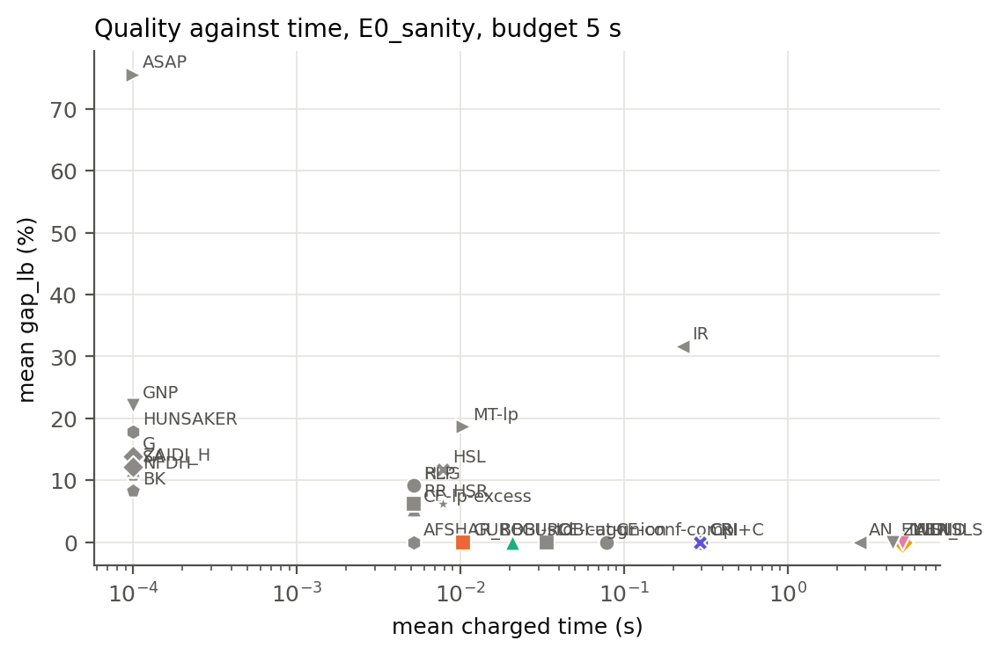

*Figure: Mean quality against mean charged time (one point per method)*

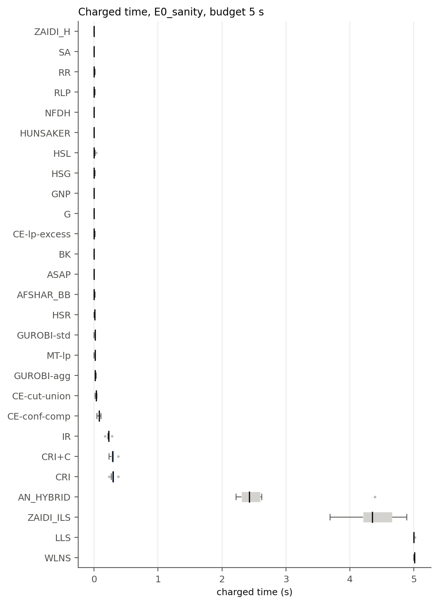

*Figure: Distribution of the charged time per run*

Friedman: N = 6 instances, k = 27 methods, chi2 = 99.02, p = 1.87e-10; Iman-Davenport F = 8.69, p = 6.51e-18; Nemenyi CD = 16.94.

*Friedman test with the Iman-Davenport correction and the Nemenyi critical difference*  (`10_E0_sanity/budget_5s/statistics/friedman_iman_davenport_test.csv`, `.tex`, `.md`)

| instances (N) | methods (k) | chi2 | p | Iman-Davenport F | p (F) | Nemenyi CD (alpha 0.05) |
|---|---|---|---|---|---|---|
| 6 | 27 | 99.0184 | 1.8682e-10 | 8.6886 | 6.5078e-18 | 16.9391 |

*Average ranks (1 = best)*  (`10_E0_sanity/budget_5s/statistics/friedman_average_ranks.csv`, `.tex`, `.md`)

| method | average rank |
|---|---|
| AFSHAR_BB | 9.50 |
| AN_HYBRID | 9.50 |
| CE-cut-union | 9.50 |
| CE-conf-comp | 9.50 |
| CRI | 9.50 |
| GUROBI-std | 9.50 |
| GUROBI-agg | 9.50 |
| CRI+C | 9.50 |
| WLNS | 9.50 |
| ZAIDI_ILS | 9.50 |
| LLS | 9.50 |
| CE-lp-excess | 10.75 |
| RR | 11.92 |
| HSR | 11.92 |
| BK | 14.58 |
| HSG | 15.75 |
| RLP | 15.75 |
| ZAIDI_H | 16.50 |
| NFDH | 16.58 |
| G | 16.75 |
| HSL | 17.75 |
| SA | 17.75 |
| GNP | 18.33 |
| MT-lp | 19.33 |
| HUNSAKER | 20.83 |
| IR | 22.33 |
| ASAP | 26.67 |

*Average ranks by family, with the Friedman p-value of each family*  (`10_E0_sanity/budget_5s/statistics/friedman_ranks_by_family.csv`, `.tex`, `.md`)

| index | AFSHAR_BB | AN_HYBRID | CE-cut-union | CE-conf-comp | CRI | GUROBI-std | GUROBI-agg | CRI+C | WLNS | ZAIDI_ILS | LLS | CE-lp-excess | RR | HSR | BK | HSG | RLP | ZAIDI_H | NFDH | G | HSL | SA | GNP | MT-lp | HUNSAKER | IR | ASAP | Friedman p | instances |
|---|---|---|---|---|---|---|---|---|---|---|---|---|---|---|---|---|---|---|---|---|---|---|---|---|---|---|---|---|---|
| omega | 9.500 | 9.500 | 9.500 | 9.500 | 9.500 | 9.500 | 9.500 | 9.500 | 9.500 | 9.500 | 9.500 | 10.750 | 11.917 | 11.917 | 14.583 | 15.750 | 15.750 | 16.500 | 16.583 | 16.750 | 17.750 | 17.750 | 18.333 | 19.333 | 20.833 | 22.333 | 26.667 | 1.868e-10 | 6.000 |

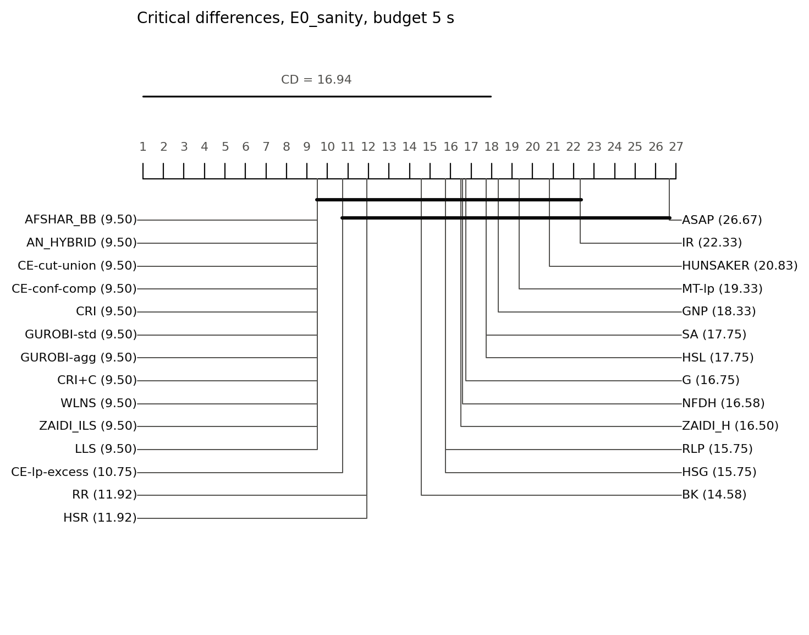

*Figure: Average ranks; methods joined by a bar are not significantly different (Nemenyi)*

*Pairwise Wilcoxon signed-rank tests (Holm), sign test, effect sizes (negative delta: A better); 351 pairs in the files, the 0 most significant of the 0 significant ones shown*  (`10_E0_sanity/budget_5s/statistics/pairwise_wilcoxon_holm_effect_sizes.csv`, `.tex`, `.md`)

(none)

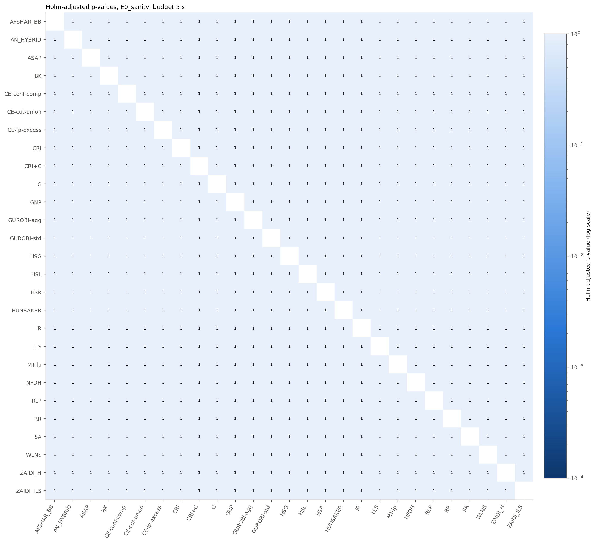

*Figure: Pairwise Holm-adjusted Wilcoxon p-values (* significant)*

*Win matrix: entry (row, column) = instances where the row method is strictly better than the column method*  (`10_E0_sanity/budget_5s/statistics/win_matrix.csv`, `.tex`, `.md`)

| method | AFSHAR_BB | AN_HYBRID | ASAP | BK | CE-conf-comp | CE-cut-union | CE-lp-excess | CRI | CRI+C | G | GNP | GUROBI-agg | GUROBI-std | HSG | HSL | HSR | HUNSAKER | IR | LLS | MT-lp | NFDH | RLP | RR | SA | WLNS | ZAIDI_H | ZAIDI_ILS |
|---|---|---|---|---|---|---|---|---|---|---|---|---|---|---|---|---|---|---|---|---|---|---|---|---|---|---|---|
| AFSHAR_BB | 0 | 0 | 6 | 3 | 0 | 0 | 1 | 0 | 0 | 3 | 4 | 0 | 0 | 3 | 4 | 1 | 5 | 5 | 0 | 4 | 4 | 3 | 1 | 4 | 0 | 3 | 0 |
| AN_HYBRID | 0 | 0 | 6 | 3 | 0 | 0 | 1 | 0 | 0 | 3 | 4 | 0 | 0 | 3 | 4 | 1 | 5 | 5 | 0 | 4 | 4 | 3 | 1 | 4 | 0 | 3 | 0 |
| ASAP | 0 | 0 | 0 | 0 | 0 | 0 | 0 | 0 | 0 | 0 | 0 | 0 | 0 | 0 | 0 | 0 | 0 | 1 | 0 | 0 | 0 | 0 | 0 | 0 | 0 | 0 | 0 |
| BK | 0 | 0 | 6 | 0 | 0 | 0 | 0 | 0 | 0 | 2 | 2 | 0 | 0 | 1 | 2 | 1 | 4 | 4 | 0 | 3 | 1 | 1 | 1 | 2 | 0 | 2 | 0 |
| CE-conf-comp | 0 | 0 | 6 | 3 | 0 | 0 | 1 | 0 | 0 | 3 | 4 | 0 | 0 | 3 | 4 | 1 | 5 | 5 | 0 | 4 | 4 | 3 | 1 | 4 | 0 | 3 | 0 |
| CE-cut-union | 0 | 0 | 6 | 3 | 0 | 0 | 1 | 0 | 0 | 3 | 4 | 0 | 0 | 3 | 4 | 1 | 5 | 5 | 0 | 4 | 4 | 3 | 1 | 4 | 0 | 3 | 0 |
| CE-lp-excess | 0 | 0 | 6 | 2 | 0 | 0 | 0 | 0 | 0 | 3 | 3 | 0 | 0 | 3 | 4 | 1 | 5 | 5 | 0 | 4 | 3 | 3 | 1 | 4 | 0 | 3 | 0 |
| CRI | 0 | 0 | 6 | 3 | 0 | 0 | 1 | 0 | 0 | 3 | 4 | 0 | 0 | 3 | 4 | 1 | 5 | 5 | 0 | 4 | 4 | 3 | 1 | 4 | 0 | 3 | 0 |
| CRI+C | 0 | 0 | 6 | 3 | 0 | 0 | 1 | 0 | 0 | 3 | 4 | 0 | 0 | 3 | 4 | 1 | 5 | 5 | 0 | 4 | 4 | 3 | 1 | 4 | 0 | 3 | 0 |
| G | 0 | 0 | 6 | 0 | 0 | 0 | 0 | 0 | 0 | 0 | 2 | 0 | 0 | 0 | 1 | 0 | 3 | 4 | 0 | 1 | 1 | 0 | 0 | 1 | 0 | 0 | 0 |
| GNP | 0 | 0 | 5 | 0 | 0 | 0 | 0 | 0 | 0 | 2 | 0 | 0 | 0 | 1 | 1 | 1 | 2 | 3 | 0 | 2 | 0 | 1 | 1 | 1 | 0 | 2 | 0 |
| GUROBI-agg | 0 | 0 | 6 | 3 | 0 | 0 | 1 | 0 | 0 | 3 | 4 | 0 | 0 | 3 | 4 | 1 | 5 | 5 | 0 | 4 | 4 | 3 | 1 | 4 | 0 | 3 | 0 |
| GUROBI-std | 0 | 0 | 6 | 3 | 0 | 0 | 1 | 0 | 0 | 3 | 4 | 0 | 0 | 3 | 4 | 1 | 5 | 5 | 0 | 4 | 4 | 3 | 1 | 4 | 0 | 3 | 0 |
| HSG | 0 | 0 | 6 | 0 | 0 | 0 | 0 | 0 | 0 | 1 | 2 | 0 | 0 | 0 | 1 | 0 | 3 | 4 | 0 | 2 | 1 | 0 | 0 | 1 | 0 | 1 | 0 |
| HSL | 0 | 0 | 6 | 0 | 0 | 0 | 0 | 0 | 0 | 1 | 2 | 0 | 0 | 0 | 0 | 0 | 2 | 3 | 0 | 2 | 0 | 0 | 0 | 0 | 0 | 1 | 0 |
| HSR | 0 | 0 | 6 | 2 | 0 | 0 | 0 | 0 | 0 | 2 | 3 | 0 | 0 | 2 | 3 | 0 | 4 | 5 | 0 | 3 | 3 | 2 | 0 | 3 | 0 | 2 | 0 |
| HUNSAKER | 0 | 0 | 6 | 0 | 0 | 0 | 0 | 0 | 0 | 1 | 2 | 0 | 0 | 0 | 0 | 0 | 0 | 3 | 0 | 2 | 0 | 0 | 0 | 0 | 0 | 1 | 0 |
| IR | 0 | 0 | 4 | 0 | 0 | 0 | 0 | 0 | 0 | 0 | 2 | 0 | 0 | 0 | 0 | 0 | 2 | 0 | 0 | 1 | 0 | 0 | 0 | 0 | 0 | 0 | 0 |
| LLS | 0 | 0 | 6 | 3 | 0 | 0 | 1 | 0 | 0 | 3 | 4 | 0 | 0 | 3 | 4 | 1 | 5 | 5 | 0 | 4 | 4 | 3 | 1 | 4 | 0 | 3 | 0 |
| MT-lp | 0 | 0 | 6 | 0 | 0 | 0 | 0 | 0 | 0 | 0 | 1 | 0 | 0 | 0 | 0 | 0 | 2 | 3 | 0 | 0 | 0 | 0 | 0 | 0 | 0 | 0 | 0 |
| NFDH | 0 | 0 | 6 | 0 | 0 | 0 | 0 | 0 | 0 | 2 | 2 | 0 | 0 | 1 | 1 | 1 | 3 | 3 | 0 | 3 | 0 | 1 | 1 | 1 | 0 | 2 | 0 |
| RLP | 0 | 0 | 6 | 0 | 0 | 0 | 0 | 0 | 0 | 1 | 2 | 0 | 0 | 0 | 1 | 0 | 3 | 4 | 0 | 2 | 1 | 0 | 0 | 1 | 0 | 1 | 0 |
| RR | 0 | 0 | 6 | 2 | 0 | 0 | 0 | 0 | 0 | 2 | 3 | 0 | 0 | 2 | 3 | 0 | 4 | 5 | 0 | 3 | 3 | 2 | 0 | 3 | 0 | 2 | 0 |
| SA | 0 | 0 | 6 | 0 | 0 | 0 | 0 | 0 | 0 | 1 | 2 | 0 | 0 | 0 | 0 | 0 | 2 | 3 | 0 | 2 | 0 | 0 | 0 | 0 | 0 | 1 | 0 |
| WLNS | 0 | 0 | 6 | 3 | 0 | 0 | 1 | 0 | 0 | 3 | 4 | 0 | 0 | 3 | 4 | 1 | 5 | 5 | 0 | 4 | 4 | 3 | 1 | 4 | 0 | 3 | 0 |
| ZAIDI_H | 0 | 0 | 6 | 0 | 0 | 0 | 0 | 0 | 0 | 1 | 2 | 0 | 0 | 0 | 1 | 0 | 3 | 4 | 0 | 2 | 1 | 0 | 0 | 1 | 0 | 0 | 0 |
| ZAIDI_ILS | 0 | 0 | 6 | 3 | 0 | 0 | 1 | 0 | 0 | 3 | 4 | 0 | 0 | 3 | 4 | 1 | 5 | 5 | 0 | 4 | 4 | 3 | 1 | 4 | 0 | 3 | 0 |

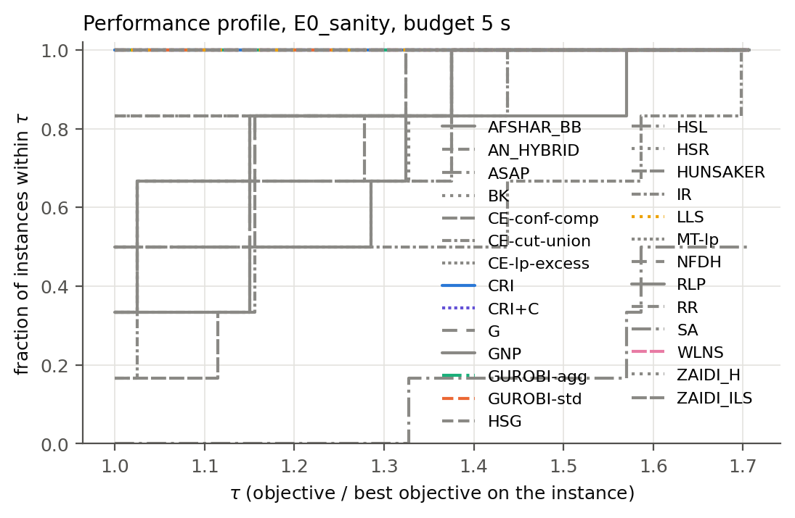

*Figure: Dolan-More performance profile of the peak (per-instance mean)*

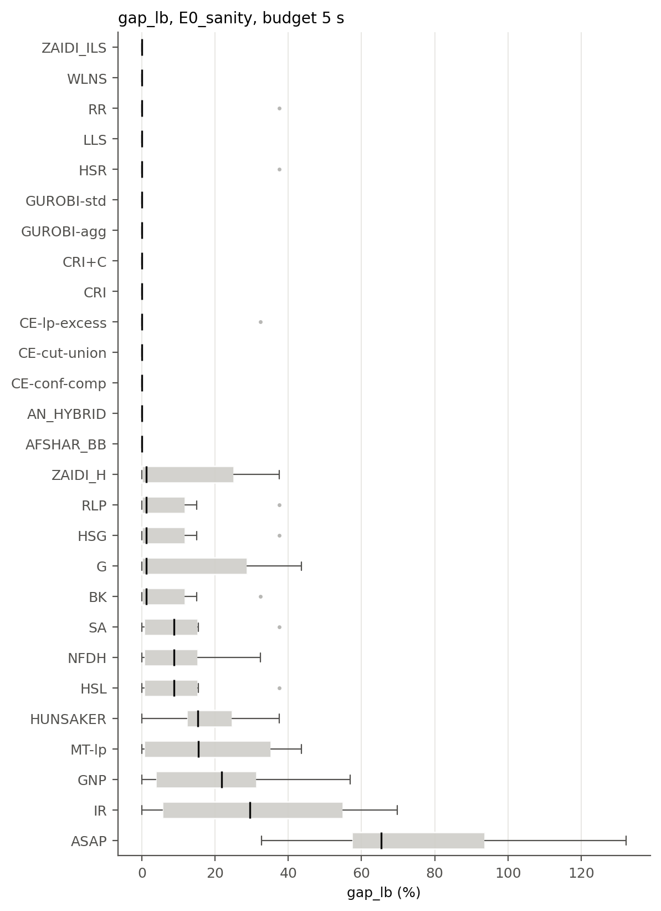

*Figure: Distribution of the per-instance gap_lb*

## E1_certificates

Files: `11_E1_certificates/`

Every lower and upper certificate (Sections 3-4) against the optimum or the best known value; validity, tightness, cost, instances proved optimal a priori.

*Addresses:* Section 6.2 of the paper (quality of the a priori certificates)

### Certificates

*Every certificate against the optimum (or best known value): a violation is an upper certificate below a proven optimum or a lower one above a feasible value*  (`11_E1_certificates/certificates/tables/all_certificates_vs_optimum.csv`, `.tex`, `.md`)

| certificate | kind | instances | mean ratio to OPT/BKS | min ratio | #equal OPT/BKS | violations | max ratio |
|---|---|---|---|---|---|---|---|
| P_LP | lower | 172 | 0.9200 | 0.5000 | 0 | 0 | n/a |
| LB_LP_rounded | lower | 172 | 0.9317 | 0.5227 | 11 | 0 | n/a |
| LB_cut | lower | 172 | 0.9793 | 0.7701 | 42 | 0 | n/a |
| LB_conf | lower | 172 | 0.9991 | 0.9840 | 95 | 0 | n/a |
| LP_plus_wmax | upper | 172 | 1.3267 | n/a | 0 | 0 | 1.9177 |
| published_hoeffding_union | upper | 172 | 3.2334 | n/a | 0 | 0 | 5.7084 |
| published_bernstein_union | upper | 172 | 2.3700 | n/a | 0 | 0 | 4.3286 |
| published_hoeffding_lll | upper | 172 | 3.3409 | n/a | 0 | 0 | 5.3424 |
| published_bernstein_lll | upper | 172 | 2.4983 | n/a | 0 | 0 | 4.7084 |
| lp_union | upper | 172 | 1.1934 | n/a | 6 | 0 | 1.4815 |
| lp_component_union | upper | 172 | 1.1812 | n/a | 7 | 0 | 1.4815 |
| lp_lll | upper | 172 | 1.1969 | n/a | 5 | 0 | 1.5227 |
| lp_averaging | upper | 172 | 1.2478 | n/a | 1 | 0 | 1.5871 |
| lp_component_averaging | upper | 172 | 1.2443 | n/a | 1 | 0 | 1.5871 |
| lp_closed_hoeffding_lll | upper | 172 | 1.6036 | n/a | 0 | 0 | 2.7058 |
| lp_closed_ks_lll | upper | 172 | 1.5690 | n/a | 0 | 0 | 2.5354 |
| lp_closed_bernstein_lll | upper | 172 | 2.0519 | n/a | 0 | 0 | 3.9125 |
| lp_closed_hoeffding_comp | upper | 172 | 1.6028 | n/a | 0 | 0 | 2.5398 |
| lp_closed_ks_comp | upper | 172 | 1.5682 | n/a | 0 | 0 | 2.4789 |
| lp_closed_bernstein_comp | upper | 171 | 2.0535 | n/a | 0 | 0 | 3.7974 |
| lp_dr_union | upper | 172 | 1.1866 | n/a | 6 | 0 | 1.4815 |
| lp_dr_component_union | upper | 172 | 1.1739 | n/a | 7 | 0 | 1.4815 |
| lp_dr_averaging | upper | 172 | 1.2359 | n/a | 1 | 0 | 1.5598 |
| lp_dr_component_averaging | upper | 172 | 1.2326 | n/a | 1 | 0 | 1.5503 |
| lp_dr_ceiling | upper | 172 | 1.4109 | n/a | 1 | 0 | 2.0551 |
| lp_exist_sys | upper | 145 | 1.1210 | n/a | 13 | 0 | 1.4364 |
| lp_emax_exact | upper | 145 | 1.2733 | n/a | 1 | 0 | 1.5450 |
| lp_exist_full | upper | 128 | 1.1136 | n/a | 16 | 0 | 1.4364 |
| cut_union | upper | 172 | 1.1933 | n/a | 10 | 0 | 1.6128 |
| cut_component_union | upper | 172 | 1.1818 | n/a | 14 | 0 | 1.6128 |
| cut_lll | upper | 172 | 1.2079 | n/a | 10 | 0 | 1.6979 |
| cut_averaging | upper | 172 | 1.2520 | n/a | 4 | 0 | 1.6856 |
| cut_component_averaging | upper | 172 | 1.2486 | n/a | 4 | 0 | 1.6856 |
| cut_closed_hoeffding_lll | upper | 172 | 1.6487 | n/a | 1 | 0 | 2.8395 |
| cut_closed_ks_lll | upper | 172 | 1.6045 | n/a | 1 | 0 | 2.6272 |
| cut_closed_bernstein_lll | upper | 172 | 2.1022 | n/a | 1 | 0 | 4.1415 |
| cut_closed_hoeffding_comp | upper | 172 | 1.6239 | n/a | 1 | 0 | 2.7563 |
| cut_closed_ks_comp | upper | 172 | 1.5812 | n/a | 1 | 0 | 2.5525 |
| cut_closed_bernstein_comp | upper | 170 | 2.0516 | n/a | 0 | 0 | 3.9243 |
| cut_dr_union | upper | 172 | 1.1868 | n/a | 11 | 0 | 1.6128 |
| cut_dr_component_union | upper | 172 | 1.1765 | n/a | 14 | 0 | 1.6128 |
| cut_dr_averaging | upper | 172 | 1.2366 | n/a | 4 | 0 | 1.6549 |
| cut_dr_component_averaging | upper | 172 | 1.2338 | n/a | 4 | 0 | 1.6549 |
| cut_dr_ceiling | upper | 172 | 1.4372 | n/a | 4 | 0 | 2.6811 |
| cut_exist_sys | upper | 129 | 1.0890 | n/a | 28 | 0 | 1.3704 |
| cut_exist_full | upper | 99 | 1.0681 | n/a | 28 | 0 | 1.2125 |
| conf_union | upper | 143 | 1.2283 | n/a | 46 | 0 | 1.5522 |
| conf_component_union | upper | 143 | 1.2212 | n/a | 46 | 0 | 1.5522 |
| conf_lll | upper | 143 | 1.2814 | n/a | 44 | 0 | 1.6951 |
| conf_averaging | upper | 143 | 1.3031 | n/a | 37 | 0 | 1.7048 |
| conf_component_averaging | upper | 143 | 1.3008 | n/a | 37 | 0 | 1.7048 |
| conf_closed_hoeffding_lll | upper | 143 | 1.6863 | n/a | 34 | 0 | 2.3984 |
| conf_closed_ks_lll | upper | 143 | 1.6530 | n/a | 34 | 0 | 2.3378 |
| conf_closed_bernstein_lll | upper | 143 | 1.9228 | n/a | 34 | 0 | 3.1285 |
| conf_closed_hoeffding_comp | upper | 143 | 1.6189 | n/a | 34 | 0 | 2.3693 |
| conf_closed_ks_comp | upper | 143 | 1.5884 | n/a | 34 | 0 | 2.2787 |
| conf_dr_union | upper | 143 | 1.1706 | n/a | 46 | 0 | 1.5275 |
| conf_dr_component_union | upper | 143 | 1.1648 | n/a | 47 | 0 | 1.5275 |
| conf_dr_averaging | upper | 143 | 1.2233 | n/a | 38 | 0 | 1.6354 |
| conf_dr_component_averaging | upper | 143 | 1.2217 | n/a | 38 | 0 | 1.6354 |
| conf_dr_ceiling | upper | 143 | 1.4419 | n/a | 38 | 0 | 2.3704 |
| conf_exist_sys | upper | 61 | 1.0055 | n/a | 54 | 0 | 1.1301 |
| conf_exist_full | upper | 58 | 1.0001 | n/a | 55 | 0 | 1.0032 |
| IR_guarantee | upper | 172 | 1.2496 | n/a | 2 | 0 | 1.8333 |
| U_best | upper (best) | 172 | 1.0542 | n/a | 57 | 0 | 1.2604 |
| LB | lower | 172 | 0.9991 | 0.9840 | 95 | 0 | n/a |
| conf_closed_bernstein_comp | upper | 108 | 2.0932 | n/a | 0 | 0 | 2.9077 |

Proved optimal by the certificates alone (U_best = LB, no search, no MILP): **63 of 172 instances** (36.6%).

*Instances proved optimal by the certificates alone (U_best = LB): no search and no MILP*  (`11_E1_certificates/certificates/tables/a_priori_optimal_instances.csv`, `.tex`, `.md`)

| family | n | a priori optimal | instances | share % |
|---|---|---|---|---|
| omega | 10 | 5 | 5 | 100 |
| omega | 20 | 10 | 10 | 100 |
| omega | 30 | 10 | 10 | 100 |
| omega | 40 | 4 | 5 | 80 |
| omega | 50 | 2 | 10 | 20 |
| omega | 75 | 0 | 5 | 0 |
| omega | 100 | 0 | 10 | 0 |
| omega | 150 | 0 | 5 | 0 |
| omega | 200 | 0 | 10 | 0 |
| omega | 500 | 0 | 3 | 0 |
| omega | 1000 | 0 | 3 | 0 |
| omega | 2000 | 0 | 3 | 0 |
| overnight | 10 | 5 | 5 | 100 |
| overnight | 20 | 1 | 5 | 20 |
| overnight | 30 | 0 | 5 | 0 |
| overnight | 50 | 0 | 5 | 0 |
| overnight | 100 | 0 | 5 | 0 |
| overnight | 200 | 0 | 5 | 0 |
| overnight | 500 | 0 | 3 | 0 |
| overnight | 1000 | 0 | 3 | 0 |
| overnight | 2000 | 0 | 3 | 0 |
| pcmax | 20 | 0 | 3 | 0 |
| pcmax | 50 | 0 | 3 | 0 |
| pcmax | 100 | 0 | 3 | 0 |
| single | 50 | 3 | 3 | 100 |
| single | 200 | 3 | 3 | 100 |
| staggered | 10 | 5 | 5 | 100 |
| staggered | 20 | 5 | 5 | 100 |
| staggered | 30 | 5 | 5 | 100 |
| staggered | 50 | 4 | 5 | 80 |
| staggered | 100 | 1 | 5 | 20 |
| staggered | 200 | 0 | 5 | 0 |
| staggered | 500 | 0 | 3 | 0 |
| staggered | 1000 | 0 | 3 | 0 |
| staggered | 2000 | 0 | 3 | 0 |

*Two-sided certificate: mean (U_best - LB)/LB, U_best above and LB below the optimum / best known value (%)*  (`11_E1_certificates/certificates/tables/two_sided_certified_interval.csv`, `.tex`, `.md`)

| family | n | two_sided_gap | U_best_above_ref | LB_below_ref | instances |
|---|---|---|---|---|---|
| omega | 10 | 0.000 | 0.000 | 0.000 | 5 |
| omega | 20 | 0.000 | 0.000 | 0.000 | 10 |
| omega | 30 | 0.000 | 0.000 | 0.000 | 10 |
| omega | 40 | 1.407 | 1.407 | 0.000 | 5 |
| omega | 50 | 14.537 | 14.447 | 0.077 | 10 |
| omega | 75 | 14.749 | 14.555 | 0.172 | 5 |
| omega | 100 | 12.164 | 12.014 | 0.134 | 10 |
| omega | 150 | 8.533 | 8.292 | 0.222 | 5 |
| omega | 200 | 5.886 | 5.700 | 0.176 | 10 |
| omega | 500 | 4.328 | 4.266 | 0.059 | 3 |
| omega | 1000 | 2.132 | 2.112 | 0.019 | 3 |
| omega | 2000 | 0.985 | 0.978 | 0.007 | 3 |
| overnight | 10 | 0.000 | 0.000 | 0.000 | 5 |
| overnight | 20 | 14.951 | 14.627 | 0.275 | 5 |
| overnight | 30 | 14.968 | 13.939 | 0.901 | 5 |
| overnight | 50 | 13.623 | 13.549 | 0.065 | 5 |
| overnight | 100 | 5.991 | 5.911 | 0.075 | 5 |
| overnight | 200 | 3.022 | 2.979 | 0.042 | 5 |
| overnight | 500 | 1.681 | 1.662 | 0.019 | 3 |
| overnight | 1000 | 0.869 | 0.864 | 0.005 | 3 |
| overnight | 2000 | 0.450 | 0.444 | 0.006 | 3 |
| pcmax | 20 | 9.246 | n/a | n/a | 3 |
| pcmax | 50 | 6.798 | n/a | n/a | 3 |
| pcmax | 100 | 5.485 | n/a | n/a | 3 |
| single | 50 | 0.000 | n/a | n/a | 3 |
| single | 200 | 0.000 | n/a | n/a | 3 |
| staggered | 10 | 0.000 | 0.000 | 0.000 | 5 |
| staggered | 20 | 0.000 | 0.000 | 0.000 | 5 |
| staggered | 30 | 0.000 | 0.000 | 0.000 | 5 |
| staggered | 50 | 0.063 | 0.063 | 0.000 | 5 |
| staggered | 100 | 7.573 | 7.573 | 0.000 | 5 |
| staggered | 200 | 9.026 | 9.026 | 0.000 | 5 |
| staggered | 500 | 6.905 | 6.834 | 0.066 | 3 |
| staggered | 1000 | 3.982 | 3.898 | 0.080 | 3 |
| staggered | 2000 | 2.180 | 2.090 | 0.088 | 3 |

Best new upper certificate (U_best) against the best non-localized bound (same LP vertex): U_best is lower by 45.7% on average (median 50.8%, min 1.9%, max 76.8%); the non-localized bound is 2.14 times U_best on average.

*Mean certificate / OPT (or best known) by family and size*  (`11_E1_certificates/certificates/tables/certificate_ratios_by_family_and_n.csv`, `.tex`, `.md`)

| family | n | U_best | lp_union | lp_component_union | lp_lll | lp_exist_sys | IR_guarantee | LB | LB_cut | LB_conf | P_LP | published_best |
|---|---|---|---|---|---|---|---|---|---|---|---|---|
| omega | 10 | 1.0000 | 1.1850 | 1.1670 | 1.1850 | 1.1670 | 1.3679 | 1.0000 | 1.0000 | 1.0000 | 0.6367 | 3.0535 |
| omega | 20 | 1.0000 | 1.2390 | 1.2159 | 1.2669 | 1.0817 | 1.4106 | 1.0000 | 0.9255 | 1.0000 | 0.7366 | 3.3207 |
| omega | 30 | 1.0000 | 1.2904 | 1.2534 | 1.2998 | 1.1276 | 1.3410 | 1.0000 | 0.9735 | 1.0000 | 0.8456 | 3.1519 |
| omega | 40 | 1.0141 | 1.3476 | 1.3062 | 1.3291 | 1.1369 | 1.3761 | 1.0000 | 0.9003 | 1.0000 | 0.8842 | 3.1520 |
| omega | 50 | 1.1445 | 1.3304 | 1.3149 | 1.3568 | 1.1989 | 1.3682 | 0.9992 | 0.9698 | 0.9992 | 0.9367 | 2.9550 |
| omega | 75 | 1.1455 | 1.3073 | 1.2982 | 1.2733 | 1.1611 | 1.3290 | 0.9983 | 0.9858 | 0.9983 | 0.9832 | 2.5496 |
| omega | 100 | 1.1201 | 1.2337 | 1.2265 | 1.2065 | 1.1232 | 1.2658 | 0.9987 | 0.9936 | 0.9987 | 0.9925 | 2.1768 |
| omega | 150 | 1.0829 | 1.1773 | 1.1667 | 1.1571 | 1.0880 | 1.1821 | 0.9978 | 0.9963 | 0.9978 | 0.9960 | 1.8435 |
| omega | 200 | 1.0570 | 1.1316 | 1.1308 | 1.1091 | 1.0659 | 1.1374 | 0.9982 | 0.9980 | 0.9982 | 0.9976 | 1.6222 |
| omega | 500 | 1.0427 | 1.0560 | 1.0560 | 1.0447 | n/a | 1.0524 | 0.9994 | 0.9994 | 0.9994 | 0.9993 | 1.2652 |
| omega | 1000 | 1.0211 | 1.0279 | 1.0279 | 1.0219 | n/a | 1.0295 | 0.9998 | 0.9998 | 0.9998 | 0.9998 | 1.1247 |
| omega | 2000 | 1.0098 | 1.0137 | 1.0136 | 1.0102 | n/a | 1.0124 | 0.9999 | 0.9999 | 0.9999 | 0.9999 | 1.0638 |
| overnight | 10 | 1.0000 | 1.3448 | 1.3448 | 1.3621 | 1.1612 | 1.4795 | 1.0000 | 0.9444 | 1.0000 | 0.7510 | 3.2677 |
| overnight | 20 | 1.1463 | 1.3464 | 1.3464 | 1.3578 | 1.1826 | 1.4487 | 0.9973 | 0.9854 | 0.9973 | 0.9794 | 2.7563 |
| overnight | 30 | 1.1394 | 1.2614 | 1.2614 | 1.2752 | 1.1544 | 1.2943 | 0.9910 | 0.9844 | 0.9910 | 0.9828 | 2.3152 |
| overnight | 50 | 1.1355 | 1.1946 | 1.1946 | 1.2139 | 1.1400 | 1.2159 | 0.9994 | 0.9985 | 0.9994 | 0.9979 | 1.9328 |
| overnight | 100 | 1.0591 | 1.1006 | 1.1006 | 1.1090 | 1.0694 | 1.1071 | 0.9992 | 0.9991 | 0.9992 | 0.9988 | 1.4776 |
| overnight | 200 | 1.0298 | 1.0535 | 1.0535 | 1.0631 | 1.0352 | 1.0552 | 0.9996 | 0.9996 | 0.9996 | 0.9994 | 1.2526 |
| overnight | 500 | 1.0166 | 1.0207 | 1.0207 | 1.0168 | n/a | 1.0207 | 0.9998 | 0.9998 | 0.9998 | 0.9998 | 1.0953 |
| overnight | 1000 | 1.0086 | 1.0108 | 1.0108 | 1.0086 | n/a | 1.0109 | 0.9999 | 0.9999 | 0.9999 | 0.9999 | 1.0500 |
| overnight | 2000 | 1.0044 | 1.0054 | 1.0054 | 1.0046 | n/a | 1.0056 | 0.9999 | 0.9999 | 0.9999 | 0.9999 | 1.0258 |
| pcmax | 20 | n/a | n/a | n/a | n/a | n/a | n/a | n/a | n/a | n/a | n/a | n/a |
| pcmax | 50 | n/a | n/a | n/a | n/a | n/a | n/a | n/a | n/a | n/a | n/a | n/a |
| pcmax | 100 | n/a | n/a | n/a | n/a | n/a | n/a | n/a | n/a | n/a | n/a | n/a |
| single | 50 | n/a | n/a | n/a | n/a | n/a | n/a | n/a | n/a | n/a | n/a | n/a |
| single | 200 | n/a | n/a | n/a | n/a | n/a | n/a | n/a | n/a | n/a | n/a | n/a |
| staggered | 10 | 1.0000 | 1.2001 | 1.2001 | 1.2807 | 1.1437 | 1.3300 | 1.0000 | 0.9575 | 1.0000 | 0.7720 | 2.8577 |
| staggered | 20 | 1.0000 | 1.1889 | 1.1753 | 1.2330 | 1.0889 | 1.4377 | 1.0000 | 0.9962 | 1.0000 | 0.8745 | 3.2848 |
| staggered | 30 | 1.0000 | 1.1164 | 1.0957 | 1.1263 | 1.0796 | 1.2278 | 1.0000 | 0.9822 | 1.0000 | 0.8307 | 2.7506 |
| staggered | 50 | 1.0006 | 1.2197 | 1.1702 | 1.2302 | 1.1209 | 1.3078 | 1.0000 | 0.9434 | 1.0000 | 0.8278 | 3.0023 |
| staggered | 100 | 1.0757 | 1.2025 | 1.1813 | 1.2031 | 1.1309 | 1.2353 | 1.0000 | 0.9658 | 1.0000 | 0.9637 | 2.2861 |
| staggered | 200 | 1.0903 | 1.1914 | 1.1675 | 1.1576 | 1.0922 | 1.2128 | 1.0000 | 0.9944 | 1.0000 | 0.9939 | 1.8805 |
| staggered | 500 | 1.0683 | 1.0917 | 1.0833 | 1.0732 | n/a | 1.0951 | 0.9993 | 0.9985 | 0.9993 | 0.9981 | 1.3942 |
| staggered | 1000 | 1.0390 | 1.0567 | 1.0527 | 1.0437 | n/a | 1.0537 | 0.9992 | 0.9992 | 0.9992 | 0.9991 | 1.2168 |
| staggered | 2000 | 1.0209 | 1.0255 | 1.0250 | 1.0210 | n/a | 1.0244 | 0.9991 | 0.9991 | 0.9991 | 0.9991 | 1.1087 |

*Share of instances (%) where the certificate is within 0.5 / 1 / 5 % of OPT (or best known)*  (`11_E1_certificates/certificates/tables/certificates_within_tolerance.csv`, `.tex`, `.md`)

| certificate | within 0.5% | within 1% | within 5% | instances |
|---|---|---|---|---|
| U_best | 35.5 | 38.4 | 51.7 | 157 |
| lp_union | 3.5 | 5.2 | 15.7 | 157 |
| lp_component_union | 4.1 | 5.8 | 18.6 | 157 |
| lp_lll | 4.7 | 7.6 | 18.6 | 157 |
| lp_exist_sys | 7.6 | 7.6 | 17.4 | 130 |
| IR_guarantee | 1.2 | 2.9 | 14.0 | 157 |
| LB | 87.2 | 89.5 | 91.3 | 157 |
| LB_cut | 58.1 | 64.0 | 79.7 | 157 |
| LB_conf | 87.2 | 89.5 | 91.3 | 157 |
| P_LP | 35.5 | 42.4 | 57.6 | 157 |
| published_best | 0.0 | 0.0 | 2.9 | 157 |

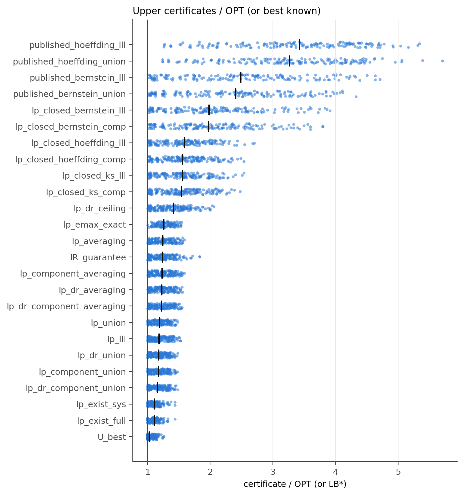

*Figure: Tightness of the upper certificates (1 = the optimum)*

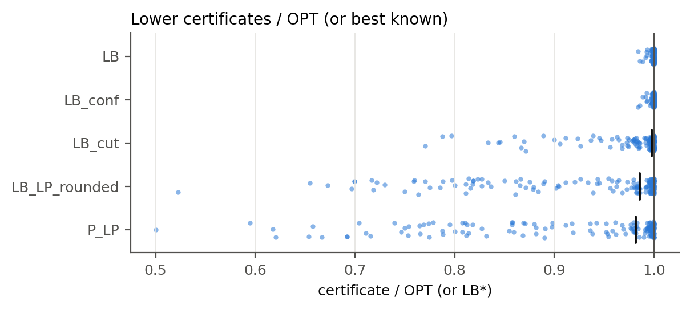

*Figure: Tightness of the lower certificates (1 = the optimum)*

*Median cost of each certificate step (s)*  (`11_E1_certificates/certificates/tables/certificate_step_costs.csv`, `.tex`, `.md`)

| family | n | info_cost_lp | info_cost_cert_lp | info_cost_attainable | info_cost_lb_cut | info_cost_lb_conf | info_cost_lb | info_cost_cert_cut | info_cost_ir | info_cost_cert_conf | info_cost_bounds |
|---|---|---|---|---|---|---|---|---|---|---|---|
| omega | 10 | 0.000 | 0.000 | 0.000 | 0.016 | 0.031 | 0.000 | 0.000 | 0.219 | 0.000 | 0.078 |
| omega | 20 | 0.008 | 0.000 | 0.000 | 0.047 | 0.062 | 0.000 | 0.000 | 0.273 | 0.000 | 0.187 |
| omega | 30 | 0.016 | 0.000 | 0.000 | 0.062 | 0.117 | 0.000 | 0.000 | 0.266 | 0.000 | 0.227 |
| omega | 40 | 0.016 | 0.000 | 0.000 | 0.125 | 0.234 | 0.000 | 0.000 | 0.422 | 0.000 | 0.406 |
| omega | 50 | 0.016 | 0.000 | 0.000 | 0.164 | 0.328 | 0.000 | 0.008 | 0.547 | 0.000 | 0.508 |
| omega | 75 | 0.031 | 0.000 | 0.000 | 0.281 | 0.844 | 0.000 | 0.000 | 0.734 | 0.016 | 0.859 |
| omega | 100 | 0.047 | 0.000 | 0.000 | 0.305 | 1.391 | 0.000 | 0.000 | 0.789 | 0.008 | 1.328 |
| omega | 150 | 0.078 | 0.000 | 0.000 | 0.266 | 3.750 | 0.000 | 0.016 | 1.016 | 0.016 | 1.219 |
| omega | 200 | 0.109 | 0.000 | 0.000 | 0.227 | 5.742 | 0.000 | 0.000 | 1.016 | 0.031 | 1.578 |
| omega | 500 | 0.234 | 0.016 | 0.000 | 0.344 | 60.000 | n/a | 0.016 | 1.141 | 0.000 | 0.156 |
| omega | 1000 | 0.516 | 0.016 | 0.031 | 0.687 | 0.000 | n/a | 0.016 | 1.531 | 0.000 | 0.203 |
| omega | 2000 | 1.125 | 0.031 | 0.094 | 1.250 | 0.000 | n/a | 0.016 | 2.375 | 0.000 | 0.281 |
| overnight | 10 | 0.016 | 0.000 | 0.000 | 0.078 | 0.094 | 0.000 | 0.000 | 0.250 | 0.000 | 0.484 |
| overnight | 20 | 0.016 | 0.000 | 0.000 | 0.141 | 0.469 | 0.000 | 0.000 | 0.328 | 0.000 | 0.578 |
| overnight | 30 | 0.031 | 0.000 | 0.000 | 0.156 | 0.766 | 0.000 | 0.000 | 0.313 | 0.000 | 0.875 |
| overnight | 50 | 0.063 | 0.016 | 0.000 | 0.312 | 4.187 | 0.000 | 0.000 | 0.766 | 0.016 | 1.031 |
| overnight | 100 | 0.141 | 0.000 | 0.016 | 0.234 | 14.641 | 0.000 | 0.016 | 0.953 | 0.016 | 1.266 |
| overnight | 200 | 0.250 | 0.016 | 0.031 | 0.437 | 60.016 | 0.000 | 0.016 | 1.109 | 0.000 | 1.469 |
| overnight | 500 | 1.703 | 0.016 | 0.172 | 1.891 | 60.031 | n/a | 0.016 | 1.937 | 0.000 | 0.234 |
| overnight | 1000 | 1.500 | 0.031 | 0.609 | 2.797 | 0.000 | n/a | 0.031 | 3.141 | 0.000 | 0.391 |
| overnight | 2000 | 2.844 | 0.078 | 2.187 | 5.984 | 0.000 | n/a | 0.078 | 5.734 | 0.000 | 0.750 |
| pcmax | 20 | 0.000 | 0.000 | 0.000 | 0.047 | 0.328 | n/a | 0.000 | 0.047 | 0.000 | 0.156 |
| pcmax | 50 | 0.016 | 0.000 | 0.000 | 0.062 | 1.641 | n/a | 0.000 | 0.062 | 0.000 | 0.234 |
| pcmax | 100 | 0.016 | 0.000 | 0.016 | 0.063 | 7.250 | n/a | 0.000 | 0.047 | 0.016 | 0.484 |
| single | 50 | 0.016 | 0.000 | 0.000 | 0.016 | 0.062 | n/a | 0.000 | 0.094 | 0.000 | 0.063 |
| single | 200 | 0.031 | 0.000 | 0.000 | 0.031 | 0.187 | n/a | 0.000 | 0.469 | 0.000 | 0.172 |
| staggered | 10 | 0.000 | 0.000 | 0.000 | 0.031 | 0.031 | 0.000 | 0.000 | 0.141 | 0.000 | 0.094 |
| staggered | 20 | 0.016 | 0.000 | 0.000 | 0.047 | 0.094 | 0.000 | 0.000 | 0.188 | 0.000 | 0.094 |
| staggered | 30 | 0.016 | 0.000 | 0.000 | 0.047 | 0.125 | 0.000 | 0.000 | 0.219 | 0.000 | 0.125 |
| staggered | 50 | 0.000 | 0.016 | 0.000 | 0.063 | 0.141 | 0.000 | 0.000 | 0.437 | 0.000 | 0.219 |
| staggered | 100 | 0.016 | 0.000 | 0.000 | 0.141 | 0.359 | 0.000 | 0.000 | 0.422 | 0.016 | 0.234 |
| staggered | 200 | 0.031 | 0.000 | 0.000 | 0.219 | 1.094 | 0.000 | 0.000 | 0.578 | 0.016 | 0.781 |
| staggered | 500 | 0.078 | 0.016 | 0.000 | 0.125 | 20.844 | n/a | 0.016 | 0.781 | 0.016 | 0.484 |
| staggered | 1000 | 0.187 | 0.000 | 0.016 | 0.312 | 0.000 | n/a | 0.016 | 1.109 | 0.000 | 0.188 |
| staggered | 2000 | 0.391 | 0.016 | 0.016 | 0.625 | 0.000 | n/a | 0.016 | 1.406 | 0.000 | 0.141 |

## E8a_tuning_faithful

Files: `12_E8a_tuning_faithful/`

Faithful tuning of the earlier SA (and, through tuned_as, of its hybrids) with its original grid (243 points, iteration mode), on the separate tuning set (never on evaluation instances).

*Addresses:* Section 6.1 of the paper (tuning on the separate tuning set)

### Tuning

*Tuning grid of SA (mean relative gap to the best value per tuning instance)*  (`12_E8a_tuning_faithful/tuning/tables/grid_SA.csv`, `.tex`, `.md`)

| point | mean_rel_gap | mean_time | chosen |
|---|---|---|---|
| {"L": 50, "T0": 50.0, "Tmin": 0.01, "alpha_c": 0.95, "alpha_p": 0.3} | **0.0323** | 0.0043 | yes |
| {"L": 50, "T0": 200.0, "Tmin": 0.01, "alpha_c": 0.95, "alpha_p": 0.3} | 0.0331 | 0.0035 | no |
| {"L": 50, "T0": 100.0, "Tmin": 0.01, "alpha_c": 0.95, "alpha_p": 0.3} | 0.0345 | 0.0052 | no |
| {"L": 50, "T0": 200.0, "Tmin": 0.01, "alpha_c": 0.95, "alpha_p": 0.5} | 0.0356 | 0.0056 | no |
| {"L": 50, "T0": 200.0, "Tmin": 0.01, "alpha_c": 0.95, "alpha_p": 0.1} | 0.0384 | 0.0056 | no |
| {"L": 50, "T0": 50.0, "Tmin": 0.01, "alpha_c": 0.95, "alpha_p": 0.5} | 0.0425 | 0.0048 | no |
| {"L": 50, "T0": 50.0, "Tmin": 0.01, "alpha_c": 0.95, "alpha_p": 0.1} | 0.0447 | 0.0035 | no |
| {"L": 80, "T0": 100.0, "Tmin": 0.01, "alpha_c": 0.9, "alpha_p": 0.3} | 0.0447 | 0.0039 | no |
| {"L": 80, "T0": 50.0, "Tmin": 0.01, "alpha_c": 0.9, "alpha_p": 0.5} | 0.0455 | 0.0030 | no |
| {"L": 50, "T0": 100.0, "Tmin": 0.01, "alpha_c": 0.95, "alpha_p": 0.1} | 0.0483 | 0.0030 | no |
| {"L": 80, "T0": 50.0, "Tmin": 0.01, "alpha_c": 0.9, "alpha_p": 0.3} | 0.0497 | 0.0043 | no |
| {"L": 80, "T0": 200.0, "Tmin": 0.01, "alpha_c": 0.9, "alpha_p": 0.3} | 0.0497 | 0.0056 | no |
| {"L": 80, "T0": 100.0, "Tmin": 0.01, "alpha_c": 0.9, "alpha_p": 0.5} | 0.0521 | 0.0048 | no |
| {"L": 50, "T0": 100.0, "Tmin": 0.01, "alpha_c": 0.95, "alpha_p": 0.5} | 0.0525 | 0.0061 | no |
| {"L": 30, "T0": 50.0, "Tmin": 0.01, "alpha_c": 0.98, "alpha_p": 0.5} | 0.0535 | 0.0052 | no |

*Marginal effect of each parameter of SA (mean over the other parameters)*  (`12_E8a_tuning_faithful/tuning/tables/marginal_effects_SA.csv`, `.tex`, `.md`)

| parameter | value | mean_rel_gap | mean_time |
|---|---|---|---|
| L | 30 | 0.1601 | 0.0024 |
| L | 50 | 0.1696 | 0.0033 |
| L | 80 | 0.1818 | 0.0039 |
| T0 | 50 | 0.1592 | 0.0031 |
| T0 | 100 | 0.1711 | 0.0032 |
| T0 | 200 | 0.1812 | 0.0033 |
| Tmin | 0.01 | 0.1178 | 0.0038 |
| Tmin | 0.1 | 0.1512 | 0.0032 |
| Tmin | 1 | 0.2426 | 0.0025 |
| alpha_c | 0.9 | 0.1663 | 0.0018 |
| alpha_c | 0.95 | 0.1359 | 0.0032 |
| alpha_c | 0.98 | 0.2094 | 0.0045 |
| alpha_p | 0.1 | 0.1840 | 0.0027 |
| alpha_p | 0.3 | 0.1662 | 0.0032 |
| alpha_p | 0.5 | 0.1613 | 0.0036 |

## E8b_tuning_budget

Files: `13_E8b_tuning_budget/`

Tuning of the budget-mode methods (SA-b and the SA-b hybrids, LLS, W-LNS) at 10 s on the separate tuning set; the chosen LLS and W-LNS values become the class defaults (used inside CRI).

*Addresses:* Section 6.1 of the paper (tuning on the separate tuning set)

### Tuning

*Tuning grid of LLS (mean relative gap to the best value per tuning instance)*  (`13_E8b_tuning_budget/tuning/tables/grid_LLS.csv`, `.tex`, `.md`)

| point | mean_rel_gap | mean_time | chosen |
|---|---|---|---|
| {"kick_size": 2} | **0.0011** | 10.0074 | yes |
| {"kick_size": 3} | 0.0012 | 10.0117 | no |
| {"kick_size": 5} | 0.0016 | 10.0070 | no |
| {"kick_size": 8} | 0.0026 | 10.0078 | no |

*Marginal effect of each parameter of LLS (mean over the other parameters)*  (`13_E8b_tuning_budget/tuning/tables/marginal_effects_LLS.csv`, `.tex`, `.md`)

| parameter | value | mean_rel_gap | mean_time |
|---|---|---|---|
| kick_size | 2 | 0.0011 | 10.0074 |
| kick_size | 3 | 0.0012 | 10.0117 |
| kick_size | 5 | 0.0016 | 10.0070 |
| kick_size | 8 | 0.0026 | 10.0078 |

*Tuning grid of SA-b (mean relative gap to the best value per tuning instance)*  (`13_E8b_tuning_budget/tuning/tables/grid_SA-b.csv`, `.tex`, `.md`)

| point | mean_rel_gap | mean_time | chosen |
|---|---|---|---|
| {"L": 200, "T0": 10.0, "alpha_c": 0.99, "alpha_p": 0.1} | **0.0671** | 10.0156 | yes |
| {"L": 200, "T0": 100.0, "alpha_c": 0.99, "alpha_p": 0.1} | 0.0679 | 10.0018 | no |
| {"L": 200, "T0": 10.0, "alpha_c": 0.99, "alpha_p": 0.3} | 0.0834 | 10.0018 | no |
| {"L": 200, "T0": 100.0, "alpha_c": 0.99, "alpha_p": 0.3} | 0.0841 | 10.0022 | no |
| {"L": 50, "T0": 10.0, "alpha_c": 0.99, "alpha_p": 0.1} | 0.0974 | 10.0156 | no |
| {"L": 50, "T0": 100.0, "alpha_c": 0.99, "alpha_p": 0.1} | 0.1003 | 10.0156 | no |
| {"L": 200, "T0": 10.0, "alpha_c": 0.95, "alpha_p": 0.1} | 0.1047 | 10.0156 | no |
| {"L": 200, "T0": 100.0, "alpha_c": 0.95, "alpha_p": 0.1} | 0.1063 | 10.0018 | no |
| {"L": 50, "T0": 10.0, "alpha_c": 0.99, "alpha_p": 0.3} | 0.1095 | 10.0156 | no |
| {"L": 50, "T0": 100.0, "alpha_c": 0.99, "alpha_p": 0.3} | 0.1103 | 10.0156 | no |
| {"L": 200, "T0": 100.0, "alpha_c": 0.95, "alpha_p": 0.3} | 0.1184 | 10.0039 | no |
| {"L": 200, "T0": 10.0, "alpha_c": 0.95, "alpha_p": 0.3} | 0.1201 | 10.0156 | no |
| {"L": 50, "T0": 10.0, "alpha_c": 0.95, "alpha_p": 0.1} | 0.1567 | 10.0156 | no |
| {"L": 50, "T0": 100.0, "alpha_c": 0.95, "alpha_p": 0.1} | 0.1612 | 10.0152 | no |
| {"L": 50, "T0": 10.0, "alpha_c": 0.95, "alpha_p": 0.3} | 0.1613 | 10.0156 | no |

*Marginal effect of each parameter of SA-b (mean over the other parameters)*  (`13_E8b_tuning_budget/tuning/tables/marginal_effects_SA-b.csv`, `.tex`, `.md`)

| parameter | value | mean_rel_gap | mean_time |
|---|---|---|---|
| L | 50 | 0.1335 | 10.0155 |
| L | 200 | 0.0940 | 10.0073 |
| T0 | 10 | 0.1125 | 10.0139 |
| T0 | 100 | 0.1150 | 10.0090 |
| alpha_c | 0.95 | 0.1375 | 10.0124 |
| alpha_c | 0.99 | 0.0900 | 10.0105 |
| alpha_p | 0.1 | 0.1077 | 10.0121 |
| alpha_p | 0.3 | 0.1198 | 10.0107 |

*Tuning grid of WLNS (mean relative gap to the best value per tuning instance)*  (`13_E8b_tuning_budget/tuning/tables/grid_WLNS.csv`, `.tex`, `.md`)

| point | mean_rel_gap | mean_time | chosen |
|---|---|---|---|
| {"sub_time_limit": 1.0, "width": 24} | **0.0199** | 10.0126 | yes |
| {"sub_time_limit": 1.0, "width": 16} | 0.0216 | 10.0178 | no |
| {"sub_time_limit": 1.0, "width": 12} | 0.0224 | 10.0196 | no |
| {"sub_time_limit": 2.0, "width": 24} | 0.0235 | 10.0230 | no |
| {"sub_time_limit": 2.0, "width": 16} | 0.0247 | 10.0160 | no |
| {"sub_time_limit": 2.0, "width": 12} | 0.0259 | 10.0200 | no |
| {"sub_time_limit": 1.0, "width": 8} | 0.0262 | 10.0143 | no |
| {"sub_time_limit": 2.0, "width": 8} | 0.0281 | 10.0174 | no |

*Marginal effect of each parameter of WLNS (mean over the other parameters)*  (`13_E8b_tuning_budget/tuning/tables/marginal_effects_WLNS.csv`, `.tex`, `.md`)

| parameter | value | mean_rel_gap | mean_time |
|---|---|---|---|
| sub_time_limit | 1 | 0.0225 | 10.0161 |
| sub_time_limit | 2 | 0.0255 | 10.0191 |
| width | 8 | 0.0271 | 10.0158 |
| width | 12 | 0.0241 | 10.0198 |
| width | 16 | 0.0231 | 10.0169 |
| width | 24 | 0.0217 | 10.0178 |

## E2_head_to_head

Files: `14_E2_head_to_head/`

Earlier methods in their original form (each method's own stopping rule) against their certified counterparts, namely RR vs MT, RLP vs CE and IR, G vs CE, and SA vs its hybrids.

*Addresses:* Section 6.3 of the paper (certified roundings and their heuristic counterparts)

### Single run

*E2_head_to_head, budget single run: gap_lb (per-instance mean over seeds)*  (`14_E2_head_to_head/single_run/tables/summary.csv`, `.tex`, `.md`)

| method | instances | runs | mean gap_lb | sd | CI95 lo | CI95 hi | median | max | #hit LB* | #best | mean time (s) | infeasible/failed |
|---|---|---|---|---|---|---|---|---|---|---|---|---|
| G | 130 | 1300 | 12.73 | 11.46 | 10.99 | 14.78 | 10.02 | 77.55 | 31 | 31 | 1.44e-04 | 0 |
| RR | 130 | 1300 | 9.30 | 6.62 | 8.18 | 10.45 | 9.10 | 27.92 | 43 | 43 | 0.01 | 0 |
| RLP | 130 | 1300 | 17.29 | 10.10 | 15.57 | 19.03 | 17.52 | 43.64 | 21 | 21 | 0.04 | 0 |
| SA | 130 | 1300 | 20.61 | 12.16 | 18.53 | 22.69 | 24.70 | 48.89 | 28 | 28 | 3.35e-03 | 0 |
| HSG | 130 | 1300 | 9.23 | 8.19 | 7.87 | 10.67 | 7.60 | 36.46 | 38 | 38 | 3.45e-03 | 0 |
| HSR | 130 | 1300 | 7.91 | 6.40 | 6.84 | 9.01 | 7.38 | 27.92 | 45 | 45 | 4.64e-03 | 0 |
| HSL | 130 | 1300 | 16.77 | 10.84 | 14.94 | 18.62 | 17.88 | 38.68 | 30 | 30 | 0.05 | 0 |
| CE-lp-excess | 130 | 130 | 5.44 | 6.72 | 4.31 | 6.65 | 3.37 | 34.97 | 38 | 38 | 0.05 | 0 |
| CE-lp-union | 130 | 130 | 5.41 | 6.77 | 4.28 | 6.59 | 3.31 | 34.97 | 38 | 38 | 0.05 | 0 |
| CE-lp-comp | 130 | 130 | 15.91 | 10.23 | 14.21 | 17.67 | 15.45 | 43.64 | 12 | 12 | 0.05 | 0 |
| CE-cut-excess | 130 | 130 | 3.37 | 3.63 | 2.75 | 4.01 | 2.68 | 19.44 | 43 | 43 | 0.22 | 0 |
| CE-cut-union | 130 | 130 | **3.37** | 3.60 | 2.75 | 4.00 | 2.68 | 19.44 | 43 | 43 | 0.22 | 0 |
| CE-cut-comp | 130 | 130 | 14.32 | 11.80 | 12.35 | 16.43 | 11.96 | 61.28 | 22 | 22 | 0.22 | 0 |
| CE-conf-excess | 125 | 125 | 4.10 | 5.13 | 3.23 | 5.04 | 1.51 | 27.66 | 53 | 53 | 1.92 | 0 |
| CE-conf-union | 125 | 125 | 4.09 | 5.17 | 3.23 | 5.05 | 1.51 | 27.66 | 53 | 53 | 1.92 | 0 |
| CE-conf-comp | 125 | 125 | 8.28 | 10.03 | 6.63 | 10.08 | 5.99 | 51.97 | 55 | 55 | 1.92 | 0 |
| IR | 130 | 130 | 26.67 | 14.58 | 24.22 | 29.17 | 24.77 | 69.79 | 4 | 4 | 0.57 | 0 |
| MT-lp | 130 | 1300 | 20.83 | 11.75 | 18.87 | 22.84 | 19.40 | 48.82 | 8 | 8 | 0.06 | 0 |
| MT-cut | 130 | 1300 | 21.35 | 14.14 | 18.87 | 23.90 | 19.15 | 59.46 | 17 | 17 | 0.24 | 0 |
| MT-conf | 125 | 1250 | 22.18 | 18.22 | 19.00 | 25.37 | 29.63 | 55.93 | 50 | 50 | 1.99 | 0 |

*Mean gap_lb by family*  (`14_E2_head_to_head/single_run/tables/mean_gap_by_family.csv`, `.tex`, `.md`)

| family | CE-conf-comp | CE-conf-excess | CE-conf-union | CE-cut-comp | CE-cut-excess | CE-cut-union | CE-lp-comp | CE-lp-excess | CE-lp-union | G | HSG | HSL | HSR | IR | MT-conf | MT-cut | MT-lp | RLP | RR | SA |
|---|---|---|---|---|---|---|---|---|---|---|---|---|---|---|---|---|---|---|---|---|
| omega | 8.34 | 4.54 | 4.51 | 15.03 | 3.71 | 3.68 | 16.63 | 5.90 | 6.02 | 15.23 | 12.44 | 19.14 | 9.45 | 28.66 | 24.28 | 23.12 | 22.07 | 18.63 | 10.32 | 22.27 |
| overnight | 13.29 | 5.16 | 5.28 | 18.27 | 3.07 | 3.07 | 16.46 | 4.29 | 4.23 | 4.39 | 4.39 | 19.07 | 5.19 | 24.53 | 29.46 | 23.98 | 20.75 | 18.23 | 5.19 | 27.08 |
| staggered | 3.94 | 2.18 | 2.14 | 8.72 | 2.90 | 2.95 | 13.66 | 5.54 | 5.17 | 15.20 | 6.57 | 8.93 | 7.04 | 24.17 | 11.21 | 14.58 | 18.00 | 13.22 | 11.02 | 10.24 |

*Mean gap_lb by size class*  (`14_E2_head_to_head/single_run/tables/mean_gap_by_size_class.csv`, `.tex`, `.md`)

| size | CE-conf-comp | CE-conf-excess | CE-conf-union | CE-cut-comp | CE-cut-excess | CE-cut-union | CE-lp-comp | CE-lp-excess | CE-lp-union | G | HSG | HSL | HSR | IR | MT-conf | MT-cut | MT-lp | RLP | RR | SA |
|---|---|---|---|---|---|---|---|---|---|---|---|---|---|---|---|---|---|---|---|---|
| medium (n<=200) | 11.57 | 5.63 | 5.58 | 14.96 | 4.59 | 4.58 | 15.69 | 5.93 | 5.96 | 11.78 | 11.09 | 19.89 | 9.53 | 22.92 | 31.97 | 19.80 | 18.75 | 17.92 | 9.91 | 25.94 |
| small (n<=30) | 4.09 | 2.14 | 2.20 | 13.45 | 1.72 | 1.72 | 16.20 | 4.78 | 4.67 | 14.01 | 6.69 | 12.51 | 5.70 | 31.78 | 9.72 | 23.46 | 23.66 | 16.43 | 8.46 | 13.33 |

*Mean gap_lb by n*  (`14_E2_head_to_head/single_run/tables/mean_gap_by_n.csv`, `.tex`, `.md`)

| n | CE-conf-comp | CE-conf-excess | CE-conf-union | CE-cut-comp | CE-cut-excess | CE-cut-union | CE-lp-comp | CE-lp-excess | CE-lp-union | G | HSG | HSL | HSR | IR | MT-conf | MT-cut | MT-lp | RLP | RR | SA |
|---|---|---|---|---|---|---|---|---|---|---|---|---|---|---|---|---|---|---|---|---|
| 10 | 0.00 | 0.00 | 0.00 | 13.52 | 0.00 | 0.00 | 16.28 | 2.76 | 2.76 | 13.40 | 4.05 | 10.40 | 3.49 | 32.25 | 0.55 | 20.39 | 25.16 | 17.17 | 5.67 | 11.82 |
| 20 | 3.72 | 2.52 | 2.67 | 14.34 | 2.48 | 2.48 | 13.84 | 4.11 | 3.79 | 14.44 | 7.63 | 13.02 | 6.01 | 34.64 | 9.53 | 26.89 | 24.56 | 15.61 | 8.96 | 13.65 |
| 30 | 7.52 | 3.37 | 3.37 | 12.50 | 2.24 | 2.24 | 18.49 | 6.98 | 6.98 | 14.03 | 7.73 | 13.58 | 7.05 | 28.56 | 16.79 | 22.33 | 21.62 | 16.69 | 10.06 | 14.13 |
| 40 | 3.29 | 5.99 | 4.99 | 22.28 | 6.25 | 6.25 | 19.07 | 5.87 | 5.87 | 17.40 | 15.08 | 20.74 | 11.09 | 36.94 | 19.02 | 31.20 | 28.35 | 24.14 | 11.35 | 21.15 |
| 50 | 14.62 | 5.60 | 5.41 | 18.18 | 6.45 | 6.33 | 19.69 | 10.07 | 10.00 | 15.06 | 13.18 | 22.75 | 10.77 | 29.08 | 29.29 | 27.85 | 25.69 | 22.00 | 11.80 | 25.59 |
| 75 | 11.43 | 7.78 | 7.78 | 21.86 | 6.79 | 6.79 | 22.68 | 7.79 | 9.33 | 16.08 | 16.08 | 30.32 | 14.94 | 32.85 | 40.25 | 29.28 | 25.85 | 27.40 | 14.94 | 33.46 |
| 100 | 12.22 | 5.87 | 5.80 | 14.30 | 4.16 | 4.27 | 14.87 | 5.21 | 5.02 | 12.07 | 11.92 | 20.02 | 9.39 | 21.59 | 33.29 | 17.43 | 17.06 | 16.93 | 9.66 | 26.87 |
| 150 | 6.57 | 4.65 | 4.56 | 12.14 | 3.11 | 3.11 | 14.51 | 2.81 | 3.15 | 7.98 | 7.98 | 20.36 | 8.73 | 17.66 | 36.09 | 13.62 | 14.81 | 16.45 | 8.73 | 29.44 |
| 200 | 11.11 | 4.87 | 5.33 | 9.56 | 2.56 | 2.54 | 10.22 | 2.82 | 2.73 | 6.70 | 6.69 | 13.96 | 6.90 | 13.43 | 33.99 | 10.43 | 10.31 | 11.28 | 6.93 | 23.82 |

*Charged time (s)*  (`14_E2_head_to_head/single_run/tables/charged_time.csv`, `.tex`, `.md`)

| method | mean | median | max |
|---|---|---|---|
| CE-conf-comp | 1.92 | 0.52 | 18.91 |
| CE-conf-excess | 1.92 | 0.53 | 18.91 |
| CE-conf-union | 1.92 | 0.53 | 18.92 |
| CE-cut-comp | 0.22 | 0.17 | 0.80 |
| CE-cut-excess | 0.22 | 0.17 | 0.80 |
| CE-cut-union | 0.22 | 0.17 | 0.80 |
| CE-lp-comp | 0.05 | 0.02 | 0.30 |
| CE-lp-excess | 0.05 | 0.03 | 0.30 |
| CE-lp-union | 0.05 | 0.02 | 0.30 |
| G | 1.44e-04 | 0.00 | 0.02 |
| HSG | 3.45e-03 | 0.00 | 0.02 |
| HSL | 0.05 | 0.02 | 0.30 |
| HSR | 4.64e-03 | 0.00 | 0.02 |
| IR | 0.57 | 0.44 | 1.47 |
| MT-conf | 1.99 | 0.54 | 19.11 |
| MT-cut | 0.24 | 0.19 | 0.84 |
| MT-lp | 0.06 | 0.03 | 0.47 |
| RLP | 0.04 | 0.02 | 0.30 |
| RR | 0.01 | 0.02 | 0.05 |
| SA | 3.35e-03 | 0.00 | 0.02 |

*All quality measures (means over instances): gap to the best lower bound LB*, to the best known value, to the proven optimum, to our own certified lower bound, to the LP bound, relative difference to the exact solver's incumbent; instances proved optimal by our certificate alone and by the method's own bound*  (`14_E2_head_to_head/single_run/tables/all_quality_measures.csv`, `.tex`, `.md`)

| method | instances | #with OPT | gap LB* % | gap BKS % | gap OPT % (proven-optimum inst.) | gap own cert. LB % | gap P_LP % | rel. diff. exact ref. % | #best | #= LB* | #proved by certificate | #proved by own bound | mean time (s) | primal integral |
|---|---|---|---|---|---|---|---|---|---|---|---|---|---|---|
| G | 130 | 89 | 12.726 | 12.620 | 14.806 | 12.726 | 26.948 | 12.189 | 31 | 31 | 31 | 0 | 1.442e-04 | n/a |
| RR | 130 | 89 | 9.296 | 9.190 | 10.311 | 9.296 | 22.878 | 8.768 | 43 | 43 | 43 | 0 | 0.012 | n/a |
| RLP | 130 | 89 | 17.290 | 17.173 | 17.876 | 17.290 | 31.636 | 16.717 | 21 | 21 | 21 | 0 | 0.043 | n/a |
| SA | 130 | 89 | 20.606 | 20.483 | 17.627 | 20.606 | 34.648 | 19.979 | 28 | 28 | 28 | 0 | 0.003 | n/a |
| HSG | 130 | 89 | 9.227 | 9.121 | 9.696 | 9.227 | 22.746 | 8.691 | 38 | 38 | 38 | 0 | 0.003 | n/a |
| HSR | 130 | 89 | 7.912 | 7.806 | 8.288 | 7.912 | 21.237 | 7.384 | 45 | 45 | 45 | 0 | 0.005 | n/a |
| HSL | 130 | 89 | 16.769 | 16.650 | 15.757 | 16.769 | 30.720 | 16.178 | 30 | 30 | 30 | 0 | 0.045 | n/a |
| CE-lp-excess | 130 | 89 | 5.443 | 5.340 | 5.898 | 5.443 | 18.606 | 4.931 | 38 | 38 | 38 | 0 | 0.048 | n/a |
| CE-lp-union | 130 | 89 | 5.411 | 5.308 | 5.842 | 5.411 | 18.565 | 4.898 | 38 | 38 | 38 | 0 | 0.047 | n/a |
| CE-lp-comp | 130 | 89 | 15.906 | 15.790 | 16.785 | 15.906 | 30.176 | 15.344 | 12 | 12 | 12 | 0 | 0.047 | n/a |
| CE-cut-excess | 130 | 89 | 3.374 | 3.272 | 3.332 | 3.374 | 16.297 | 2.866 | 43 | 43 | 43 | 0 | 0.218 | n/a |
| CE-cut-union | 130 | 89 | 3.368 | 3.266 | 3.321 | 3.368 | 16.290 | 2.860 | 43 | 43 | 43 | 0 | 0.218 | n/a |
| CE-cut-comp | 130 | 89 | 14.322 | 14.205 | 14.297 | 14.322 | 28.301 | 13.759 | 22 | 22 | 22 | 0 | 0.217 | n/a |
| CE-conf-excess | 125 | 88 | 4.098 | 3.990 | 3.347 | 4.098 | 17.482 | 3.575 | 53 | 53 | 53 | 0 | 1.922 | n/a |
| CE-conf-union | 125 | 88 | 4.094 | 3.985 | 3.269 | 4.094 | 17.476 | 3.571 | 53 | 53 | 53 | 0 | 1.920 | n/a |
| CE-conf-comp | 125 | 88 | 8.277 | 8.162 | 6.047 | 8.277 | 21.744 | 7.721 | 55 | 55 | 55 | 0 | 1.921 | n/a |
| IR | 130 | 89 | 26.669 | 26.546 | 29.793 | 26.669 | 42.978 | 26.077 | 4 | 4 | 4 | 0 | 0.568 | n/a |
| MT-lp | 130 | 89 | 20.827 | 20.709 | 23.241 | 20.827 | 36.108 | 20.256 | 8 | 8 | 8 | 0 | 0.065 | n/a |
| MT-cut | 130 | 89 | 21.346 | 21.225 | 23.275 | 21.346 | 36.501 | 20.769 | 17 | 17 | 17 | 0 | 0.235 | n/a |
| MT-conf | 125 | 88 | 22.182 | 22.046 | 16.300 | 22.182 | 36.054 | 21.510 | 50 | 50 | 50 | 0 | 1.995 | n/a |

*Variability over seeds (per-instance standard deviation and range)*  (`14_E2_head_to_head/single_run/tables/seed_variability.csv`, `.tex`, `.md`)

| method | seeds | mean sd gap_lb | mean range gap_lb | mean sd peak (kW) |
|---|---|---|---|---|
| G | 10 | 3.841 | 10.829 | 1.391 |
| RR | 10 | 4.318 | 12.015 | 1.907 |
| RLP | 10 | 2.238 | 6.456 | 1.086 |
| SA | 10 | 2.638 | 7.667 | 1.537 |
| HSG | 10 | 1.977 | 5.593 | 0.863 |
| HSR | 10 | 2.831 | 8.302 | 1.436 |
| HSL | 10 | 2.631 | 7.691 | 1.597 |
| MT-lp | 10 | 2.613 | 6.870 | 1.186 |
| MT-cut | 10 | 3.449 | 9.286 | 1.377 |
| MT-conf | 10 | 4.224 | 12.167 | 2.839 |

*Per-instance mean peak (kW) of every method*  (`14_E2_head_to_head/single_run/tables/per_instance_mean_peak.csv`, `.tex`, `.md`)

(none)

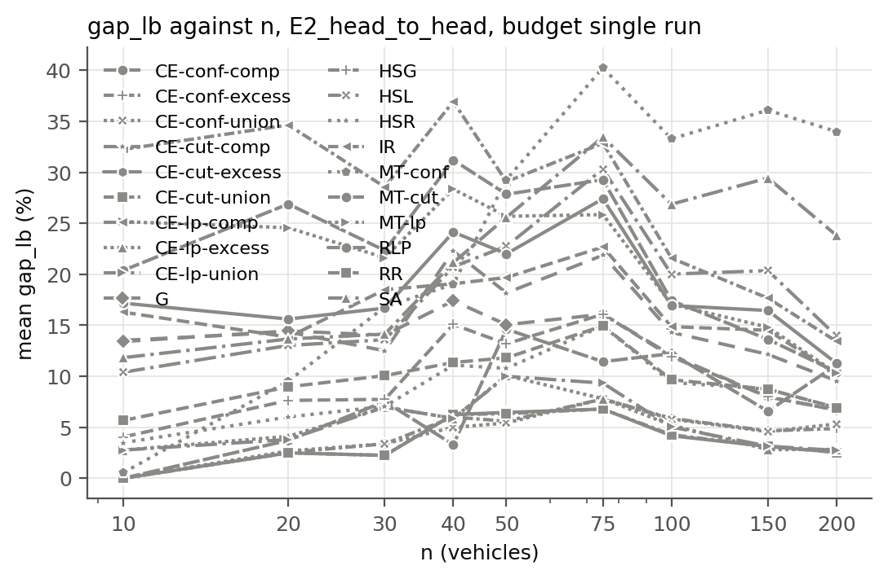

*Figure: Mean gap_lb against the number of vehicles, per method*

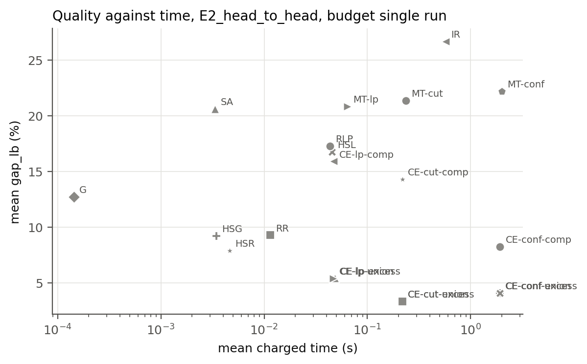

*Figure: Mean quality against mean charged time (one point per method)*

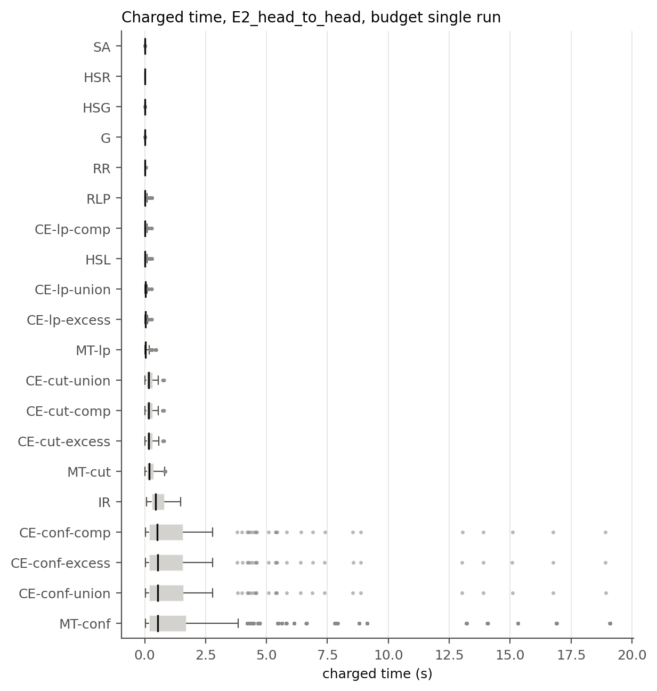

*Figure: Distribution of the charged time per run*

Friedman: N = 125 instances, k = 20 methods, chi2 = 1396.39, p = 7.59e-285; Iman-Davenport F = 176.94, p = 0; Nemenyi CD = 2.65.

*Friedman test with the Iman-Davenport correction and the Nemenyi critical difference*  (`14_E2_head_to_head/single_run/statistics/friedman_iman_davenport_test.csv`, `.tex`, `.md`)

| instances (N) | methods (k) | chi2 | p | Iman-Davenport F | p (F) | Nemenyi CD (alpha 0.05) |
|---|---|---|---|---|---|---|
| 125 | 20 | 1396.3892 | 7.5935e-285 | 176.9368 | 0.0000 | 2.6519 |

*Average ranks (1 = best)*  (`14_E2_head_to_head/single_run/statistics/friedman_average_ranks.csv`, `.tex`, `.md`)

| method | average rank |
|---|---|
| CE-cut-excess | 4.56 |
| CE-cut-union | 4.57 |
| CE-conf-excess | 5.27 |
| CE-conf-union | 5.28 |
| CE-lp-union | 5.72 |
| CE-lp-excess | 5.83 |
| HSR | 8.32 |
| CE-conf-comp | 8.50 |
| HSG | 9.34 |
| RR | 9.86 |
| G | 11.29 |
| CE-cut-comp | 11.91 |
| CE-lp-comp | 13.15 |
| HSL | 14.12 |
| MT-conf | 14.12 |
| RLP | 14.31 |
| SA | 15.07 |
| MT-cut | 15.44 |
| MT-lp | 15.67 |
| IR | 17.67 |

*Average ranks by family, with the Friedman p-value of each family*  (`14_E2_head_to_head/single_run/statistics/friedman_ranks_by_family.csv`, `.tex`, `.md`)

| index | CE-cut-union | CE-cut-excess | CE-conf-excess | CE-conf-union | CE-lp-union | CE-lp-excess | CE-conf-comp | HSR | RR | HSG | CE-cut-comp | G | CE-lp-comp | MT-conf | RLP | HSL | MT-lp | MT-cut | SA | IR | Friedman p | instances |
|---|---|---|---|---|---|---|---|---|---|---|---|---|---|---|---|---|---|---|---|---|---|---|
| omega | 4.071 | 4.086 | 4.979 | 4.979 | 5.393 | 5.421 | 7.957 | 8.214 | 9.207 | 10.379 | 11.729 | 12.079 | 13.043 | 14.514 | 14.750 | 14.829 | 15.429 | 15.479 | 15.743 | 17.721 | 1.512e-172 | 70.000 |
| overnight | 4.440 | 4.440 | 5.680 | 5.880 | 5.400 | 5.480 | 11.840 | 7.680 | 7.680 | 6.460 | 13.840 | 6.460 | 13.260 | 16.200 | 13.960 | 15.160 | 15.800 | 16.720 | 16.280 | 17.340 | 9.349e-60 | 25.000 |
| staggered | 5.850 | 5.750 | 5.600 | 5.500 | 6.733 | 7.083 | 6.983 | 9.100 | 13.217 | 9.300 | 10.717 | 13.483 | 13.317 | 11.483 | 13.567 | 11.583 | 16.133 | 14.283 | 12.483 | 17.833 | 2.477e-49 | 30.000 |

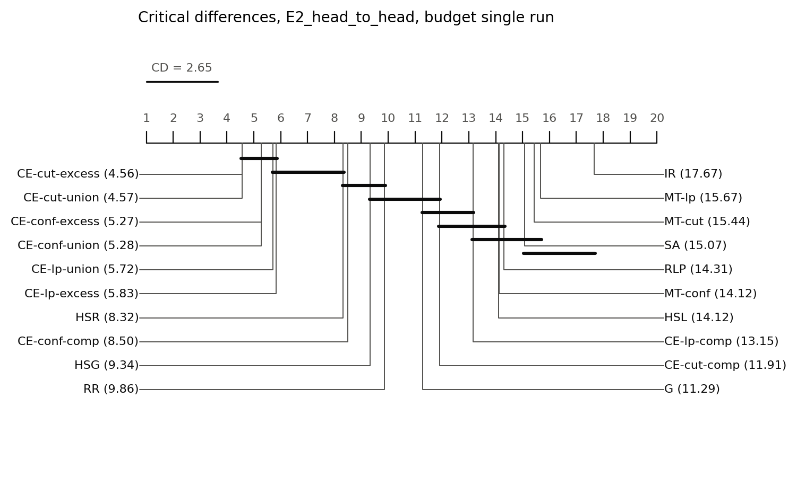

*Figure: Average ranks; methods joined by a bar are not significantly different (Nemenyi)*

*Pairwise Wilcoxon signed-rank tests (Holm), sign test, effect sizes (negative delta: A better); 190 pairs in the files, the 40 most significant of the 163 significant ones shown*  (`14_E2_head_to_head/single_run/statistics/pairwise_wilcoxon_holm_effect_sizes.csv`, `.tex`, `.md`)

| A | B | N | mean_A | mean_B | win_A | tie | win_B | p | p_holm | p_sign | cliff_delta | cliff_mag | A12 | significant |
|---|---|---|---|---|---|---|---|---|---|---|---|---|---|---|
| CE-conf-excess | IR | 125 | 4.098 | 27.520 | 121 | 4 | 0 | 3.337e-22 | 6.341e-20 | 7.523e-37 | -0.905 | large | 0.952 | yes |
| CE-conf-union | IR | 125 | 4.094 | 27.520 | 121 | 4 | 0 | 3.337e-22 | 6.341e-20 | 7.523e-37 | -0.905 | large | 0.952 | yes |
| CE-conf-union | MT-lp | 125 | 4.094 | 21.446 | 120 | 5 | 0 | 3.538e-22 | 6.652e-20 | 1.505e-36 | -0.834 | large | 0.917 | yes |
| CE-conf-excess | MT-lp | 125 | 4.098 | 21.446 | 120 | 5 | 0 | 3.538e-22 | 6.652e-20 | 1.505e-36 | -0.833 | large | 0.916 | yes |
| CE-cut-excess | IR | 125 | 3.483 | 27.520 | 120 | 5 | 0 | 3.538e-22 | 6.652e-20 | 1.505e-36 | -0.925 | large | 0.963 | yes |
| CE-cut-union | MT-lp | 125 | 3.476 | 21.446 | 120 | 5 | 0 | 3.538e-22 | 6.652e-20 | 1.505e-36 | -0.879 | large | 0.939 | yes |
| CE-cut-union | IR | 125 | 3.476 | 27.520 | 120 | 5 | 0 | 3.538e-22 | 6.652e-20 | 1.505e-36 | -0.926 | large | 0.963 | yes |
| CE-cut-excess | MT-lp | 125 | 3.483 | 21.446 | 120 | 5 | 0 | 3.538e-22 | 6.652e-20 | 1.505e-36 | -0.877 | large | 0.938 | yes |
| CE-lp-excess | MT-lp | 125 | 5.634 | 21.446 | 120 | 5 | 0 | 3.538e-22 | 6.652e-20 | 1.505e-36 | -0.774 | large | 0.887 | yes |
| CE-lp-union | MT-lp | 125 | 5.600 | 21.446 | 120 | 5 | 0 | 3.538e-22 | 6.652e-20 | 1.505e-36 | -0.772 | large | 0.886 | yes |
| HSR | IR | 125 | 8.183 | 27.520 | 120 | 4 | 1 | 3.765e-22 | 6.777e-20 | 9.178e-35 | -0.808 | large | 0.904 | yes |
| CE-lp-union | IR | 125 | 5.600 | 27.520 | 120 | 4 | 1 | 4.456e-22 | 7.975e-20 | 9.178e-35 | -0.856 | large | 0.928 | yes |
| CE-lp-excess | IR | 125 | 5.634 | 27.520 | 120 | 4 | 1 | 4.456e-22 | 7.975e-20 | 9.178e-35 | -0.858 | large | 0.929 | yes |
| CE-conf-excess | RLP | 125 | 4.098 | 17.770 | 117 | 8 | 0 | 4.508e-22 | 7.979e-20 | 1.204e-35 | -0.758 | large | 0.879 | yes |
| CE-conf-union | RLP | 125 | 4.094 | 17.770 | 117 | 8 | 0 | 4.508e-22 | 7.979e-20 | 1.204e-35 | -0.758 | large | 0.879 | yes |
| CE-conf-union | MT-cut | 125 | 4.094 | 22.014 | 115 | 10 | 0 | 5.591e-22 | 9.785e-20 | 4.815e-35 | -0.780 | large | 0.890 | yes |
| CE-conf-excess | MT-cut | 125 | 4.098 | 22.014 | 115 | 10 | 0 | 5.591e-22 | 9.785e-20 | 4.815e-35 | -0.779 | large | 0.889 | yes |
| CE-cut-excess | RLP | 125 | 3.483 | 17.770 | 116 | 8 | 1 | 6.160e-22 | 1.053e-19 | 1.420e-33 | -0.794 | large | 0.897 | yes |
| HSG | IR | 125 | 9.548 | 27.520 | 118 | 4 | 3 | 6.089e-22 | 1.053e-19 | 2.222e-31 | -0.734 | large | 0.867 | yes |
| CE-cut-union | RLP | 125 | 3.476 | 17.770 | 116 | 8 | 1 | 6.160e-22 | 1.053e-19 | 1.420e-33 | -0.794 | large | 0.897 | yes |
| IR | RR | 125 | 27.520 | 9.623 | 3 | 4 | 118 | 6.089e-22 | 1.053e-19 | 2.222e-31 | 0.767 | large | 0.117 | yes |
| CE-cut-excess | MT-cut | 125 | 3.483 | 22.014 | 114 | 11 | 0 | 6.325e-22 | 1.069e-19 | 9.630e-35 | -0.817 | large | 0.909 | yes |
| CE-cut-union | MT-cut | 125 | 3.476 | 22.014 | 114 | 11 | 0 | 6.325e-22 | 1.069e-19 | 9.630e-35 | -0.819 | large | 0.910 | yes |
| CE-lp-union | RLP | 125 | 5.600 | 17.770 | 115 | 9 | 1 | 6.822e-22 | 1.139e-19 | 2.817e-33 | -0.681 | large | 0.840 | yes |
| CE-lp-excess | RLP | 125 | 5.634 | 17.770 | 114 | 10 | 1 | 6.987e-22 | 1.160e-19 | 5.585e-33 | -0.682 | large | 0.841 | yes |
| HSR | MT-lp | 125 | 8.183 | 21.446 | 116 | 5 | 4 | 1.321e-21 | 2.179e-19 | 1.279e-29 | -0.662 | large | 0.831 | yes |
| CE-lp-comp | CE-lp-union | 125 | 16.371 | 5.600 | 0 | 16 | 109 | 1.361e-21 | 2.232e-19 | 3.081e-33 | 0.624 | large | 0.188 | yes |
| CE-conf-excess | CE-lp-comp | 125 | 4.098 | 16.371 | 111 | 12 | 2 | 1.377e-21 | 2.244e-19 | 1.241e-30 | -0.707 | large | 0.853 | yes |
| CE-conf-union | CE-lp-comp | 125 | 4.094 | 16.371 | 111 | 12 | 2 | 1.377e-21 | 2.244e-19 | 1.241e-30 | -0.707 | large | 0.853 | yes |
| CE-lp-comp | CE-lp-excess | 125 | 16.371 | 5.634 | 0 | 17 | 108 | 1.632e-21 | 2.628e-19 | 6.163e-33 | 0.626 | large | 0.187 | yes |
| CE-cut-union | CE-lp-comp | 125 | 3.476 | 16.371 | 110 | 13 | 2 | 1.831e-21 | 2.929e-19 | 2.438e-30 | -0.747 | large | 0.874 | yes |
| CE-cut-excess | CE-lp-comp | 125 | 3.483 | 16.371 | 110 | 13 | 2 | 1.831e-21 | 2.929e-19 | 2.438e-30 | -0.746 | large | 0.873 | yes |
| CE-conf-excess | SA | 125 | 4.098 | 20.430 | 108 | 16 | 1 | 2.349e-21 | 3.711e-19 | 3.390e-31 | -0.689 | large | 0.844 | yes |
| CE-conf-union | SA | 125 | 4.094 | 20.430 | 108 | 16 | 1 | 2.349e-21 | 3.711e-19 | 3.390e-31 | -0.690 | large | 0.845 | yes |
| CE-cut-union | SA | 125 | 3.476 | 20.430 | 108 | 16 | 1 | 2.462e-21 | 3.841e-19 | 3.390e-31 | -0.688 | large | 0.844 | yes |
| CE-cut-excess | SA | 125 | 3.483 | 20.430 | 108 | 16 | 1 | 2.462e-21 | 3.841e-19 | 3.390e-31 | -0.688 | large | 0.844 | yes |
| CE-cut-excess | HSL | 125 | 3.483 | 17.175 | 107 | 17 | 1 | 2.882e-21 | 4.438e-19 | 6.718e-31 | -0.675 | large | 0.838 | yes |
| CE-cut-union | HSL | 125 | 3.476 | 17.175 | 107 | 17 | 1 | 2.882e-21 | 4.438e-19 | 6.718e-31 | -0.676 | large | 0.838 | yes |
| CE-conf-union | HSL | 125 | 4.094 | 17.175 | 107 | 17 | 1 | 3.093e-21 | 4.702e-19 | 6.718e-31 | -0.662 | large | 0.831 | yes |
| CE-conf-excess | HSL | 125 | 4.098 | 17.175 | 107 | 17 | 1 | 3.093e-21 | 4.702e-19 | 6.718e-31 | -0.663 | large | 0.831 | yes |

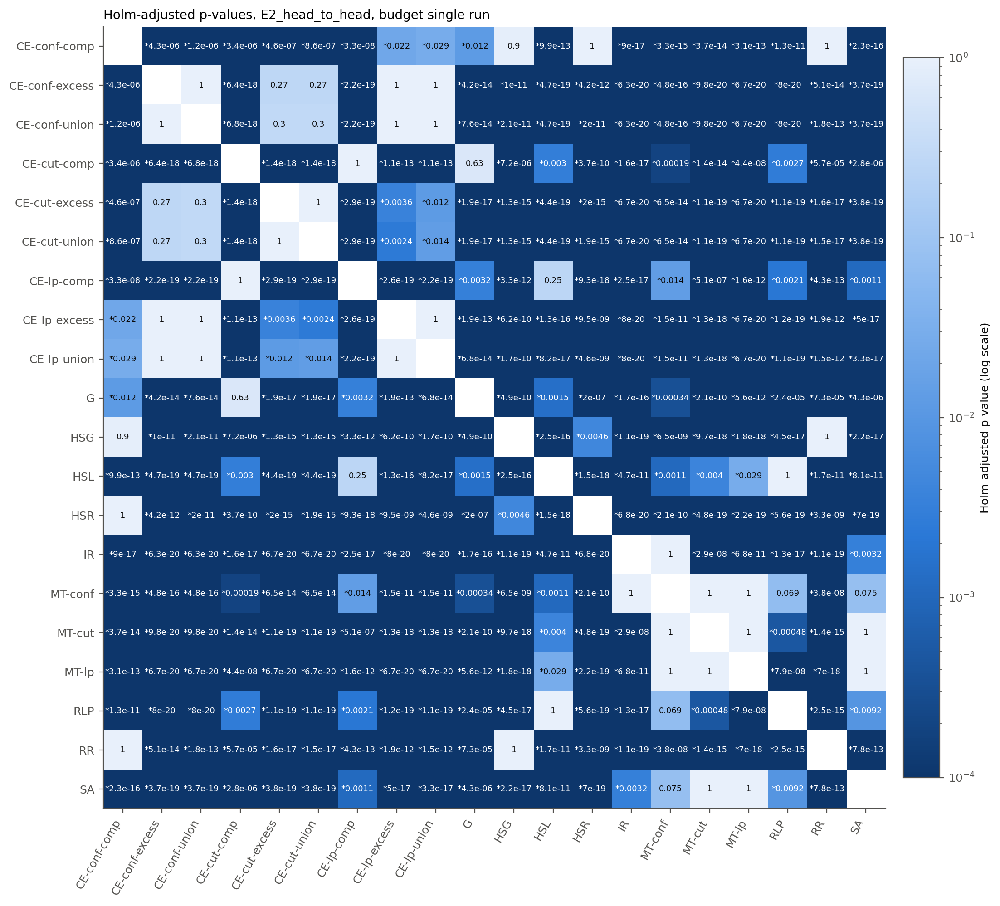

*Figure: Pairwise Holm-adjusted Wilcoxon p-values (* significant)*

*Win matrix: entry (row, column) = instances where the row method is strictly better than the column method*  (`14_E2_head_to_head/single_run/statistics/win_matrix.csv`, `.tex`, `.md`)

| method | CE-conf-comp | CE-conf-excess | CE-conf-union | CE-cut-comp | CE-cut-excess | CE-cut-union | CE-lp-comp | CE-lp-excess | CE-lp-union | G | HSG | HSL | HSR | IR | MT-conf | MT-cut | MT-lp | RLP | RR | SA |
|---|---|---|---|---|---|---|---|---|---|---|---|---|---|---|---|---|---|---|---|---|
| CE-conf-comp | 0 | 14 | 13 | 74 | 16 | 17 | 82 | 28 | 29 | 76 | 65 | 92 | 57 | 103 | 79 | 95 | 96 | 91 | 70 | 101 |
| CE-conf-excess | 57 | 0 | 7 | 100 | 26 | 26 | 111 | 43 | 43 | 99 | 88 | 107 | 89 | 121 | 81 | 115 | 120 | 117 | 102 | 108 |
| CE-conf-union | 58 | 9 | 0 | 100 | 26 | 26 | 111 | 43 | 43 | 98 | 87 | 107 | 87 | 121 | 81 | 115 | 120 | 117 | 100 | 108 |
| CE-cut-comp | 27 | 3 | 3 | 0 | 0 | 0 | 65 | 7 | 7 | 44 | 31 | 77 | 21 | 109 | 74 | 94 | 90 | 83 | 34 | 82 |
| CE-cut-excess | 66 | 47 | 47 | 100 | 0 | 4 | 110 | 53 | 52 | 106 | 95 | 107 | 94 | 120 | 80 | 114 | 120 | 116 | 108 | 108 |
| CE-cut-union | 65 | 47 | 47 | 100 | 2 | 0 | 110 | 54 | 52 | 106 | 95 | 107 | 94 | 120 | 80 | 114 | 120 | 116 | 108 | 108 |
| CE-lp-comp | 30 | 2 | 2 | 45 | 2 | 2 | 0 | 0 | 0 | 35 | 20 | 75 | 7 | 107 | 72 | 86 | 96 | 74 | 17 | 77 |
| CE-lp-excess | 59 | 37 | 36 | 93 | 24 | 23 | 108 | 0 | 2 | 99 | 87 | 102 | 82 | 120 | 78 | 112 | 120 | 114 | 98 | 104 |
| CE-lp-union | 58 | 37 | 36 | 93 | 27 | 27 | 109 | 7 | 0 | 100 | 88 | 103 | 83 | 120 | 78 | 112 | 120 | 115 | 98 | 105 |
| G | 38 | 15 | 16 | 75 | 7 | 7 | 83 | 16 | 15 | 0 | 0 | 81 | 30 | 108 | 76 | 99 | 99 | 89 | 36 | 83 |
| HSG | 39 | 15 | 16 | 80 | 7 | 7 | 97 | 17 | 16 | 48 | 0 | 97 | 34 | 118 | 79 | 108 | 112 | 108 | 53 | 100 |
| HSL | 17 | 1 | 1 | 33 | 1 | 1 | 43 | 6 | 5 | 38 | 10 | 0 | 3 | 89 | 74 | 65 | 66 | 49 | 23 | 83 |
| HSR | 45 | 12 | 14 | 88 | 7 | 7 | 108 | 19 | 18 | 84 | 69 | 104 | 0 | 120 | 80 | 111 | 116 | 113 | 44 | 106 |
| IR | 17 | 0 | 0 | 6 | 0 | 0 | 7 | 1 | 1 | 13 | 3 | 31 | 1 | 0 | 60 | 24 | 20 | 8 | 3 | 46 |
| MT-conf | 2 | 0 | 0 | 29 | 8 | 8 | 42 | 14 | 14 | 39 | 26 | 35 | 23 | 61 | 0 | 49 | 54 | 45 | 36 | 36 |
| MT-cut | 20 | 0 | 0 | 15 | 0 | 0 | 30 | 2 | 2 | 21 | 9 | 51 | 5 | 95 | 66 | 0 | 47 | 46 | 15 | 59 |
| MT-lp | 24 | 0 | 0 | 28 | 0 | 0 | 20 | 0 | 0 | 19 | 8 | 53 | 4 | 100 | 66 | 69 | 0 | 32 | 7 | 56 |
| RLP | 25 | 0 | 0 | 33 | 1 | 1 | 35 | 1 | 1 | 31 | 10 | 68 | 4 | 110 | 72 | 70 | 87 | 0 | 14 | 73 |
| RR | 44 | 12 | 14 | 83 | 6 | 6 | 102 | 16 | 16 | 79 | 60 | 94 | 0 | 118 | 78 | 104 | 113 | 106 | 0 | 95 |
| SA | 8 | 1 | 1 | 29 | 1 | 1 | 41 | 5 | 4 | 36 | 9 | 21 | 2 | 74 | 73 | 58 | 64 | 45 | 21 | 0 |

*CE-cut-excess against every other method (wins = instances where the control is strictly better)*  (`14_E2_head_to_head/single_run/statistics/CE-cut-excess_vs_each_method.csv`, `.tex`, `.md`)

| method | control | N | mean_control | mean_method | p | wins | ties | losses | cliff_delta | cliff_mag | A12 | p_holm | significant |
|---|---|---|---|---|---|---|---|---|---|---|---|---|---|
| CE-conf-comp | CE-cut-excess | 125 | 3.483 | 8.277 | 7.469e-09 | 66 | 43 | 16 | -0.185 | small | 0.593 | 4.481e-08 | yes |
| CE-conf-excess | CE-cut-excess | 125 | 3.483 | 4.098 | 0.011 | 47 | 52 | 26 | -0.002 | negligible | 0.501 | 0.034 | yes |
| CE-conf-union | CE-cut-excess | 125 | 3.483 | 4.094 | 0.014 | 47 | 52 | 26 | 4.480e-04 | negligible | 0.500 | 0.034 | yes |
| CE-cut-comp | CE-cut-excess | 125 | 3.483 | 14.755 | 9.580e-21 | 100 | 25 | 0 | -0.633 | large | 0.817 | 1.150e-19 | yes |
| CE-cut-union | CE-cut-excess | 125 | 3.483 | 3.476 | 0.426 | 4 | 119 | 2 | -0.002 | negligible | 0.501 | 0.426 | no |
| CE-lp-comp | CE-cut-excess | 125 | 3.483 | 16.371 | 1.831e-21 | 110 | 13 | 2 | -0.746 | large | 0.873 | 2.746e-20 | yes |
| CE-lp-excess | CE-cut-excess | 125 | 3.483 | 5.634 | 9.517e-05 | 53 | 48 | 24 | -0.149 | small | 0.574 | 4.759e-04 | yes |
| CE-lp-union | CE-cut-excess | 125 | 3.483 | 5.600 | 3.731e-04 | 52 | 46 | 27 | -0.135 | negligible | 0.567 | 0.001 | yes |
| G | CE-cut-excess | 125 | 3.483 | 13.187 | 1.419e-19 | 106 | 12 | 7 | -0.620 | large | 0.810 | 1.419e-18 | yes |
| HSG | CE-cut-excess | 125 | 3.483 | 9.548 | 1.110e-17 | 95 | 23 | 7 | -0.448 | medium | 0.724 | 9.986e-17 | yes |
| HSL | CE-cut-excess | 125 | 3.483 | 17.175 | 2.882e-21 | 107 | 17 | 1 | -0.675 | large | 0.838 | 3.746e-20 | yes |
| HSR | CE-cut-excess | 125 | 3.483 | 8.183 | 1.757e-17 | 94 | 24 | 7 | -0.434 | medium | 0.717 | 1.405e-16 | yes |
| IR | CE-cut-excess | 125 | 3.483 | 27.520 | 3.538e-22 | 120 | 5 | 0 | -0.925 | large | 0.963 | 6.722e-21 | yes |
| MT-conf | CE-cut-excess | 125 | 3.483 | 22.182 | 6.126e-16 | 80 | 37 | 8 | -0.409 | medium | 0.704 | 4.288e-15 | yes |
| MT-cut | CE-cut-excess | 125 | 3.483 | 22.014 | 6.325e-22 | 114 | 11 | 0 | -0.817 | large | 0.909 | 1.047e-20 | yes |
| MT-lp | CE-cut-excess | 125 | 3.483 | 21.446 | 3.538e-22 | 120 | 5 | 0 | -0.877 | large | 0.938 | 6.722e-21 | yes |
| RLP | CE-cut-excess | 125 | 3.483 | 17.770 | 6.160e-22 | 116 | 8 | 1 | -0.794 | large | 0.897 | 1.047e-20 | yes |
| RR | CE-cut-excess | 125 | 3.483 | 9.623 | 1.195e-19 | 108 | 11 | 6 | -0.572 | large | 0.786 | 1.315e-18 | yes |
| SA | CE-cut-excess | 125 | 3.483 | 20.430 | 2.462e-21 | 108 | 16 | 1 | -0.688 | large | 0.844 | 3.447e-20 | yes |

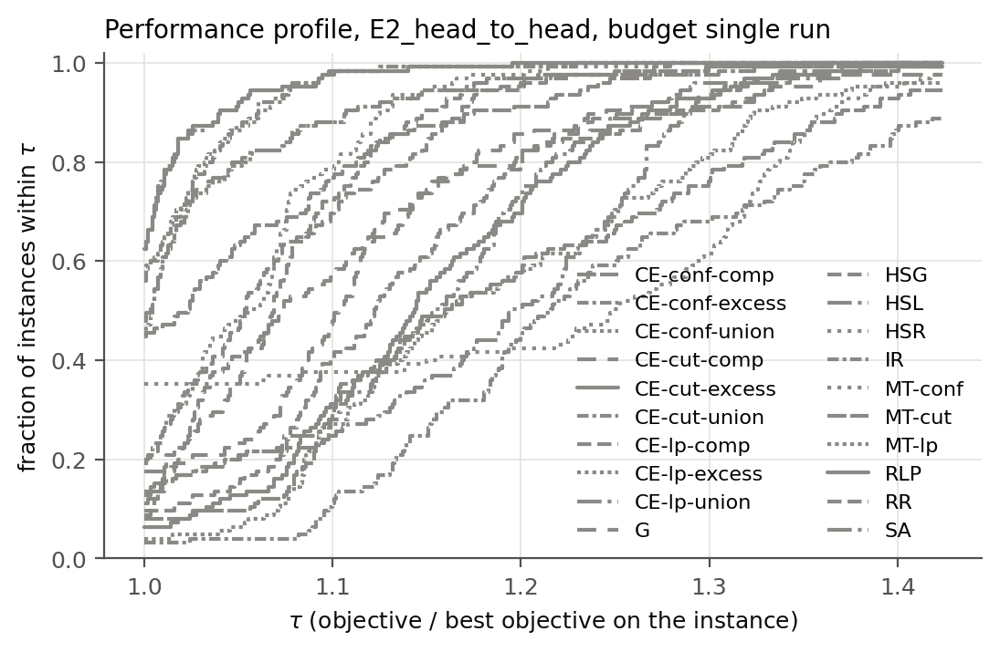

*Figure: Dolan-More performance profile of the peak (per-instance mean)*

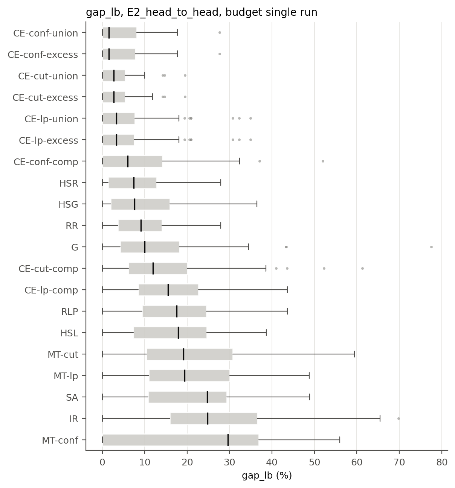

*Figure: Distribution of the per-instance gap_lb*

### Head-to-head comparisons

*Head-to-head: earlier method (A) against its certified counterpart (B)*  (`14_E2_head_to_head/head_to_head/tables/pairs_wilcoxon_holm.csv`, `.tex`, `.md`)

| budget | A | B | N | mean gap_lb A | mean gap_lb B | mean time A | mean time B | A better | ties | B better | p (Wilcoxon) | Cliff delta | magnitude | p (Holm) |
|---|---|---|---|---|---|---|---|---|---|---|---|---|---|---|
| n/a | RR | MT-lp | 130 | 9.296 | 20.827 | 0.012 | 0.065 | 118 | 5 | 7 | 9.491e-21 | -0.577 | large | 7.593e-20 |
| n/a | RR | MT-cut | 130 | 9.296 | 21.346 | 0.012 | 0.235 | 109 | 6 | 15 | 2.585e-18 | -0.514 | large | 1.292e-17 |
| n/a | RR | MT-conf | 125 | 9.623 | 22.182 | 0.012 | 1.995 | 78 | 11 | 36 | 5.721e-10 | -0.277 | small | 5.721e-10 |
| n/a | RLP | CE-lp-excess | 130 | 17.290 | 5.443 | 0.043 | 0.048 | 1 | 10 | 119 | 1.018e-22 | 0.670 | large | 1.018e-21 |
| n/a | RLP | CE-cut-excess | 130 | 17.290 | 3.374 | 0.043 | 0.218 | 1 | 8 | 121 | 9.015e-23 | 0.785 | large | 9.916e-22 |
| n/a | RLP | CE-conf-comp | 125 | 17.770 | 8.277 | 0.043 | 1.921 | 25 | 9 | 91 | 1.450e-13 | 0.533 | large | 2.899e-13 |
| n/a | RLP | IR | 130 | 17.290 | 26.669 | 0.043 | 0.568 | 113 | 7 | 10 | 3.685e-20 | -0.372 | medium | 2.211e-19 |
| n/a | G | CE-lp-excess | 130 | 12.726 | 5.443 | 1.442e-04 | 0.048 | 17 | 10 | 103 | 8.345e-16 | 0.453 | medium | 3.338e-15 |
| n/a | SA | HSG | 130 | 20.606 | 9.227 | 0.003 | 0.003 | 9 | 16 | 105 | 2.023e-20 | 0.528 | large | 1.416e-19 |
| n/a | SA | HSR | 130 | 20.606 | 7.912 | 0.003 | 0.005 | 2 | 17 | 111 | 6.433e-22 | 0.582 | large | 5.789e-21 |
| n/a | SA | HSL | 130 | 20.606 | 16.769 | 0.003 | 0.045 | 21 | 21 | 88 | 8.386e-14 | 0.220 | small | 2.516e-13 |

- budget nan s, RR vs MT-lp: RR better on more instances (118/5/7 W/T/L for RR), significant (Holm p = 7.59e-20), mean gap_lb 9.296 vs 20.827.

- budget nan s, RR vs MT-cut: RR better on more instances (109/6/15 W/T/L for RR), significant (Holm p = 1.29e-17), mean gap_lb 9.296 vs 21.346.

- budget nan s, RR vs MT-conf: RR better on more instances (78/11/36 W/T/L for RR), significant (Holm p = 5.72e-10), mean gap_lb 9.623 vs 22.182.

- budget nan s, RLP vs CE-lp-excess: CE-lp-excess better on more instances (1/10/119 W/T/L for RLP), significant (Holm p = 1.02e-21), mean gap_lb 17.290 vs 5.443.

- budget nan s, RLP vs CE-cut-excess: CE-cut-excess better on more instances (1/8/121 W/T/L for RLP), significant (Holm p = 9.92e-22), mean gap_lb 17.290 vs 3.374.

- budget nan s, RLP vs CE-conf-comp: CE-conf-comp better on more instances (25/9/91 W/T/L for RLP), significant (Holm p = 2.9e-13), mean gap_lb 17.770 vs 8.277.

- budget nan s, RLP vs IR: RLP better on more instances (113/7/10 W/T/L for RLP), significant (Holm p = 2.21e-19), mean gap_lb 17.290 vs 26.669.

- budget nan s, G vs CE-lp-excess: CE-lp-excess better on more instances (17/10/103 W/T/L for G), significant (Holm p = 3.34e-15), mean gap_lb 12.726 vs 5.443.

- budget nan s, SA vs HSG: HSG better on more instances (9/16/105 W/T/L for SA), significant (Holm p = 1.42e-19), mean gap_lb 20.606 vs 9.227.

- budget nan s, SA vs HSR: HSR better on more instances (2/17/111 W/T/L for SA), significant (Holm p = 5.79e-21), mean gap_lb 20.606 vs 7.912.

- budget nan s, SA vs HSL: HSL better on more instances (21/21/88 W/T/L for SA), significant (Holm p = 2.52e-13), mean gap_lb 20.606 vs 16.769.

## E2b_head_to_head_budgets

Files: `15_E2b_head_to_head_budgets/`

The same pairs at equal budgets (1 s and 10 s), where the earlier methods use the whole budget (restarts, more trials, more iterations); MT repeats with new seeds.

*Addresses:* Section 6.3 of the paper (the same pairs at equal budgets)

### Budget 1 s

*E2b_head_to_head_budgets, budget 1 s: gap_lb (per-instance mean over seeds)*  (`15_E2b_head_to_head_budgets/budget_1s/tables/summary.csv`, `.tex`, `.md`)

| method | instances | runs | mean gap_lb | sd | CI95 lo | CI95 hi | median | max | #hit LB* | #best | mean time (s) | infeasible/failed |
|---|---|---|---|---|---|---|---|---|---|---|---|---|
| G-b | 90 | 270 | 3.41 | 4.85 | 2.45 | 4.50 | 1.51 | 22.14 | 37 | 38 | 1.01 | 0 |
| RR-b | 90 | 270 | 8.85 | 6.63 | 7.48 | 10.26 | 8.71 | 25.00 | 29 | 29 | 1.01 | 0 |
| RLP-b | 90 | 270 | 10.66 | 8.76 | 8.95 | 12.46 | 10.17 | 43.64 | 20 | 20 | 1.01 | 0 |
| MT-lp-b | 90 | 270 | 12.80 | 10.14 | 10.82 | 14.95 | 11.39 | 43.64 | 11 | 11 | 1.03 | 0 |
| MT-cut-b | 90 | 270 | 9.85 | 9.17 | 8.10 | 11.76 | 8.92 | 49.83 | 22 | 22 | 1.02 | 0 |
| CE-lp-excess | 90 | 90 | 5.62 | 7.29 | 4.26 | 7.16 | 3.49 | 34.97 | 28 | 28 | 0.05 | 0 |
| CE-cut-excess | 90 | 90 | 3.09 | 3.57 | 2.38 | 3.84 | 2.10 | 19.44 | 32 | 32 | 0.21 | 0 |
| CE-conf-comp | 85 | 85 | 8.51 | 11.00 | 6.26 | 10.90 | 3.87 | 51.97 | 40 | 40 | 1.91 | 0 |
| IR | 90 | 90 | 25.96 | 15.96 | 22.76 | 29.48 | 23.47 | 69.79 | 4 | 4 | 0.52 | 0 |
| CRI-R | 90 | 270 | **2.45** | 2.92 | 1.90 | 3.07 | 1.16 | 13.12 | 37 | 37 | 0.47 | 0 |

*Mean gap_lb by family*  (`15_E2b_head_to_head_budgets/budget_1s/tables/mean_gap_by_family.csv`, `.tex`, `.md`)

| family | CE-conf-comp | CE-cut-excess | CE-lp-excess | CRI-R | G-b | IR | MT-cut-b | MT-lp-b | RLP-b | RR-b |
|---|---|---|---|---|---|---|---|---|---|---|
| omega | 9.10 | 3.31 | 7.05 | 2.63 | 5.65 | 29.18 | 8.61 | 13.99 | 11.46 | 10.42 |
| overnight | 13.29 | 3.07 | 4.29 | 2.77 | 2.45 | 24.53 | 14.55 | 13.34 | 12.06 | 4.99 |
| staggered | 3.94 | 2.90 | 5.54 | 1.95 | 2.12 | 24.17 | 6.40 | 11.06 | 8.45 | 11.15 |

*Mean gap_lb by size class*  (`15_E2b_head_to_head_budgets/budget_1s/tables/mean_gap_by_size_class.csv`, `.tex`, `.md`)

| size | CE-conf-comp | CE-cut-excess | CE-lp-excess | CRI-R | G-b | IR | MT-cut-b | MT-lp-b | RLP-b | RR-b |
|---|---|---|---|---|---|---|---|---|---|---|
| medium (n<=200) | 12.47 | 4.12 | 5.60 | 3.37 | 5.26 | 19.84 | 10.25 | 11.01 | 11.10 | 8.85 |
| small (n<=30) | 5.00 | 2.07 | 5.64 | 1.52 | 1.55 | 32.08 | 9.45 | 14.58 | 10.21 | 8.85 |

*Mean gap_lb by n*  (`15_E2b_head_to_head_budgets/budget_1s/tables/mean_gap_by_n.csv`, `.tex`, `.md`)

| n | CE-conf-comp | CE-cut-excess | CE-lp-excess | CRI-R | G-b | IR | MT-cut-b | MT-lp-b | RLP-b | RR-b |
|---|---|---|---|---|---|---|---|---|---|---|
| 10 | 0.00 | 0.00 | 2.76 | 0.00 | 0.00 | 32.25 | 4.77 | 16.76 | 11.13 | 5.69 |
| 20 | 4.95 | 3.31 | 5.48 | 2.28 | 2.82 | 34.90 | 13.58 | 12.70 | 9.14 | 10.12 |
| 30 | 10.03 | 2.89 | 8.69 | 2.28 | 1.84 | 29.09 | 10.02 | 14.29 | 10.37 | 10.75 |
| 50 | 15.44 | 5.89 | 8.85 | 4.11 | 5.20 | 26.45 | 13.27 | 15.24 | 14.33 | 9.88 |
| 100 | 11.21 | 3.82 | 5.03 | 3.68 | 6.39 | 20.03 | 10.26 | 11.20 | 11.31 | 8.97 |
| 200 | 9.92 | 2.65 | 2.93 | 2.34 | 4.20 | 13.03 | 7.22 | 6.59 | 7.66 | 7.70 |

*Charged time (s)*  (`15_E2b_head_to_head_budgets/budget_1s/tables/charged_time.csv`, `.tex`, `.md`)

| method | mean | median | max |
|---|---|---|---|
| CE-conf-comp | 1.91 | 0.50 | 18.92 |
| CE-cut-excess | 0.21 | 0.16 | 0.80 |
| CE-lp-excess | 0.05 | 0.02 | 0.28 |
| CRI-R | 0.47 | 0.52 | 0.70 |
| G-b | 1.01 | 1.02 | 1.02 |
| IR | 0.52 | 0.35 | 1.47 |
| MT-cut-b | 1.02 | 1.02 | 1.14 |
| MT-lp-b | 1.03 | 1.02 | 1.48 |
| RLP-b | 1.01 | 1.02 | 1.02 |
| RR-b | 1.01 | 1.02 | 1.02 |

*All quality measures (means over instances): gap to the best lower bound LB*, to the best known value, to the proven optimum, to our own certified lower bound, to the LP bound, relative difference to the exact solver's incumbent; instances proved optimal by our certificate alone and by the method's own bound*  (`15_E2b_head_to_head_budgets/budget_1s/tables/all_quality_measures.csv`, `.tex`, `.md`)

| method | instances | #with OPT | gap LB* % | gap BKS % | gap OPT % (proven-optimum inst.) | gap own cert. LB % | gap P_LP % | rel. diff. exact ref. % | #best | #= LB* | #proved by certificate | #proved by own bound | mean time (s) | primal integral |
|---|---|---|---|---|---|---|---|---|---|---|---|---|---|---|
| G-b | 90 | 65 | 3.407 | 3.314 | 2.833 | 3.407 | 17.701 | 2.990 | 38 | 37 | 37 | 0 | 1.015 | 0.031 |
| RR-b | 90 | 65 | 8.851 | 8.755 | 9.814 | 8.851 | 23.942 | 8.432 | 29 | 29 | 29 | 0 | 1.015 | 0.075 |
| RLP-b | 90 | 65 | 10.658 | 10.556 | 10.495 | 10.658 | 25.709 | 10.217 | 20 | 20 | 20 | 0 | 1.010 | 0.133 |
| MT-lp-b | 90 | 65 | 12.798 | 12.696 | 13.721 | 12.798 | 28.508 | 12.361 | 11 | 11 | 11 | 0 | 1.025 | 0.162 |
| MT-cut-b | 90 | 65 | 9.853 | 9.749 | 9.227 | 9.853 | 24.700 | 9.412 | 22 | 22 | 22 | 0 | 1.017 | 0.279 |
| CE-lp-excess | 90 | 65 | 5.623 | 5.529 | 6.163 | 5.623 | 20.312 | 5.213 | 28 | 28 | 28 | 0 | 0.047 | 0.093 |
| CE-cut-excess | 90 | 65 | 3.093 | 3.000 | 3.052 | 3.093 | 17.449 | 2.687 | 32 | 32 | 32 | 0 | 0.207 | 0.228 |
| CE-conf-comp | 85 | 64 | 8.514 | 8.406 | 6.343 | 8.514 | 23.769 | 8.067 | 40 | 40 | 40 | 0 | 1.910 | 0.535 |
| IR | 90 | 65 | 25.958 | 25.844 | 28.632 | 25.958 | 43.968 | 25.486 | 4 | 4 | 4 | 0 | 0.523 | 0.604 |
| CRI-R | 90 | 65 | 2.448 | 2.355 | 2.266 | 2.448 | 16.722 | 2.043 | 37 | 37 | 37 | 35 | 0.473 | 0.457 |

*Variability over seeds (per-instance standard deviation and range)*  (`15_E2b_head_to_head_budgets/budget_1s/tables/seed_variability.csv`, `.tex`, `.md`)

| method | seeds | mean sd gap_lb | mean range gap_lb | mean sd peak (kW) |
|---|---|---|---|---|
| G-b | 3 | 0.089 | 0.155 | 0.057 |
| RR-b | 3 | 4.295 | 7.815 | 1.803 |
| RLP-b | 3 | 0.327 | 0.597 | 0.277 |
| MT-lp-b | 3 | 0.051 | 0.089 | 0.042 |
| MT-cut-b | 3 | 0.161 | 0.290 | 0.097 |
| CRI-R | 3 | 0.129 | 0.249 | 0.043 |

*Per-instance mean peak (kW) of every method*  (`15_E2b_head_to_head_budgets/budget_1s/tables/per_instance_mean_peak.csv`, `.tex`, `.md`)

(none)

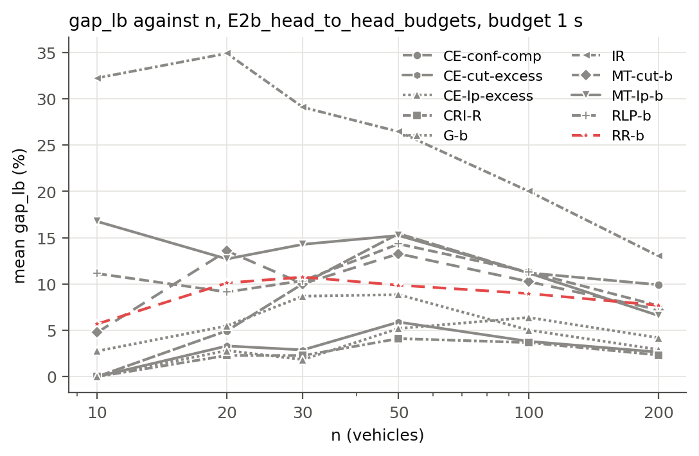

*Figure: Mean gap_lb against the number of vehicles, per method*

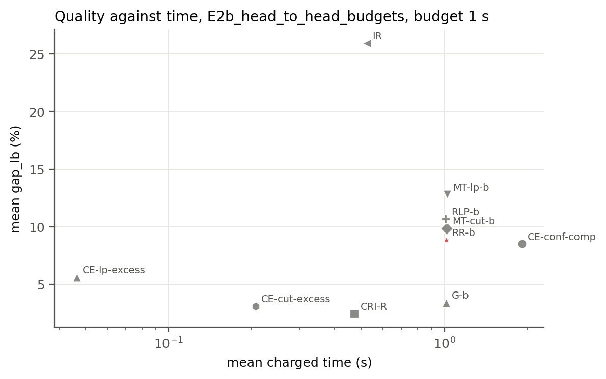

*Figure: Mean quality against mean charged time (one point per method)*

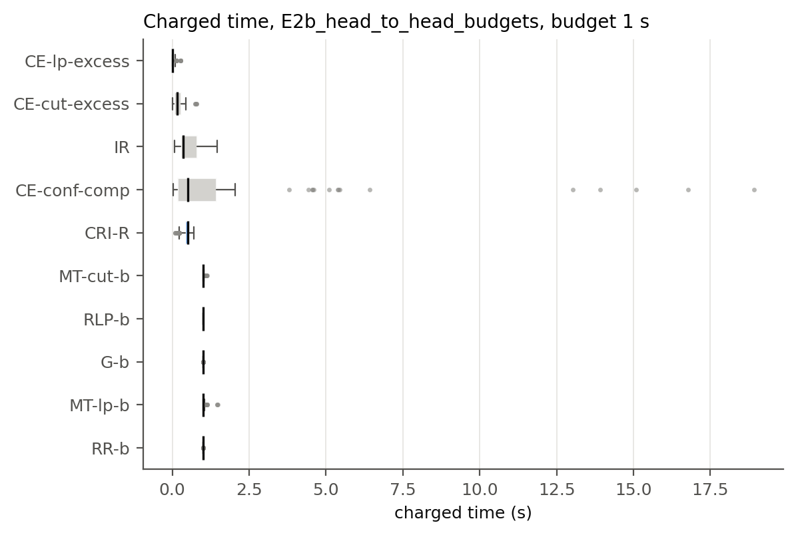

*Figure: Distribution of the charged time per run*

Friedman: N = 85 instances, k = 10 methods, chi2 = 418.14, p = 1.84e-84; Iman-Davenport F = 101.26, p = 1.61e-123; Nemenyi CD = 1.47.

*Friedman test with the Iman-Davenport correction and the Nemenyi critical difference*  (`15_E2b_head_to_head_budgets/budget_1s/statistics/friedman_iman_davenport_test.csv`, `.tex`, `.md`)

| instances (N) | methods (k) | chi2 | p | Iman-Davenport F | p (F) | Nemenyi CD (alpha 0.05) |
|---|---|---|---|---|---|---|
| 85 | 10 | 418.1358 | 1.8434e-84 | 101.2598 | 1.6068e-123 | 1.4693 |

*Average ranks (1 = best)*  (`15_E2b_head_to_head_budgets/budget_1s/statistics/friedman_average_ranks.csv`, `.tex`, `.md`)

| method | average rank |
|---|---|
| CRI-R | 2.79 |
| CE-cut-excess | 3.41 |
| G-b | 3.51 |
| CE-lp-excess | 4.17 |
| CE-conf-comp | 5.56 |
| MT-cut-b | 6.21 |
| RR-b | 6.30 |
| RLP-b | 6.51 |
| MT-lp-b | 7.05 |
| IR | 9.49 |

*Average ranks by family, with the Friedman p-value of each family*  (`15_E2b_head_to_head_budgets/budget_1s/statistics/friedman_ranks_by_family.csv`, `.tex`, `.md`)

| index | CRI-R | CE-cut-excess | CE-lp-excess | G-b | MT-cut-b | CE-conf-comp | RR-b | MT-lp-b | RLP-b | IR | Friedman p | instances |
|---|---|---|---|---|---|---|---|---|---|---|---|---|
| omega | 2.583 | 3.200 | 4.300 | 4.533 | 5.567 | 5.617 | 6.267 | 6.683 | 6.783 | 9.467 | 5.764e-26 | 30.000 |
| overnight | 2.520 | 3.100 | 3.620 | 2.420 | 7.380 | 6.880 | 4.760 | 7.540 | 7.120 | 9.660 | 1.807e-31 | 25.000 |
| staggered | 3.233 | 3.867 | 4.500 | 3.400 | 5.883 | 4.400 | 7.617 | 7.000 | 5.733 | 9.367 | 1.830e-28 | 30.000 |

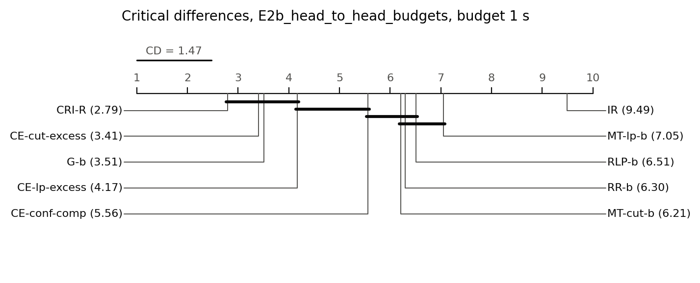

*Figure: Average ranks; methods joined by a bar are not significantly different (Nemenyi)*

*Pairwise Wilcoxon signed-rank tests (Holm), sign test, effect sizes (negative delta: A better); 45 pairs in the files, the 32 most significant of the 32 significant ones shown*  (`15_E2b_head_to_head_budgets/budget_1s/statistics/pairwise_wilcoxon_holm_effect_sizes.csv`, `.tex`, `.md`)

| A | B | N | mean_A | mean_B | win_A | tie | win_B | p | p_holm | p_sign | cliff_delta | cliff_mag | A12 | significant |
|---|---|---|---|---|---|---|---|---|---|---|---|---|---|---|
| G-b | IR | 85 | 3.547 | 27.167 | 81 | 4 | 0 | 1.390e-15 | 6.254e-14 | 8.272e-25 | -0.873 | large | 0.937 | yes |
| CRI-R | IR | 85 | 2.553 | 27.167 | 81 | 4 | 0 | 1.390e-15 | 6.254e-14 | 8.272e-25 | -0.911 | large | 0.955 | yes |
| CE-cut-excess | IR | 85 | 3.236 | 27.167 | 80 | 5 | 0 | 1.513e-15 | 6.506e-14 | 1.654e-24 | -0.898 | large | 0.949 | yes |
| IR | MT-cut-b | 85 | 27.167 | 10.245 | 0 | 7 | 78 | 1.880e-15 | 7.897e-14 | 6.617e-24 | 0.671 | large | 0.164 | yes |
| CE-lp-excess | IR | 85 | 5.914 | 27.167 | 80 | 4 | 1 | 2.126e-15 | 8.717e-14 | 6.783e-23 | -0.811 | large | 0.905 | yes |
| CRI-R | MT-lp-b | 85 | 2.553 | 13.341 | 74 | 11 | 0 | 3.472e-15 | 1.389e-13 | 1.059e-22 | -0.708 | large | 0.854 | yes |
| IR | RR-b | 85 | 27.167 | 9.306 | 3 | 5 | 77 | 4.057e-15 | 1.582e-13 | 1.413e-19 | 0.721 | large | 0.140 | yes |
| CRI-R | RR-b | 85 | 2.553 | 9.306 | 74 | 10 | 1 | 4.440e-15 | 1.687e-13 | 4.023e-21 | -0.623 | large | 0.812 | yes |
| IR | RLP-b | 85 | 27.167 | 11.042 | 1 | 7 | 77 | 5.388e-15 | 1.994e-13 | 5.228e-22 | 0.648 | large | 0.176 | yes |
| IR | MT-lp-b | 85 | 27.167 | 13.341 | 1 | 8 | 76 | 6.133e-15 | 2.208e-13 | 1.032e-21 | 0.555 | large | 0.223 | yes |
| CE-cut-excess | MT-lp-b | 85 | 3.236 | 13.341 | 70 | 13 | 2 | 1.605e-14 | 5.619e-13 | 1.113e-18 | -0.664 | large | 0.832 | yes |
| CRI-R | RLP-b | 85 | 2.553 | 11.042 | 65 | 20 | 0 | 2.959e-14 | 1.006e-12 | 5.421e-20 | -0.589 | large | 0.794 | yes |
| CE-lp-excess | MT-lp-b | 85 | 5.914 | 13.341 | 65 | 18 | 2 | 9.845e-14 | 3.249e-12 | 3.089e-17 | -0.487 | large | 0.744 | yes |
| CRI-R | MT-cut-b | 85 | 2.553 | 10.245 | 61 | 23 | 1 | 2.147e-13 | 6.869e-12 | 2.732e-17 | -0.530 | large | 0.765 | yes |
| CE-cut-excess | RR-b | 85 | 3.236 | 9.306 | 71 | 10 | 4 | 2.563e-13 | 7.946e-12 | 6.807e-17 | -0.558 | large | 0.779 | yes |
| CE-cut-excess | RLP-b | 85 | 3.236 | 11.042 | 61 | 22 | 2 | 2.762e-13 | 8.286e-12 | 4.374e-16 | -0.547 | large | 0.773 | yes |
| CE-cut-excess | MT-cut-b | 85 | 3.236 | 10.245 | 57 | 27 | 1 | 1.360e-12 | 3.944e-11 | 4.094e-16 | -0.484 | large | 0.742 | yes |
| G-b | MT-lp-b | 85 | 3.547 | 13.341 | 67 | 11 | 7 | 2.060e-12 | 5.769e-11 | 2.120e-13 | -0.629 | large | 0.815 | yes |
| CE-conf-comp | IR | 85 | 8.514 | 27.167 | 67 | 5 | 13 | 2.428e-12 | 6.557e-11 | 6.415e-10 | -0.688 | large | 0.844 | yes |
| G-b | RLP-b | 85 | 3.547 | 11.042 | 61 | 19 | 5 | 9.020e-12 | 2.345e-10 | 2.631e-13 | -0.506 | large | 0.753 | yes |
| G-b | RR-b | 85 | 3.547 | 9.306 | 65 | 10 | 10 | 1.355e-10 | 3.388e-09 | 5.154e-11 | -0.533 | large | 0.767 | yes |
| G-b | MT-cut-b | 85 | 3.547 | 10.245 | 54 | 24 | 7 | 1.546e-10 | 3.710e-09 | 4.322e-10 | -0.451 | medium | 0.725 | yes |
| CE-lp-excess | RLP-b | 85 | 5.914 | 11.042 | 53 | 28 | 4 | 3.012e-10 | 6.927e-09 | 5.911e-12 | -0.379 | medium | 0.689 | yes |
| CE-lp-excess | CRI-R | 85 | 5.914 | 2.553 | 0 | 44 | 41 | 1.004e-09 | 2.210e-08 | 9.095e-13 | 0.264 | small | 0.368 | yes |
| CE-conf-comp | CRI-R | 85 | 8.514 | 2.553 | 6 | 36 | 43 | 4.656e-08 | 9.777e-07 | 5.728e-08 | 0.209 | small | 0.396 | yes |
| CE-lp-excess | RR-b | 85 | 5.914 | 9.306 | 61 | 12 | 12 | 7.163e-08 | 1.433e-06 | 4.802e-09 | -0.357 | medium | 0.678 | yes |
| CE-lp-excess | MT-cut-b | 85 | 5.914 | 10.245 | 53 | 22 | 10 | 1.200e-06 | 2.280e-05 | 3.382e-08 | -0.307 | small | 0.654 | yes |
| CE-conf-comp | CE-cut-excess | 85 | 8.514 | 3.236 | 11 | 31 | 43 | 4.200e-06 | 7.560e-05 | 1.401e-05 | 0.160 | small | 0.420 | yes |
| CE-cut-excess | CRI-R | 85 | 3.236 | 2.553 | 0 | 62 | 23 | 5.773e-06 | 9.814e-05 | 2.384e-07 | 0.100 | negligible | 0.450 | yes |
| CE-conf-comp | G-b | 85 | 8.514 | 3.547 | 10 | 36 | 39 | 1.012e-05 | 1.620e-04 | 3.846e-05 | 0.164 | small | 0.418 | yes |
| MT-lp-b | RR-b | 85 | 13.341 | 9.306 | 25 | 7 | 53 | 1.221e-04 | 0.002 | 0.002 | 0.210 | small | 0.395 | yes |
| CE-cut-excess | CE-lp-excess | 85 | 3.236 | 5.914 | 35 | 35 | 15 | 4.909e-04 | 0.007 | 0.007 | -0.184 | small | 0.592 | yes |

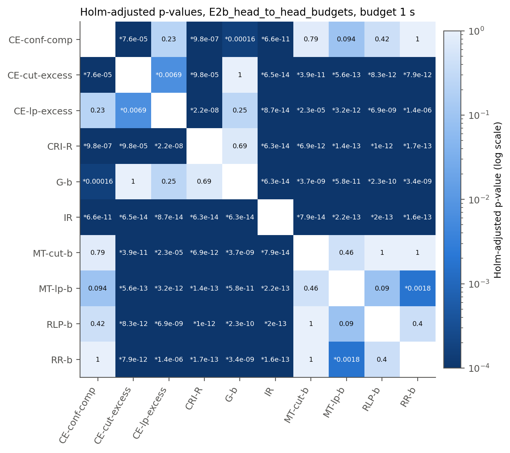

*Figure: Pairwise Holm-adjusted Wilcoxon p-values (* significant)*

*Win matrix: entry (row, column) = instances where the row method is strictly better than the column method*  (`15_E2b_head_to_head_budgets/budget_1s/statistics/win_matrix.csv`, `.tex`, `.md`)

| method | CE-conf-comp | CE-cut-excess | CE-lp-excess | CRI-R | G-b | IR | MT-cut-b | MT-lp-b | RLP-b | RR-b |
|---|---|---|---|---|---|---|---|---|---|---|
| CE-conf-comp | 0 | 11 | 20 | 6 | 10 | 67 | 36 | 46 | 39 | 43 |
| CE-cut-excess | 43 | 0 | 35 | 0 | 24 | 80 | 57 | 70 | 61 | 71 |
| CE-lp-excess | 37 | 15 | 0 | 0 | 21 | 80 | 53 | 65 | 53 | 61 |
| CRI-R | 43 | 23 | 41 | 0 | 27 | 81 | 61 | 74 | 65 | 74 |
| G-b | 39 | 28 | 35 | 19 | 0 | 81 | 54 | 67 | 61 | 65 |
| IR | 13 | 0 | 1 | 0 | 0 | 0 | 0 | 1 | 1 | 3 |
| MT-cut-b | 28 | 1 | 10 | 1 | 7 | 78 | 0 | 40 | 36 | 37 |
| MT-lp-b | 28 | 2 | 2 | 0 | 7 | 76 | 29 | 0 | 23 | 25 |
| RLP-b | 26 | 2 | 4 | 0 | 5 | 77 | 28 | 39 | 0 | 32 |
| RR-b | 32 | 4 | 12 | 1 | 10 | 77 | 41 | 53 | 45 | 0 |

*CRI-R against every other method (wins = instances where the control is strictly better)*  (`15_E2b_head_to_head_budgets/budget_1s/statistics/CRI-R_vs_each_method.csv`, `.tex`, `.md`)

| method | control | N | mean_control | mean_method | p | wins | ties | losses | cliff_delta | cliff_mag | A12 | p_holm | significant |
|---|---|---|---|---|---|---|---|---|---|---|---|---|---|
| CE-conf-comp | CRI-R | 85 | 2.553 | 8.514 | 4.656e-08 | 43 | 36 | 6 | -0.209 | small | 0.604 | 1.397e-07 | yes |
| CE-cut-excess | CRI-R | 85 | 2.553 | 3.236 | 5.773e-06 | 23 | 62 | 0 | -0.100 | negligible | 0.550 | 1.155e-05 | yes |
| CE-lp-excess | CRI-R | 85 | 2.553 | 5.914 | 1.004e-09 | 41 | 44 | 0 | -0.264 | small | 0.632 | 4.017e-09 | yes |
| G-b | CRI-R | 85 | 2.553 | 3.547 | 0.115 | 27 | 39 | 19 | -0.040 | negligible | 0.520 | 0.115 | no |
| IR | CRI-R | 85 | 2.553 | 27.167 | 1.390e-15 | 81 | 4 | 0 | -0.911 | large | 0.955 | 1.251e-14 | yes |
| MT-cut-b | CRI-R | 85 | 2.553 | 10.245 | 2.147e-13 | 61 | 23 | 1 | -0.530 | large | 0.765 | 1.073e-12 | yes |
| MT-lp-b | CRI-R | 85 | 2.553 | 13.341 | 3.472e-15 | 74 | 11 | 0 | -0.708 | large | 0.854 | 2.777e-14 | yes |
| RLP-b | CRI-R | 85 | 2.553 | 11.042 | 2.959e-14 | 65 | 20 | 0 | -0.589 | large | 0.794 | 1.775e-13 | yes |
| RR-b | CRI-R | 85 | 2.553 | 9.306 | 4.440e-15 | 74 | 10 | 1 | -0.623 | large | 0.812 | 3.108e-14 | yes |

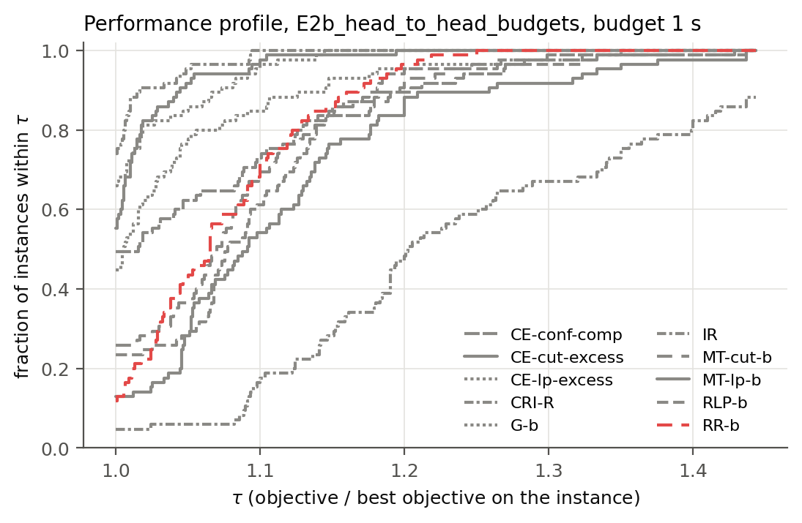

*Figure: Dolan-More performance profile of the peak (per-instance mean)*

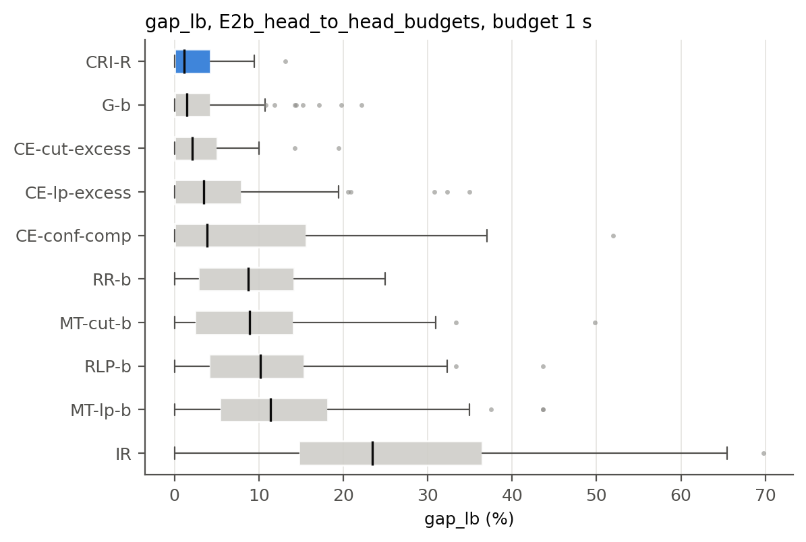

*Figure: Distribution of the per-instance gap_lb*

### Budget 10 s

*E2b_head_to_head_budgets, budget 10 s: gap_lb (per-instance mean over seeds)*  (`15_E2b_head_to_head_budgets/budget_10s/tables/summary.csv`, `.tex`, `.md`)

| method | instances | runs | mean gap_lb | sd | CI95 lo | CI95 hi | median | max | #hit LB* | #best | mean time (s) | infeasible/failed |
|---|---|---|---|---|---|---|---|---|---|---|---|---|
| G-b | 90 | 270 | 3.21 | 4.69 | 2.30 | 4.27 | 1.35 | 22.14 | 37 | 38 | 10.01 | 0 |
| RR-b | 90 | 270 | 8.85 | 6.63 | 7.48 | 10.26 | 8.71 | 25.00 | 29 | 29 | 10.02 | 0 |
| RLP-b | 90 | 270 | 10.06 | 8.57 | 8.39 | 11.84 | 9.46 | 43.64 | 21 | 21 | 10.01 | 0 |
| MT-lp-b | 90 | 270 | 12.73 | 10.14 | 10.76 | 14.88 | 11.39 | 43.64 | 11 | 11 | 10.03 | 0 |
| MT-cut-b | 90 | 270 | 9.46 | 8.77 | 7.76 | 11.33 | 8.38 | 40.40 | 23 | 23 | 10.02 | 0 |
| CE-lp-excess | 90 | 90 | 5.62 | 7.29 | 4.26 | 7.16 | 3.49 | 34.97 | 28 | 28 | 0.05 | 0 |
| CE-cut-excess | 90 | 90 | 3.09 | 3.57 | 2.38 | 3.84 | 2.10 | 19.44 | 32 | 32 | 0.21 | 0 |
| CE-conf-comp | 85 | 85 | 8.51 | 11.00 | 6.26 | 10.90 | 3.87 | 51.97 | 40 | 40 | 1.91 | 0 |
| IR | 90 | 90 | 25.96 | 15.96 | 22.76 | 29.48 | 23.47 | 69.79 | 4 | 4 | 0.52 | 0 |
| CRI-R | 90 | 270 | **1.90** | 2.42 | 1.43 | 2.41 | 0.66 | 9.25 | 41 | 41 | 1.83 | 0 |

*Mean gap_lb by family*  (`15_E2b_head_to_head_budgets/budget_10s/tables/mean_gap_by_family.csv`, `.tex`, `.md`)

| family | CE-conf-comp | CE-cut-excess | CE-lp-excess | CRI-R | G-b | IR | MT-cut-b | MT-lp-b | RLP-b | RR-b |
|---|---|---|---|---|---|---|---|---|---|---|
| omega | 9.10 | 3.31 | 7.05 | 2.32 | 5.28 | 29.18 | 8.14 | 13.95 | 10.79 | 10.42 |
| overnight | 13.29 | 3.07 | 4.29 | 2.26 | 2.37 | 24.53 | 14.18 | 13.27 | 11.27 | 4.99 |
| staggered | 3.94 | 2.90 | 5.54 | 1.11 | 1.98 | 24.17 | 6.06 | 10.97 | 8.12 | 11.15 |

*Mean gap_lb by size class*  (`15_E2b_head_to_head_budgets/budget_10s/tables/mean_gap_by_size_class.csv`, `.tex`, `.md`)

| size | CE-conf-comp | CE-cut-excess | CE-lp-excess | CRI-R | G-b | IR | MT-cut-b | MT-lp-b | RLP-b | RR-b |
|---|---|---|---|---|---|---|---|---|---|---|
| medium (n<=200) | 12.47 | 4.12 | 5.60 | 2.61 | 5.01 | 19.84 | 9.87 | 10.91 | 10.32 | 8.85 |
| small (n<=30) | 5.00 | 2.07 | 5.64 | 1.18 | 1.41 | 32.08 | 9.06 | 14.55 | 9.80 | 8.85 |

*Mean gap_lb by n*  (`15_E2b_head_to_head_budgets/budget_10s/tables/mean_gap_by_n.csv`, `.tex`, `.md`)

| n | CE-conf-comp | CE-cut-excess | CE-lp-excess | CRI-R | G-b | IR | MT-cut-b | MT-lp-b | RLP-b | RR-b |
|---|---|---|---|---|---|---|---|---|---|---|
| 10 | 0.00 | 0.00 | 2.76 | 0.00 | 0.00 | 32.25 | 4.77 | 16.76 | 10.89 | 5.69 |
| 20 | 4.95 | 3.31 | 5.48 | 1.28 | 2.73 | 34.90 | 12.95 | 12.70 | 8.86 | 10.12 |
| 30 | 10.03 | 2.89 | 8.69 | 2.28 | 1.49 | 29.09 | 9.45 | 14.17 | 9.66 | 10.75 |
| 50 | 15.44 | 5.89 | 8.85 | 2.65 | 5.06 | 26.45 | 12.62 | 15.24 | 13.53 | 9.88 |
| 100 | 11.21 | 3.82 | 5.03 | 2.90 | 5.99 | 20.03 | 10.02 | 11.02 | 10.34 | 8.97 |
| 200 | 9.92 | 2.65 | 2.93 | 2.29 | 3.99 | 13.03 | 6.96 | 6.48 | 7.10 | 7.70 |

*Charged time (s)*  (`15_E2b_head_to_head_budgets/budget_10s/tables/charged_time.csv`, `.tex`, `.md`)

| method | mean | median | max |
|---|---|---|---|
| CE-conf-comp | 1.91 | 0.50 | 18.92 |
| CE-cut-excess | 0.21 | 0.16 | 0.80 |
| CE-lp-excess | 0.05 | 0.02 | 0.28 |
| CRI-R | 1.83 | 0.98 | 5.22 |
| G-b | 10.01 | 10.02 | 10.02 |
| IR | 0.52 | 0.35 | 1.47 |
| MT-cut-b | 10.02 | 10.02 | 10.14 |
| MT-lp-b | 10.03 | 10.02 | 10.48 |
| RLP-b | 10.01 | 10.02 | 10.02 |
| RR-b | 10.02 | 10.02 | 10.02 |

*All quality measures (means over instances): gap to the best lower bound LB*, to the best known value, to the proven optimum, to our own certified lower bound, to the LP bound, relative difference to the exact solver's incumbent; instances proved optimal by our certificate alone and by the method's own bound*  (`15_E2b_head_to_head_budgets/budget_10s/tables/all_quality_measures.csv`, `.tex`, `.md`)

| method | instances | #with OPT | gap LB* % | gap BKS % | gap OPT % (proven-optimum inst.) | gap own cert. LB % | gap P_LP % | rel. diff. exact ref. % | #best | #= LB* | #proved by certificate | #proved by own bound | mean time (s) | primal integral |
|---|---|---|---|---|---|---|---|---|---|---|---|---|---|---|
| G-b | 90 | 65 | 3.210 | 3.118 | 2.642 | 3.210 | 17.494 | 2.795 | 38 | 37 | 37 | 0 | 10.014 | 0.029 |
| RR-b | 90 | 65 | 8.851 | 8.755 | 9.814 | 8.851 | 23.942 | 8.432 | 29 | 29 | 29 | 0 | 10.015 | 0.075 |
| RLP-b | 90 | 65 | 10.061 | 9.960 | 9.999 | 10.061 | 25.082 | 9.624 | 21 | 21 | 21 | 0 | 10.014 | 0.092 |
| MT-lp-b | 90 | 65 | 12.730 | 12.628 | 13.667 | 12.730 | 28.438 | 12.293 | 11 | 11 | 11 | 0 | 10.028 | 0.111 |
| MT-cut-b | 90 | 65 | 9.463 | 9.358 | 8.725 | 9.463 | 24.272 | 9.021 | 23 | 23 | 23 | 0 | 10.022 | 0.101 |
| CE-lp-excess | 90 | 65 | 5.623 | 5.529 | 6.163 | 5.623 | 20.312 | 5.213 | 28 | 28 | 28 | 0 | 0.047 | 0.053 |
| CE-cut-excess | 90 | 65 | 3.093 | 3.000 | 3.052 | 3.093 | 17.449 | 2.687 | 32 | 32 | 32 | 0 | 0.207 | 0.048 |
| CE-conf-comp | 85 | 64 | 8.514 | 8.406 | 6.343 | 8.514 | 23.769 | 8.067 | 40 | 40 | 40 | 0 | 1.910 | 0.211 |
| IR | 90 | 65 | 25.958 | 25.844 | 28.632 | 25.958 | 43.968 | 25.486 | 4 | 4 | 4 | 0 | 0.523 | 0.237 |
| CRI-R | 90 | 65 | 1.899 | 1.806 | 1.596 | 1.899 | 16.138 | 1.494 | 41 | 41 | 41 | 41 | 1.827 | 0.191 |

*Variability over seeds (per-instance standard deviation and range)*  (`15_E2b_head_to_head_budgets/budget_10s/tables/seed_variability.csv`, `.tex`, `.md`)

| method | seeds | mean sd gap_lb | mean range gap_lb | mean sd peak (kW) |
|---|---|---|---|---|
| G-b | 3 | 0.009 | 0.017 | 0.012 |
| RR-b | 3 | 4.295 | 7.815 | 1.803 |
| RLP-b | 3 | 0.257 | 0.459 | 0.176 |
| MT-lp-b | 3 | 0.015 | 0.025 | 0.013 |
| MT-cut-b | 3 | 0.128 | 0.222 | 0.068 |
| CRI-R | 3 | 0.012 | 0.021 | 0.009 |

*Per-instance mean peak (kW) of every method*  (`15_E2b_head_to_head_budgets/budget_10s/tables/per_instance_mean_peak.csv`, `.tex`, `.md`)

(none)

*Figure: Mean gap_lb against the number of vehicles, per method*

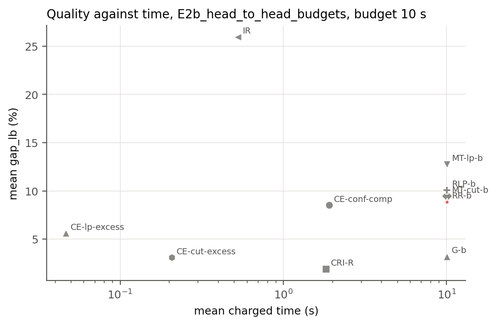

*Figure: Mean quality against mean charged time (one point per method)*

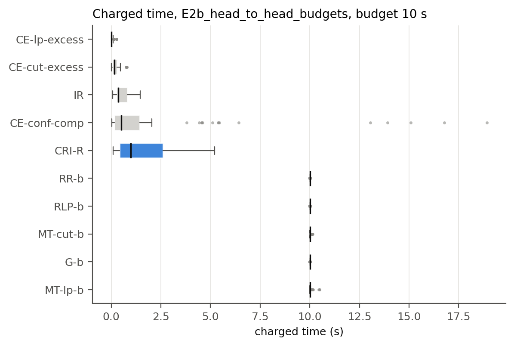

*Figure: Distribution of the charged time per run*

Friedman: N = 85 instances, k = 10 methods, chi2 = 422.15, p = 2.56e-85; Iman-Davenport F = 103.43, p = 2.04e-125; Nemenyi CD = 1.47.

*Friedman test with the Iman-Davenport correction and the Nemenyi critical difference*  (`15_E2b_head_to_head_budgets/budget_10s/statistics/friedman_iman_davenport_test.csv`, `.tex`, `.md`)

| instances (N) | methods (k) | chi2 | p | Iman-Davenport F | p (F) | Nemenyi CD (alpha 0.05) |
|---|---|---|---|---|---|---|
| 85 | 10 | 422.1489 | 2.5624e-85 | 103.4283 | 2.0420e-125 | 1.4693 |

*Average ranks (1 = best)*  (`15_E2b_head_to_head_budgets/budget_10s/statistics/friedman_average_ranks.csv`, `.tex`, `.md`)

| method | average rank |
|---|---|
| CRI-R | 2.68 |
| CE-cut-excess | 3.46 |
| G-b | 3.52 |
| CE-lp-excess | 4.22 |
| CE-conf-comp | 5.61 |
| RLP-b | 6.25 |
| MT-cut-b | 6.26 |
| RR-b | 6.32 |
| MT-lp-b | 7.18 |
| IR | 9.49 |

*Average ranks by family, with the Friedman p-value of each family*  (`15_E2b_head_to_head_budgets/budget_10s/statistics/friedman_ranks_by_family.csv`, `.tex`, `.md`)

| index | CRI-R | CE-cut-excess | CE-lp-excess | G-b | MT-cut-b | CE-conf-comp | RR-b | RLP-b | MT-lp-b | IR | Friedman p | instances |
|---|---|---|---|---|---|---|---|---|---|---|---|---|
| omega | 2.583 | 3.233 | 4.333 | 4.517 | 5.583 | 5.700 | 6.300 | 6.483 | 6.800 | 9.467 | 1.197e-25 | 30.000 |
| overnight | 2.380 | 3.140 | 3.660 | 2.460 | 7.580 | 6.900 | 4.760 | 6.700 | 7.760 | 9.660 | 6.150e-32 | 25.000 |
| staggered | 3.017 | 3.967 | 4.583 | 3.400 | 5.850 | 4.450 | 7.650 | 5.633 | 7.067 | 9.383 | 3.849e-29 | 30.000 |

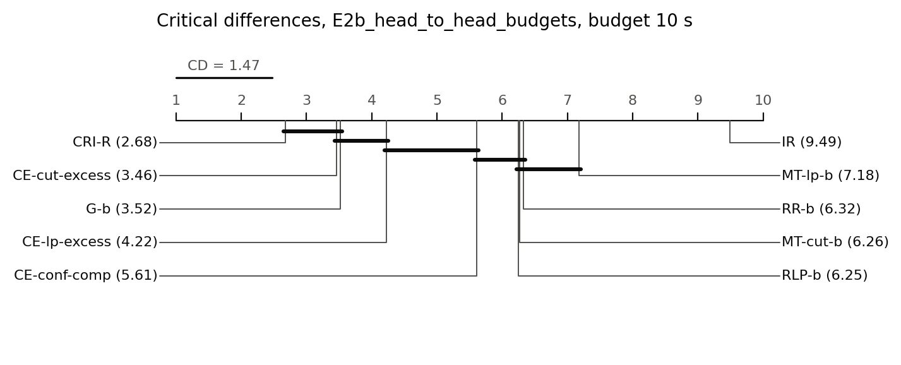

*Figure: Average ranks; methods joined by a bar are not significantly different (Nemenyi)*

*Pairwise Wilcoxon signed-rank tests (Holm), sign test, effect sizes (negative delta: A better); 45 pairs in the files, the 33 most significant of the 33 significant ones shown*  (`15_E2b_head_to_head_budgets/budget_10s/statistics/pairwise_wilcoxon_holm_effect_sizes.csv`, `.tex`, `.md`)

| A | B | N | mean_A | mean_B | win_A | tie | win_B | p | p_holm | p_sign | cliff_delta | cliff_mag | A12 | significant |
|---|---|---|---|---|---|---|---|---|---|---|---|---|---|---|
| G-b | IR | 85 | 3.342 | 27.167 | 81 | 4 | 0 | 1.390e-15 | 6.254e-14 | 8.272e-25 | -0.879 | large | 0.939 | yes |
| CRI-R | IR | 85 | 1.973 | 27.167 | 81 | 4 | 0 | 1.390e-15 | 6.254e-14 | 8.272e-25 | -0.919 | large | 0.960 | yes |
| CE-cut-excess | IR | 85 | 3.236 | 27.167 | 80 | 5 | 0 | 1.513e-15 | 6.506e-14 | 1.654e-24 | -0.898 | large | 0.949 | yes |
| IR | MT-cut-b | 85 | 27.167 | 9.831 | 0 | 6 | 79 | 1.674e-15 | 7.030e-14 | 3.309e-24 | 0.682 | large | 0.159 | yes |
| CE-lp-excess | IR | 85 | 5.914 | 27.167 | 80 | 4 | 1 | 2.126e-15 | 8.717e-14 | 6.783e-23 | -0.811 | large | 0.905 | yes |
| CRI-R | MT-lp-b | 85 | 1.973 | 13.269 | 74 | 11 | 0 | 3.472e-15 | 1.389e-13 | 1.059e-22 | -0.743 | large | 0.871 | yes |
| IR | RR-b | 85 | 27.167 | 9.306 | 3 | 5 | 77 | 4.057e-15 | 1.582e-13 | 1.413e-19 | 0.721 | large | 0.140 | yes |
| CRI-R | RR-b | 85 | 1.973 | 9.306 | 74 | 10 | 1 | 4.440e-15 | 1.687e-13 | 4.023e-21 | -0.680 | large | 0.840 | yes |
| IR | RLP-b | 85 | 27.167 | 10.426 | 1 | 7 | 77 | 5.026e-15 | 1.859e-13 | 5.228e-22 | 0.672 | large | 0.164 | yes |
| IR | MT-lp-b | 85 | 27.167 | 13.269 | 1 | 8 | 76 | 6.133e-15 | 2.208e-13 | 1.032e-21 | 0.557 | large | 0.222 | yes |
| CE-cut-excess | MT-lp-b | 85 | 3.236 | 13.269 | 70 | 13 | 2 | 1.605e-14 | 5.619e-13 | 1.113e-18 | -0.662 | large | 0.831 | yes |
| CRI-R | RLP-b | 85 | 1.973 | 10.426 | 65 | 20 | 0 | 2.959e-14 | 1.006e-12 | 5.421e-20 | -0.611 | large | 0.806 | yes |
| CRI-R | MT-cut-b | 85 | 1.973 | 9.831 | 61 | 24 | 0 | 1.019e-13 | 3.359e-12 | 8.674e-19 | -0.555 | large | 0.778 | yes |
| CE-lp-excess | MT-lp-b | 85 | 5.914 | 13.269 | 65 | 18 | 2 | 1.018e-13 | 3.359e-12 | 3.089e-17 | -0.483 | large | 0.741 | yes |
| CE-cut-excess | RR-b | 85 | 3.236 | 9.306 | 71 | 10 | 4 | 2.563e-13 | 7.946e-12 | 6.807e-17 | -0.558 | large | 0.779 | yes |
| CE-cut-excess | RLP-b | 85 | 3.236 | 10.426 | 61 | 22 | 2 | 4.818e-13 | 1.445e-11 | 4.374e-16 | -0.533 | large | 0.767 | yes |
| G-b | MT-lp-b | 85 | 3.342 | 13.269 | 67 | 11 | 7 | 1.367e-12 | 3.964e-11 | 2.120e-13 | -0.639 | large | 0.820 | yes |
| CE-conf-comp | IR | 85 | 8.514 | 27.167 | 67 | 5 | 13 | 2.428e-12 | 6.799e-11 | 6.415e-10 | -0.688 | large | 0.844 | yes |
| CE-cut-excess | MT-cut-b | 85 | 3.236 | 9.831 | 56 | 27 | 2 | 6.235e-12 | 1.684e-10 | 1.188e-14 | -0.464 | medium | 0.732 | yes |
| G-b | RLP-b | 85 | 3.342 | 10.426 | 60 | 20 | 5 | 1.636e-11 | 4.253e-10 | 4.870e-13 | -0.495 | large | 0.748 | yes |
| G-b | RR-b | 85 | 3.342 | 9.306 | 65 | 10 | 10 | 8.281e-11 | 2.070e-09 | 5.154e-11 | -0.551 | large | 0.776 | yes |
| G-b | MT-cut-b | 85 | 3.342 | 9.831 | 54 | 25 | 6 | 1.164e-10 | 2.794e-09 | 9.723e-11 | -0.444 | medium | 0.722 | yes |
| CE-conf-comp | CRI-R | 85 | 8.514 | 1.973 | 1 | 41 | 43 | 2.810e-10 | 6.463e-09 | 5.116e-12 | 0.249 | small | 0.375 | yes |
| CE-lp-excess | CRI-R | 85 | 5.914 | 1.973 | 0 | 42 | 43 | 3.838e-10 | 8.443e-09 | 2.274e-13 | 0.336 | medium | 0.332 | yes |
| CE-lp-excess | RLP-b | 85 | 5.914 | 10.426 | 51 | 28 | 6 | 4.141e-09 | 8.697e-08 | 5.676e-10 | -0.354 | medium | 0.677 | yes |
| CE-lp-excess | RR-b | 85 | 5.914 | 9.306 | 61 | 12 | 12 | 7.163e-08 | 1.433e-06 | 4.802e-09 | -0.357 | medium | 0.678 | yes |
| CE-cut-excess | CRI-R | 85 | 3.236 | 1.973 | 0 | 56 | 29 | 2.625e-07 | 4.988e-06 | 3.725e-09 | 0.190 | small | 0.405 | yes |
| MT-lp-b | RLP-b | 85 | 13.269 | 10.426 | 13 | 24 | 48 | 1.389e-06 | 2.499e-05 | 7.665e-06 | 0.159 | small | 0.421 | yes |
| CE-lp-excess | MT-cut-b | 85 | 5.914 | 9.831 | 53 | 22 | 10 | 2.275e-06 | 3.867e-05 | 3.382e-08 | -0.283 | small | 0.642 | yes |
| CE-conf-comp | CE-cut-excess | 85 | 8.514 | 3.236 | 11 | 31 | 43 | 4.200e-06 | 6.720e-05 | 1.401e-05 | 0.160 | small | 0.420 | yes |
| CE-conf-comp | G-b | 85 | 8.514 | 3.342 | 10 | 36 | 39 | 7.682e-06 | 1.152e-04 | 3.846e-05 | 0.173 | small | 0.413 | yes |
| MT-lp-b | RR-b | 85 | 13.269 | 9.306 | 25 | 7 | 53 | 1.650e-04 | 0.002 | 0.002 | 0.205 | small | 0.398 | yes |
| CE-cut-excess | CE-lp-excess | 85 | 3.236 | 5.914 | 35 | 35 | 15 | 4.909e-04 | 0.006 | 0.007 | -0.184 | small | 0.592 | yes |

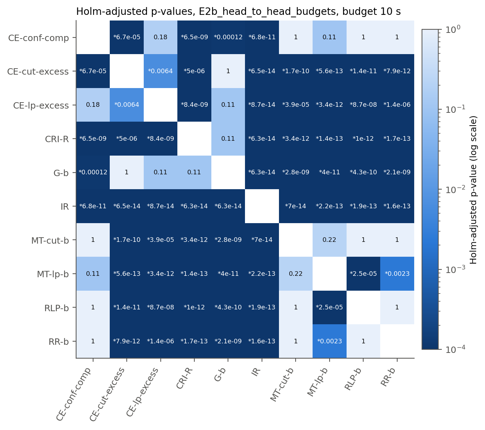

*Figure: Pairwise Holm-adjusted Wilcoxon p-values (* significant)*

*Win matrix: entry (row, column) = instances where the row method is strictly better than the column method*  (`15_E2b_head_to_head_budgets/budget_10s/statistics/win_matrix.csv`, `.tex`, `.md`)

| method | CE-conf-comp | CE-cut-excess | CE-lp-excess | CRI-R | G-b | IR | MT-cut-b | MT-lp-b | RLP-b | RR-b |
|---|---|---|---|---|---|---|---|---|---|---|
| CE-conf-comp | 0 | 11 | 20 | 1 | 10 | 67 | 36 | 46 | 38 | 43 |
| CE-cut-excess | 43 | 0 | 35 | 0 | 22 | 80 | 56 | 70 | 61 | 71 |
| CE-lp-excess | 37 | 15 | 0 | 0 | 20 | 80 | 53 | 65 | 51 | 61 |
| CRI-R | 43 | 29 | 43 | 0 | 29 | 81 | 61 | 74 | 65 | 74 |
| G-b | 39 | 28 | 37 | 15 | 0 | 81 | 54 | 67 | 60 | 65 |
| IR | 13 | 0 | 1 | 0 | 0 | 0 | 0 | 1 | 1 | 3 |
| MT-cut-b | 28 | 2 | 10 | 0 | 6 | 79 | 0 | 42 | 30 | 37 |
| MT-lp-b | 28 | 2 | 2 | 0 | 7 | 76 | 28 | 0 | 13 | 25 |
| RLP-b | 28 | 2 | 6 | 0 | 5 | 77 | 35 | 48 | 0 | 34 |
| RR-b | 32 | 4 | 12 | 1 | 10 | 77 | 41 | 53 | 43 | 0 |

*CRI-R against every other method (wins = instances where the control is strictly better)*  (`15_E2b_head_to_head_budgets/budget_10s/statistics/CRI-R_vs_each_method.csv`, `.tex`, `.md`)

| method | control | N | mean_control | mean_method | p | wins | ties | losses | cliff_delta | cliff_mag | A12 | p_holm | significant |
|---|---|---|---|---|---|---|---|---|---|---|---|---|---|
| CE-conf-comp | CRI-R | 85 | 1.973 | 8.514 | 2.810e-10 | 43 | 41 | 1 | -0.249 | small | 0.625 | 1.124e-09 | yes |
| CE-cut-excess | CRI-R | 85 | 1.973 | 3.236 | 2.625e-07 | 29 | 56 | 0 | -0.190 | small | 0.595 | 5.251e-07 | yes |
| CE-lp-excess | CRI-R | 85 | 1.973 | 5.914 | 3.838e-10 | 43 | 42 | 0 | -0.336 | medium | 0.668 | 1.151e-09 | yes |
| G-b | CRI-R | 85 | 1.973 | 3.342 | 0.010 | 29 | 41 | 15 | -0.100 | negligible | 0.550 | 0.010 | yes |
| IR | CRI-R | 85 | 1.973 | 27.167 | 1.390e-15 | 81 | 4 | 0 | -0.919 | large | 0.960 | 1.251e-14 | yes |
| MT-cut-b | CRI-R | 85 | 1.973 | 9.831 | 1.019e-13 | 61 | 24 | 0 | -0.555 | large | 0.778 | 5.095e-13 | yes |
| MT-lp-b | CRI-R | 85 | 1.973 | 13.269 | 3.472e-15 | 74 | 11 | 0 | -0.743 | large | 0.871 | 2.777e-14 | yes |
| RLP-b | CRI-R | 85 | 1.973 | 10.426 | 2.959e-14 | 65 | 20 | 0 | -0.611 | large | 0.806 | 1.775e-13 | yes |
| RR-b | CRI-R | 85 | 1.973 | 9.306 | 4.440e-15 | 74 | 10 | 1 | -0.680 | large | 0.840 | 3.108e-14 | yes |

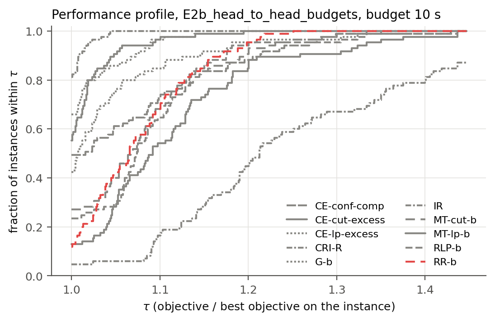

*Figure: Dolan-More performance profile of the peak (per-instance mean)*

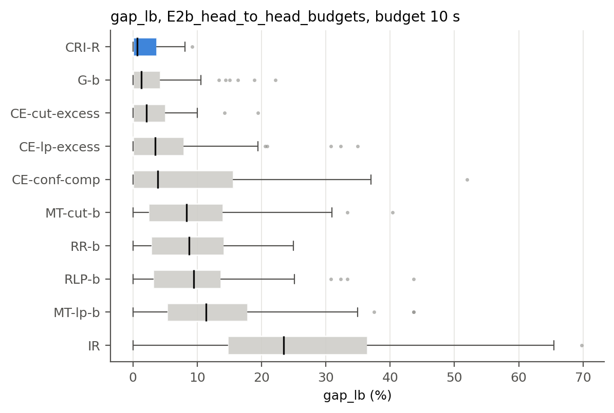

*Figure: Distribution of the per-instance gap_lb*

### Head-to-head comparisons

*Head-to-head: earlier method (A) against its certified counterpart (B)*  (`15_E2b_head_to_head_budgets/head_to_head/tables/pairs_wilcoxon_holm.csv`, `.tex`, `.md`)

| budget | A | B | N | mean gap_lb A | mean gap_lb B | mean time A | mean time B | A better | ties | B better | p (Wilcoxon) | Cliff delta | magnitude | p (Holm) |
|---|---|---|---|---|---|---|---|---|---|---|---|---|---|---|
| 1.000 | RR-b | MT-lp-b | 90 | 8.851 | 12.798 | 1.015 | 1.025 | 58 | 7 | 25 | 3.668e-05 | -0.202 | small | 2.934e-04 |
| 1.000 | RR-b | MT-cut-b | 90 | 8.851 | 9.853 | 1.015 | 1.017 | 46 | 7 | 37 | 0.397 | -0.003 | negligible | 1.000 |
| 1.000 | RLP-b | CE-lp-excess | 90 | 10.658 | 5.623 | 1.010 | 0.047 | 4 | 28 | 58 | 4.224e-11 | 0.368 | medium | 4.224e-10 |
| 1.000 | RLP-b | CE-cut-excess | 90 | 10.658 | 3.093 | 1.010 | 0.207 | 2 | 22 | 66 | 3.178e-14 | 0.529 | large | 3.813e-13 |
| 1.000 | RLP-b | IR | 90 | 10.658 | 25.958 | 1.010 | 0.523 | 82 | 7 | 1 | 8.722e-16 | -0.602 | large | 1.143e-14 |
| 1.000 | G-b | CE-cut-excess | 90 | 3.407 | 3.093 | 1.015 | 0.207 | 29 | 33 | 28 | 0.934 | -0.049 | negligible | 1.000 |
| 1.000 | G-b | CRI-R | 90 | 3.407 | 2.448 | 1.015 | 0.473 | 20 | 39 | 31 | 0.067 | 0.040 | negligible | 0.336 |
| 10.000 | RR-b | MT-lp-b | 90 | 8.851 | 12.730 | 10.015 | 10.028 | 58 | 7 | 25 | 5.370e-05 | -0.197 | small | 3.759e-04 |
| 10.000 | RR-b | MT-cut-b | 90 | 8.851 | 9.463 | 10.015 | 10.022 | 46 | 7 | 37 | 0.534 | 0.022 | negligible | 1.000 |
| 10.000 | RLP-b | CE-lp-excess | 90 | 10.061 | 5.623 | 10.014 | 0.047 | 6 | 28 | 56 | 6.285e-10 | 0.344 | medium | 5.656e-09 |
| 10.000 | RLP-b | CE-cut-excess | 90 | 10.061 | 3.093 | 10.014 | 0.207 | 2 | 22 | 66 | 6.499e-14 | 0.515 | large | 7.149e-13 |
| 10.000 | RLP-b | IR | 90 | 10.061 | 25.958 | 10.014 | 0.523 | 82 | 7 | 1 | 8.167e-16 | -0.624 | large | 1.143e-14 |
| 10.000 | G-b | CE-cut-excess | 90 | 3.210 | 3.093 | 10.014 | 0.207 | 29 | 35 | 26 | 0.701 | -0.067 | negligible | 1.000 |
| 10.000 | G-b | CRI-R | 90 | 3.210 | 1.899 | 10.014 | 1.827 | 16 | 41 | 33 | 0.005 | 0.101 | negligible | 0.030 |

- budget 1 s, RR-b vs MT-lp-b: RR-b better on more instances (58/7/25 W/T/L for RR-b), significant (Holm p = 0.000293), mean gap_lb 8.851 vs 12.798.

- budget 1 s, RR-b vs MT-cut-b: RR-b better on more instances (46/7/37 W/T/L for RR-b), not significant (Holm p = 1), mean gap_lb 8.851 vs 9.853.

- budget 1 s, RLP-b vs CE-lp-excess: CE-lp-excess better on more instances (4/28/58 W/T/L for RLP-b), significant (Holm p = 4.22e-10), mean gap_lb 10.658 vs 5.623.

- budget 1 s, RLP-b vs CE-cut-excess: CE-cut-excess better on more instances (2/22/66 W/T/L for RLP-b), significant (Holm p = 3.81e-13), mean gap_lb 10.658 vs 3.093.

- budget 1 s, RLP-b vs IR: RLP-b better on more instances (82/7/1 W/T/L for RLP-b), significant (Holm p = 1.14e-14), mean gap_lb 10.658 vs 25.958.

- budget 1 s, G-b vs CE-cut-excess: G-b better on more instances (29/33/28 W/T/L for G-b), not significant (Holm p = 1), mean gap_lb 3.407 vs 3.093.

- budget 1 s, G-b vs CRI-R: CRI-R better on more instances (20/39/31 W/T/L for G-b), not significant (Holm p = 0.336), mean gap_lb 3.407 vs 2.448.

- budget 10 s, RR-b vs MT-lp-b: RR-b better on more instances (58/7/25 W/T/L for RR-b), significant (Holm p = 0.000376), mean gap_lb 8.851 vs 12.730.

- budget 10 s, RR-b vs MT-cut-b: RR-b better on more instances (46/7/37 W/T/L for RR-b), not significant (Holm p = 1), mean gap_lb 8.851 vs 9.463.

- budget 10 s, RLP-b vs CE-lp-excess: CE-lp-excess better on more instances (6/28/56 W/T/L for RLP-b), significant (Holm p = 5.66e-09), mean gap_lb 10.061 vs 5.623.

- budget 10 s, RLP-b vs CE-cut-excess: CE-cut-excess better on more instances (2/22/66 W/T/L for RLP-b), significant (Holm p = 7.15e-13), mean gap_lb 10.061 vs 3.093.

- budget 10 s, RLP-b vs IR: RLP-b better on more instances (82/7/1 W/T/L for RLP-b), significant (Holm p = 1.14e-14), mean gap_lb 10.061 vs 25.958.

- budget 10 s, G-b vs CE-cut-excess: G-b better on more instances (29/35/26 W/T/L for G-b), not significant (Holm p = 1), mean gap_lb 3.210 vs 3.093.

- budget 10 s, G-b vs CRI-R: CRI-R better on more instances (16/41/33 W/T/L for G-b), significant (Holm p = 0.0305), mean gap_lb 3.210 vs 1.899.

### Across budgets

*Mean gap_lb (per-instance mean over seeds) of every method at every budget*  (`15_E2b_head_to_head_budgets/across_budgets/tables/mean_gap_by_budget.csv`, `.tex`, `.md`)

| method | 1 s | 10 s |
|---|---|---|
| CE-conf-comp | 8.514 | 8.514 |
| CE-cut-excess | 3.093 | 3.093 |
| CE-lp-excess | 5.623 | 5.623 |
| CRI-R | **2.448** | **1.899** |
| G-b | 3.407 | 3.210 |
| IR | 25.958 | 25.958 |
| MT-cut-b | 9.853 | 9.463 |
| MT-lp-b | 12.798 | 12.730 |
| RLP-b | 10.658 | 10.061 |
| RR-b | 8.851 | 8.851 |

*Mean charged time (s) at every budget*  (`15_E2b_head_to_head_budgets/across_budgets/tables/mean_charged_time_by_budget.csv`, `.tex`, `.md`)

| method | 1 s | 10 s |
|---|---|---|
| CE-conf-comp | 1.910 | 1.910 |
| CE-cut-excess | 0.207 | 0.207 |
| CE-lp-excess | 0.047 | 0.047 |
| CRI-R | 0.473 | 1.827 |
| G-b | 1.015 | 10.014 |
| IR | 0.523 | 0.523 |
| MT-cut-b | 1.017 | 10.022 |
| MT-lp-b | 1.025 | 10.028 |
| RLP-b | 1.010 | 10.014 |
| RR-b | 1.015 | 10.015 |

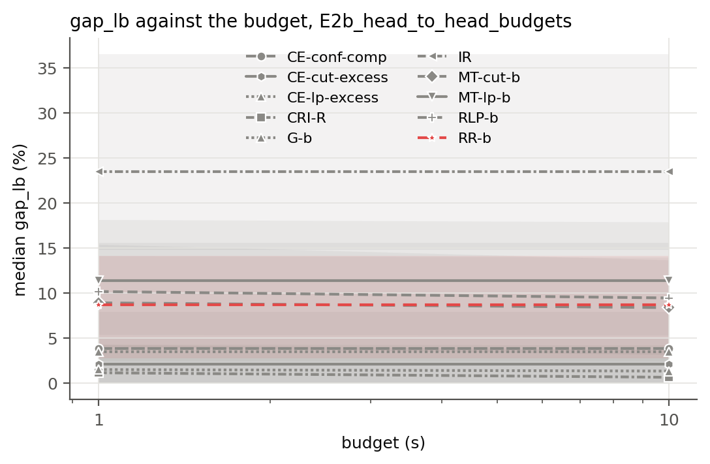

*Figure: Median gap_lb (IQR band) against the time budget: the time-quality trade-off of each method*

## E4a_equal_budgets

Files: `16_E4a_equal_budgets/`

Every method and Gurobi (standard and aggregated models, one thread each) at the same wall-clock budgets of 1 s and 10 s.

*Addresses:* Section 6.4 of the paper (equal time budgets; Gurobi's bounds and MIP gaps)

### Budget 1 s

*E4a_equal_budgets, budget 1 s: gap_lb (per-instance mean over seeds)*  (`16_E4a_equal_budgets/budget_1s/tables/summary.csv`, `.tex`, `.md`)

| method | instances | runs | mean gap_lb | sd | CI95 lo | CI95 hi | median | max | #hit LB* | #best | mean time (s) | infeasible/failed |
|---|---|---|---|---|---|---|---|---|---|---|---|---|
| G-b | 112 | 336 | 4.89 | 4.86 | 4.02 | 5.79 | 3.69 | 22.14 | 15 | 15 | 1.01 | 0 |
| RR-b | 112 | 336 | 8.09 | 6.35 | 6.96 | 9.25 | 8.02 | 23.93 | 11 | 11 | 1.01 | 0 |
| RLP-b | 112 | 336 | 9.40 | 6.96 | 8.18 | 10.71 | 8.99 | 30.79 | 8 | 8 | 1.09 | 0 |
| SA-b | 112 | 336 | 7.13 | 4.37 | 6.31 | 7.93 | 7.44 | 16.75 | 17 | 17 | 1.01 | 0 |
| HSC-b | 112 | 336 | 2.52 | 2.49 | 2.08 | 3.01 | 1.87 | 11.19 | 18 | 18 | 1.05 | 0 |
| LLS | 112 | 336 | **0.41** | 0.43 | 0.33 | 0.49 | 0.30 | 1.95 | 32 | 34 | 1.02 | 0 |
| WLNS | 112 | 336 | 5.14 | 5.13 | 4.24 | 6.07 | 4.19 | 23.09 | 23 | 23 | 1.04 | 0 |
| BK | 112 | 112 | 5.84 | 5.69 | 4.82 | 6.92 | 4.35 | 22.99 | 9 | 9 | 1.26e-03 | 0 |
| CRI | 112 | 336 | 0.42 | 0.43 | 0.34 | 0.51 | 0.30 | 1.95 | 33 | 35 | 0.95 | 0 |
| CRI+C | 112 | 336 | 0.44 | 0.45 | 0.36 | 0.52 | 0.31 | 1.95 | 33 | 34 | 0.93 | 0 |
| GUROBI-std | 112 | 112 | 4.39 | 11.23 | 2.55 | 6.72 | 1.09 | 53.50 | 29 | 29 | 0.82 | 0 |
| GUROBI-agg | 112 | 112 | 24.47 | 34.61 | 17.98 | 31.26 | 6.97 | 160.03 | 27 | 27 | 1.01 | 0 |

*Mean gap_lb by family*  (`16_E4a_equal_budgets/budget_1s/tables/mean_gap_by_family.csv`, `.tex`, `.md`)

| family | BK | CRI | CRI+C | G-b | GUROBI-agg | GUROBI-std | HSC-b | LLS | RLP-b | RR-b | SA-b | WLNS |
|---|---|---|---|---|---|---|---|---|---|---|---|---|
| omega | 7.14 | 0.49 | 0.51 | 6.41 | 14.46 | 2.77 | 3.27 | 0.46 | 11.08 | 9.23 | 7.37 | 6.78 |
| overnight | 1.42 | 0.38 | 0.40 | 1.32 | 62.71 | 12.57 | 1.18 | 0.31 | 6.26 | 1.78 | 9.96 | 1.63 |
| staggered | 6.78 | 0.30 | 0.30 | 4.40 | 12.92 | 0.53 | 1.86 | 0.38 | 8.04 | 11.38 | 3.63 | 4.28 |

*Mean gap_lb by size class*  (`16_E4a_equal_budgets/budget_1s/tables/mean_gap_by_size_class.csv`, `.tex`, `.md`)

| size | BK | CRI | CRI+C | G-b | GUROBI-agg | GUROBI-std | HSC-b | LLS | RLP-b | RR-b | SA-b | WLNS |
|---|---|---|---|---|---|---|---|---|---|---|---|---|
| large (n<=1000) | 1.70 | 0.23 | 0.24 | 3.56 | 64.06 | 8.84 | 1.07 | 0.32 | 3.62 | 4.35 | 7.11 | 3.60 |
| medium (n<=200) | 7.61 | 0.55 | 0.57 | 6.13 | 14.37 | 1.48 | 3.35 | 0.50 | 12.67 | 9.90 | 7.93 | 6.55 |
| small (n<=30) | 4.39 | 0.00 | 0.00 | 0.46 | 0.00 | 0.00 | 0.00 | 0.00 | 2.19 | 5.47 | 0.00 | 0.00 |
| very large (n>1000) | 0.98 | 0.22 | 0.23 | 2.14 | 56.64 | 24.61 | 1.31 | 0.30 | 1.66 | 3.41 | 8.33 | 2.21 |

*Mean gap_lb by n*  (`16_E4a_equal_budgets/budget_1s/tables/mean_gap_by_n.csv`, `.tex`, `.md`)

| n | BK | CRI | CRI+C | G-b | GUROBI-agg | GUROBI-std | HSC-b | LLS | RLP-b | RR-b | SA-b | WLNS |
|---|---|---|---|---|---|---|---|---|---|---|---|---|
| 20 | 2.64 | 0.00 | 0.00 | 0.00 | 0.00 | 0.00 | 0.00 | 0.00 | 0.45 | 4.86 | 0.00 | 0.00 |
| 30 | 6.14 | 0.00 | 0.00 | 0.91 | 0.00 | 0.00 | 0.00 | 0.00 | 3.93 | 6.09 | 0.00 | 0.00 |
| 40 | 9.23 | 0.00 | 0.00 | 5.42 | 0.34 | 0.00 | 3.69 | 0.00 | 12.72 | 13.60 | 3.88 | 3.47 |
| 50 | 10.09 | 0.56 | 0.57 | 6.03 | 7.37 | 1.30 | 3.96 | 0.53 | 15.65 | 11.19 | 7.75 | 5.98 |
| 75 | 15.65 | 0.73 | 0.76 | 9.58 | 8.96 | 2.58 | 5.98 | 0.69 | 20.71 | 15.54 | 12.35 | 12.76 |
| 100 | 6.62 | 0.62 | 0.64 | 7.29 | 11.96 | 1.55 | 3.18 | 0.54 | 12.19 | 9.46 | 7.77 | 7.90 |
| 150 | 4.42 | 0.82 | 0.84 | 5.98 | 12.38 | 2.35 | 2.81 | 0.63 | 12.34 | 8.79 | 11.60 | 7.04 |
| 200 | 4.49 | 0.51 | 0.54 | 4.40 | 29.14 | 1.46 | 2.32 | 0.48 | 8.22 | 6.99 | 7.27 | 4.86 |
| 500 | 1.71 | 0.24 | 0.25 | 4.41 | 60.25 | 0.65 | 0.93 | 0.29 | 4.72 | 5.18 | 7.04 | 4.38 |
| 1000 | 1.69 | 0.22 | 0.23 | 2.71 | 67.86 | 17.03 | 1.21 | 0.35 | 2.52 | 3.52 | 7.18 | 2.83 |
| 2000 | 0.98 | 0.22 | 0.23 | 2.14 | 56.64 | 24.61 | 1.31 | 0.30 | 1.66 | 3.41 | 8.33 | 2.21 |

*Charged time (s)*  (`16_E4a_equal_budgets/budget_1s/tables/charged_time.csv`, `.tex`, `.md`)

| method | mean | median | max |
|---|---|---|---|
| BK | 1.26e-03 | 0.00 | 0.02 |
| CRI | 0.95 | 1.02 | 1.17 |
| CRI+C | 0.93 | 1.00 | 1.08 |
| G-b | 1.01 | 1.02 | 1.02 |
| GUROBI-agg | 1.01 | 1.05 | 3.05 |
| GUROBI-std | 0.82 | 1.00 | 1.36 |
| HSC-b | 1.05 | 1.05 | 1.23 |
| LLS | 1.02 | 1.02 | 1.22 |
| RLP-b | 1.09 | 1.02 | 2.89 |
| RR-b | 1.01 | 1.02 | 1.02 |
| SA-b | 1.01 | 1.02 | 1.02 |
| WLNS | 1.04 | 1.03 | 1.41 |

*All quality measures (means over instances): gap to the best lower bound LB*, to the best known value, to the proven optimum, to our own certified lower bound, to the LP bound, relative difference to the exact solver's incumbent; instances proved optimal by our certificate alone and by the method's own bound*  (`16_E4a_equal_budgets/budget_1s/tables/all_quality_measures.csv`, `.tex`, `.md`)

| method | instances | #with OPT | gap LB* % | gap BKS % | gap OPT % (proven-optimum inst.) | gap own cert. LB % | gap P_LP % | rel. diff. exact ref. % | #best | #= LB* | #proved by certificate | #proved by own bound | mean time (s) | primal integral |
|---|---|---|---|---|---|---|---|---|---|---|---|---|---|---|
| G-b | 112 | 56 | 4.887 | 4.812 | 4.854 | 4.887 | 9.990 | 4.731 | 15 | 15 | 15 | 0 | 1.009 | 0.045 |
| RR-b | 112 | 56 | 8.093 | 8.017 | 10.363 | 8.093 | 13.483 | 8.646 | 11 | 11 | 11 | 0 | 1.009 | 0.071 |
| RLP-b | 112 | 56 | 9.396 | 9.318 | 10.853 | 9.396 | 14.707 | 10.673 | 8 | 8 | 8 | 0 | 1.092 | 0.267 |
| SA-b | 112 | 56 | 7.125 | 7.049 | 5.695 | 7.125 | 12.218 | 6.254 | 17 | 17 | 17 | 0 | 1.010 | 0.072 |
| HSC-b | 112 | 56 | 2.523 | 2.451 | 2.751 | 2.523 | 7.587 | 2.258 | 18 | 18 | 18 | 0 | 1.049 | 0.504 |
| LLS | 112 | 56 | 0.411 | 0.341 | 0.279 | 0.411 | 5.422 | -0.240 | 34 | 32 | 32 | 0 | 1.018 | 0.005 |
| WLNS | 112 | 56 | 5.143 | 5.067 | 4.770 | 5.143 | 10.223 | 5.045 | 23 | 23 | 23 | 0 | 1.040 | 0.062 |
| BK | 112 | 56 | 5.838 | 5.763 | 8.048 | 5.838 | 11.156 | 6.508 | 9 | 9 | 9 | 0 | 0.001 | 0.053 |
| CRI | 112 | 56 | 0.425 | 0.355 | 0.293 | 0.425 | 5.436 | -0.195 | 35 | 33 | 33 | 13 | 0.951 | 0.506 |
| CRI+C | 112 | 56 | 0.441 | 0.370 | 0.299 | 0.441 | 5.452 | -0.178 | 34 | 33 | 33 | 23 | 0.934 | 0.503 |
| GUROBI-std | 112 | 56 | 4.389 | 4.317 | 2.933 | 4.389 | 9.406 | 0.612 | 29 | 29 | 29 | 26 | 0.820 | 0.116 |
| GUROBI-agg | 112 | 56 | 24.469 | 24.384 | 10.148 | 24.469 | 29.529 | 11.887 | 27 | 27 | 27 | 21 | 1.007 | 0.257 |

*Variability over seeds (per-instance standard deviation and range)*  (`16_E4a_equal_budgets/budget_1s/tables/seed_variability.csv`, `.tex`, `.md`)

| method | seeds | mean sd gap_lb | mean range gap_lb | mean sd peak (kW) |
|---|---|---|---|---|
| G-b | 3 | 0.079 | 0.137 | 0.105 |
| RR-b | 3 | 2.405 | 4.435 | 2.199 |
| RLP-b | 3 | 0.456 | 0.843 | 1.292 |
| SA-b | 3 | 0.308 | 0.577 | 0.548 |
| HSC-b | 3 | 0.132 | 0.241 | 0.090 |
| LLS | 3 | 0.057 | 0.106 | 0.088 |
| WLNS | 3 | 0.949 | 1.793 | 0.803 |
| CRI | 3 | 0.071 | 0.129 | 0.125 |
| CRI+C | 3 | 0.069 | 0.126 | 0.086 |

*Per-instance mean peak (kW) of every method*  (`16_E4a_equal_budgets/budget_1s/tables/per_instance_mean_peak.csv`, `.tex`, `.md`)

(none)

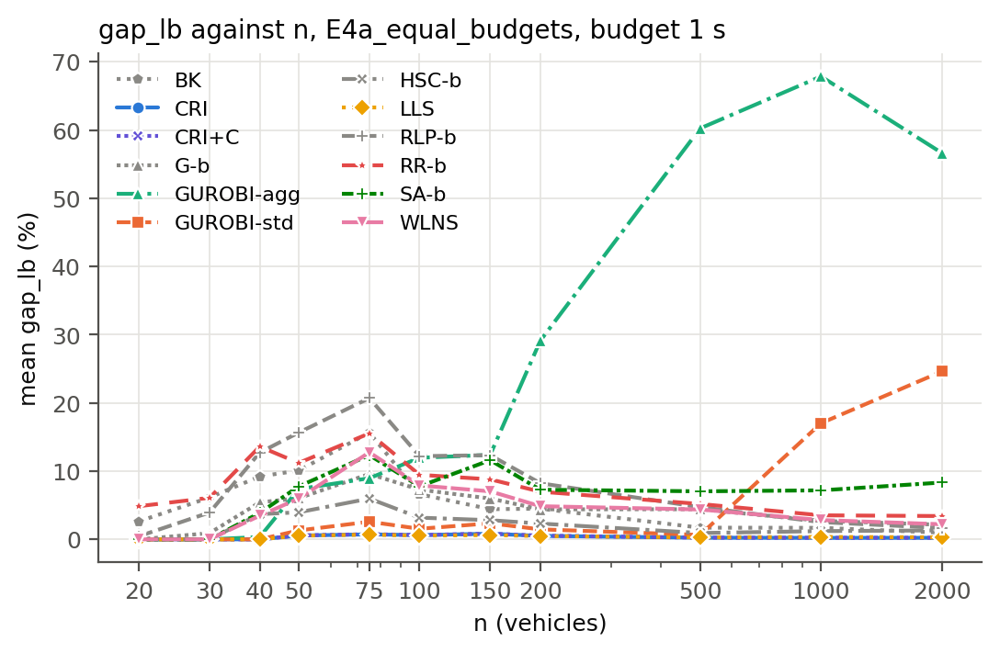

*Figure: Mean gap_lb against the number of vehicles, per method*

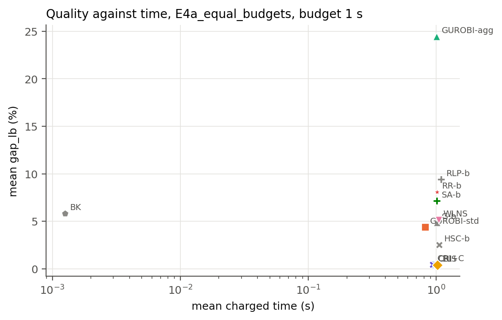

*Figure: Mean quality against mean charged time (one point per method)*

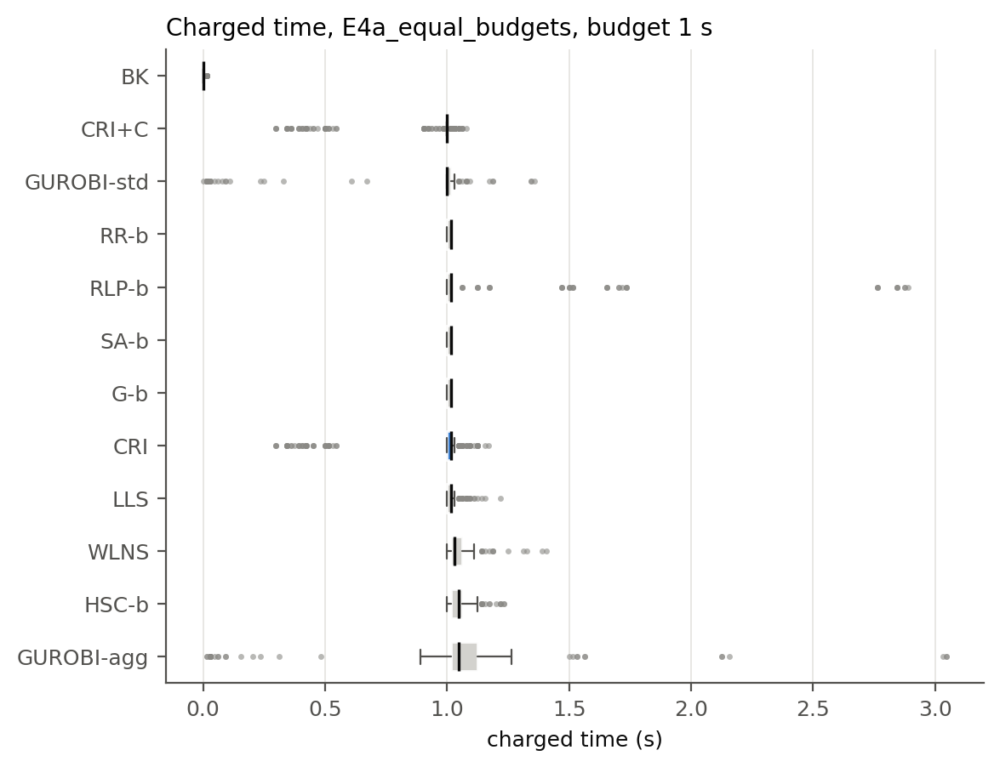

*Figure: Distribution of the charged time per run*

Friedman: N = 112 instances, k = 12 methods, chi2 = 760.87, p = 4.74e-156; Iman-Davenport F = 179.27, p = 1.04e-245; Nemenyi CD = 1.57.

*Friedman test with the Iman-Davenport correction and the Nemenyi critical difference*  (`16_E4a_equal_budgets/budget_1s/statistics/friedman_iman_davenport_test.csv`, `.tex`, `.md`)

| instances (N) | methods (k) | chi2 | p | Iman-Davenport F | p (F) | Nemenyi CD (alpha 0.05) |
|---|---|---|---|---|---|---|
| 112 | 12 | 760.8725 | 4.7445e-156 | 179.2654 | 1.0443e-245 | 1.5746 |

*Average ranks (1 = best)*  (`16_E4a_equal_budgets/budget_1s/statistics/friedman_average_ranks.csv`, `.tex`, `.md`)

| method | average rank |
|---|---|
| LLS | 2.29 |
| CRI | 2.67 |
| CRI+C | 3.08 |
| GUROBI-std | 4.96 |
| HSC-b | 5.92 |
| G-b | 7.29 |
| BK | 7.39 |
| WLNS | 7.93 |
| GUROBI-agg | 8.34 |
| SA-b | 8.73 |
| RR-b | 9.42 |
| RLP-b | 9.96 |

*Average ranks by family, with the Friedman p-value of each family*  (`16_E4a_equal_budgets/budget_1s/statistics/friedman_ranks_by_family.csv`, `.tex`, `.md`)

| index | LLS | CRI | CRI+C | GUROBI-std | HSC-b | G-b | BK | GUROBI-agg | WLNS | SA-b | RR-b | RLP-b | Friedman p | instances |
|---|---|---|---|---|---|---|---|---|---|---|---|---|---|---|
| omega | 2.422 | 2.789 | 3.203 | 4.672 | 5.781 | 7.617 | 7.625 | 7.758 | 8.086 | 8.578 | 9.281 | 10.188 | 4.717e-88 | 64.000 |
| overnight | 1.000 | 2.271 | 2.812 | 6.750 | 6.292 | 5.938 | 5.229 | 11.833 | 7.521 | 10.458 | 7.688 | 10.208 | 4.622e-43 | 24.000 |
| staggered | 3.250 | 2.771 | 3.021 | 3.938 | 5.938 | 7.792 | 8.938 | 6.396 | 7.938 | 7.396 | 11.542 | 9.083 | 1.376e-32 | 24.000 |

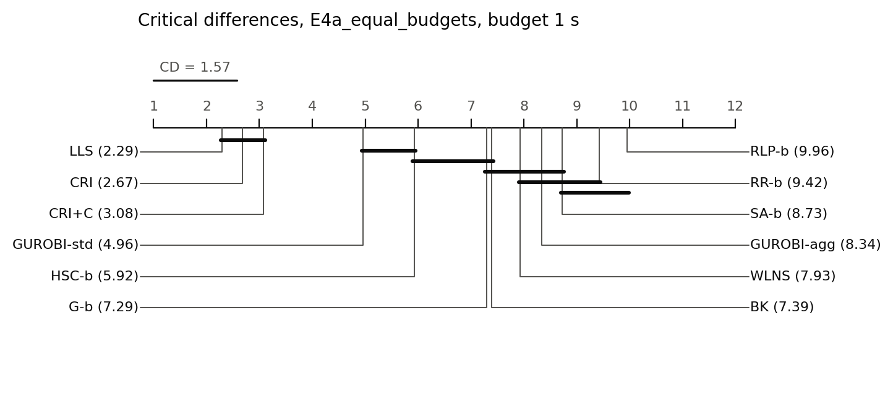

*Figure: Average ranks; methods joined by a bar are not significantly different (Nemenyi)*

*Pairwise Wilcoxon signed-rank tests (Holm), sign test, effect sizes (negative delta: A better); 66 pairs in the files, the 40 most significant of the 61 significant ones shown*  (`16_E4a_equal_budgets/budget_1s/statistics/pairwise_wilcoxon_holm_effect_sizes.csv`, `.tex`, `.md`)

| A | B | N | mean_A | mean_B | win_A | tie | win_B | p | p_holm | p_sign | cliff_delta | cliff_mag | A12 | significant |
|---|---|---|---|---|---|---|---|---|---|---|---|---|---|---|
| CRI+C | RR-b | 112 | 0.441 | 8.093 | 107 | 5 | 0 | 4.989e-20 | 3.293e-18 | 1.233e-32 | -0.827 | large | 0.914 | yes |
| CRI | RR-b | 112 | 0.425 | 8.093 | 107 | 5 | 0 | 4.989e-20 | 3.293e-18 | 1.233e-32 | -0.830 | large | 0.915 | yes |
| LLS | RR-b | 112 | 0.411 | 8.093 | 107 | 5 | 0 | 4.989e-20 | 3.293e-18 | 1.233e-32 | -0.834 | large | 0.917 | yes |
| CRI | RLP-b | 112 | 0.425 | 9.396 | 104 | 8 | 0 | 6.528e-20 | 4.113e-18 | 9.861e-32 | -0.865 | large | 0.933 | yes |
| LLS | RLP-b | 112 | 0.411 | 9.396 | 104 | 8 | 0 | 6.528e-20 | 4.113e-18 | 9.861e-32 | -0.867 | large | 0.933 | yes |
| CRI+C | RLP-b | 112 | 0.441 | 9.396 | 104 | 8 | 0 | 6.528e-20 | 4.113e-18 | 9.861e-32 | -0.864 | large | 0.932 | yes |
| BK | LLS | 112 | 5.838 | 0.411 | 0 | 9 | 103 | 7.313e-20 | 4.388e-18 | 1.972e-31 | 0.670 | large | 0.165 | yes |
| BK | CRI+C | 112 | 5.838 | 0.441 | 0 | 9 | 103 | 7.313e-20 | 4.388e-18 | 1.972e-31 | 0.658 | large | 0.171 | yes |
| BK | CRI | 112 | 5.838 | 0.425 | 2 | 9 | 101 | 1.672e-19 | 9.697e-18 | 1.056e-27 | 0.661 | large | 0.170 | yes |
| G-b | LLS | 112 | 4.887 | 0.411 | 0 | 15 | 97 | 1.828e-19 | 1.042e-17 | 1.262e-29 | 0.665 | large | 0.167 | yes |
| CRI+C | G-b | 112 | 0.441 | 4.887 | 97 | 15 | 0 | 1.828e-19 | 1.042e-17 | 1.262e-29 | -0.655 | large | 0.827 | yes |
| CRI | G-b | 112 | 0.425 | 4.887 | 97 | 15 | 0 | 1.828e-19 | 1.042e-17 | 1.262e-29 | -0.658 | large | 0.829 | yes |
| CRI+C | HSC-b | 112 | 0.441 | 2.523 | 95 | 17 | 0 | 2.700e-19 | 1.458e-17 | 5.049e-29 | -0.564 | large | 0.782 | yes |
| CRI | HSC-b | 112 | 0.425 | 2.523 | 95 | 17 | 0 | 2.700e-19 | 1.458e-17 | 5.049e-29 | -0.573 | large | 0.786 | yes |
| CRI+C | SA-b | 112 | 0.441 | 7.125 | 95 | 17 | 0 | 2.700e-19 | 1.458e-17 | 5.049e-29 | -0.732 | large | 0.866 | yes |
| CRI | SA-b | 112 | 0.425 | 7.125 | 95 | 17 | 0 | 2.700e-19 | 1.458e-17 | 5.049e-29 | -0.733 | large | 0.866 | yes |
| LLS | SA-b | 112 | 0.411 | 7.125 | 95 | 17 | 0 | 2.700e-19 | 1.458e-17 | 5.049e-29 | -0.734 | large | 0.867 | yes |
| LLS | WLNS | 112 | 0.411 | 5.143 | 94 | 18 | 0 | 3.330e-19 | 1.632e-17 | 1.010e-28 | -0.622 | large | 0.811 | yes |
| CRI | WLNS | 112 | 0.425 | 5.143 | 94 | 18 | 0 | 3.330e-19 | 1.632e-17 | 1.010e-28 | -0.616 | large | 0.808 | yes |
| CRI+C | WLNS | 112 | 0.441 | 5.143 | 94 | 18 | 0 | 3.330e-19 | 1.632e-17 | 1.010e-28 | -0.613 | large | 0.807 | yes |
| HSC-b | RLP-b | 112 | 2.523 | 9.396 | 100 | 8 | 4 | 3.768e-19 | 1.733e-17 | 4.719e-25 | -0.628 | large | 0.814 | yes |
| HSC-b | RR-b | 112 | 2.523 | 8.093 | 101 | 5 | 6 | 9.162e-19 | 4.123e-17 | 2.365e-23 | -0.536 | large | 0.768 | yes |
| HSC-b | LLS | 112 | 2.523 | 0.411 | 3 | 17 | 92 | 1.965e-18 | 8.648e-17 | 7.218e-24 | 0.579 | large | 0.211 | yes |
| GUROBI-agg | LLS | 112 | 24.469 | 0.411 | 0 | 27 | 85 | 3.303e-18 | 1.420e-16 | 5.170e-26 | 0.573 | large | 0.214 | yes |
| CRI+C | GUROBI-agg | 112 | 0.441 | 24.469 | 85 | 26 | 1 | 5.087e-18 | 2.136e-16 | 2.249e-24 | -0.569 | large | 0.784 | yes |
| CRI | GUROBI-agg | 112 | 0.425 | 24.469 | 85 | 26 | 1 | 5.218e-18 | 2.140e-16 | 2.249e-24 | -0.569 | large | 0.785 | yes |
| GUROBI-agg | GUROBI-std | 112 | 24.469 | 4.389 | 0 | 33 | 79 | 2.178e-17 | 8.711e-16 | 3.309e-24 | 0.438 | medium | 0.281 | yes |
| CRI+C | GUROBI-std | 112 | 0.441 | 4.389 | 82 | 28 | 2 | 5.701e-17 | 2.223e-15 | 3.692e-22 | -0.391 | medium | 0.696 | yes |
| CRI | GUROBI-std | 112 | 0.425 | 4.389 | 82 | 28 | 2 | 7.488e-17 | 2.846e-15 | 3.692e-22 | -0.399 | medium | 0.699 | yes |
| HSC-b | SA-b | 112 | 2.523 | 7.125 | 87 | 16 | 9 | 8.448e-17 | 3.126e-15 | 3.640e-17 | -0.573 | large | 0.787 | yes |
| GUROBI-std | LLS | 112 | 4.389 | 0.411 | 3 | 29 | 80 | 1.952e-16 | 7.027e-15 | 1.972e-20 | 0.409 | medium | 0.296 | yes |
| G-b | RLP-b | 112 | 4.887 | 9.396 | 87 | 7 | 18 | 2.649e-13 | 9.270e-12 | 4.946e-12 | -0.394 | medium | 0.697 | yes |
| RLP-b | WLNS | 112 | 9.396 | 5.143 | 19 | 8 | 85 | 3.806e-13 | 1.294e-11 | 3.786e-11 | 0.365 | medium | 0.318 | yes |
| BK | RLP-b | 112 | 5.838 | 9.396 | 88 | 9 | 15 | 1.019e-12 | 3.364e-11 | 9.655e-14 | -0.307 | small | 0.654 | yes |
| BK | HSC-b | 112 | 5.838 | 2.523 | 24 | 9 | 79 | 2.666e-12 | 8.532e-11 | 4.981e-08 | 0.322 | small | 0.339 | yes |
| HSC-b | WLNS | 112 | 2.523 | 5.143 | 71 | 25 | 16 | 1.958e-11 | 6.071e-10 | 1.957e-09 | -0.268 | small | 0.634 | yes |
| BK | RR-b | 112 | 5.838 | 8.093 | 88 | 8 | 16 | 5.850e-11 | 1.755e-09 | 3.180e-13 | -0.219 | small | 0.610 | yes |
| GUROBI-std | RLP-b | 112 | 4.389 | 9.396 | 95 | 8 | 9 | 2.543e-10 | 7.374e-09 | 2.986e-19 | -0.638 | large | 0.819 | yes |
| GUROBI-std | RR-b | 112 | 4.389 | 8.093 | 96 | 5 | 11 | 3.058e-10 | 8.563e-09 | 4.301e-18 | -0.568 | large | 0.784 | yes |
| CRI | CRI+C | 112 | 0.425 | 0.441 | 50 | 59 | 3 | 5.248e-10 | 1.417e-08 | 5.520e-12 | -0.020 | negligible | 0.510 | yes |

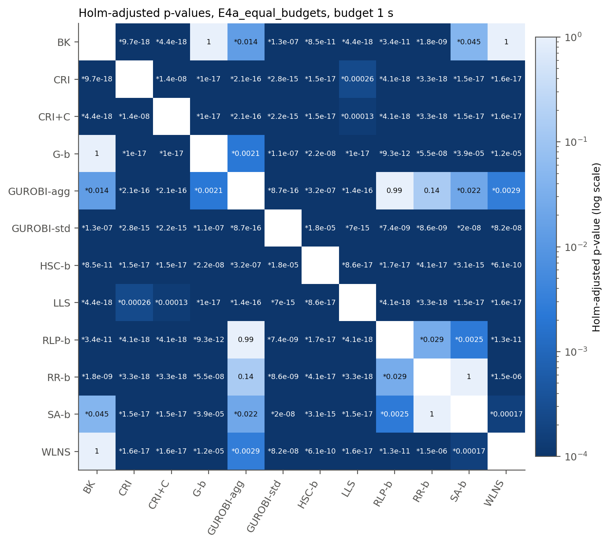

*Figure: Pairwise Holm-adjusted Wilcoxon p-values (* significant)*

*Win matrix: entry (row, column) = instances where the row method is strictly better than the column method*  (`16_E4a_equal_budgets/budget_1s/statistics/win_matrix.csv`, `.tex`, `.md`)

| method | BK | CRI | CRI+C | G-b | GUROBI-agg | GUROBI-std | HSC-b | LLS | RLP-b | RR-b | SA-b | WLNS |
|---|---|---|---|---|---|---|---|---|---|---|---|---|
| BK | 0 | 2 | 0 | 60 | 59 | 18 | 24 | 0 | 88 | 88 | 64 | 63 |
| CRI | 101 | 0 | 50 | 97 | 85 | 82 | 95 | 13 | 104 | 107 | 95 | 94 |
| CRI+C | 103 | 3 | 0 | 97 | 85 | 82 | 95 | 13 | 104 | 107 | 95 | 94 |
| G-b | 44 | 0 | 0 | 0 | 56 | 15 | 26 | 0 | 87 | 82 | 69 | 76 |
| GUROBI-agg | 44 | 1 | 1 | 41 | 0 | 0 | 28 | 0 | 57 | 54 | 43 | 40 |
| GUROBI-std | 85 | 2 | 2 | 82 | 79 | 0 | 73 | 3 | 95 | 96 | 86 | 81 |
| HSC-b | 79 | 0 | 0 | 69 | 65 | 21 | 0 | 3 | 100 | 101 | 87 | 71 |
| LLS | 103 | 59 | 60 | 97 | 85 | 80 | 92 | 0 | 104 | 107 | 95 | 94 |
| RLP-b | 15 | 0 | 0 | 18 | 47 | 9 | 4 | 0 | 0 | 40 | 35 | 19 |
| RR-b | 16 | 0 | 0 | 26 | 53 | 11 | 6 | 0 | 68 | 0 | 52 | 29 |
| SA-b | 37 | 0 | 0 | 27 | 52 | 9 | 9 | 0 | 69 | 55 | 0 | 30 |
| WLNS | 40 | 0 | 0 | 19 | 54 | 12 | 16 | 0 | 85 | 78 | 66 | 0 |

*CRI against every other method (wins = instances where the control is strictly better)*  (`16_E4a_equal_budgets/budget_1s/statistics/CRI_vs_each_method.csv`, `.tex`, `.md`)

| method | control | N | mean_control | mean_method | p | wins | ties | losses | cliff_delta | cliff_mag | A12 | p_holm | significant |
|---|---|---|---|---|---|---|---|---|---|---|---|---|---|
| BK | CRI | 112 | 0.425 | 5.838 | 1.672e-19 | 101 | 9 | 2 | -0.661 | large | 0.830 | 1.505e-18 | yes |
| CRI+C | CRI | 112 | 0.425 | 0.441 | 5.248e-10 | 50 | 59 | 3 | -0.020 | negligible | 0.510 | 1.050e-09 | yes |
| G-b | CRI | 112 | 0.425 | 4.887 | 1.828e-19 | 97 | 15 | 0 | -0.658 | large | 0.829 | 1.505e-18 | yes |
| GUROBI-agg | CRI | 112 | 0.425 | 24.469 | 5.218e-18 | 85 | 26 | 1 | -0.569 | large | 0.785 | 2.087e-17 | yes |
| GUROBI-std | CRI | 112 | 0.425 | 4.389 | 7.488e-17 | 82 | 28 | 2 | -0.399 | medium | 0.699 | 2.247e-16 | yes |
| HSC-b | CRI | 112 | 0.425 | 2.523 | 2.700e-19 | 95 | 17 | 0 | -0.573 | large | 0.786 | 1.890e-18 | yes |
| LLS | CRI | 112 | 0.425 | 0.411 | 2.025e-05 | 13 | 40 | 59 | 0.020 | negligible | 0.490 | 2.025e-05 | yes |
| RLP-b | CRI | 112 | 0.425 | 9.396 | 6.528e-20 | 104 | 8 | 0 | -0.865 | large | 0.933 | 6.528e-19 | yes |
| RR-b | CRI | 112 | 0.425 | 8.093 | 4.989e-20 | 107 | 5 | 0 | -0.830 | large | 0.915 | 5.488e-19 | yes |
| SA-b | CRI | 112 | 0.425 | 7.125 | 2.700e-19 | 95 | 17 | 0 | -0.733 | large | 0.866 | 1.890e-18 | yes |
| WLNS | CRI | 112 | 0.425 | 5.143 | 3.330e-19 | 94 | 18 | 0 | -0.616 | large | 0.808 | 1.890e-18 | yes |

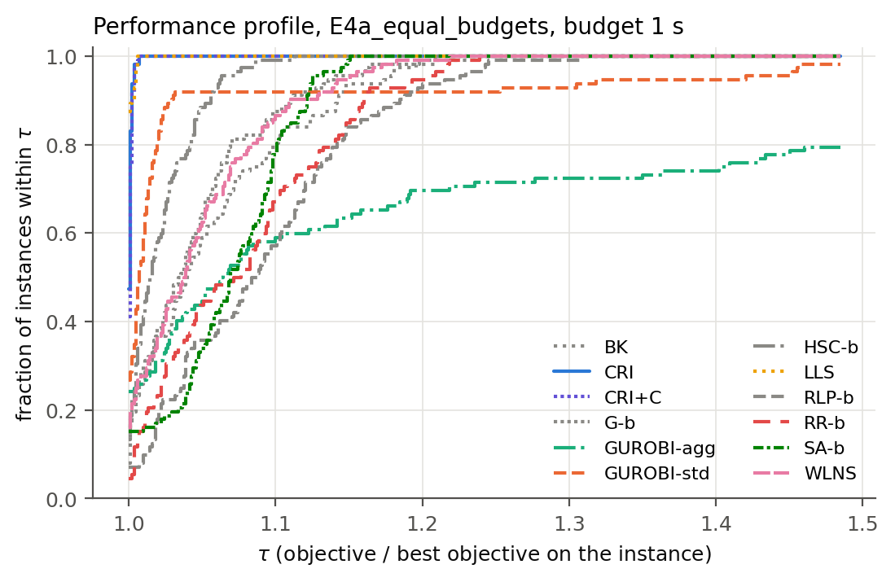

*Figure: Dolan-More performance profile of the peak (per-instance mean)*

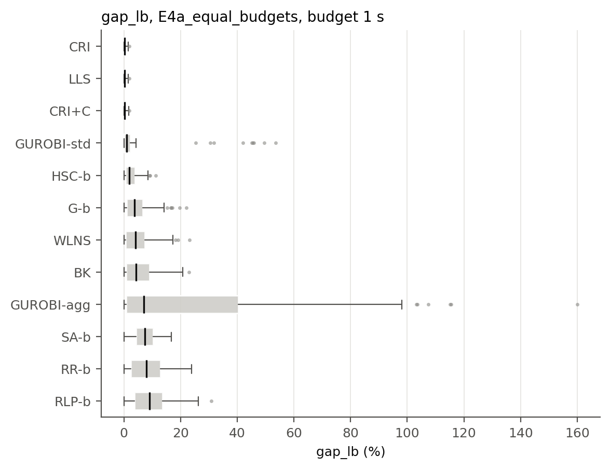

*Figure: Distribution of the per-instance gap_lb*

### Budget 10 s

*E4a_equal_budgets, budget 10 s: gap_lb (per-instance mean over seeds)*  (`16_E4a_equal_budgets/budget_10s/tables/summary.csv`, `.tex`, `.md`)

| method | instances | runs | mean gap_lb | sd | CI95 lo | CI95 hi | median | max | #hit LB* | #best | mean time (s) | infeasible/failed |
|---|---|---|---|---|---|---|---|---|---|---|---|---|
| G-b | 112 | 336 | 4.56 | 4.68 | 3.75 | 5.43 | 3.20 | 22.14 | 16 | 16 | 10.01 | 0 |
| RR-b | 112 | 336 | 8.09 | 6.35 | 6.96 | 9.25 | 8.02 | 23.93 | 11 | 11 | 10.01 | 0 |
| RLP-b | 112 | 336 | 8.56 | 6.64 | 7.37 | 9.82 | 8.34 | 30.79 | 8 | 8 | 10.01 | 0 |
| SA-b | 112 | 336 | 6.57 | 4.26 | 5.78 | 7.36 | 6.82 | 16.75 | 18 | 18 | 10.01 | 0 |
| HSC-b | 112 | 336 | 2.02 | 2.32 | 1.61 | 2.45 | 1.17 | 9.34 | 23 | 23 | 10.11 | 0 |
| LLS | 112 | 336 | 0.25 | 0.33 | 0.19 | 0.31 | 0.15 | 1.95 | 38 | 57 | 10.02 | 0 |
| WLNS | 112 | 336 | 2.78 | 3.31 | 2.19 | 3.41 | 1.86 | 17.09 | 32 | 32 | 10.03 | 0 |
| BK | 112 | 112 | 5.84 | 5.69 | 4.82 | 6.92 | 4.35 | 22.99 | 9 | 9 | 9.77e-04 | 0 |
| CRI | 112 | 336 | **0.22** | 0.30 | 0.17 | 0.27 | 0.15 | 1.95 | 41 | 54 | 7.27 | 0 |
| CRI+C | 112 | 336 | 0.23 | 0.30 | 0.18 | 0.29 | 0.15 | 1.95 | 42 | 48 | 7.16 | 0 |
| GUROBI-std | 112 | 112 | 0.67 | 0.74 | 0.54 | 0.81 | 0.45 | 3.65 | 31 | 31 | 7.50 | 0 |
| GUROBI-agg | 112 | 112 | 3.52 | 13.94 | 1.25 | 6.39 | 0.98 | 98.66 | 32 | 32 | 7.74 | 0 |

*Mean gap_lb by family*  (`16_E4a_equal_budgets/budget_10s/tables/mean_gap_by_family.csv`, `.tex`, `.md`)

| family | BK | CRI | CRI+C | G-b | GUROBI-agg | GUROBI-std | HSC-b | LLS | RLP-b | RR-b | SA-b | WLNS |
|---|---|---|---|---|---|---|---|---|---|---|---|---|
| omega | 7.14 | 0.27 | 0.29 | 5.92 | 1.28 | 0.86 | 2.65 | 0.30 | 10.10 | 9.23 | 6.83 | 3.92 |
| overnight | 1.42 | 0.20 | 0.21 | 1.29 | 12.63 | 0.59 | 1.11 | 0.15 | 5.46 | 1.78 | 9.43 | 1.25 |
| staggered | 6.78 | 0.09 | 0.10 | 4.19 | 0.38 | 0.25 | 1.26 | 0.21 | 7.54 | 11.38 | 3.04 | 1.25 |

*Mean gap_lb by size class*  (`16_E4a_equal_budgets/budget_10s/tables/mean_gap_by_size_class.csv`, `.tex`, `.md`)

| size | BK | CRI | CRI+C | G-b | GUROBI-agg | GUROBI-std | HSC-b | LLS | RLP-b | RR-b | SA-b | WLNS |
|---|---|---|---|---|---|---|---|---|---|---|---|---|
| large (n<=1000) | 1.70 | 0.11 | 0.12 | 3.48 | 6.75 | 0.34 | 0.60 | 0.15 | 2.83 | 4.35 | 6.81 | 1.81 |
| medium (n<=200) | 7.61 | 0.29 | 0.31 | 5.67 | 1.50 | 0.90 | 2.85 | 0.31 | 11.70 | 9.90 | 7.21 | 3.52 |
| small (n<=30) | 4.39 | 0.00 | 0.00 | 0.31 | 0.00 | 0.00 | 0.00 | 0.00 | 2.09 | 5.47 | 0.00 | 0.00 |
| very large (n>1000) | 0.98 | 0.08 | 0.08 | 2.12 | 17.76 | 0.16 | 0.24 | 0.16 | 1.04 | 3.41 | 8.08 | 1.58 |

*Mean gap_lb by n*  (`16_E4a_equal_budgets/budget_10s/tables/mean_gap_by_n.csv`, `.tex`, `.md`)

| n | BK | CRI | CRI+C | G-b | GUROBI-agg | GUROBI-std | HSC-b | LLS | RLP-b | RR-b | SA-b | WLNS |
|---|---|---|---|---|---|---|---|---|---|---|---|---|
| 20 | 2.64 | 0.00 | 0.00 | 0.00 | 0.00 | 0.00 | 0.00 | 0.00 | 0.45 | 4.86 | 0.00 | 0.00 |
| 30 | 6.14 | 0.00 | 0.00 | 0.61 | 0.00 | 0.00 | 0.00 | 0.00 | 3.73 | 6.09 | 0.00 | 0.00 |
| 40 | 9.23 | 0.00 | 0.00 | 3.60 | 0.00 | 0.00 | 0.62 | 0.00 | 11.12 | 13.60 | 2.92 | 0.17 |
| 50 | 10.09 | 0.40 | 0.38 | 5.56 | 1.25 | 0.76 | 3.30 | 0.40 | 14.79 | 11.19 | 6.97 | 2.36 |
| 75 | 15.65 | 0.49 | 0.51 | 8.89 | 2.84 | 1.03 | 5.98 | 0.51 | 18.85 | 15.54 | 11.52 | 7.91 |
| 100 | 6.62 | 0.25 | 0.30 | 6.96 | 1.82 | 1.14 | 2.98 | 0.28 | 11.18 | 9.46 | 7.13 | 4.88 |
| 150 | 4.42 | 0.37 | 0.43 | 5.77 | 2.04 | 1.50 | 2.62 | 0.35 | 11.32 | 8.79 | 10.88 | 5.27 |
| 200 | 4.49 | 0.22 | 0.25 | 4.19 | 1.32 | 0.85 | 2.09 | 0.28 | 7.56 | 6.99 | 6.63 | 2.63 |
| 500 | 1.71 | 0.12 | 0.13 | 4.30 | 2.05 | 0.37 | 0.79 | 0.13 | 3.60 | 5.18 | 6.70 | 1.80 |
| 1000 | 1.69 | 0.11 | 0.11 | 2.67 | 11.45 | 0.30 | 0.42 | 0.17 | 2.05 | 3.52 | 6.92 | 1.82 |
| 2000 | 0.98 | 0.08 | 0.08 | 2.12 | 17.76 | 0.16 | 0.24 | 0.16 | 1.04 | 3.41 | 8.08 | 1.58 |

*Charged time (s)*  (`16_E4a_equal_budgets/budget_10s/tables/charged_time.csv`, `.tex`, `.md`)

| method | mean | median | max |
|---|---|---|---|
| BK | 9.77e-04 | 0.00 | 0.02 |
| CRI | 7.27 | 10.02 | 10.16 |
| CRI+C | 7.16 | 9.83 | 10.05 |
| G-b | 10.01 | 10.00 | 10.02 |
| GUROBI-agg | 7.74 | 10.05 | 12.34 |
| GUROBI-std | 7.50 | 10.02 | 10.37 |
| HSC-b | 10.11 | 10.08 | 10.42 |
| LLS | 10.02 | 10.02 | 10.17 |
| RLP-b | 10.01 | 10.02 | 10.02 |
| RR-b | 10.01 | 10.00 | 10.02 |
| SA-b | 10.01 | 10.00 | 10.02 |
| WLNS | 10.03 | 10.02 | 10.39 |

*All quality measures (means over instances): gap to the best lower bound LB*, to the best known value, to the proven optimum, to our own certified lower bound, to the LP bound, relative difference to the exact solver's incumbent; instances proved optimal by our certificate alone and by the method's own bound*  (`16_E4a_equal_budgets/budget_10s/tables/all_quality_measures.csv`, `.tex`, `.md`)

| method | instances | #with OPT | gap LB* % | gap BKS % | gap OPT % (proven-optimum inst.) | gap own cert. LB % | gap P_LP % | rel. diff. exact ref. % | #best | #= LB* | #proved by certificate | #proved by own bound | mean time (s) | primal integral |
|---|---|---|---|---|---|---|---|---|---|---|---|---|---|---|
| G-b | 112 | 56 | 4.555 | 4.481 | 4.333 | 4.555 | 9.643 | 4.315 | 16 | 16 | 16 | 0 | 10.007 | 0.042 |
| RR-b | 112 | 56 | 8.093 | 8.017 | 10.363 | 8.093 | 13.483 | 8.646 | 11 | 11 | 11 | 0 | 10.007 | 0.070 |
| RLP-b | 112 | 56 | 8.558 | 8.481 | 9.947 | 8.558 | 13.843 | 9.810 | 8 | 8 | 8 | 0 | 10.008 | 0.104 |
| SA-b | 112 | 56 | 6.574 | 6.498 | 5.062 | 6.574 | 11.654 | 5.624 | 18 | 18 | 18 | 0 | 10.007 | 0.062 |
| HSC-b | 112 | 56 | 2.022 | 1.950 | 2.053 | 2.022 | 7.063 | 1.810 | 23 | 23 | 23 | 0 | 10.105 | 0.309 |
| LLS | 112 | 56 | 0.247 | 0.177 | 0.200 | 0.247 | 5.258 | -0.403 | 57 | 38 | 38 | 0 | 10.017 | 0.003 |
| WLNS | 112 | 56 | 2.777 | 2.704 | 1.790 | 2.777 | 7.806 | 2.392 | 32 | 32 | 32 | 0 | 10.033 | 0.036 |
| BK | 112 | 56 | 5.838 | 5.763 | 8.048 | 5.838 | 11.156 | 6.508 | 9 | 9 | 9 | 0 | 9.770e-04 | 0.052 |
| CRI | 112 | 56 | 0.219 | 0.149 | 0.159 | 0.219 | 5.229 | -0.424 | 54 | 41 | 41 | 40 | 7.265 | 0.304 |
| CRI+C | 112 | 56 | 0.233 | 0.163 | 0.157 | 0.233 | 5.243 | -0.407 | 48 | 42 | 42 | 42 | 7.158 | 0.303 |
| GUROBI-std | 112 | 56 | 0.672 | 0.602 | 0.376 | 0.672 | 5.684 | 0.110 | 31 | 31 | 31 | 30 | 7.504 | 0.025 |
| GUROBI-agg | 112 | 56 | 3.516 | 3.444 | 0.754 | 3.516 | 8.530 | 0.628 | 32 | 32 | 32 | 29 | 7.741 | 0.081 |

*Variability over seeds (per-instance standard deviation and range)*  (`16_E4a_equal_budgets/budget_10s/tables/seed_variability.csv`, `.tex`, `.md`)

| method | seeds | mean sd gap_lb | mean range gap_lb | mean sd peak (kW) |
|---|---|---|---|---|
| G-b | 3 | 0.015 | 0.027 | 0.042 |
| RR-b | 3 | 2.405 | 4.435 | 2.199 |
| RLP-b | 3 | 0.342 | 0.628 | 0.376 |
| SA-b | 3 | 0.203 | 0.381 | 0.419 |
| HSC-b | 3 | 0.032 | 0.059 | 0.027 |
| LLS | 3 | 0.059 | 0.107 | 0.075 |
| WLNS | 3 | 0.379 | 0.719 | 0.504 |
| CRI | 3 | 0.056 | 0.101 | 0.064 |
| CRI+C | 3 | 0.063 | 0.112 | 0.068 |

*Per-instance mean peak (kW) of every method*  (`16_E4a_equal_budgets/budget_10s/tables/per_instance_mean_peak.csv`, `.tex`, `.md`)

(none)

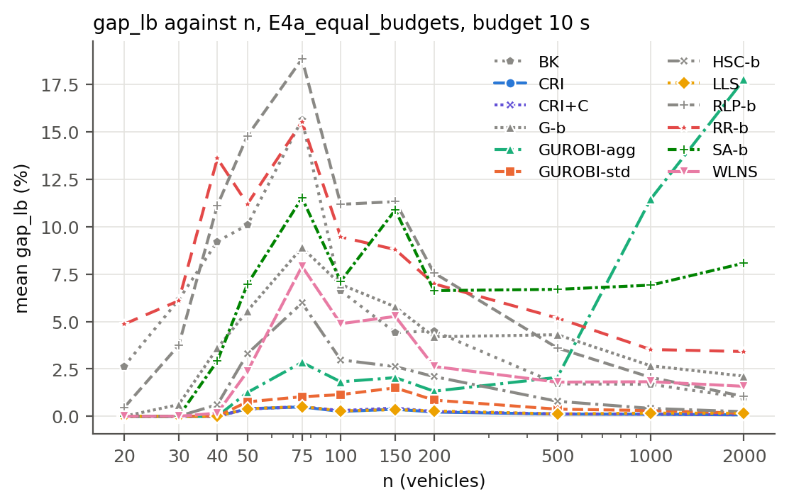

*Figure: Mean gap_lb against the number of vehicles, per method*

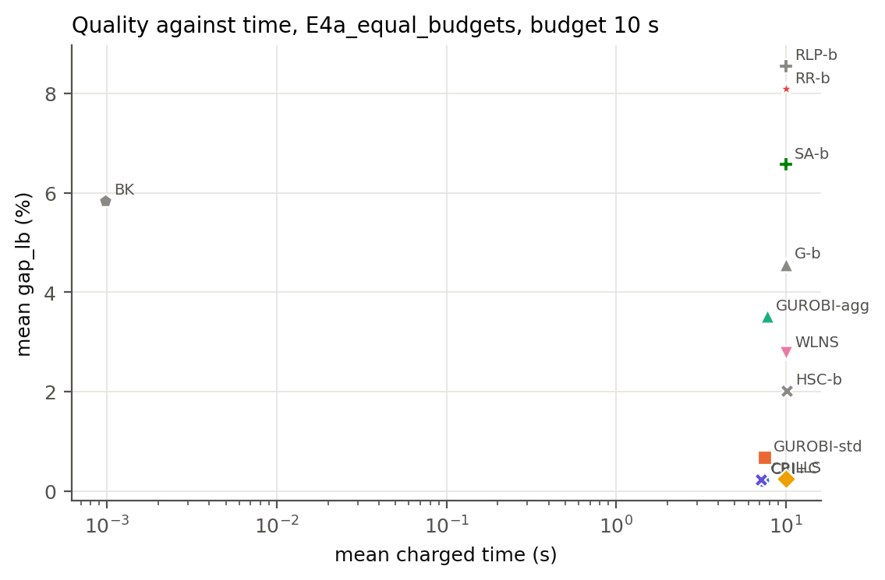

*Figure: Mean quality against mean charged time (one point per method)*

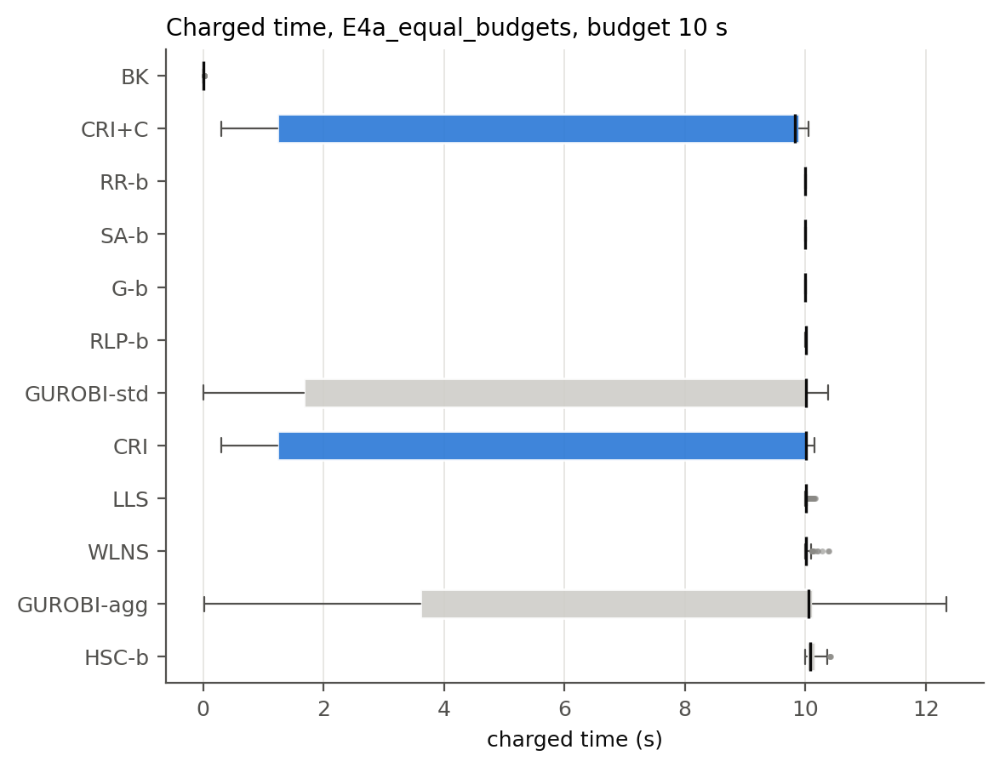

*Figure: Distribution of the charged time per run*

Friedman: N = 112 instances, k = 12 methods, chi2 = 873.91, p = 2.51e-180; Iman-Davenport F = 270.89, p = 3.55e-318; Nemenyi CD = 1.57.

*Friedman test with the Iman-Davenport correction and the Nemenyi critical difference*  (`16_E4a_equal_budgets/budget_10s/statistics/friedman_iman_davenport_test.csv`, `.tex`, `.md`)

| instances (N) | methods (k) | chi2 | p | Iman-Davenport F | p (F) | Nemenyi CD (alpha 0.05) |
|---|---|---|---|---|---|---|
| 112 | 12 | 873.9102 | 2.5142e-180 | 270.8930 | 3.5475e-318 | 1.5746 |

*Average ranks (1 = best)*  (`16_E4a_equal_budgets/budget_10s/statistics/friedman_average_ranks.csv`, `.tex`, `.md`)

| method | average rank |
|---|---|
| CRI | 2.70 |
| LLS | 2.70 |
| CRI+C | 3.12 |
| GUROBI-std | 4.34 |
| GUROBI-agg | 5.66 |
| HSC-b | 6.09 |
| WLNS | 6.84 |
| BK | 8.18 |
| G-b | 8.38 |
| SA-b | 9.42 |
| RR-b | 10.17 |
| RLP-b | 10.40 |

*Average ranks by family, with the Friedman p-value of each family*  (`16_E4a_equal_budgets/budget_10s/statistics/friedman_ranks_by_family.csv`, `.tex`, `.md`)

| index | LLS | CRI | CRI+C | GUROBI-std | GUROBI-agg | HSC-b | WLNS | BK | G-b | SA-b | RR-b | RLP-b | Friedman p | instances |
|---|---|---|---|---|---|---|---|---|---|---|---|---|---|---|
| omega | 2.805 | 2.875 | 3.242 | 4.406 | 4.883 | 5.852 | 7.047 | 8.469 | 8.703 | 9.172 | 10.047 | 10.500 | 9.429e-105 | 64.000 |
| overnight | 1.083 | 2.125 | 2.792 | 4.354 | 9.062 | 6.583 | 7.479 | 5.938 | 7.146 | 11.500 | 8.812 | 11.125 | 4.468e-44 | 24.000 |
| staggered | 4.042 | 2.812 | 3.146 | 4.167 | 4.333 | 6.229 | 5.667 | 9.646 | 8.729 | 7.979 | 11.833 | 9.417 | 4.135e-38 | 24.000 |

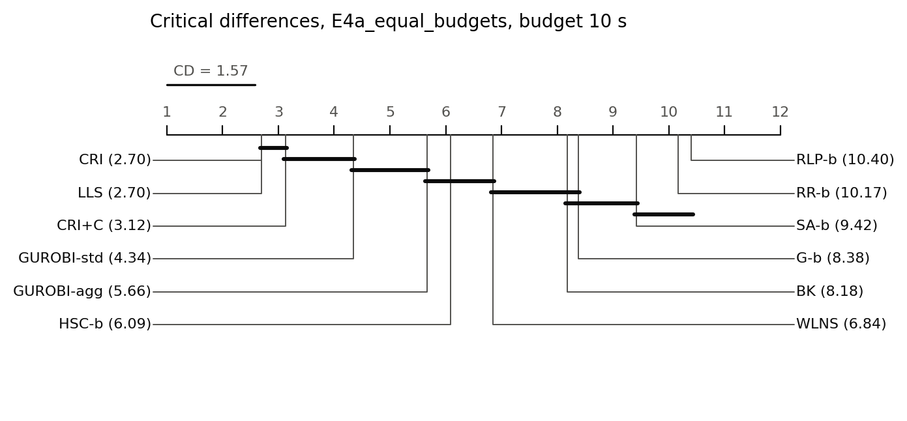

*Figure: Average ranks; methods joined by a bar are not significantly different (Nemenyi)*

*Pairwise Wilcoxon signed-rank tests (Holm), sign test, effect sizes (negative delta: A better); 66 pairs in the files, the 40 most significant of the 60 significant ones shown*  (`16_E4a_equal_budgets/budget_10s/statistics/pairwise_wilcoxon_holm_effect_sizes.csv`, `.tex`, `.md`)

| A | B | N | mean_A | mean_B | win_A | tie | win_B | p | p_holm | p_sign | cliff_delta | cliff_mag | A12 | significant |
|---|---|---|---|---|---|---|---|---|---|---|---|---|---|---|
| CRI | RR-b | 112 | 0.219 | 8.093 | 107 | 5 | 0 | 4.989e-20 | 3.293e-18 | 1.233e-32 | -0.884 | large | 0.942 | yes |
| CRI+C | RR-b | 112 | 0.233 | 8.093 | 107 | 5 | 0 | 4.989e-20 | 3.293e-18 | 1.233e-32 | -0.877 | large | 0.938 | yes |
| LLS | RR-b | 112 | 0.247 | 8.093 | 107 | 5 | 0 | 4.989e-20 | 3.293e-18 | 1.233e-32 | -0.874 | large | 0.937 | yes |
| GUROBI-std | RR-b | 112 | 0.672 | 8.093 | 107 | 5 | 0 | 4.989e-20 | 3.293e-18 | 1.233e-32 | -0.794 | large | 0.897 | yes |
| GUROBI-std | RLP-b | 112 | 0.672 | 8.558 | 104 | 8 | 0 | 6.528e-20 | 4.048e-18 | 9.861e-32 | -0.794 | large | 0.897 | yes |
| HSC-b | RLP-b | 112 | 2.022 | 8.558 | 104 | 8 | 0 | 6.528e-20 | 4.048e-18 | 9.861e-32 | -0.634 | large | 0.817 | yes |
| CRI+C | RLP-b | 112 | 0.233 | 8.558 | 104 | 8 | 0 | 6.528e-20 | 4.048e-18 | 9.861e-32 | -0.863 | large | 0.932 | yes |
| CRI | RLP-b | 112 | 0.219 | 8.558 | 104 | 8 | 0 | 6.528e-20 | 4.048e-18 | 9.861e-32 | -0.865 | large | 0.932 | yes |
| LLS | RLP-b | 112 | 0.247 | 8.558 | 104 | 8 | 0 | 6.528e-20 | 4.048e-18 | 9.861e-32 | -0.858 | large | 0.929 | yes |
| BK | LLS | 112 | 5.838 | 0.247 | 0 | 9 | 103 | 7.313e-20 | 4.168e-18 | 1.972e-31 | 0.722 | large | 0.139 | yes |
| BK | CRI | 112 | 5.838 | 0.219 | 0 | 9 | 103 | 7.313e-20 | 4.168e-18 | 1.972e-31 | 0.732 | large | 0.134 | yes |
| BK | CRI+C | 112 | 5.838 | 0.233 | 0 | 9 | 103 | 7.313e-20 | 4.168e-18 | 1.972e-31 | 0.726 | large | 0.137 | yes |
| HSC-b | RR-b | 112 | 2.022 | 8.093 | 105 | 5 | 2 | 8.764e-20 | 4.733e-18 | 7.123e-29 | -0.612 | large | 0.806 | yes |
| CRI+C | G-b | 112 | 0.233 | 4.555 | 96 | 16 | 0 | 2.211e-19 | 1.172e-17 | 2.524e-29 | -0.684 | large | 0.842 | yes |
| G-b | LLS | 112 | 4.555 | 0.247 | 0 | 16 | 96 | 2.211e-19 | 1.172e-17 | 2.524e-29 | 0.678 | large | 0.161 | yes |
| CRI | G-b | 112 | 0.219 | 4.555 | 96 | 16 | 0 | 2.211e-19 | 1.172e-17 | 2.524e-29 | -0.687 | large | 0.844 | yes |
| LLS | SA-b | 112 | 0.247 | 6.574 | 94 | 18 | 0 | 3.330e-19 | 1.665e-17 | 1.010e-28 | -0.714 | large | 0.857 | yes |
| GUROBI-std | SA-b | 112 | 0.672 | 6.574 | 94 | 18 | 0 | 3.330e-19 | 1.665e-17 | 1.010e-28 | -0.696 | large | 0.848 | yes |
| CRI | SA-b | 112 | 0.219 | 6.574 | 94 | 18 | 0 | 3.330e-19 | 1.665e-17 | 1.010e-28 | -0.718 | large | 0.859 | yes |
| CRI+C | SA-b | 112 | 0.233 | 6.574 | 94 | 18 | 0 | 3.330e-19 | 1.665e-17 | 1.010e-28 | -0.717 | large | 0.859 | yes |
| G-b | GUROBI-std | 112 | 4.555 | 0.672 | 1 | 16 | 95 | 4.165e-19 | 1.916e-17 | 2.449e-27 | 0.597 | large | 0.202 | yes |
| BK | GUROBI-std | 112 | 5.838 | 0.672 | 5 | 9 | 98 | 6.747e-19 | 3.036e-17 | 1.817e-23 | 0.620 | large | 0.190 | yes |
| CRI+C | HSC-b | 112 | 0.233 | 2.022 | 89 | 23 | 0 | 1.093e-18 | 4.809e-17 | 3.231e-27 | -0.485 | large | 0.743 | yes |
| CRI | HSC-b | 112 | 0.219 | 2.022 | 89 | 23 | 0 | 1.093e-18 | 4.809e-17 | 3.231e-27 | -0.493 | large | 0.746 | yes |
| HSC-b | LLS | 112 | 2.022 | 0.247 | 1 | 23 | 88 | 2.778e-18 | 1.167e-16 | 2.908e-25 | 0.477 | large | 0.261 | yes |
| HSC-b | SA-b | 112 | 2.022 | 6.574 | 88 | 22 | 2 | 3.093e-18 | 1.268e-16 | 6.617e-24 | -0.570 | large | 0.785 | yes |
| CRI | WLNS | 112 | 0.219 | 2.777 | 82 | 30 | 0 | 8.213e-18 | 3.285e-16 | 4.136e-25 | -0.471 | medium | 0.736 | yes |
| CRI+C | WLNS | 112 | 0.233 | 2.777 | 82 | 30 | 0 | 8.213e-18 | 3.285e-16 | 4.136e-25 | -0.466 | medium | 0.733 | yes |
| LLS | WLNS | 112 | 0.247 | 2.777 | 82 | 28 | 2 | 2.377e-17 | 9.033e-16 | 3.692e-22 | -0.459 | medium | 0.730 | yes |
| SA-b | WLNS | 112 | 6.574 | 2.777 | 4 | 18 | 90 | 2.488e-17 | 9.206e-16 | 3.219e-22 | 0.494 | large | 0.253 | yes |
| RR-b | WLNS | 112 | 8.093 | 2.777 | 10 | 5 | 97 | 4.225e-17 | 1.521e-15 | 4.817e-19 | 0.529 | large | 0.236 | yes |
| RLP-b | WLNS | 112 | 8.558 | 2.777 | 11 | 8 | 93 | 4.229e-17 | 1.521e-15 | 2.487e-17 | 0.554 | large | 0.223 | yes |
| CRI+C | GUROBI-agg | 112 | 0.233 | 3.516 | 79 | 31 | 2 | 6.572e-17 | 2.234e-15 | 2.748e-21 | -0.419 | medium | 0.710 | yes |
| GUROBI-std | WLNS | 112 | 0.672 | 2.777 | 81 | 28 | 3 | 9.827e-17 | 3.243e-15 | 1.022e-20 | -0.350 | medium | 0.675 | yes |
| CRI | GUROBI-agg | 112 | 0.219 | 3.516 | 78 | 32 | 2 | 1.450e-16 | 4.640e-15 | 5.362e-21 | -0.426 | medium | 0.713 | yes |
| GUROBI-std | HSC-b | 112 | 0.672 | 2.022 | 81 | 26 | 5 | 1.495e-16 | 4.640e-15 | 9.579e-19 | -0.306 | small | 0.653 | yes |
| BK | HSC-b | 112 | 5.838 | 2.022 | 16 | 10 | 86 | 1.346e-15 | 4.037e-14 | 9.135e-13 | 0.414 | medium | 0.293 | yes |
| GUROBI-agg | LLS | 112 | 3.516 | 0.247 | 4 | 32 | 76 | 1.478e-15 | 4.287e-14 | 2.758e-18 | 0.408 | medium | 0.296 | yes |
| CRI+C | GUROBI-std | 112 | 0.233 | 0.672 | 76 | 33 | 3 | 2.266e-15 | 6.345e-14 | 2.721e-19 | -0.290 | small | 0.645 | yes |
| GUROBI-agg | RLP-b | 112 | 3.516 | 8.558 | 99 | 8 | 5 | 2.403e-15 | 6.489e-14 | 9.540e-24 | -0.664 | large | 0.832 | yes |

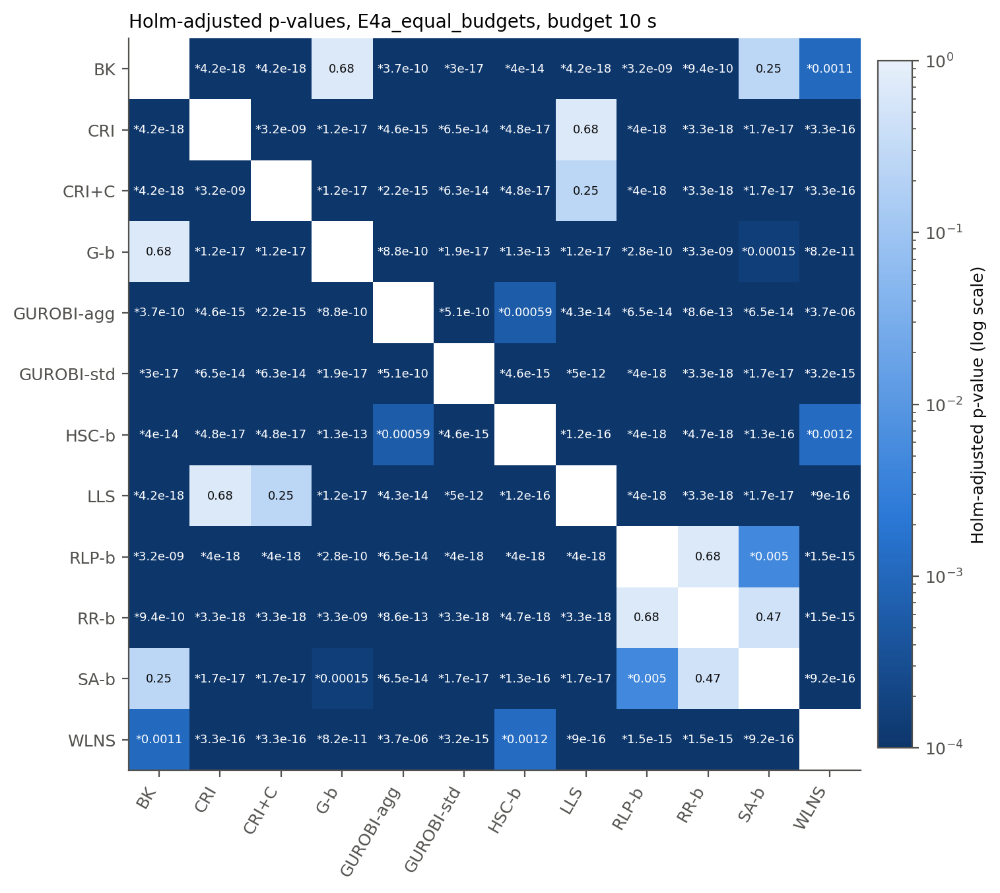

*Figure: Pairwise Holm-adjusted Wilcoxon p-values (* significant)*

*Win matrix: entry (row, column) = instances where the row method is strictly better than the column method*  (`16_E4a_equal_budgets/budget_10s/statistics/win_matrix.csv`, `.tex`, `.md`)

| method | BK | CRI | CRI+C | G-b | GUROBI-agg | GUROBI-std | HSC-b | LLS | RLP-b | RR-b | SA-b | WLNS |
|---|---|---|---|---|---|---|---|---|---|---|---|---|
| BK | 0 | 0 | 0 | 58 | 19 | 5 | 16 | 0 | 84 | 88 | 62 | 45 |
| CRI | 103 | 0 | 45 | 96 | 78 | 76 | 89 | 26 | 104 | 107 | 94 | 82 |
| CRI+C | 103 | 1 | 0 | 96 | 79 | 76 | 89 | 23 | 104 | 107 | 94 | 82 |
| G-b | 46 | 0 | 0 | 0 | 18 | 1 | 11 | 0 | 83 | 83 | 66 | 21 |
| GUROBI-agg | 84 | 2 | 2 | 77 | 0 | 14 | 60 | 4 | 99 | 95 | 90 | 63 |
| GUROBI-std | 98 | 3 | 3 | 95 | 65 | 0 | 81 | 6 | 104 | 107 | 94 | 81 |
| HSC-b | 86 | 0 | 0 | 81 | 26 | 5 | 0 | 1 | 104 | 105 | 88 | 62 |
| LLS | 103 | 43 | 49 | 96 | 76 | 72 | 88 | 0 | 104 | 107 | 94 | 82 |
| RLP-b | 18 | 0 | 0 | 21 | 5 | 0 | 0 | 0 | 0 | 46 | 35 | 11 |
| RR-b | 16 | 0 | 0 | 25 | 12 | 0 | 2 | 0 | 62 | 0 | 51 | 10 |
| SA-b | 40 | 0 | 0 | 30 | 4 | 0 | 2 | 0 | 69 | 56 | 0 | 4 |
| WLNS | 58 | 0 | 0 | 74 | 21 | 3 | 28 | 2 | 93 | 97 | 90 | 0 |

*CRI against every other method (wins = instances where the control is strictly better)*  (`16_E4a_equal_budgets/budget_10s/statistics/CRI_vs_each_method.csv`, `.tex`, `.md`)

| method | control | N | mean_control | mean_method | p | wins | ties | losses | cliff_delta | cliff_mag | A12 | p_holm | significant |
|---|---|---|---|---|---|---|---|---|---|---|---|---|---|
| BK | CRI | 112 | 0.219 | 5.838 | 7.313e-20 | 103 | 9 | 0 | -0.732 | large | 0.866 | 6.581e-19 | yes |
| CRI+C | CRI | 112 | 0.219 | 0.233 | 2.240e-10 | 45 | 66 | 1 | -0.033 | negligible | 0.516 | 4.480e-10 | yes |
| G-b | CRI | 112 | 0.219 | 4.555 | 2.211e-19 | 96 | 16 | 0 | -0.687 | large | 0.844 | 1.769e-18 | yes |
| GUROBI-agg | CRI | 112 | 0.219 | 3.516 | 1.450e-16 | 78 | 32 | 2 | -0.426 | medium | 0.713 | 5.800e-16 | yes |
| GUROBI-std | CRI | 112 | 0.219 | 0.672 | 2.611e-15 | 76 | 33 | 3 | -0.303 | small | 0.651 | 7.834e-15 | yes |
| HSC-b | CRI | 112 | 0.219 | 2.022 | 1.093e-18 | 89 | 23 | 0 | -0.493 | large | 0.746 | 6.558e-18 | yes |
| LLS | CRI | 112 | 0.219 | 0.247 | 0.337 | 26 | 43 | 43 | -0.046 | negligible | 0.523 | 0.337 | no |
| RLP-b | CRI | 112 | 0.219 | 8.558 | 6.528e-20 | 104 | 8 | 0 | -0.865 | large | 0.932 | 6.528e-19 | yes |
| RR-b | CRI | 112 | 0.219 | 8.093 | 4.989e-20 | 107 | 5 | 0 | -0.884 | large | 0.942 | 5.488e-19 | yes |
| SA-b | CRI | 112 | 0.219 | 6.574 | 3.330e-19 | 94 | 18 | 0 | -0.718 | large | 0.859 | 2.331e-18 | yes |
| WLNS | CRI | 112 | 0.219 | 2.777 | 8.213e-18 | 82 | 30 | 0 | -0.471 | medium | 0.736 | 4.106e-17 | yes |

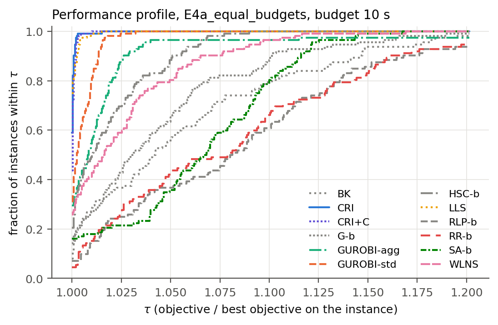

*Figure: Dolan-More performance profile of the peak (per-instance mean)*

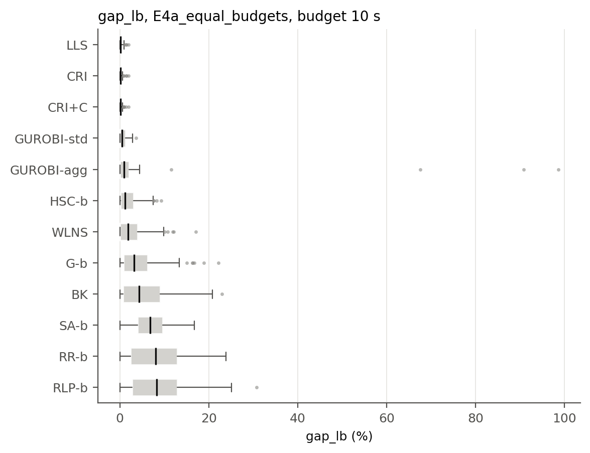

*Figure: Distribution of the per-instance gap_lb*

### Anytime behaviour

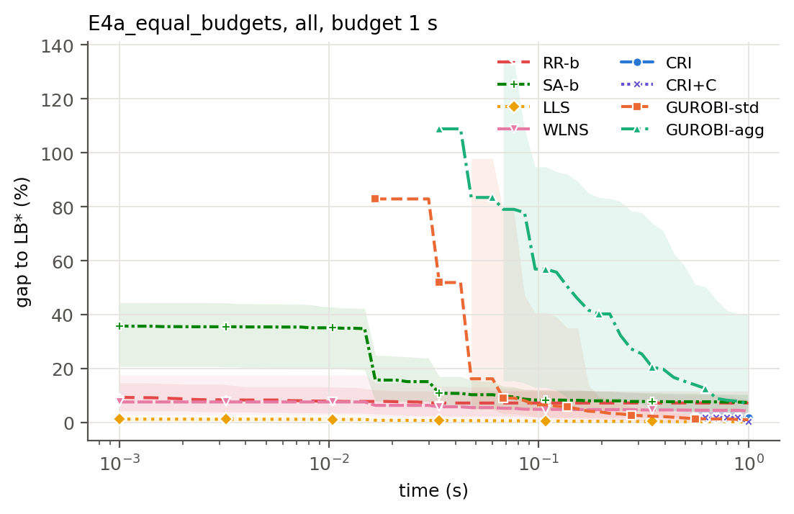

*Figure: Median (IQR band) gap to LB* over time, all; the curve of a method starts when its first schedule exists (artifact time included)*

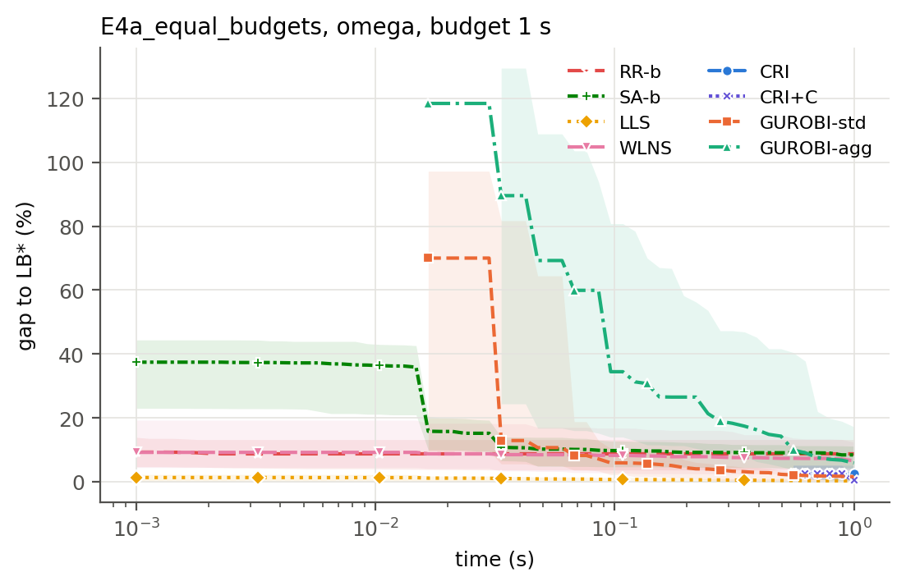

*Figure: Median (IQR band) gap to LB* over time, omega; the curve of a method starts when its first schedule exists (artifact time included)*

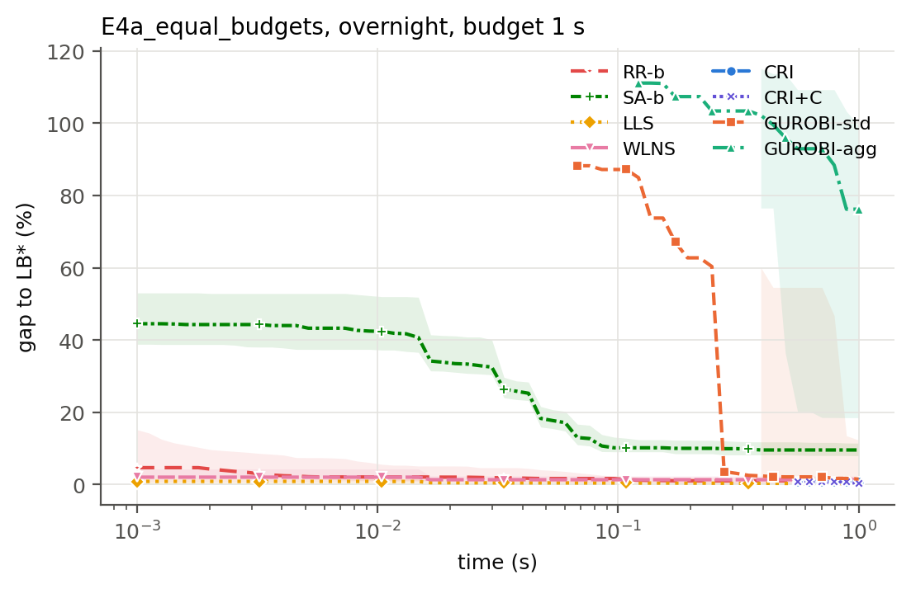

*Figure: Median (IQR band) gap to LB* over time, overnight; the curve of a method starts when its first schedule exists (artifact time included)*

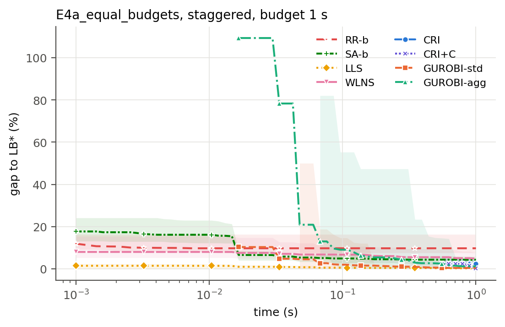

*Figure: Median (IQR band) gap to LB* over time, staggered; the curve of a method starts when its first schedule exists (artifact time included)*

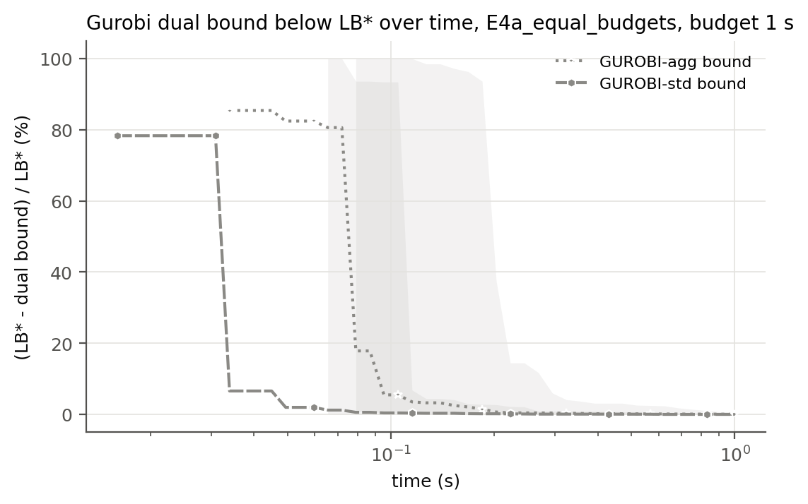

*Figure: Median distance of Gurobi's dual bound below the best known lower bound over time (0 = as strong as LB*)*

*Time to targets (median s; inf = not reached), share of runs reaching each target (%), mean primal integral (normalized by the budget)*  (`16_E4a_equal_budgets/budget_1s/tables/time_to_target_and_primal_integral.csv`, `.tex`, `.md`)

| method | median ttt_0 | median ttt_0.005 | median ttt_0.01 | median ttt_0.05 | reached ttt_0 | reached ttt_0.005 | reached ttt_0.01 | reached ttt_0.05 | primal_integral |
|---|---|---|---|---|---|---|---|---|---|
| BK | ∞ | ∞ | ∞ | 0.016 | 8.036 | 21.429 | 26.786 | 54.464 | 0.053 |
| CRI | ∞ | 1.016 | 1.000 | 0.500 | 27.083 | 61.607 | 88.393 | 100.000 | 0.506 |
| CRI+C | ∞ | 0.906 | 0.891 | 0.500 | 27.083 | 61.012 | 86.905 | 100.000 | 0.503 |
| G-b | ∞ | ∞ | ∞ | 0.000 | 13.393 | 19.643 | 25.000 | 60.119 | 0.045 |
| GUROBI-agg | ∞ | ∞ | ∞ | ∞ | 24.107 | 24.107 | 25.893 | 42.857 | 0.257 |
| GUROBI-std | ∞ | ∞ | ∞ | 0.148 | 25.893 | 32.143 | 48.214 | 91.964 | 0.116 |
| HSC-b | ∞ | ∞ | ∞ | 0.500 | 15.476 | 23.512 | 36.607 | 80.357 | 0.504 |
| LLS | ∞ | 0.147 | 0.016 | 0.000 | 27.381 | 61.905 | 88.988 | 100.000 | **0.005** |
| RLP-b | ∞ | ∞ | ∞ | ∞ | 7.143 | 7.143 | 9.226 | 35.714 | 0.267 |
| RR-b | ∞ | ∞ | ∞ | ∞ | 7.738 | 13.690 | 18.155 | 41.964 | 0.071 |
| SA-b | ∞ | ∞ | ∞ | ∞ | 15.179 | 15.476 | 16.369 | 32.738 | 0.072 |
| WLNS | ∞ | ∞ | ∞ | 0.078 | 18.155 | 23.512 | 28.869 | 60.417 | 0.062 |

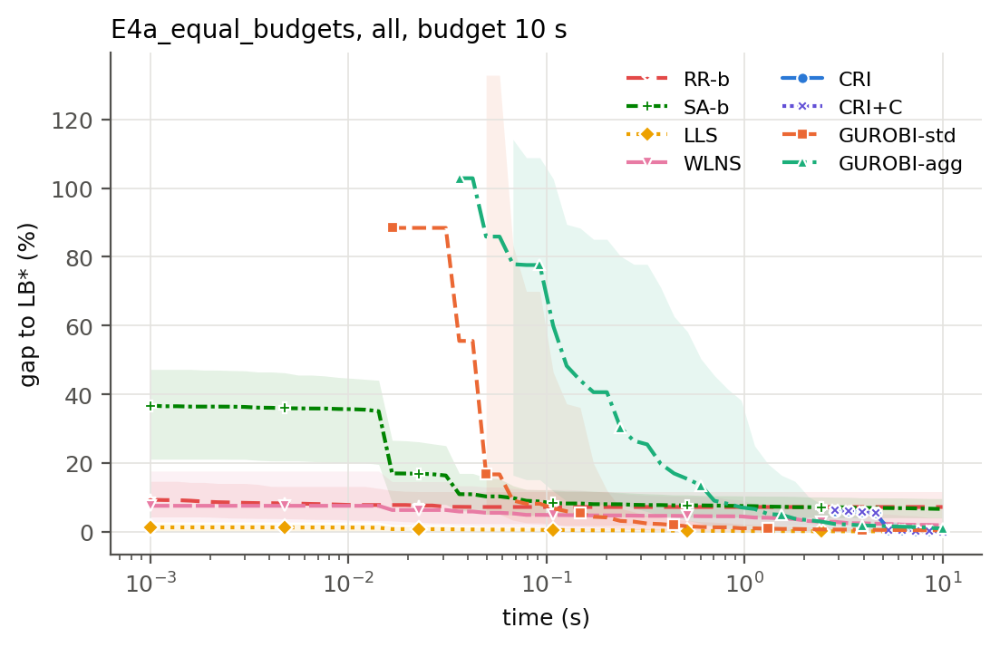

*Figure: Median (IQR band) gap to LB* over time, all; the curve of a method starts when its first schedule exists (artifact time included)*

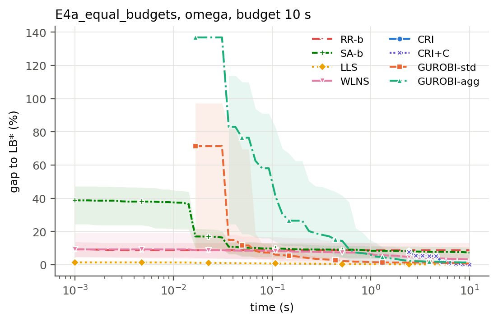

*Figure: Median (IQR band) gap to LB* over time, omega; the curve of a method starts when its first schedule exists (artifact time included)*

*Figure: Median (IQR band) gap to LB* over time, overnight; the curve of a method starts when its first schedule exists (artifact time included)*

*Figure: Median (IQR band) gap to LB* over time, staggered; the curve of a method starts when its first schedule exists (artifact time included)*

*Figure: Median distance of Gurobi's dual bound below the best known lower bound over time (0 = as strong as LB*)*

*Time to targets (median s; inf = not reached), share of runs reaching each target (%), mean primal integral (normalized by the budget)*  (`16_E4a_equal_budgets/budget_10s/tables/time_to_target_and_primal_integral.csv`, `.tex`, `.md`)

| method | median ttt_0 | median ttt_0.005 | median ttt_0.01 | median ttt_0.05 | reached ttt_0 | reached ttt_0.005 | reached ttt_0.01 | reached ttt_0.05 | primal_integral |
|---|---|---|---|---|---|---|---|---|---|
| BK | ∞ | ∞ | ∞ | 0.016 | 8.036 | 21.429 | 26.786 | 54.464 | 0.052 |
| CRI | ∞ | 6.859 | 5.016 | 5.000 | 32.440 | 88.095 | 96.726 | 100.000 | 0.304 |
| CRI+C | ∞ | 6.867 | 5.016 | 5.000 | 32.440 | 86.607 | 96.726 | 100.000 | 0.303 |
| G-b | ∞ | ∞ | ∞ | 0.000 | 14.286 | 21.429 | 25.893 | 63.393 | 0.042 |
| GUROBI-agg | ∞ | ∞ | 9.563 | 1.461 | 28.571 | 40.179 | 50.893 | 96.429 | 0.081 |
| GUROBI-std | ∞ | 7.836 | 1.148 | 0.164 | 27.679 | 52.679 | 66.964 | 100.000 | 0.025 |
| HSC-b | ∞ | ∞ | ∞ | 5.000 | 20.536 | 37.500 | 47.917 | 83.929 | 0.309 |
| LLS | ∞ | 0.150 | 0.016 | 0.000 | 29.464 | 83.631 | 95.833 | 100.000 | **0.003** |
| RLP-b | ∞ | ∞ | ∞ | ∞ | 7.143 | 9.821 | 14.881 | 36.905 | 0.104 |
| RR-b | ∞ | ∞ | ∞ | ∞ | 7.738 | 13.690 | 18.155 | 41.964 | 0.070 |
| SA-b | ∞ | ∞ | ∞ | ∞ | 16.071 | 17.262 | 18.750 | 35.119 | 0.062 |
| WLNS | ∞ | ∞ | ∞ | 0.078 | 27.679 | 35.417 | 41.071 | 80.357 | 0.036 |

### Gurobi: status, bounds and MIP gaps

*Gurobi per model, budget, family and size: proven optima, MIP gap reported by Gurobi (incumbent vs its own bound), gap to LB*, and its dual bound relative to our certified LB (negative: our certificate is stronger)*  (`16_E4a_equal_budgets/gurobi_status_and_bounds/tables/by_model_budget_family_size.csv`, `.tex`, `.md`)

| method | budget | family | n | runs | proven | mean_mip_gap_pct | max_mip_gap_pct | mean_gap_lb | bound_minus_certLB_pct | time |
|---|---|---|---|---|---|---|---|---|---|---|
| GUROBI-agg | 1.000 | omega | 20 | 5 | 5 | 0.000 | 0.000 | 0.000 | 0.000 | 0.028 |
| GUROBI-agg | 1.000 | omega | 30 | 5 | 5 | 0.000 | 0.000 | 0.000 | 0.000 | 0.037 |
| GUROBI-agg | 1.000 | omega | 40 | 5 | 2 | 2.395 | 5.724 | 0.342 | -2.072 | 0.672 |
| GUROBI-agg | 1.000 | omega | 50 | 10 | 2 | 8.670 | 29.676 | 7.531 | -2.696 | 0.883 |
| GUROBI-agg | 1.000 | omega | 75 | 5 | 0 | 9.134 | 17.308 | 8.962 | -1.188 | 1.028 |
| GUROBI-agg | 1.000 | omega | 100 | 10 | 0 | 5.089 | 7.751 | 4.919 | -0.447 | 1.042 |
| GUROBI-agg | 1.000 | omega | 150 | 5 | 0 | 10.540 | 22.222 | 12.383 | -0.106 | 1.059 |
| GUROBI-agg | 1.000 | omega | 200 | 10 | 0 | 16.927 | 45.256 | 24.475 | -0.022 | 1.053 |
| GUROBI-agg | 1.000 | omega | 500 | 3 | 0 | 36.739 | 37.900 | 58.104 | 0.000 | 1.115 |
| GUROBI-agg | 1.000 | omega | 1000 | 3 | 0 | 33.123 | 34.562 | 49.598 | 0.000 | 1.240 |
| GUROBI-agg | 1.000 | omega | 2000 | 3 | 0 | 29.363 | 30.275 | 41.581 | 0.000 | 1.531 |
| GUROBI-agg | 1.000 | overnight | 50 | 5 | 0 | 12.484 | 16.682 | 14.413 | -0.063 | 1.059 |
| GUROBI-agg | 1.000 | overnight | 100 | 5 | 0 | 24.922 | 48.441 | 37.996 | -0.010 | 1.106 |
| GUROBI-agg | 1.000 | overnight | 200 | 5 | 0 | 33.775 | 53.592 | 65.805 | 0.000 | 1.206 |
| GUROBI-agg | 1.000 | overnight | 500 | 3 | 0 | 53.947 | 61.543 | 120.432 | 0.000 | 1.536 |
| GUROBI-agg | 1.000 | overnight | 1000 | 3 | 0 | 50.393 | 53.497 | 102.423 | 0.000 | 2.135 |
| GUROBI-agg | 1.000 | overnight | 2000 | 3 | 0 | ∞ | ∞ | 81.786 | −∞ | 3.042 |
| GUROBI-agg | 1.000 | staggered | 50 | 5 | 5 | 0.000 | 0.000 | 0.000 | 0.000 | 0.062 |
| GUROBI-agg | 1.000 | staggered | 100 | 5 | 2 | 1.460 | 3.565 | 0.000 | -1.460 | 0.856 |
| GUROBI-agg | 1.000 | staggered | 200 | 5 | 0 | 2.191 | 3.303 | 1.788 | -0.448 | 1.034 |
| GUROBI-agg | 1.000 | staggered | 500 | 3 | 0 | 2.235 | 3.464 | 2.215 | -0.084 | 1.073 |
| GUROBI-agg | 1.000 | staggered | 1000 | 3 | 0 | 30.723 | 44.531 | 51.561 | 0.000 | 1.146 |
| GUROBI-agg | 1.000 | staggered | 2000 | 3 | 0 | 31.744 | 33.422 | 46.564 | 0.000 | 1.255 |
| GUROBI-agg | 10.000 | omega | 20 | 5 | 5 | 0.000 | 0.000 | 0.000 | 0.000 | 0.025 |
| GUROBI-agg | 10.000 | omega | 30 | 5 | 5 | 0.000 | 0.000 | 0.000 | 0.000 | 0.041 |
| GUROBI-agg | 10.000 | omega | 40 | 5 | 5 | 0.000 | 0.000 | 0.000 | 0.000 | 1.197 |
| GUROBI-agg | 10.000 | omega | 50 | 10 | 4 | 1.512 | 4.489 | 1.138 | -0.412 | 6.603 |
| GUROBI-agg | 10.000 | omega | 75 | 5 | 0 | 3.517 | 4.492 | 2.841 | -0.785 | 10.025 |
| GUROBI-agg | 10.000 | omega | 100 | 10 | 0 | 2.940 | 3.971 | 2.744 | -0.281 | 10.044 |
| GUROBI-agg | 10.000 | omega | 150 | 5 | 0 | 2.067 | 2.623 | 2.039 | -0.071 | 10.066 |
| GUROBI-agg | 10.000 | omega | 200 | 10 | 0 | 1.497 | 1.858 | 1.506 | -0.014 | 10.066 |
| GUROBI-agg | 10.000 | omega | 500 | 3 | 0 | 0.574 | 0.828 | 0.578 | 0.000 | 10.115 |
| GUROBI-agg | 10.000 | omega | 1000 | 3 | 0 | 0.408 | 0.548 | 0.410 | 0.000 | 10.234 |
| GUROBI-agg | 10.000 | omega | 2000 | 3 | 0 | 0.120 | 0.129 | 0.120 | 0.000 | 10.484 |
| GUROBI-agg | 10.000 | overnight | 50 | 5 | 0 | 2.726 | 3.825 | 2.741 | -0.063 | 10.063 |
| GUROBI-agg | 10.000 | overnight | 100 | 5 | 0 | 1.768 | 2.195 | 1.790 | -0.010 | 10.125 |
| GUROBI-agg | 10.000 | overnight | 200 | 5 | 0 | 1.480 | 2.357 | 1.506 | 0.000 | 10.206 |
| GUROBI-agg | 10.000 | overnight | 500 | 3 | 0 | 4.357 | 10.373 | 4.770 | 0.000 | 10.552 |
| GUROBI-agg | 10.000 | overnight | 1000 | 3 | 0 | 16.974 | 49.662 | 33.309 | 0.000 | 11.125 |
| GUROBI-agg | 10.000 | overnight | 2000 | 3 | 0 | 29.412 | 47.596 | 52.901 | 0.000 | 12.099 |
| GUROBI-agg | 10.000 | staggered | 50 | 5 | 5 | 0.000 | 0.000 | 0.000 | 0.000 | 0.063 |
| GUROBI-agg | 10.000 | staggered | 100 | 5 | 5 | 0.000 | 0.000 | 0.000 | 0.000 | 1.106 |
| GUROBI-agg | 10.000 | staggered | 200 | 5 | 0 | 0.982 | 2.074 | 0.775 | -0.220 | 10.028 |
| GUROBI-agg | 10.000 | staggered | 500 | 3 | 0 | 0.849 | 1.103 | 0.806 | -0.050 | 10.062 |
| GUROBI-agg | 10.000 | staggered | 1000 | 3 | 0 | 0.637 | 0.802 | 0.641 | 0.000 | 10.125 |
| GUROBI-agg | 10.000 | staggered | 2000 | 3 | 0 | 0.271 | 0.298 | 0.272 | 0.000 | 10.260 |
| GUROBI-std | 1.000 | omega | 20 | 5 | 5 | 0.000 | 0.000 | 0.000 | 0.000 | 0.016 |
| GUROBI-std | 1.000 | omega | 30 | 5 | 5 | 0.000 | 0.000 | 0.000 | 0.000 | 0.019 |
| GUROBI-std | 1.000 | omega | 40 | 5 | 4 | 0.548 | 2.740 | 0.000 | -0.548 | 0.303 |
| GUROBI-std | 1.000 | omega | 50 | 10 | 3 | 3.331 | 7.363 | 1.651 | -1.765 | 0.742 |
| GUROBI-std | 1.000 | omega | 75 | 5 | 0 | 3.590 | 5.093 | 2.583 | -1.115 | 1.006 |
| GUROBI-std | 1.000 | omega | 100 | 10 | 0 | 2.865 | 3.971 | 2.508 | -0.432 | 1.002 |
| GUROBI-std | 1.000 | omega | 150 | 5 | 0 | 2.436 | 2.951 | 2.352 | -0.144 | 1.012 |
| GUROBI-std | 1.000 | omega | 200 | 10 | 0 | 1.924 | 2.529 | 1.934 | -0.029 | 1.009 |
| GUROBI-std | 1.000 | omega | 500 | 3 | 0 | 0.723 | 0.800 | 0.729 | 0.000 | 1.021 |
| GUROBI-std | 1.000 | omega | 1000 | 3 | 0 | 0.515 | 0.608 | 0.518 | 0.000 | 1.031 |
| GUROBI-std | 1.000 | omega | 2000 | 3 | 0 | 22.582 | 24.150 | 29.231 | 0.000 | 1.078 |
| GUROBI-std | 1.000 | overnight | 50 | 5 | 0 | 1.947 | 2.366 | 1.902 | -0.083 | 1.006 |
| GUROBI-std | 1.000 | overnight | 100 | 5 | 0 | 1.174 | 1.659 | 1.178 | -0.010 | 1.019 |
| GUROBI-std | 1.000 | overnight | 200 | 5 | 0 | 0.689 | 1.148 | 0.694 | 0.000 | 1.041 |
| GUROBI-std | 1.000 | overnight | 500 | 3 | 0 | 0.440 | 0.560 | 0.442 | 0.000 | 1.078 |
| GUROBI-std | 1.000 | overnight | 1000 | 3 | 0 | 100.000 | 100.000 | 49.623 | -100.000 | 1.182 |
| GUROBI-std | 1.000 | overnight | 2000 | 3 | 0 | ∞ | ∞ | 44.212 | −∞ | 1.349 |
| GUROBI-std | 1.000 | staggered | 50 | 5 | 5 | 0.000 | 0.000 | 0.000 | 0.000 | 0.031 |
| GUROBI-std | 1.000 | staggered | 100 | 5 | 4 | 0.266 | 1.328 | 0.000 | -0.266 | 0.519 |
| GUROBI-std | 1.000 | staggered | 200 | 5 | 0 | 1.671 | 2.189 | 1.293 | -0.402 | 1.000 |
| GUROBI-std | 1.000 | staggered | 500 | 3 | 0 | 0.801 | 1.056 | 0.774 | -0.033 | 1.016 |
| GUROBI-std | 1.000 | staggered | 1000 | 3 | 0 | 0.937 | 0.966 | 0.945 | 0.000 | 1.026 |
| GUROBI-std | 1.000 | staggered | 2000 | 3 | 0 | 0.386 | 0.465 | 0.388 | 0.000 | 1.036 |
| GUROBI-std | 10.000 | omega | 20 | 5 | 5 | 0.000 | 0.000 | 0.000 | 0.000 | 0.016 |
| GUROBI-std | 10.000 | omega | 30 | 5 | 5 | 0.000 | 0.000 | 0.000 | 0.000 | 0.019 |
| GUROBI-std | 10.000 | omega | 40 | 5 | 5 | 0.000 | 0.000 | 0.000 | 0.000 | 0.444 |
| GUROBI-std | 10.000 | omega | 50 | 10 | 5 | 1.115 | 3.769 | 0.835 | -0.305 | 6.133 |
| GUROBI-std | 10.000 | omega | 75 | 5 | 0 | 1.871 | 2.886 | 1.031 | -0.863 | 10.000 |
| GUROBI-std | 10.000 | omega | 100 | 10 | 0 | 2.117 | 3.116 | 1.866 | -0.292 | 10.003 |
| GUROBI-std | 10.000 | omega | 150 | 5 | 0 | 1.582 | 1.930 | 1.500 | -0.106 | 10.019 |
| GUROBI-std | 10.000 | omega | 200 | 10 | 0 | 1.264 | 1.430 | 1.266 | -0.014 | 10.012 |
| GUROBI-std | 10.000 | omega | 500 | 3 | 0 | 0.504 | 0.535 | 0.506 | 0.000 | 10.031 |
| GUROBI-std | 10.000 | omega | 1000 | 3 | 0 | 0.276 | 0.319 | 0.277 | 0.000 | 10.047 |
| GUROBI-std | 10.000 | omega | 2000 | 3 | 0 | 0.143 | 0.167 | 0.143 | 0.000 | 10.094 |
| GUROBI-std | 10.000 | overnight | 50 | 5 | 0 | 1.421 | 1.606 | 1.377 | -0.063 | 10.016 |
| GUROBI-std | 10.000 | overnight | 100 | 5 | 0 | 0.840 | 0.994 | 0.837 | -0.010 | 10.022 |
| GUROBI-std | 10.000 | overnight | 200 | 5 | 0 | 0.460 | 0.539 | 0.462 | 0.000 | 10.047 |
| GUROBI-std | 10.000 | overnight | 500 | 3 | 0 | 0.156 | 0.166 | 0.156 | 0.000 | 10.109 |
| GUROBI-std | 10.000 | overnight | 1000 | 3 | 0 | 0.069 | 0.079 | 0.069 | 0.000 | 10.182 |
| GUROBI-std | 10.000 | overnight | 2000 | 3 | 0 | 0.049 | 0.072 | 0.049 | 0.000 | 10.365 |
| GUROBI-std | 10.000 | staggered | 50 | 5 | 5 | 0.000 | 0.000 | 0.000 | 0.000 | 0.031 |
| GUROBI-std | 10.000 | staggered | 100 | 5 | 5 | 0.000 | 0.000 | 0.000 | 0.000 | 0.641 |
| GUROBI-std | 10.000 | staggered | 200 | 5 | 0 | 0.790 | 1.175 | 0.416 | -0.377 | 10.003 |
| GUROBI-std | 10.000 | staggered | 500 | 3 | 0 | 0.459 | 0.627 | 0.461 | 0.000 | 10.016 |
| GUROBI-std | 10.000 | staggered | 1000 | 3 | 0 | 0.557 | 0.637 | 0.560 | 0.000 | 10.026 |
| GUROBI-std | 10.000 | staggered | 2000 | 3 | 0 | 0.284 | 0.357 | 0.285 | 0.000 | 10.042 |

*Gurobi termination status*  (`16_E4a_equal_budgets/gurobi_status_and_bounds/tables/termination_status.csv`, `.tex`, `.md`)

| method | budget | OPTIMAL | TIME_LIMIT |
|---|---|---|---|
| GUROBI-agg | 1 | 21 | 91 |
| GUROBI-agg | 10 | 29 | 83 |
| GUROBI-std | 1 | 26 | 86 |
| GUROBI-std | 10 | 30 | 82 |

*Per instance: Gurobi incumbent, dual bound, MIP gap, status (Minor comment 1)*  (`16_E4a_equal_budgets/gurobi_status_and_bounds/tables/per_instance_bounds_and_gaps.csv`, `.tex`, `.md`)

| instance | method | budget | objective | lower_bound | mip_gap_pct | info_grb_status | time | LB_certified | P_LP | control | control certified gap % |
|---|---|---|---|---|---|---|---|---|---|---|---|
| large_omega_n1000_T96_000 | GUROBI-std | 10.000 | 721.900 | 719.600 | 0.319 | TIME_LIMIT | 10.063 | 719.600 | 719.585 | 720.200 | 0.083 |
| large_omega_n1000_T96_000 | GUROBI-agg | 10.000 | 722.800 | 719.600 | 0.443 | TIME_LIMIT | 10.203 | 719.600 | 719.585 | 720.200 | 0.083 |
| large_omega_n1000_T96_000 | GUROBI-std | 1.000 | 724.000 | 719.600 | 0.608 | TIME_LIMIT | 1.031 | 719.600 | 719.585 | 720.733 | 0.157 |
| large_omega_n1000_T96_000 | GUROBI-agg | 1.000 | 1044.800 | 719.600 | 31.126 | TIME_LIMIT | 1.234 | 719.600 | 719.585 | 720.733 | 0.157 |
| large_omega_n1000_T96_001 | GUROBI-std | 10.000 | 727.900 | 726.000 | 0.261 | TIME_LIMIT | 10.047 | 726.000 | 725.983 | 726.533 | 0.073 |
| large_omega_n1000_T96_001 | GUROBI-agg | 10.000 | 730.000 | 726.000 | 0.548 | TIME_LIMIT | 10.203 | 726.000 | 725.983 | 726.533 | 0.073 |
| large_omega_n1000_T96_001 | GUROBI-std | 1.000 | 729.000 | 726.000 | 0.412 | TIME_LIMIT | 1.031 | 726.000 | 725.983 | 727.000 | 0.138 |
| large_omega_n1000_T96_001 | GUROBI-agg | 1.000 | 1094.700 | 726.000 | 33.680 | TIME_LIMIT | 1.266 | 726.000 | 725.983 | 727.000 | 0.138 |
| large_omega_n1000_T96_002 | GUROBI-std | 10.000 | 683.300 | 681.600 | 0.249 | TIME_LIMIT | 10.031 | 681.600 | 681.547 | 682.067 | 0.068 |
| large_omega_n1000_T96_002 | GUROBI-agg | 10.000 | 683.200 | 681.600 | 0.234 | TIME_LIMIT | 10.297 | 681.600 | 681.547 | 682.067 | 0.068 |
| large_omega_n1000_T96_002 | GUROBI-std | 1.000 | 685.200 | 681.600 | 0.525 | TIME_LIMIT | 1.031 | 681.600 | 681.547 | 682.733 | 0.166 |
| large_omega_n1000_T96_002 | GUROBI-agg | 1.000 | 1041.600 | 681.600 | 34.562 | TIME_LIMIT | 1.219 | 681.600 | 681.547 | 682.733 | 0.166 |
| large_omega_n2000_T96_000 | GUROBI-std | 10.000 | 1391.500 | 1389.600 | 0.137 | TIME_LIMIT | 10.109 | 1389.600 | 1389.517 | 1390.133 | 0.038 |
| large_omega_n2000_T96_000 | GUROBI-agg | 10.000 | 1391.400 | 1389.600 | 0.129 | TIME_LIMIT | 10.453 | 1389.600 | 1389.517 | 1390.133 | 0.038 |
| large_omega_n2000_T96_000 | GUROBI-std | 1.000 | 1741.400 | 1389.600 | 20.202 | TIME_LIMIT | 1.063 | 1389.600 | 1389.517 | 1390.700 | 0.079 |
| large_omega_n2000_T96_000 | GUROBI-agg | 1.000 | 1949.500 | 1389.600 | 28.720 | TIME_LIMIT | 1.562 | 1389.600 | 1389.517 | 1390.700 | 0.079 |
| large_omega_n2000_T96_001 | GUROBI-std | 10.000 | 1438.700 | 1436.900 | 0.125 | TIME_LIMIT | 10.078 | 1436.900 | 1436.846 | 1437.467 | 0.039 |
| large_omega_n2000_T96_001 | GUROBI-agg | 10.000 | 1438.600 | 1436.900 | 0.118 | TIME_LIMIT | 10.484 | 1436.900 | 1436.846 | 1437.467 | 0.039 |
| large_omega_n2000_T96_001 | GUROBI-std | 1.000 | 1875.700 | 1436.900 | 23.394 | TIME_LIMIT | 1.094 | 1436.900 | 1436.846 | 1438.000 | 0.077 |
| large_omega_n2000_T96_001 | GUROBI-agg | 1.000 | 2060.800 | 1436.900 | 30.275 | TIME_LIMIT | 1.531 | 1436.900 | 1436.846 | 1438.000 | 0.077 |
| large_omega_n2000_T96_002 | GUROBI-std | 10.000 | 1437.400 | 1435.000 | 0.167 | TIME_LIMIT | 10.094 | 1435.000 | 1434.922 | 1435.567 | 0.039 |
| large_omega_n2000_T96_002 | GUROBI-agg | 10.000 | 1436.600 | 1435.000 | 0.111 | TIME_LIMIT | 10.516 | 1435.000 | 1434.922 | 1435.567 | 0.039 |
| large_omega_n2000_T96_002 | GUROBI-std | 1.000 | 1891.900 | 1435.000 | 24.150 | TIME_LIMIT | 1.078 | 1435.000 | 1434.922 | 1436.167 | 0.081 |
| large_omega_n2000_T96_002 | GUROBI-agg | 1.000 | 2023.800 | 1435.000 | 29.094 | TIME_LIMIT | 1.500 | 1435.000 | 1434.922 | 1436.167 | 0.081 |
| large_omega_n500_T96_000 | GUROBI-std | 10.000 | 378.500 | 376.600 | 0.502 | TIME_LIMIT | 10.047 | 376.600 | 376.594 | 377.033 | 0.115 |
| large_omega_n500_T96_000 | GUROBI-agg | 10.000 | 378.300 | 376.600 | 0.449 | TIME_LIMIT | 10.109 | 376.600 | 376.594 | 377.033 | 0.115 |
| large_omega_n500_T96_000 | GUROBI-std | 1.000 | 379.100 | 376.600 | 0.659 | TIME_LIMIT | 1.031 | 376.600 | 376.594 | 377.567 | 0.257 |
| large_omega_n500_T96_000 | GUROBI-agg | 1.000 | 587.400 | 376.600 | 35.887 | TIME_LIMIT | 1.109 | 376.600 | 376.594 | 377.567 | 0.257 |
| large_omega_n500_T96_001 | GUROBI-std | 10.000 | 337.000 | 335.400 | 0.475 | TIME_LIMIT | 10.031 | 335.400 | 335.354 | 335.933 | 0.159 |
| large_omega_n500_T96_001 | GUROBI-agg | 10.000 | 338.200 | 335.400 | 0.828 | TIME_LIMIT | 10.109 | 335.400 | 335.354 | 335.933 | 0.159 |
| large_omega_n500_T96_001 | GUROBI-std | 1.000 | 337.800 | 335.400 | 0.710 | TIME_LIMIT | 1.016 | 335.400 | 335.354 | 336.300 | 0.268 |
| large_omega_n500_T96_001 | GUROBI-agg | 1.000 | 540.100 | 335.400 | 37.900 | TIME_LIMIT | 1.109 | 335.400 | 335.354 | 336.300 | 0.268 |
| large_omega_n500_T96_002 | GUROBI-std | 10.000 | 336.500 | 334.700 | 0.535 | TIME_LIMIT | 10.016 | 334.700 | 334.622 | 335.300 | 0.179 |
| large_omega_n500_T96_002 | GUROBI-agg | 10.000 | 336.200 | 334.700 | 0.446 | TIME_LIMIT | 10.125 | 334.700 | 334.622 | 335.300 | 0.179 |
| large_omega_n500_T96_002 | GUROBI-std | 1.000 | 337.400 | 334.700 | 0.800 | TIME_LIMIT | 1.016 | 334.700 | 334.622 | 335.967 | 0.378 |
| large_omega_n500_T96_002 | GUROBI-agg | 1.000 | 526.500 | 334.700 | 36.429 | TIME_LIMIT | 1.125 | 334.700 | 334.622 | 335.967 | 0.378 |
| large_overnight_n1000_T96_000 | GUROBI-std | 10.000 | 1896.200 | 1894.900 | 0.069 | TIME_LIMIT | 10.188 | 1894.900 | 1894.855 | 1895.600 | 0.037 |
| large_overnight_n1000_T96_000 | GUROBI-agg | 10.000 | 1904.800 | 1894.900 | 0.520 | TIME_LIMIT | 11.094 | 1894.900 | 1894.855 | 1895.600 | 0.037 |
| large_overnight_n1000_T96_000 | GUROBI-std | 1.000 | 2908.600 | 0.000 | 100.000 | TIME_LIMIT | 1.172 | 1894.900 | 1894.855 | 1896.000 | 0.058 |
| large_overnight_n1000_T96_000 | GUROBI-agg | 1.000 | 3929.400 | 1894.900 | 51.776 | TIME_LIMIT | 2.156 | 1894.900 | 1894.855 | 1896.000 | 0.058 |
| large_overnight_n1000_T96_001 | GUROBI-std | 10.000 | 1838.900 | 1837.800 | 0.060 | TIME_LIMIT | 10.187 | 1837.800 | 1837.706 | 1838.400 | 0.033 |
| large_overnight_n1000_T96_001 | GUROBI-agg | 10.000 | 1851.500 | 1837.800 | 0.740 | TIME_LIMIT | 11.141 | 1837.800 | 1837.706 | 1838.400 | 0.033 |
| large_overnight_n1000_T96_001 | GUROBI-std | 1.000 | 2748.900 | 0.000 | 100.000 | TIME_LIMIT | 1.188 | 1837.800 | 1837.706 | 1838.800 | 0.054 |
| large_overnight_n1000_T96_001 | GUROBI-agg | 1.000 | 3397.400 | 1837.800 | 45.906 | TIME_LIMIT | 2.125 | 1837.800 | 1837.706 | 1838.800 | 0.054 |
| large_overnight_n1000_T96_002 | GUROBI-std | 10.000 | 1887.800 | 1886.300 | 0.079 | TIME_LIMIT | 10.172 | 1886.300 | 1886.203 | 1886.900 | 0.032 |
| large_overnight_n1000_T96_002 | GUROBI-agg | 10.000 | 3747.300 | 1886.300 | 49.662 | TIME_LIMIT | 11.141 | 1886.300 | 1886.203 | 1886.900 | 0.032 |
| large_overnight_n1000_T96_002 | GUROBI-std | 1.000 | 2750.200 | 0.000 | 100.000 | TIME_LIMIT | 1.187 | 1886.300 | 1886.203 | 1888.567 | 0.120 |
| large_overnight_n1000_T96_002 | GUROBI-agg | 1.000 | 4056.300 | 1886.300 | 53.497 | TIME_LIMIT | 2.125 | 1886.300 | 1886.203 | 1888.567 | 0.120 |
| large_overnight_n2000_T96_000 | GUROBI-std | 10.000 | 3749.300 | 3746.600 | 0.072 | TIME_LIMIT | 10.375 | 3746.600 | 3746.565 | 3747.300 | 0.019 |
| large_overnight_n2000_T96_000 | GUROBI-agg | 10.000 | 3758.700 | 3746.600 | 0.322 | TIME_LIMIT | 12.344 | 3746.600 | 3746.565 | 3747.300 | 0.019 |
| large_overnight_n2000_T96_000 | GUROBI-std | 1.000 | 5453.800 | −∞ | ∞ | TIME_LIMIT | 1.359 | 3746.600 | 3746.565 | 3749.300 | 0.072 |
| large_overnight_n2000_T96_000 | GUROBI-agg | 1.000 | 7005.300 | −∞ | ∞ | TIME_LIMIT | 3.047 | 3746.600 | 3746.565 | 3749.300 | 0.072 |
| large_overnight_n2000_T96_001 | GUROBI-std | 10.000 | 3657.400 | 3656.300 | 0.030 | TIME_LIMIT | 10.359 | 3656.300 | 3656.268 | 3657.100 | 0.022 |
| large_overnight_n2000_T96_001 | GUROBI-agg | 10.000 | 6126.300 | 3656.300 | 40.318 | TIME_LIMIT | 12.031 | 3656.300 | 3656.268 | 3657.100 | 0.022 |
| large_overnight_n2000_T96_001 | GUROBI-std | 1.000 | 5190.500 | −∞ | ∞ | TIME_LIMIT | 1.344 | 3656.300 | 3656.268 | 3657.867 | 0.043 |
| large_overnight_n2000_T96_001 | GUROBI-agg | 1.000 | 6126.300 | −∞ | ∞ | TIME_LIMIT | 3.047 | 3656.300 | 3656.268 | 3657.867 | 0.043 |
| large_overnight_n2000_T96_002 | GUROBI-std | 10.000 | 3636.500 | 3634.900 | 0.044 | TIME_LIMIT | 10.359 | 3634.900 | 3634.874 | 3635.633 | 0.020 |
| large_overnight_n2000_T96_002 | GUROBI-agg | 10.000 | 6936.300 | 3634.900 | 47.596 | TIME_LIMIT | 11.922 | 3634.900 | 3634.874 | 3635.633 | 0.020 |
| large_overnight_n2000_T96_002 | GUROBI-std | 1.000 | 5274.600 | −∞ | ∞ | TIME_LIMIT | 1.344 | 3634.900 | 3634.874 | 3635.967 | 0.029 |
| large_overnight_n2000_T96_002 | GUROBI-agg | 1.000 | 6936.300 | 0.000 | 100.000 | TIME_LIMIT | 3.031 | 3634.900 | 3634.874 | 3635.967 | 0.029 |
| large_overnight_n500_T96_000 | GUROBI-std | 10.000 | 962.900 | 961.300 | 0.166 | TIME_LIMIT | 10.109 | 961.300 | 961.264 | 961.933 | 0.066 |
| large_overnight_n500_T96_000 | GUROBI-agg | 10.000 | 971.700 | 961.300 | 1.070 | TIME_LIMIT | 10.578 | 961.300 | 961.264 | 961.933 | 0.066 |
| large_overnight_n500_T96_000 | GUROBI-std | 1.000 | 963.500 | 961.300 | 0.228 | TIME_LIMIT | 1.078 | 961.300 | 961.264 | 962.300 | 0.104 |
| large_overnight_n500_T96_000 | GUROBI-agg | 1.000 | 1904.100 | 961.300 | 49.514 | TIME_LIMIT | 1.531 | 961.300 | 961.264 | 962.300 | 0.104 |
| large_overnight_n500_T96_001 | GUROBI-std | 10.000 | 916.500 | 915.000 | 0.164 | TIME_LIMIT | 10.125 | 915.000 | 914.972 | 915.667 | 0.073 |
| large_overnight_n500_T96_001 | GUROBI-agg | 10.000 | 1020.900 | 915.000 | 10.373 | TIME_LIMIT | 10.547 | 915.000 | 914.972 | 915.667 | 0.073 |
| large_overnight_n500_T96_001 | GUROBI-std | 1.000 | 919.900 | 915.000 | 0.533 | TIME_LIMIT | 1.078 | 915.000 | 914.972 | 916.200 | 0.131 |
| large_overnight_n500_T96_001 | GUROBI-agg | 1.000 | 1859.200 | 915.000 | 50.785 | TIME_LIMIT | 1.516 | 915.000 | 914.972 | 916.200 | 0.131 |
| large_overnight_n500_T96_002 | GUROBI-std | 10.000 | 871.600 | 870.400 | 0.138 | TIME_LIMIT | 10.094 | 870.400 | 870.351 | 871.000 | 0.069 |
| large_overnight_n500_T96_002 | GUROBI-agg | 10.000 | 884.800 | 870.400 | 1.627 | TIME_LIMIT | 10.531 | 870.400 | 870.351 | 871.000 | 0.069 |
| large_overnight_n500_T96_002 | GUROBI-std | 1.000 | 875.300 | 870.400 | 0.560 | TIME_LIMIT | 1.078 | 870.400 | 870.351 | 871.467 | 0.123 |
| large_overnight_n500_T96_002 | GUROBI-agg | 1.000 | 2263.300 | 870.400 | 61.543 | TIME_LIMIT | 1.562 | 870.400 | 870.351 | 871.467 | 0.123 |
| large_staggered_n1000_T96_000 | GUROBI-std | 10.000 | 361.200 | 358.900 | 0.637 | TIME_LIMIT | 10.016 | 358.900 | 358.847 | 359.733 | 0.232 |
| large_staggered_n1000_T96_000 | GUROBI-agg | 10.000 | 361.800 | 358.900 | 0.802 | TIME_LIMIT | 10.125 | 358.900 | 358.847 | 359.733 | 0.232 |
| large_staggered_n1000_T96_000 | GUROBI-std | 1.000 | 362.400 | 358.900 | 0.966 | TIME_LIMIT | 1.016 | 358.900 | 358.847 | 360.867 | 0.548 |
| large_staggered_n1000_T96_000 | GUROBI-agg | 1.000 | 390.000 | 358.900 | 7.974 | TIME_LIMIT | 1.141 | 358.900 | 358.847 | 360.867 | 0.548 |
| large_staggered_n1000_T96_001 | GUROBI-std | 10.000 | 384.700 | 382.900 | 0.468 | TIME_LIMIT | 10.031 | 382.900 | 382.833 | 383.467 | 0.148 |
| large_staggered_n1000_T96_001 | GUROBI-agg | 10.000 | 385.300 | 382.900 | 0.623 | TIME_LIMIT | 10.141 | 382.900 | 382.833 | 383.467 | 0.148 |
| large_staggered_n1000_T96_001 | GUROBI-std | 1.000 | 386.500 | 382.900 | 0.931 | TIME_LIMIT | 1.031 | 382.900 | 382.833 | 384.200 | 0.340 |
| large_staggered_n1000_T96_001 | GUROBI-agg | 1.000 | 690.300 | 382.900 | 44.531 | TIME_LIMIT | 1.172 | 382.900 | 382.833 | 384.200 | 0.340 |
| large_staggered_n1000_T96_002 | GUROBI-std | 10.000 | 371.300 | 369.200 | 0.566 | TIME_LIMIT | 10.031 | 369.200 | 369.176 | 370.200 | 0.271 |
| large_staggered_n1000_T96_002 | GUROBI-agg | 10.000 | 371.000 | 369.200 | 0.485 | TIME_LIMIT | 10.109 | 369.200 | 369.176 | 370.200 | 0.271 |
| large_staggered_n1000_T96_002 | GUROBI-std | 1.000 | 372.600 | 369.200 | 0.913 | TIME_LIMIT | 1.031 | 369.200 | 369.176 | 370.567 | 0.370 |
| large_staggered_n1000_T96_002 | GUROBI-agg | 1.000 | 611.900 | 369.200 | 39.663 | TIME_LIMIT | 1.125 | 369.200 | 369.176 | 370.567 | 0.370 |
| large_staggered_n2000_T96_000 | GUROBI-std | 10.000 | 729.300 | 727.300 | 0.274 | TIME_LIMIT | 10.031 | 727.300 | 727.289 | 728.767 | 0.202 |
| large_staggered_n2000_T96_000 | GUROBI-agg | 10.000 | 729.200 | 727.300 | 0.261 | TIME_LIMIT | 10.281 | 727.300 | 727.289 | 728.767 | 0.202 |
| large_staggered_n2000_T96_000 | GUROBI-std | 1.000 | 730.700 | 727.300 | 0.465 | TIME_LIMIT | 1.031 | 727.300 | 727.289 | 735.533 | 1.132 |
| large_staggered_n2000_T96_000 | GUROBI-agg | 1.000 | 1092.400 | 727.300 | 33.422 | TIME_LIMIT | 1.250 | 727.300 | 727.289 | 735.533 | 1.132 |
| large_staggered_n2000_T96_001 | GUROBI-std | 10.000 | 771.300 | 769.600 | 0.220 | TIME_LIMIT | 10.031 | 769.600 | 769.556 | 770.700 | 0.143 |
| large_staggered_n2000_T96_001 | GUROBI-agg | 10.000 | 771.900 | 769.600 | 0.298 | TIME_LIMIT | 10.219 | 769.600 | 769.556 | 770.700 | 0.143 |
| large_staggered_n2000_T96_001 | GUROBI-std | 1.000 | 771.700 | 769.600 | 0.272 | TIME_LIMIT | 1.047 | 769.600 | 769.556 | 771.267 | 0.217 |
| large_staggered_n2000_T96_001 | GUROBI-agg | 1.000 | 1101.200 | 769.600 | 30.113 | TIME_LIMIT | 1.266 | 769.600 | 769.556 | 771.267 | 0.217 |
| large_staggered_n2000_T96_002 | GUROBI-std | 10.000 | 783.300 | 780.500 | 0.357 | TIME_LIMIT | 10.062 | 780.500 | 780.470 | 781.700 | 0.154 |
| large_staggered_n2000_T96_002 | GUROBI-agg | 10.000 | 782.500 | 780.500 | 0.256 | TIME_LIMIT | 10.281 | 780.500 | 780.470 | 781.700 | 0.154 |
| large_staggered_n2000_T96_002 | GUROBI-std | 1.000 | 783.800 | 780.500 | 0.421 | TIME_LIMIT | 1.031 | 780.500 | 780.470 | 782.667 | 0.278 |
| large_staggered_n2000_T96_002 | GUROBI-agg | 1.000 | 1142.700 | 780.500 | 31.697 | TIME_LIMIT | 1.250 | 780.500 | 780.470 | 782.667 | 0.278 |
| large_staggered_n500_T96_000 | GUROBI-std | 10.000 | 198.800 | 198.300 | 0.252 | TIME_LIMIT | 10.016 | 198.300 | 197.841 | 198.367 | 0.034 |
| large_staggered_n500_T96_000 | GUROBI-agg | 10.000 | 199.000 | 198.100 | 0.452 | TIME_LIMIT | 10.062 | 198.300 | 197.841 | 198.367 | 0.034 |
| large_staggered_n500_T96_000 | GUROBI-std | 1.000 | 199.300 | 198.200 | 0.552 | TIME_LIMIT | 1.016 | 198.300 | 197.841 | 198.667 | 0.185 |
| large_staggered_n500_T96_000 | GUROBI-agg | 1.000 | 199.300 | 197.900 | 0.702 | TIME_LIMIT | 1.125 | 198.300 | 197.841 | 198.667 | 0.185 |
| large_staggered_n500_T96_001 | GUROBI-std | 10.000 | 200.800 | 199.800 | 0.498 | TIME_LIMIT | 10.016 | 199.800 | 199.627 | 200.167 | 0.184 |
| large_staggered_n500_T96_001 | GUROBI-agg | 10.000 | 201.700 | 199.700 | 0.992 | TIME_LIMIT | 10.062 | 199.800 | 199.627 | 200.167 | 0.184 |
| large_staggered_n500_T96_001 | GUROBI-std | 1.000 | 201.300 | 199.700 | 0.795 | TIME_LIMIT | 1.016 | 199.800 | 199.627 | 200.600 | 0.400 |
| large_staggered_n500_T96_001 | GUROBI-agg | 1.000 | 204.900 | 199.700 | 2.538 | TIME_LIMIT | 1.047 | 199.800 | 199.627 | 200.600 | 0.400 |
| large_staggered_n500_T96_002 | GUROBI-std | 10.000 | 207.500 | 206.200 | 0.627 | TIME_LIMIT | 10.016 | 206.200 | 206.107 | 206.533 | 0.162 |
| large_staggered_n500_T96_002 | GUROBI-agg | 10.000 | 208.500 | 206.200 | 1.103 | TIME_LIMIT | 10.062 | 206.200 | 206.107 | 206.533 | 0.162 |
| large_staggered_n500_T96_002 | GUROBI-std | 1.000 | 208.400 | 206.200 | 1.056 | TIME_LIMIT | 1.016 | 206.200 | 206.107 | 206.833 | 0.307 |
| large_staggered_n500_T96_002 | GUROBI-agg | 1.000 | 213.600 | 206.200 | 3.464 | TIME_LIMIT | 1.047 | 206.200 | 206.107 | 206.833 | 0.307 |
| medium_omega_n100_T96_000 | GUROBI-std | 10.000 | 69.000 | 68.100 | 1.304 | TIME_LIMIT | 10.016 | 68.100 | 66.679 | 68.367 | 0.392 |
| medium_omega_n100_T96_000 | GUROBI-agg | 10.000 | 69.900 | 68.000 | 2.718 | TIME_LIMIT | 10.031 | 68.100 | 66.679 | 68.367 | 0.392 |
| medium_omega_n100_T96_000 | GUROBI-std | 1.000 | 69.000 | 67.300 | 2.464 | TIME_LIMIT | 1.000 | 68.100 | 66.679 | 68.533 | 0.636 |
| medium_omega_n100_T96_000 | GUROBI-agg | 1.000 | 72.800 | 67.200 | 7.692 | TIME_LIMIT | 1.031 | 68.100 | 66.679 | 68.533 | 0.636 |
| medium_omega_n100_T96_001 | GUROBI-std | 10.000 | 67.400 | 65.300 | 3.116 | TIME_LIMIT | 10.000 | 65.500 | 65.202 | 65.800 | 0.458 |
| medium_omega_n100_T96_001 | GUROBI-agg | 10.000 | 68.000 | 65.300 | 3.971 | TIME_LIMIT | 10.062 | 65.500 | 65.202 | 65.800 | 0.458 |
| medium_omega_n100_T96_001 | GUROBI-std | 1.000 | 68.000 | 65.300 | 3.971 | TIME_LIMIT | 1.000 | 65.500 | 65.202 | 66.233 | 1.120 |
| medium_omega_n100_T96_001 | GUROBI-agg | 1.000 | 68.000 | 65.300 | 3.971 | TIME_LIMIT | 1.031 | 65.500 | 65.202 | 66.233 | 1.120 |
| medium_omega_n100_T96_002 | GUROBI-std | 10.000 | 94.500 | 92.300 | 2.328 | TIME_LIMIT | 10.000 | 92.500 | 92.116 | 93.000 | 0.541 |
| medium_omega_n100_T96_002 | GUROBI-agg | 10.000 | 95.400 | 92.300 | 3.249 | TIME_LIMIT | 10.047 | 92.500 | 92.116 | 93.000 | 0.541 |
| medium_omega_n100_T96_002 | GUROBI-std | 1.000 | 95.500 | 92.200 | 3.455 | TIME_LIMIT | 1.000 | 92.500 | 92.116 | 93.833 | 1.441 |
| medium_omega_n100_T96_002 | GUROBI-agg | 1.000 | 96.800 | 92.200 | 4.752 | TIME_LIMIT | 1.031 | 92.500 | 92.116 | 93.833 | 1.441 |
| medium_omega_n100_T96_003 | GUROBI-std | 10.000 | 75.200 | 73.400 | 2.394 | TIME_LIMIT | 10.000 | 73.700 | 73.337 | 74.100 | 0.543 |
| medium_omega_n100_T96_003 | GUROBI-agg | 10.000 | 76.200 | 73.400 | 3.675 | TIME_LIMIT | 10.078 | 73.700 | 73.337 | 74.100 | 0.543 |
| medium_omega_n100_T96_003 | GUROBI-std | 1.000 | 75.300 | 73.400 | 2.523 | TIME_LIMIT | 1.000 | 73.700 | 73.337 | 74.767 | 1.447 |
| medium_omega_n100_T96_003 | GUROBI-agg | 1.000 | 78.600 | 73.400 | 6.616 | TIME_LIMIT | 1.031 | 73.700 | 73.337 | 74.767 | 1.447 |
| medium_omega_n100_T96_004 | GUROBI-std | 10.000 | 77.500 | 76.000 | 1.935 | TIME_LIMIT | 10.016 | 76.100 | 75.917 | 76.600 | 0.657 |
| medium_omega_n100_T96_004 | GUROBI-agg | 10.000 | 77.200 | 76.000 | 1.554 | TIME_LIMIT | 10.031 | 76.100 | 75.917 | 76.600 | 0.657 |
| medium_omega_n100_T96_004 | GUROBI-std | 1.000 | 78.000 | 76.000 | 2.564 | TIME_LIMIT | 1.000 | 76.100 | 75.917 | 76.600 | 0.657 |
| medium_omega_n100_T96_004 | GUROBI-agg | 1.000 | 78.500 | 76.000 | 3.185 | TIME_LIMIT | 1.016 | 76.100 | 75.917 | 76.600 | 0.657 |
| medium_omega_n200_T96_000 | GUROBI-std | 10.000 | 145.100 | 143.100 | 1.378 | TIME_LIMIT | 10.016 | 143.200 | 143.088 | 143.800 | 0.419 |
| medium_omega_n200_T96_000 | GUROBI-agg | 10.000 | 145.400 | 143.100 | 1.582 | TIME_LIMIT | 10.047 | 143.200 | 143.088 | 143.800 | 0.419 |
| medium_omega_n200_T96_000 | GUROBI-std | 1.000 | 146.200 | 143.100 | 2.120 | TIME_LIMIT | 1.000 | 143.200 | 143.088 | 144.367 | 0.815 |
| medium_omega_n200_T96_000 | GUROBI-agg | 1.000 | 150.100 | 143.100 | 4.664 | TIME_LIMIT | 1.031 | 143.200 | 143.088 | 144.367 | 0.815 |
| medium_omega_n200_T96_001 | GUROBI-std | 10.000 | 146.900 | 144.800 | 1.430 | TIME_LIMIT | 10.016 | 144.800 | 144.709 | 145.200 | 0.276 |
| medium_omega_n200_T96_001 | GUROBI-agg | 10.000 | 147.100 | 144.800 | 1.564 | TIME_LIMIT | 10.062 | 144.800 | 144.709 | 145.200 | 0.276 |
| medium_omega_n200_T96_001 | GUROBI-std | 1.000 | 148.000 | 144.800 | 2.162 | TIME_LIMIT | 1.016 | 144.800 | 144.709 | 145.700 | 0.622 |
| medium_omega_n200_T96_001 | GUROBI-agg | 1.000 | 163.400 | 144.800 | 11.383 | TIME_LIMIT | 1.047 | 144.800 | 144.709 | 145.700 | 0.622 |
| medium_omega_n200_T96_002 | GUROBI-std | 10.000 | 145.200 | 143.300 | 1.309 | TIME_LIMIT | 10.000 | 143.300 | 143.258 | 143.733 | 0.302 |
| medium_omega_n200_T96_002 | GUROBI-agg | 10.000 | 145.500 | 143.300 | 1.512 | TIME_LIMIT | 10.063 | 143.300 | 143.258 | 143.733 | 0.302 |
| medium_omega_n200_T96_002 | GUROBI-std | 1.000 | 145.600 | 143.300 | 1.580 | TIME_LIMIT | 1.000 | 143.300 | 143.258 | 144.167 | 0.605 |
| medium_omega_n200_T96_002 | GUROBI-agg | 1.000 | 153.700 | 143.300 | 6.766 | TIME_LIMIT | 1.047 | 143.300 | 143.258 | 144.167 | 0.605 |
| medium_omega_n200_T96_003 | GUROBI-std | 10.000 | 163.800 | 162.100 | 1.038 | TIME_LIMIT | 10.016 | 162.100 | 162.025 | 162.467 | 0.226 |
| medium_omega_n200_T96_003 | GUROBI-agg | 10.000 | 163.700 | 162.100 | 0.977 | TIME_LIMIT | 10.063 | 162.100 | 162.025 | 162.467 | 0.226 |
| medium_omega_n200_T96_003 | GUROBI-std | 1.000 | 164.700 | 162.100 | 1.579 | TIME_LIMIT | 1.000 | 162.100 | 162.025 | 162.900 | 0.494 |
| medium_omega_n200_T96_003 | GUROBI-agg | 1.000 | 184.400 | 162.100 | 12.093 | TIME_LIMIT | 1.047 | 162.100 | 162.025 | 162.900 | 0.494 |
| medium_omega_n200_T96_004 | GUROBI-std | 10.000 | 165.600 | 163.900 | 1.027 | TIME_LIMIT | 10.000 | 163.900 | 163.802 | 164.200 | 0.183 |
| medium_omega_n200_T96_004 | GUROBI-agg | 10.000 | 165.500 | 163.900 | 0.967 | TIME_LIMIT | 10.062 | 163.900 | 163.802 | 164.200 | 0.183 |
| medium_omega_n200_T96_004 | GUROBI-std | 1.000 | 166.200 | 163.900 | 1.384 | TIME_LIMIT | 1.000 | 163.900 | 163.802 | 164.533 | 0.386 |
| medium_omega_n200_T96_004 | GUROBI-agg | 1.000 | 178.200 | 163.900 | 8.025 | TIME_LIMIT | 1.047 | 163.900 | 163.802 | 164.533 | 0.386 |
| medium_omega_n50_T96_000 | GUROBI-std | 10.000 | 40.600 | 40.200 | 0.985 | TIME_LIMIT | 10.000 | 40.600 | 38.003 | 41.200 | 1.478 |
| medium_omega_n50_T96_000 | GUROBI-agg | 10.000 | 41.200 | 40.200 | 2.427 | TIME_LIMIT | 10.016 | 40.600 | 38.003 | 41.200 | 1.478 |
| medium_omega_n50_T96_000 | GUROBI-std | 1.000 | 42.100 | 39.000 | 7.363 | TIME_LIMIT | 1.000 | 40.600 | 38.003 | 41.200 | 1.478 |
| medium_omega_n50_T96_000 | GUROBI-agg | 1.000 | 55.600 | 39.100 | 29.676 | TIME_LIMIT | 1.016 | 40.600 | 38.003 | 41.200 | 1.478 |
| medium_omega_n50_T96_001 | GUROBI-std | 10.000 | 50.800 | 50.800 | 0.000 | OPTIMAL | 0.219 | 50.800 | 45.629 | 50.800 | -1.399e-14 |
| medium_omega_n50_T96_001 | GUROBI-agg | 10.000 | 50.800 | 50.800 | 0.000 | OPTIMAL | 1.109 | 50.800 | 45.629 | 50.800 | -1.399e-14 |
| medium_omega_n50_T96_001 | GUROBI-std | 1.000 | 50.800 | 50.800 | 0.000 | OPTIMAL | 0.234 | 50.800 | 45.629 | 50.800 | -1.399e-14 |
| medium_omega_n50_T96_001 | GUROBI-agg | 1.000 | 50.800 | 47.400 | 6.693 | TIME_LIMIT | 1.016 | 50.800 | 45.629 | 50.800 | -1.399e-14 |
| medium_omega_n50_T96_002 | GUROBI-std | 10.000 | 28.800 | 28.800 | 0.000 | OPTIMAL | 0.094 | 28.800 | 24.742 | 28.800 | 0.000 |
| medium_omega_n50_T96_002 | GUROBI-agg | 10.000 | 28.800 | 28.800 | 0.000 | OPTIMAL | 0.469 | 28.800 | 24.742 | 28.800 | 0.000 |
| medium_omega_n50_T96_002 | GUROBI-std | 1.000 | 28.800 | 28.800 | 0.000 | OPTIMAL | 0.094 | 28.800 | 24.742 | 28.800 | 0.000 |
| medium_omega_n50_T96_002 | GUROBI-agg | 1.000 | 28.800 | 28.800 | 0.000 | OPTIMAL | 0.484 | 28.800 | 24.742 | 28.800 | 0.000 |
| medium_omega_n50_T96_003 | GUROBI-std | 10.000 | 39.800 | 38.300 | 3.769 | TIME_LIMIT | 10.000 | 38.400 | 38.122 | 38.600 | 0.521 |
| medium_omega_n50_T96_003 | GUROBI-agg | 10.000 | 40.100 | 38.300 | 4.489 | TIME_LIMIT | 10.031 | 38.400 | 38.122 | 38.600 | 0.521 |
| medium_omega_n50_T96_003 | GUROBI-std | 1.000 | 39.800 | 38.200 | 4.020 | TIME_LIMIT | 1.000 | 38.400 | 38.122 | 38.800 | 1.042 |
| medium_omega_n50_T96_003 | GUROBI-agg | 1.000 | 41.100 | 38.200 | 7.056 | TIME_LIMIT | 1.016 | 38.400 | 38.122 | 38.800 | 1.042 |
| medium_omega_n50_T96_004 | GUROBI-std | 10.000 | 52.800 | 52.800 | 0.000 | OPTIMAL | 1.266 | 52.800 | 48.515 | 52.800 | -1.346e-14 |
| medium_omega_n50_T96_004 | GUROBI-agg | 10.000 | 52.800 | 52.800 | 0.000 | OPTIMAL | 4.078 | 52.800 | 48.515 | 52.800 | -1.346e-14 |
| medium_omega_n50_T96_004 | GUROBI-std | 1.000 | 52.800 | 50.600 | 4.167 | TIME_LIMIT | 1.000 | 52.800 | 48.515 | 52.800 | -1.346e-14 |
| medium_omega_n50_T96_004 | GUROBI-agg | 1.000 | 54.200 | 49.700 | 8.303 | TIME_LIMIT | 1.016 | 52.800 | 48.515 | 52.800 | -1.346e-14 |
| medium_overnight_n100_T96_000 | GUROBI-std | 10.000 | 179.700 | 178.300 | 0.779 | TIME_LIMIT | 10.016 | 178.300 | 178.201 | 178.900 | 0.337 |
| medium_overnight_n100_T96_000 | GUROBI-agg | 10.000 | 180.900 | 178.300 | 1.437 | TIME_LIMIT | 10.125 | 178.300 | 178.201 | 178.900 | 0.337 |
| medium_overnight_n100_T96_000 | GUROBI-std | 1.000 | 180.700 | 178.300 | 1.328 | TIME_LIMIT | 1.016 | 178.300 | 178.201 | 179.233 | 0.523 |
| medium_overnight_n100_T96_000 | GUROBI-agg | 1.000 | 244.200 | 178.300 | 26.986 | TIME_LIMIT | 1.125 | 178.300 | 178.201 | 179.233 | 0.523 |
| medium_overnight_n100_T96_001 | GUROBI-std | 10.000 | 171.000 | 169.300 | 0.994 | TIME_LIMIT | 10.031 | 169.300 | 169.251 | 169.800 | 0.295 |
| medium_overnight_n100_T96_001 | GUROBI-agg | 10.000 | 173.100 | 169.300 | 2.195 | TIME_LIMIT | 10.109 | 169.300 | 169.251 | 169.800 | 0.295 |
| medium_overnight_n100_T96_001 | GUROBI-std | 1.000 | 171.000 | 169.300 | 0.994 | TIME_LIMIT | 1.016 | 169.300 | 169.251 | 170.300 | 0.591 |
| medium_overnight_n100_T96_001 | GUROBI-agg | 1.000 | 210.000 | 169.300 | 19.381 | TIME_LIMIT | 1.125 | 169.300 | 169.251 | 170.300 | 0.591 |
| medium_overnight_n100_T96_002 | GUROBI-std | 10.000 | 203.200 | 201.500 | 0.837 | TIME_LIMIT | 10.016 | 201.500 | 201.422 | 202.000 | 0.248 |
| medium_overnight_n100_T96_002 | GUROBI-agg | 10.000 | 204.300 | 201.500 | 1.371 | TIME_LIMIT | 10.109 | 201.500 | 201.422 | 202.000 | 0.248 |
| medium_overnight_n100_T96_002 | GUROBI-std | 1.000 | 204.900 | 201.500 | 1.659 | TIME_LIMIT | 1.016 | 201.500 | 201.422 | 202.533 | 0.513 |
| medium_overnight_n100_T96_002 | GUROBI-agg | 1.000 | 232.900 | 201.500 | 13.482 | TIME_LIMIT | 1.094 | 201.500 | 201.422 | 202.533 | 0.513 |
| medium_overnight_n100_T96_003 | GUROBI-std | 10.000 | 199.100 | 197.400 | 0.854 | TIME_LIMIT | 10.016 | 197.500 | 197.389 | 197.900 | 0.203 |
| medium_overnight_n100_T96_003 | GUROBI-agg | 10.000 | 201.500 | 197.400 | 2.035 | TIME_LIMIT | 10.156 | 197.500 | 197.389 | 197.900 | 0.203 |
| medium_overnight_n100_T96_003 | GUROBI-std | 1.000 | 199.300 | 197.400 | 0.953 | TIME_LIMIT | 1.031 | 197.500 | 197.389 | 198.400 | 0.456 |
| medium_overnight_n100_T96_003 | GUROBI-agg | 1.000 | 235.900 | 197.400 | 16.320 | TIME_LIMIT | 1.094 | 197.500 | 197.389 | 198.400 | 0.456 |
| medium_overnight_n100_T96_004 | GUROBI-std | 10.000 | 203.200 | 201.700 | 0.738 | TIME_LIMIT | 10.031 | 201.700 | 201.608 | 202.233 | 0.264 |
| medium_overnight_n100_T96_004 | GUROBI-agg | 10.000 | 205.400 | 201.700 | 1.801 | TIME_LIMIT | 10.125 | 201.700 | 201.608 | 202.233 | 0.264 |
| medium_overnight_n100_T96_004 | GUROBI-std | 1.000 | 203.600 | 201.700 | 0.933 | TIME_LIMIT | 1.016 | 201.700 | 201.608 | 202.633 | 0.463 |
| medium_overnight_n100_T96_004 | GUROBI-agg | 1.000 | 391.200 | 201.700 | 48.441 | TIME_LIMIT | 1.094 | 201.700 | 201.608 | 202.633 | 0.463 |
| medium_overnight_n200_T96_000 | GUROBI-std | 10.000 | 370.300 | 368.700 | 0.432 | TIME_LIMIT | 10.031 | 368.700 | 368.610 | 369.333 | 0.172 |
| medium_overnight_n200_T96_000 | GUROBI-agg | 10.000 | 377.600 | 368.700 | 2.357 | TIME_LIMIT | 10.188 | 368.700 | 368.610 | 369.333 | 0.172 |
| medium_overnight_n200_T96_000 | GUROBI-std | 1.000 | 370.300 | 368.700 | 0.432 | TIME_LIMIT | 1.031 | 368.700 | 368.610 | 369.667 | 0.262 |
| medium_overnight_n200_T96_000 | GUROBI-agg | 1.000 | 406.400 | 368.700 | 9.277 | TIME_LIMIT | 1.234 | 368.700 | 368.610 | 369.667 | 0.262 |
| medium_overnight_n200_T96_001 | GUROBI-std | 10.000 | 372.400 | 371.100 | 0.349 | TIME_LIMIT | 10.047 | 371.100 | 371.006 | 371.767 | 0.180 |
| medium_overnight_n200_T96_001 | GUROBI-agg | 10.000 | 376.200 | 371.100 | 1.356 | TIME_LIMIT | 10.188 | 371.100 | 371.006 | 371.767 | 0.180 |
| medium_overnight_n200_T96_001 | GUROBI-std | 1.000 | 372.500 | 371.100 | 0.376 | TIME_LIMIT | 1.031 | 371.100 | 371.006 | 372.267 | 0.314 |
| medium_overnight_n200_T96_001 | GUROBI-agg | 1.000 | 712.300 | 371.100 | 47.901 | TIME_LIMIT | 1.203 | 371.100 | 371.006 | 372.267 | 0.314 |
| medium_overnight_n200_T96_002 | GUROBI-std | 10.000 | 332.600 | 331.000 | 0.481 | TIME_LIMIT | 10.047 | 331.000 | 330.998 | 331.667 | 0.201 |
| medium_overnight_n200_T96_002 | GUROBI-agg | 10.000 | 334.000 | 331.000 | 0.898 | TIME_LIMIT | 10.188 | 331.000 | 330.998 | 331.667 | 0.201 |
| medium_overnight_n200_T96_002 | GUROBI-std | 1.000 | 334.300 | 331.000 | 0.987 | TIME_LIMIT | 1.047 | 331.000 | 330.998 | 332.300 | 0.393 |
| medium_overnight_n200_T96_002 | GUROBI-agg | 1.000 | 673.900 | 331.000 | 50.883 | TIME_LIMIT | 1.187 | 331.000 | 330.998 | 332.300 | 0.393 |
| medium_overnight_n200_T96_003 | GUROBI-std | 10.000 | 419.600 | 417.500 | 0.500 | TIME_LIMIT | 10.062 | 417.500 | 417.485 | 418.100 | 0.144 |
| medium_overnight_n200_T96_003 | GUROBI-agg | 10.000 | 425.900 | 417.500 | 1.972 | TIME_LIMIT | 10.266 | 417.500 | 417.485 | 418.100 | 0.144 |
| medium_overnight_n200_T96_003 | GUROBI-std | 1.000 | 419.600 | 417.500 | 0.500 | TIME_LIMIT | 1.047 | 417.500 | 417.485 | 418.500 | 0.240 |
| medium_overnight_n200_T96_003 | GUROBI-agg | 1.000 | 450.000 | 417.500 | 7.222 | TIME_LIMIT | 1.203 | 417.500 | 417.485 | 418.500 | 0.240 |
| medium_overnight_n200_T96_004 | GUROBI-std | 10.000 | 389.700 | 387.600 | 0.539 | TIME_LIMIT | 10.047 | 387.600 | 387.507 | 388.100 | 0.129 |
| medium_overnight_n200_T96_004 | GUROBI-agg | 10.000 | 390.800 | 387.600 | 0.819 | TIME_LIMIT | 10.203 | 387.600 | 387.507 | 388.100 | 0.129 |
| medium_overnight_n200_T96_004 | GUROBI-std | 1.000 | 392.100 | 387.600 | 1.148 | TIME_LIMIT | 1.047 | 387.600 | 387.507 | 388.700 | 0.284 |
| medium_overnight_n200_T96_004 | GUROBI-agg | 1.000 | 835.200 | 387.600 | 53.592 | TIME_LIMIT | 1.203 | 387.600 | 387.507 | 388.700 | 0.284 |
| medium_overnight_n50_T96_000 | GUROBI-std | 10.000 | 100.500 | 99.100 | 1.393 | TIME_LIMIT | 10.016 | 99.100 | 99.005 | 99.533 | 0.437 |
| medium_overnight_n50_T96_000 | GUROBI-agg | 10.000 | 101.600 | 99.100 | 2.461 | TIME_LIMIT | 10.047 | 99.100 | 99.005 | 99.533 | 0.437 |
| medium_overnight_n50_T96_000 | GUROBI-std | 1.000 | 100.800 | 99.100 | 1.687 | TIME_LIMIT | 1.016 | 99.100 | 99.005 | 100.067 | 0.975 |
| medium_overnight_n50_T96_000 | GUROBI-agg | 1.000 | 118.800 | 99.100 | 16.582 | TIME_LIMIT | 1.063 | 99.100 | 99.005 | 100.067 | 0.975 |
| medium_overnight_n50_T96_001 | GUROBI-std | 10.000 | 89.200 | 88.000 | 1.345 | TIME_LIMIT | 10.016 | 88.100 | 87.955 | 88.333 | 0.265 |
| medium_overnight_n50_T96_001 | GUROBI-agg | 10.000 | 91.500 | 88.000 | 3.825 | TIME_LIMIT | 10.047 | 88.100 | 87.955 | 88.333 | 0.265 |
| medium_overnight_n50_T96_001 | GUROBI-std | 1.000 | 89.600 | 88.000 | 1.786 | TIME_LIMIT | 1.000 | 88.100 | 87.955 | 88.833 | 0.832 |
| medium_overnight_n50_T96_001 | GUROBI-agg | 1.000 | 101.200 | 88.000 | 13.043 | TIME_LIMIT | 1.047 | 88.100 | 87.955 | 88.833 | 0.832 |
| medium_overnight_n50_T96_002 | GUROBI-std | 10.000 | 93.400 | 91.900 | 1.606 | TIME_LIMIT | 10.016 | 92.000 | 91.853 | 92.333 | 0.362 |
| medium_overnight_n50_T96_002 | GUROBI-agg | 10.000 | 94.500 | 91.900 | 2.751 | TIME_LIMIT | 10.062 | 92.000 | 91.853 | 92.333 | 0.362 |
| medium_overnight_n50_T96_002 | GUROBI-std | 1.000 | 93.800 | 91.900 | 2.026 | TIME_LIMIT | 1.000 | 92.000 | 91.853 | 92.667 | 0.725 |
| medium_overnight_n50_T96_002 | GUROBI-agg | 1.000 | 110.300 | 91.900 | 16.682 | TIME_LIMIT | 1.047 | 92.000 | 91.853 | 92.667 | 0.725 |
| medium_overnight_n50_T96_003 | GUROBI-std | 10.000 | 96.200 | 94.900 | 1.351 | TIME_LIMIT | 10.016 | 94.900 | 94.824 | 95.433 | 0.562 |
| medium_overnight_n50_T96_003 | GUROBI-agg | 10.000 | 97.100 | 94.900 | 2.266 | TIME_LIMIT | 10.062 | 94.900 | 94.824 | 95.433 | 0.562 |
| medium_overnight_n50_T96_003 | GUROBI-std | 1.000 | 97.200 | 94.900 | 2.366 | TIME_LIMIT | 1.000 | 94.900 | 94.824 | 95.767 | 0.913 |
| medium_overnight_n50_T96_003 | GUROBI-agg | 1.000 | 103.300 | 94.900 | 8.132 | TIME_LIMIT | 1.094 | 94.900 | 94.824 | 95.767 | 0.913 |
| medium_overnight_n50_T96_004 | GUROBI-std | 10.000 | 106.400 | 104.900 | 1.410 | TIME_LIMIT | 10.016 | 105.000 | 104.787 | 105.633 | 0.603 |
| medium_overnight_n50_T96_004 | GUROBI-agg | 10.000 | 107.400 | 104.900 | 2.328 | TIME_LIMIT | 10.094 | 105.000 | 104.787 | 105.633 | 0.603 |
| medium_overnight_n50_T96_004 | GUROBI-std | 1.000 | 106.800 | 104.800 | 1.873 | TIME_LIMIT | 1.016 | 105.000 | 104.787 | 105.967 | 0.921 |
| medium_overnight_n50_T96_004 | GUROBI-agg | 1.000 | 114.000 | 104.900 | 7.982 | TIME_LIMIT | 1.047 | 105.000 | 104.787 | 105.967 | 0.921 |
| medium_staggered_n100_T96_000 | GUROBI-std | 10.000 | 49.900 | 49.900 | 0.000 | OPTIMAL | 0.672 | 49.900 | 48.300 | 49.900 | 0.000 |
| medium_staggered_n100_T96_000 | GUROBI-agg | 10.000 | 49.900 | 49.900 | 0.000 | OPTIMAL | 1.187 | 49.900 | 48.300 | 49.900 | 0.000 |
| medium_staggered_n100_T96_000 | GUROBI-std | 1.000 | 49.900 | 49.900 | 0.000 | OPTIMAL | 0.672 | 49.900 | 48.300 | 49.900 | 0.000 |
| medium_staggered_n100_T96_000 | GUROBI-agg | 1.000 | 49.900 | 48.700 | 2.405 | TIME_LIMIT | 1.016 | 49.900 | 48.300 | 49.900 | 0.000 |
| medium_staggered_n100_T96_001 | GUROBI-std | 10.000 | 56.500 | 56.500 | 0.000 | OPTIMAL | 0.063 | 56.500 | 53.850 | 56.500 | 0.000 |
| medium_staggered_n100_T96_001 | GUROBI-agg | 10.000 | 56.500 | 56.500 | 0.000 | OPTIMAL | 0.328 | 56.500 | 53.850 | 56.500 | 0.000 |
| medium_staggered_n100_T96_001 | GUROBI-std | 1.000 | 56.500 | 56.500 | 0.000 | OPTIMAL | 0.062 | 56.500 | 53.850 | 56.500 | 0.000 |
| medium_staggered_n100_T96_001 | GUROBI-agg | 1.000 | 56.500 | 56.500 | 0.000 | OPTIMAL | 0.312 | 56.500 | 53.850 | 56.500 | 0.000 |
| medium_staggered_n100_T96_002 | GUROBI-std | 10.000 | 58.900 | 58.900 | 0.000 | OPTIMAL | 0.609 | 58.900 | 56.213 | 58.900 | 0.000 |
| medium_staggered_n100_T96_002 | GUROBI-agg | 10.000 | 58.900 | 58.900 | 0.000 | OPTIMAL | 1.422 | 58.900 | 56.213 | 58.900 | 0.000 |
| medium_staggered_n100_T96_002 | GUROBI-std | 1.000 | 58.900 | 58.900 | 0.000 | OPTIMAL | 0.609 | 58.900 | 56.213 | 58.900 | 0.000 |
| medium_staggered_n100_T96_002 | GUROBI-agg | 1.000 | 58.900 | 56.800 | 3.565 | TIME_LIMIT | 1.031 | 58.900 | 56.213 | 58.900 | 0.000 |
| medium_staggered_n100_T96_003 | GUROBI-std | 10.000 | 52.700 | 52.700 | 0.000 | OPTIMAL | 1.562 | 52.700 | 51.711 | 52.700 | 1.348e-14 |
| medium_staggered_n100_T96_003 | GUROBI-agg | 10.000 | 52.700 | 52.700 | 0.000 | OPTIMAL | 1.703 | 52.700 | 51.711 | 52.700 | 1.348e-14 |
| medium_staggered_n100_T96_003 | GUROBI-std | 1.000 | 52.700 | 52.000 | 1.328 | TIME_LIMIT | 1.000 | 52.700 | 51.711 | 53.033 | 0.633 |
| medium_staggered_n100_T96_003 | GUROBI-agg | 1.000 | 52.700 | 52.000 | 1.328 | TIME_LIMIT | 1.031 | 52.700 | 51.711 | 53.033 | 0.633 |
| medium_staggered_n100_T96_004 | GUROBI-std | 10.000 | 59.500 | 59.500 | 0.000 | OPTIMAL | 0.297 | 59.500 | 57.230 | 59.500 | 0.000 |
| medium_staggered_n100_T96_004 | GUROBI-agg | 10.000 | 59.500 | 59.500 | 0.000 | OPTIMAL | 0.891 | 59.500 | 57.230 | 59.500 | 0.000 |
| medium_staggered_n100_T96_004 | GUROBI-std | 1.000 | 59.500 | 59.500 | 0.000 | OPTIMAL | 0.250 | 59.500 | 57.230 | 59.500 | 0.000 |
| medium_staggered_n100_T96_004 | GUROBI-agg | 1.000 | 59.500 | 59.500 | 0.000 | OPTIMAL | 0.891 | 59.500 | 57.230 | 59.500 | 0.000 |
| medium_staggered_n200_T96_000 | GUROBI-std | 10.000 | 92.000 | 91.300 | 0.761 | TIME_LIMIT | 10.000 | 91.500 | 91.036 | 91.533 | 0.036 |
| medium_staggered_n200_T96_000 | GUROBI-agg | 10.000 | 91.500 | 91.300 | 0.219 | TIME_LIMIT | 10.031 | 91.500 | 91.036 | 91.533 | 0.036 |
| medium_staggered_n200_T96_000 | GUROBI-std | 1.000 | 92.000 | 91.300 | 0.761 | TIME_LIMIT | 1.000 | 91.500 | 91.036 | 91.700 | 0.219 |
| medium_staggered_n200_T96_000 | GUROBI-agg | 1.000 | 92.400 | 91.300 | 1.190 | TIME_LIMIT | 1.031 | 91.500 | 91.036 | 91.700 | 0.219 |
| medium_staggered_n200_T96_001 | GUROBI-std | 10.000 | 81.600 | 81.100 | 0.613 | TIME_LIMIT | 10.000 | 81.400 | 80.775 | 81.467 | 0.082 |
| medium_staggered_n200_T96_001 | GUROBI-agg | 10.000 | 81.400 | 81.300 | 0.123 | TIME_LIMIT | 10.031 | 81.400 | 80.775 | 81.467 | 0.082 |
| medium_staggered_n200_T96_001 | GUROBI-std | 1.000 | 82.300 | 81.000 | 1.580 | TIME_LIMIT | 1.000 | 81.400 | 80.775 | 81.600 | 0.246 |
| medium_staggered_n200_T96_001 | GUROBI-agg | 1.000 | 83.000 | 80.900 | 2.530 | TIME_LIMIT | 1.078 | 81.400 | 80.775 | 81.600 | 0.246 |
| medium_staggered_n200_T96_002 | GUROBI-std | 10.000 | 93.600 | 92.500 | 1.175 | TIME_LIMIT | 10.000 | 93.000 | 92.150 | 93.000 | 0.000 |
| medium_staggered_n200_T96_002 | GUROBI-agg | 10.000 | 94.000 | 92.800 | 1.277 | TIME_LIMIT | 10.031 | 93.000 | 92.150 | 93.000 | 0.000 |
| medium_staggered_n200_T96_002 | GUROBI-std | 1.000 | 94.400 | 92.500 | 2.013 | TIME_LIMIT | 1.000 | 93.000 | 92.150 | 94.000 | 1.075 |
| medium_staggered_n200_T96_002 | GUROBI-agg | 1.000 | 94.400 | 92.400 | 2.119 | TIME_LIMIT | 1.016 | 93.000 | 92.150 | 94.000 | 1.075 |
| medium_staggered_n200_T96_003 | GUROBI-std | 10.000 | 98.200 | 97.400 | 0.815 | TIME_LIMIT | 10.016 | 97.800 | 97.373 | 97.800 | 0.000 |
| medium_staggered_n200_T96_003 | GUROBI-agg | 10.000 | 98.700 | 97.500 | 1.216 | TIME_LIMIT | 10.031 | 97.800 | 97.373 | 97.800 | 0.000 |
| medium_staggered_n200_T96_003 | GUROBI-std | 1.000 | 99.200 | 97.400 | 1.815 | TIME_LIMIT | 1.000 | 97.800 | 97.373 | 98.067 | 0.273 |
| medium_staggered_n200_T96_003 | GUROBI-agg | 1.000 | 99.200 | 97.400 | 1.815 | TIME_LIMIT | 1.015 | 97.800 | 97.373 | 98.067 | 0.273 |
| medium_staggered_n200_T96_004 | GUROBI-std | 10.000 | 85.400 | 84.900 | 0.585 | TIME_LIMIT | 10.000 | 85.200 | 84.829 | 85.633 | 0.509 |
| medium_staggered_n200_T96_004 | GUROBI-agg | 10.000 | 86.800 | 85.000 | 2.074 | TIME_LIMIT | 10.016 | 85.200 | 84.829 | 85.633 | 0.509 |
| medium_staggered_n200_T96_004 | GUROBI-std | 1.000 | 86.800 | 84.900 | 2.189 | TIME_LIMIT | 1.000 | 85.200 | 84.829 | 86.033 | 0.978 |
| medium_staggered_n200_T96_004 | GUROBI-agg | 1.000 | 87.800 | 84.900 | 3.303 | TIME_LIMIT | 1.031 | 85.200 | 84.829 | 86.033 | 0.978 |
| medium_staggered_n50_T96_000 | GUROBI-std | 10.000 | 29.200 | 29.200 | 0.000 | OPTIMAL | 0.016 | 29.200 | 23.586 | 29.200 | 0.000 |
| medium_staggered_n50_T96_000 | GUROBI-agg | 10.000 | 29.200 | 29.200 | 0.000 | OPTIMAL | 0.109 | 29.200 | 23.586 | 29.200 | 0.000 |
| medium_staggered_n50_T96_000 | GUROBI-std | 1.000 | 29.200 | 29.200 | 0.000 | OPTIMAL | 0.016 | 29.200 | 23.586 | 29.200 | 0.000 |
| medium_staggered_n50_T96_000 | GUROBI-agg | 1.000 | 29.200 | 29.200 | 0.000 | OPTIMAL | 0.094 | 29.200 | 23.586 | 29.200 | 0.000 |
| medium_staggered_n50_T96_001 | GUROBI-std | 10.000 | 30.700 | 30.700 | 0.000 | OPTIMAL | 0.031 | 30.700 | 24.790 | 30.700 | 0.000 |
| medium_staggered_n50_T96_001 | GUROBI-agg | 10.000 | 30.700 | 30.700 | 0.000 | OPTIMAL | 0.062 | 30.700 | 24.790 | 30.700 | 0.000 |
| medium_staggered_n50_T96_001 | GUROBI-std | 1.000 | 30.700 | 30.700 | 0.000 | OPTIMAL | 0.031 | 30.700 | 24.790 | 30.700 | 0.000 |
| medium_staggered_n50_T96_001 | GUROBI-agg | 1.000 | 30.700 | 30.700 | 0.000 | OPTIMAL | 0.063 | 30.700 | 24.790 | 30.700 | 0.000 |
| medium_staggered_n50_T96_002 | GUROBI-std | 10.000 | 44.000 | 44.000 | 0.000 | OPTIMAL | 0.016 | 44.000 | 36.587 | 44.000 | 0.000 |
| medium_staggered_n50_T96_002 | GUROBI-agg | 10.000 | 44.000 | 44.000 | 0.000 | OPTIMAL | 0.031 | 44.000 | 36.587 | 44.000 | 0.000 |
| medium_staggered_n50_T96_002 | GUROBI-std | 1.000 | 44.000 | 44.000 | 0.000 | OPTIMAL | 0.016 | 44.000 | 36.587 | 44.000 | 0.000 |
| medium_staggered_n50_T96_002 | GUROBI-agg | 1.000 | 44.000 | 44.000 | 0.000 | OPTIMAL | 0.031 | 44.000 | 36.587 | 44.000 | 0.000 |
| medium_staggered_n50_T96_003 | GUROBI-std | 10.000 | 38.400 | 38.400 | 0.000 | OPTIMAL | 0.016 | 38.400 | 28.800 | 38.400 | 0.000 |
| medium_staggered_n50_T96_003 | GUROBI-agg | 10.000 | 38.400 | 38.400 | 0.000 | OPTIMAL | 0.031 | 38.400 | 28.800 | 38.400 | 0.000 |
| medium_staggered_n50_T96_003 | GUROBI-std | 1.000 | 38.400 | 38.400 | 0.000 | OPTIMAL | 0.016 | 38.400 | 28.800 | 38.400 | 0.000 |
| medium_staggered_n50_T96_003 | GUROBI-agg | 1.000 | 38.400 | 38.400 | 0.000 | OPTIMAL | 0.031 | 38.400 | 28.800 | 38.400 | 0.000 |
| medium_staggered_n50_T96_004 | GUROBI-std | 10.000 | 31.500 | 31.500 | 0.000 | OPTIMAL | 0.078 | 31.500 | 29.680 | 31.500 | 0.000 |
| medium_staggered_n50_T96_004 | GUROBI-agg | 10.000 | 31.500 | 31.500 | 0.000 | OPTIMAL | 0.078 | 31.500 | 29.680 | 31.500 | 0.000 |
| medium_staggered_n50_T96_004 | GUROBI-std | 1.000 | 31.500 | 31.500 | 0.000 | OPTIMAL | 0.078 | 31.500 | 29.680 | 31.500 | 0.000 |
| medium_staggered_n50_T96_004 | GUROBI-agg | 1.000 | 31.500 | 31.500 | 0.000 | OPTIMAL | 0.094 | 31.500 | 29.680 | 31.500 | 0.000 |
| omega_published_omega_n100_T96_000 | GUROBI-std | 10.000 | 76.600 | 74.800 | 2.350 | TIME_LIMIT | 10.000 | 75.100 | 74.771 | 75.233 | 0.178 |
| omega_published_omega_n100_T96_000 | GUROBI-agg | 10.000 | 77.000 | 74.900 | 2.727 | TIME_LIMIT | 10.031 | 75.100 | 74.771 | 75.233 | 0.178 |
| omega_published_omega_n100_T96_000 | GUROBI-std | 1.000 | 77.000 | 74.800 | 2.857 | TIME_LIMIT | 1.000 | 75.100 | 74.771 | 75.700 | 0.799 |
| omega_published_omega_n100_T96_000 | GUROBI-agg | 1.000 | 79.400 | 74.800 | 5.793 | TIME_LIMIT | 1.047 | 75.100 | 74.771 | 75.700 | 0.799 |
| omega_published_omega_n100_T96_001 | GUROBI-std | 10.000 | 82.800 | 81.400 | 1.691 | TIME_LIMIT | 10.000 | 81.600 | 81.275 | 81.767 | 0.204 |
| omega_published_omega_n100_T96_001 | GUROBI-agg | 10.000 | 83.700 | 81.500 | 2.628 | TIME_LIMIT | 10.047 | 81.600 | 81.275 | 81.767 | 0.204 |
| omega_published_omega_n100_T96_001 | GUROBI-std | 1.000 | 83.500 | 81.300 | 2.635 | TIME_LIMIT | 1.000 | 81.600 | 81.275 | 82.133 | 0.654 |
| omega_published_omega_n100_T96_001 | GUROBI-agg | 1.000 | 84.200 | 81.300 | 3.444 | TIME_LIMIT | 1.078 | 81.600 | 81.275 | 82.133 | 0.654 |
| omega_published_omega_n100_T96_002 | GUROBI-std | 10.000 | 74.200 | 72.600 | 2.156 | TIME_LIMIT | 10.000 | 72.900 | 72.513 | 73.200 | 0.412 |
| omega_published_omega_n100_T96_002 | GUROBI-agg | 10.000 | 75.300 | 72.600 | 3.586 | TIME_LIMIT | 10.031 | 72.900 | 72.513 | 73.200 | 0.412 |
| omega_published_omega_n100_T96_002 | GUROBI-std | 1.000 | 75.100 | 72.600 | 3.329 | TIME_LIMIT | 1.016 | 72.900 | 72.513 | 73.633 | 1.006 |
| omega_published_omega_n100_T96_002 | GUROBI-agg | 1.000 | 78.700 | 72.600 | 7.751 | TIME_LIMIT | 1.047 | 72.900 | 72.513 | 73.633 | 1.006 |
| omega_published_omega_n100_T96_003 | GUROBI-std | 10.000 | 69.400 | 68.100 | 1.873 | TIME_LIMIT | 10.000 | 68.400 | 67.994 | 68.500 | 0.146 |
| omega_published_omega_n100_T96_003 | GUROBI-agg | 10.000 | 69.900 | 68.100 | 2.575 | TIME_LIMIT | 10.047 | 68.400 | 67.994 | 68.500 | 0.146 |
| omega_published_omega_n100_T96_003 | GUROBI-std | 1.000 | 70.000 | 68.100 | 2.714 | TIME_LIMIT | 1.000 | 68.400 | 67.994 | 68.800 | 0.585 |
| omega_published_omega_n100_T96_003 | GUROBI-agg | 1.000 | 70.900 | 68.100 | 3.949 | TIME_LIMIT | 1.078 | 68.400 | 67.994 | 68.800 | 0.585 |
| omega_published_omega_n100_T96_004 | GUROBI-std | 10.000 | 84.200 | 82.500 | 2.019 | TIME_LIMIT | 10.000 | 82.800 | 82.386 | 82.967 | 0.201 |
| omega_published_omega_n100_T96_004 | GUROBI-agg | 10.000 | 84.800 | 82.500 | 2.712 | TIME_LIMIT | 10.031 | 82.800 | 82.386 | 82.967 | 0.201 |
| omega_published_omega_n100_T96_004 | GUROBI-std | 1.000 | 84.300 | 82.500 | 2.135 | TIME_LIMIT | 1.000 | 82.800 | 82.386 | 83.500 | 0.845 |
| omega_published_omega_n100_T96_004 | GUROBI-agg | 1.000 | 85.700 | 82.500 | 3.734 | TIME_LIMIT | 1.031 | 82.800 | 82.386 | 83.500 | 0.845 |
| omega_published_omega_n150_T120_000 | GUROBI-std | 10.000 | 107.200 | 105.700 | 1.399 | TIME_LIMIT | 10.016 | 105.800 | 105.639 | 106.200 | 0.378 |
| omega_published_omega_n150_T120_000 | GUROBI-agg | 10.000 | 108.000 | 105.700 | 2.130 | TIME_LIMIT | 10.047 | 105.800 | 105.639 | 106.200 | 0.378 |
| omega_published_omega_n150_T120_000 | GUROBI-std | 1.000 | 108.100 | 105.700 | 2.220 | TIME_LIMIT | 1.000 | 105.800 | 105.639 | 106.667 | 0.819 |
| omega_published_omega_n150_T120_000 | GUROBI-agg | 1.000 | 135.900 | 105.700 | 22.222 | TIME_LIMIT | 1.047 | 105.800 | 105.639 | 106.667 | 0.819 |
| omega_published_omega_n150_T120_001 | GUROBI-std | 10.000 | 120.700 | 118.600 | 1.740 | TIME_LIMIT | 10.016 | 118.700 | 118.474 | 119.267 | 0.477 |
| omega_published_omega_n150_T120_001 | GUROBI-agg | 10.000 | 121.300 | 118.600 | 2.226 | TIME_LIMIT | 10.063 | 118.700 | 118.474 | 119.267 | 0.477 |
| omega_published_omega_n150_T120_001 | GUROBI-std | 1.000 | 121.200 | 118.500 | 2.228 | TIME_LIMIT | 1.016 | 118.700 | 118.474 | 119.700 | 0.842 |
| omega_published_omega_n150_T120_001 | GUROBI-agg | 1.000 | 124.600 | 118.600 | 4.815 | TIME_LIMIT | 1.062 | 118.700 | 118.474 | 119.700 | 0.842 |
| omega_published_omega_n150_T120_002 | GUROBI-std | 10.000 | 98.800 | 97.600 | 1.215 | TIME_LIMIT | 10.031 | 97.600 | 97.456 | 98.067 | 0.478 |
| omega_published_omega_n150_T120_002 | GUROBI-agg | 10.000 | 99.100 | 97.600 | 1.514 | TIME_LIMIT | 10.078 | 97.600 | 97.456 | 98.067 | 0.478 |
| omega_published_omega_n150_T120_002 | GUROBI-std | 1.000 | 99.400 | 97.500 | 1.911 | TIME_LIMIT | 1.016 | 97.600 | 97.456 | 98.500 | 0.922 |
| omega_published_omega_n150_T120_002 | GUROBI-agg | 1.000 | 114.000 | 97.600 | 14.386 | TIME_LIMIT | 1.078 | 97.600 | 97.456 | 98.500 | 0.922 |
| omega_published_omega_n150_T120_003 | GUROBI-std | 10.000 | 116.900 | 115.000 | 1.625 | TIME_LIMIT | 10.016 | 115.200 | 114.969 | 115.433 | 0.203 |
| omega_published_omega_n150_T120_003 | GUROBI-agg | 10.000 | 118.200 | 115.100 | 2.623 | TIME_LIMIT | 10.062 | 115.200 | 114.969 | 115.433 | 0.203 |
| omega_published_omega_n150_T120_003 | GUROBI-std | 1.000 | 118.400 | 115.000 | 2.872 | TIME_LIMIT | 1.016 | 115.200 | 114.969 | 115.867 | 0.579 |
| omega_published_omega_n150_T120_003 | GUROBI-agg | 1.000 | 119.100 | 115.000 | 3.442 | TIME_LIMIT | 1.062 | 115.200 | 114.969 | 115.867 | 0.579 |
| omega_published_omega_n150_T120_004 | GUROBI-std | 10.000 | 114.000 | 111.800 | 1.930 | TIME_LIMIT | 10.016 | 112.000 | 111.792 | 112.367 | 0.327 |
| omega_published_omega_n150_T120_004 | GUROBI-agg | 10.000 | 114.000 | 111.900 | 1.842 | TIME_LIMIT | 10.078 | 112.000 | 111.792 | 112.367 | 0.327 |
| omega_published_omega_n150_T120_004 | GUROBI-std | 1.000 | 115.200 | 111.800 | 2.951 | TIME_LIMIT | 1.016 | 112.000 | 111.792 | 113.067 | 0.952 |
| omega_published_omega_n150_T120_004 | GUROBI-agg | 1.000 | 121.300 | 111.800 | 7.832 | TIME_LIMIT | 1.047 | 112.000 | 111.792 | 113.067 | 0.952 |
| omega_published_omega_n200_T120_000 | GUROBI-std | 10.000 | 140.400 | 138.700 | 1.211 | TIME_LIMIT | 10.000 | 138.700 | 138.561 | 139.300 | 0.433 |
| omega_published_omega_n200_T120_000 | GUROBI-agg | 10.000 | 140.600 | 138.700 | 1.351 | TIME_LIMIT | 10.078 | 138.700 | 138.561 | 139.300 | 0.433 |
| omega_published_omega_n200_T120_000 | GUROBI-std | 1.000 | 141.600 | 138.600 | 2.119 | TIME_LIMIT | 1.016 | 138.700 | 138.561 | 139.500 | 0.577 |
| omega_published_omega_n200_T120_000 | GUROBI-agg | 1.000 | 231.300 | 138.700 | 40.035 | TIME_LIMIT | 1.063 | 138.700 | 138.561 | 139.500 | 0.577 |
| omega_published_omega_n200_T120_001 | GUROBI-std | 10.000 | 139.200 | 137.400 | 1.293 | TIME_LIMIT | 10.016 | 137.500 | 137.359 | 137.900 | 0.291 |
| omega_published_omega_n200_T120_001 | GUROBI-agg | 10.000 | 139.900 | 137.400 | 1.787 | TIME_LIMIT | 10.062 | 137.500 | 137.359 | 137.900 | 0.291 |
| omega_published_omega_n200_T120_001 | GUROBI-std | 1.000 | 139.600 | 137.400 | 1.576 | TIME_LIMIT | 1.016 | 137.500 | 137.359 | 138.267 | 0.558 |
| omega_published_omega_n200_T120_001 | GUROBI-agg | 1.000 | 157.700 | 137.400 | 12.873 | TIME_LIMIT | 1.062 | 137.500 | 137.359 | 138.267 | 0.558 |
| omega_published_omega_n200_T120_002 | GUROBI-std | 10.000 | 132.300 | 130.500 | 1.361 | TIME_LIMIT | 10.031 | 130.500 | 130.376 | 130.867 | 0.281 |
| omega_published_omega_n200_T120_002 | GUROBI-agg | 10.000 | 132.900 | 130.500 | 1.806 | TIME_LIMIT | 10.062 | 130.500 | 130.376 | 130.867 | 0.281 |
| omega_published_omega_n200_T120_002 | GUROBI-std | 1.000 | 132.700 | 130.400 | 1.733 | TIME_LIMIT | 1.016 | 130.500 | 130.376 | 131.333 | 0.639 |
| omega_published_omega_n200_T120_002 | GUROBI-agg | 1.000 | 238.200 | 130.400 | 45.256 | TIME_LIMIT | 1.063 | 130.500 | 130.376 | 131.333 | 0.639 |
| omega_published_omega_n200_T120_003 | GUROBI-std | 10.000 | 144.600 | 142.600 | 1.383 | TIME_LIMIT | 10.016 | 142.600 | 142.511 | 142.967 | 0.257 |
| omega_published_omega_n200_T120_003 | GUROBI-agg | 10.000 | 145.300 | 142.600 | 1.858 | TIME_LIMIT | 10.094 | 142.600 | 142.511 | 142.967 | 0.257 |
| omega_published_omega_n200_T120_003 | GUROBI-std | 1.000 | 146.300 | 142.600 | 2.529 | TIME_LIMIT | 1.016 | 142.600 | 142.511 | 143.400 | 0.561 |
| omega_published_omega_n200_T120_003 | GUROBI-agg | 1.000 | 158.200 | 142.600 | 9.861 | TIME_LIMIT | 1.063 | 142.600 | 142.511 | 143.400 | 0.561 |
| omega_published_omega_n200_T120_004 | GUROBI-std | 10.000 | 140.400 | 138.700 | 1.211 | TIME_LIMIT | 10.016 | 138.700 | 138.657 | 139.167 | 0.336 |
| omega_published_omega_n200_T120_004 | GUROBI-agg | 10.000 | 140.900 | 138.700 | 1.561 | TIME_LIMIT | 10.063 | 138.700 | 138.657 | 139.167 | 0.336 |
| omega_published_omega_n200_T120_004 | GUROBI-std | 1.000 | 142.200 | 138.700 | 2.461 | TIME_LIMIT | 1.016 | 138.700 | 138.657 | 139.633 | 0.673 |
| omega_published_omega_n200_T120_004 | GUROBI-agg | 1.000 | 169.800 | 138.700 | 18.316 | TIME_LIMIT | 1.062 | 138.700 | 138.657 | 139.633 | 0.673 |
| omega_published_omega_n20_T48_000 | GUROBI-std | 10.000 | 22.000 | 22.000 | 0.000 | OPTIMAL | 0.016 | 22.000 | 16.265 | 22.000 | 0.000 |
| omega_published_omega_n20_T48_000 | GUROBI-agg | 10.000 | 22.000 | 22.000 | 0.000 | OPTIMAL | 0.016 | 22.000 | 16.265 | 22.000 | 0.000 |
| omega_published_omega_n20_T48_000 | GUROBI-std | 1.000 | 22.000 | 22.000 | 0.000 | OPTIMAL | 0.016 | 22.000 | 16.265 | 22.000 | 0.000 |
| omega_published_omega_n20_T48_000 | GUROBI-agg | 1.000 | 22.000 | 22.000 | 0.000 | OPTIMAL | 0.031 | 22.000 | 16.265 | 22.000 | 0.000 |
| omega_published_omega_n20_T48_001 | GUROBI-std | 10.000 | 30.700 | 30.700 | 0.000 | OPTIMAL | 0.016 | 30.700 | 21.967 | 30.700 | 0.000 |
| omega_published_omega_n20_T48_001 | GUROBI-agg | 10.000 | 30.700 | 30.700 | 0.000 | OPTIMAL | 0.031 | 30.700 | 21.967 | 30.700 | 0.000 |
| omega_published_omega_n20_T48_001 | GUROBI-std | 1.000 | 30.700 | 30.700 | 0.000 | OPTIMAL | 0.016 | 30.700 | 21.967 | 30.700 | 0.000 |
| omega_published_omega_n20_T48_001 | GUROBI-agg | 1.000 | 30.700 | 30.700 | 0.000 | OPTIMAL | 0.031 | 30.700 | 21.967 | 30.700 | 0.000 |
| omega_published_omega_n20_T48_002 | GUROBI-std | 10.000 | 26.400 | 26.400 | 0.000 | OPTIMAL | 0.016 | 26.400 | 19.904 | 26.400 | -1.346e-14 |
| omega_published_omega_n20_T48_002 | GUROBI-agg | 10.000 | 26.400 | 26.400 | 0.000 | OPTIMAL | 0.031 | 26.400 | 19.904 | 26.400 | -1.346e-14 |
| omega_published_omega_n20_T48_002 | GUROBI-std | 1.000 | 26.400 | 26.400 | 0.000 | OPTIMAL | 0.016 | 26.400 | 19.904 | 26.400 | -1.346e-14 |
| omega_published_omega_n20_T48_002 | GUROBI-agg | 1.000 | 26.400 | 26.400 | 0.000 | OPTIMAL | 0.031 | 26.400 | 19.904 | 26.400 | -1.346e-14 |
| omega_published_omega_n20_T48_003 | GUROBI-std | 10.000 | 33.500 | 33.500 | 0.000 | OPTIMAL | 0.016 | 33.500 | 23.586 | 33.500 | 0.000 |
| omega_published_omega_n20_T48_003 | GUROBI-agg | 10.000 | 33.500 | 33.500 | 0.000 | OPTIMAL | 0.016 | 33.500 | 23.586 | 33.500 | 0.000 |
| omega_published_omega_n20_T48_003 | GUROBI-std | 1.000 | 33.500 | 33.500 | 0.000 | OPTIMAL | 0.016 | 33.500 | 23.586 | 33.500 | 0.000 |
| omega_published_omega_n20_T48_003 | GUROBI-agg | 1.000 | 33.500 | 33.500 | 0.000 | OPTIMAL | 0.016 | 33.500 | 23.586 | 33.500 | 0.000 |
| omega_published_omega_n20_T48_004 | GUROBI-std | 10.000 | 25.400 | 25.400 | 0.000 | OPTIMAL | 0.016 | 25.400 | 19.778 | 25.400 | -1.399e-14 |
| omega_published_omega_n20_T48_004 | GUROBI-agg | 10.000 | 25.400 | 25.400 | 0.000 | OPTIMAL | 0.031 | 25.400 | 19.778 | 25.400 | -1.399e-14 |
| omega_published_omega_n20_T48_004 | GUROBI-std | 1.000 | 25.400 | 25.400 | 0.000 | OPTIMAL | 0.016 | 25.400 | 19.778 | 25.400 | -1.399e-14 |
| omega_published_omega_n20_T48_004 | GUROBI-agg | 1.000 | 25.400 | 25.400 | 0.000 | OPTIMAL | 0.031 | 25.400 | 19.778 | 25.400 | -1.399e-14 |
| omega_published_omega_n30_T48_000 | GUROBI-std | 10.000 | 31.600 | 31.600 | 0.000 | OPTIMAL | 0.016 | 31.600 | 24.475 | 31.600 | 1.124e-14 |
| omega_published_omega_n30_T48_000 | GUROBI-agg | 10.000 | 31.600 | 31.600 | 0.000 | OPTIMAL | 0.031 | 31.600 | 24.475 | 31.600 | 1.124e-14 |
| omega_published_omega_n30_T48_000 | GUROBI-std | 1.000 | 31.600 | 31.600 | 0.000 | OPTIMAL | 0.016 | 31.600 | 24.475 | 31.600 | 1.124e-14 |
| omega_published_omega_n30_T48_000 | GUROBI-agg | 1.000 | 31.600 | 31.600 | 0.000 | OPTIMAL | 0.016 | 31.600 | 24.475 | 31.600 | 1.124e-14 |
| omega_published_omega_n30_T48_001 | GUROBI-std | 10.000 | 33.500 | 33.500 | 0.000 | OPTIMAL | 0.031 | 33.500 | 29.469 | 33.500 | 0.000 |
| omega_published_omega_n30_T48_001 | GUROBI-agg | 10.000 | 33.500 | 33.500 | 0.000 | OPTIMAL | 0.047 | 33.500 | 29.469 | 33.500 | 0.000 |
| omega_published_omega_n30_T48_001 | GUROBI-std | 1.000 | 33.500 | 33.500 | 0.000 | OPTIMAL | 0.031 | 33.500 | 29.469 | 33.500 | 0.000 |
| omega_published_omega_n30_T48_001 | GUROBI-agg | 1.000 | 33.500 | 33.500 | 0.000 | OPTIMAL | 0.047 | 33.500 | 29.469 | 33.500 | 0.000 |
| omega_published_omega_n30_T48_002 | GUROBI-std | 10.000 | 28.800 | 28.800 | 0.000 | OPTIMAL | 0.016 | 28.800 | 24.688 | 28.800 | 0.000 |
| omega_published_omega_n30_T48_002 | GUROBI-agg | 10.000 | 28.800 | 28.800 | 0.000 | OPTIMAL | 0.016 | 28.800 | 24.688 | 28.800 | 0.000 |
| omega_published_omega_n30_T48_002 | GUROBI-std | 1.000 | 28.800 | 28.800 | 0.000 | OPTIMAL | 0.016 | 28.800 | 24.688 | 28.800 | 0.000 |
| omega_published_omega_n30_T48_002 | GUROBI-agg | 1.000 | 28.800 | 28.800 | 0.000 | OPTIMAL | 0.031 | 28.800 | 24.688 | 28.800 | 0.000 |
| omega_published_omega_n30_T48_003 | GUROBI-std | 10.000 | 44.000 | 44.000 | 0.000 | OPTIMAL | 0.000 | 44.000 | 35.667 | 44.000 | 0.000 |
| omega_published_omega_n30_T48_003 | GUROBI-agg | 10.000 | 44.000 | 44.000 | 0.000 | OPTIMAL | 0.031 | 44.000 | 35.667 | 44.000 | 0.000 |
| omega_published_omega_n30_T48_003 | GUROBI-std | 1.000 | 44.000 | 44.000 | 0.000 | OPTIMAL | 0.000 | 44.000 | 35.667 | 44.000 | 0.000 |
| omega_published_omega_n30_T48_003 | GUROBI-agg | 1.000 | 44.000 | 44.000 | 0.000 | OPTIMAL | 0.031 | 44.000 | 35.667 | 44.000 | 0.000 |
| omega_published_omega_n30_T48_004 | GUROBI-std | 10.000 | 31.200 | 31.200 | 0.000 | OPTIMAL | 0.031 | 31.200 | 27.088 | 31.200 | 0.000 |
| omega_published_omega_n30_T48_004 | GUROBI-agg | 10.000 | 31.200 | 31.200 | 0.000 | OPTIMAL | 0.078 | 31.200 | 27.088 | 31.200 | 0.000 |
| omega_published_omega_n30_T48_004 | GUROBI-std | 1.000 | 31.200 | 31.200 | 0.000 | OPTIMAL | 0.031 | 31.200 | 27.088 | 31.200 | 0.000 |
| omega_published_omega_n30_T48_004 | GUROBI-agg | 1.000 | 31.200 | 31.200 | 0.000 | OPTIMAL | 0.062 | 31.200 | 27.088 | 31.200 | 0.000 |
| omega_published_omega_n40_T72_000 | GUROBI-std | 10.000 | 39.800 | 39.800 | 0.000 | OPTIMAL | 0.328 | 39.800 | 38.259 | 39.800 | 0.000 |
| omega_published_omega_n40_T72_000 | GUROBI-agg | 10.000 | 39.800 | 39.800 | 0.000 | OPTIMAL | 1.922 | 39.800 | 38.259 | 39.800 | 0.000 |
| omega_published_omega_n40_T72_000 | GUROBI-std | 1.000 | 39.800 | 39.800 | 0.000 | OPTIMAL | 0.328 | 39.800 | 38.259 | 39.800 | 0.000 |
| omega_published_omega_n40_T72_000 | GUROBI-agg | 1.000 | 39.800 | 38.900 | 2.261 | TIME_LIMIT | 1.000 | 39.800 | 38.259 | 39.800 | 0.000 |
| omega_published_omega_n40_T72_001 | GUROBI-std | 10.000 | 33.500 | 33.500 | 0.000 | OPTIMAL | 0.047 | 33.500 | 25.925 | 33.500 | 0.000 |
| omega_published_omega_n40_T72_001 | GUROBI-agg | 10.000 | 33.500 | 33.500 | 0.000 | OPTIMAL | 0.203 | 33.500 | 25.925 | 33.500 | 0.000 |
| omega_published_omega_n40_T72_001 | GUROBI-std | 1.000 | 33.500 | 33.500 | 0.000 | OPTIMAL | 0.047 | 33.500 | 25.925 | 33.500 | 0.000 |
| omega_published_omega_n40_T72_001 | GUROBI-agg | 1.000 | 33.500 | 33.500 | 0.000 | OPTIMAL | 0.203 | 33.500 | 25.925 | 33.500 | 0.000 |
| omega_published_omega_n40_T72_002 | GUROBI-std | 10.000 | 36.900 | 36.900 | 0.000 | OPTIMAL | 0.031 | 36.900 | 29.967 | 36.900 | 0.000 |
| omega_published_omega_n40_T72_002 | GUROBI-agg | 10.000 | 36.900 | 36.900 | 0.000 | OPTIMAL | 0.156 | 36.900 | 29.967 | 36.900 | 0.000 |
| omega_published_omega_n40_T72_002 | GUROBI-std | 1.000 | 36.900 | 36.900 | 0.000 | OPTIMAL | 0.031 | 36.900 | 29.967 | 36.900 | 0.000 |
| omega_published_omega_n40_T72_002 | GUROBI-agg | 1.000 | 36.900 | 36.900 | 0.000 | OPTIMAL | 0.156 | 36.900 | 29.967 | 36.900 | 0.000 |
| omega_published_omega_n40_T72_003 | GUROBI-std | 10.000 | 32.600 | 32.600 | 0.000 | OPTIMAL | 0.109 | 32.600 | 30.507 | 32.600 | 0.000 |
| omega_published_omega_n40_T72_003 | GUROBI-agg | 10.000 | 32.600 | 32.600 | 0.000 | OPTIMAL | 1.484 | 32.600 | 30.507 | 32.600 | 0.000 |
| omega_published_omega_n40_T72_003 | GUROBI-std | 1.000 | 32.600 | 32.600 | 0.000 | OPTIMAL | 0.109 | 32.600 | 30.507 | 32.600 | 0.000 |
| omega_published_omega_n40_T72_003 | GUROBI-agg | 1.000 | 32.600 | 31.300 | 3.988 | TIME_LIMIT | 1.000 | 32.600 | 30.507 | 32.600 | 0.000 |
| omega_published_omega_n40_T72_004 | GUROBI-std | 10.000 | 29.200 | 29.200 | 0.000 | OPTIMAL | 1.703 | 29.200 | 27.394 | 29.200 | 0.000 |
| omega_published_omega_n40_T72_004 | GUROBI-agg | 10.000 | 29.200 | 29.200 | 0.000 | OPTIMAL | 2.219 | 29.200 | 27.394 | 29.200 | 0.000 |
| omega_published_omega_n40_T72_004 | GUROBI-std | 1.000 | 29.200 | 28.400 | 2.740 | TIME_LIMIT | 1.000 | 29.200 | 27.394 | 29.200 | 0.000 |
| omega_published_omega_n40_T72_004 | GUROBI-agg | 1.000 | 29.700 | 28.000 | 5.724 | TIME_LIMIT | 1.000 | 29.200 | 27.394 | 29.200 | 0.000 |
| omega_published_omega_n50_T72_000 | GUROBI-std | 10.000 | 36.400 | 36.400 | 0.000 | OPTIMAL | 0.094 | 36.400 | 33.178 | 36.400 | 0.000 |
| omega_published_omega_n50_T72_000 | GUROBI-agg | 10.000 | 36.400 | 36.400 | 0.000 | OPTIMAL | 0.234 | 36.400 | 33.178 | 36.400 | 0.000 |
| omega_published_omega_n50_T72_000 | GUROBI-std | 1.000 | 36.400 | 36.400 | 0.000 | OPTIMAL | 0.094 | 36.400 | 33.178 | 36.400 | 0.000 |
| omega_published_omega_n50_T72_000 | GUROBI-agg | 1.000 | 36.400 | 36.400 | 0.000 | OPTIMAL | 0.234 | 36.400 | 33.178 | 36.400 | 0.000 |
| omega_published_omega_n50_T72_001 | GUROBI-std | 10.000 | 37.400 | 37.400 | 0.000 | OPTIMAL | 9.656 | 37.400 | 35.591 | 37.400 | 0.000 |
| omega_published_omega_n50_T72_001 | GUROBI-agg | 10.000 | 37.400 | 37.000 | 1.070 | TIME_LIMIT | 10.016 | 37.400 | 35.591 | 37.400 | 0.000 |
| omega_published_omega_n50_T72_001 | GUROBI-std | 1.000 | 37.900 | 36.400 | 3.958 | TIME_LIMIT | 1.000 | 37.400 | 35.591 | 37.400 | 0.000 |
| omega_published_omega_n50_T72_001 | GUROBI-agg | 1.000 | 37.900 | 36.100 | 4.749 | TIME_LIMIT | 1.000 | 37.400 | 35.591 | 37.400 | 0.000 |
| omega_published_omega_n50_T72_002 | GUROBI-std | 10.000 | 36.800 | 36.000 | 2.174 | TIME_LIMIT | 10.000 | 36.300 | 35.267 | 36.800 | 1.377 |
| omega_published_omega_n50_T72_002 | GUROBI-agg | 10.000 | 36.800 | 36.000 | 2.174 | TIME_LIMIT | 10.031 | 36.300 | 35.267 | 36.800 | 1.377 |
| omega_published_omega_n50_T72_002 | GUROBI-std | 1.000 | 37.300 | 35.600 | 4.558 | TIME_LIMIT | 1.000 | 36.300 | 35.267 | 36.867 | 1.561 |
| omega_published_omega_n50_T72_002 | GUROBI-agg | 1.000 | 38.200 | 35.400 | 7.330 | TIME_LIMIT | 1.016 | 36.300 | 35.267 | 36.867 | 1.561 |
| omega_published_omega_n50_T72_003 | GUROBI-std | 10.000 | 52.300 | 50.800 | 2.868 | TIME_LIMIT | 10.000 | 51.300 | 50.084 | 52.300 | 1.949 |
| omega_published_omega_n50_T72_003 | GUROBI-agg | 10.000 | 52.700 | 50.800 | 3.605 | TIME_LIMIT | 10.016 | 51.300 | 50.084 | 52.300 | 1.949 |
| omega_published_omega_n50_T72_003 | GUROBI-std | 1.000 | 53.200 | 50.300 | 5.451 | TIME_LIMIT | 1.000 | 51.300 | 50.084 | 52.300 | 1.949 |
| omega_published_omega_n50_T72_003 | GUROBI-agg | 1.000 | 53.200 | 50.400 | 5.263 | TIME_LIMIT | 1.016 | 51.300 | 50.084 | 52.300 | 1.949 |
| omega_published_omega_n50_T72_004 | GUROBI-std | 10.000 | 36.900 | 36.400 | 1.355 | TIME_LIMIT | 10.000 | 36.400 | 34.883 | 36.533 | 0.366 |
| omega_published_omega_n50_T72_004 | GUROBI-agg | 10.000 | 36.900 | 36.400 | 1.355 | TIME_LIMIT | 10.031 | 36.400 | 34.883 | 36.533 | 0.366 |
| omega_published_omega_n50_T72_004 | GUROBI-std | 1.000 | 36.900 | 35.500 | 3.794 | TIME_LIMIT | 1.000 | 36.400 | 34.883 | 36.667 | 0.733 |
| omega_published_omega_n50_T72_004 | GUROBI-agg | 1.000 | 43.100 | 35.500 | 17.633 | TIME_LIMIT | 1.016 | 36.400 | 34.883 | 36.667 | 0.733 |
| omega_published_omega_n75_T96_000 | GUROBI-std | 10.000 | 49.800 | 48.800 | 2.008 | TIME_LIMIT | 10.000 | 49.300 | 48.438 | 49.433 | 0.270 |
| omega_published_omega_n75_T96_000 | GUROBI-agg | 10.000 | 51.200 | 48.900 | 4.492 | TIME_LIMIT | 10.031 | 49.300 | 48.438 | 49.433 | 0.270 |
| omega_published_omega_n75_T96_000 | GUROBI-std | 1.000 | 50.600 | 48.600 | 3.953 | TIME_LIMIT | 1.016 | 49.300 | 48.438 | 49.567 | 0.541 |
| omega_published_omega_n75_T96_000 | GUROBI-agg | 1.000 | 52.600 | 48.500 | 7.795 | TIME_LIMIT | 1.031 | 49.300 | 48.438 | 49.567 | 0.541 |
| omega_published_omega_n75_T96_001 | GUROBI-std | 10.000 | 56.500 | 55.700 | 1.416 | TIME_LIMIT | 10.000 | 56.100 | 55.526 | 56.567 | 0.832 |
| omega_published_omega_n75_T96_001 | GUROBI-agg | 10.000 | 56.900 | 55.800 | 1.933 | TIME_LIMIT | 10.016 | 56.100 | 55.526 | 56.567 | 0.832 |
| omega_published_omega_n75_T96_001 | GUROBI-std | 1.000 | 57.100 | 55.700 | 2.452 | TIME_LIMIT | 1.000 | 56.100 | 55.526 | 56.600 | 0.891 |
| omega_published_omega_n75_T96_001 | GUROBI-agg | 1.000 | 59.500 | 55.700 | 6.387 | TIME_LIMIT | 1.031 | 56.100 | 55.526 | 56.600 | 0.891 |
| omega_published_omega_n75_T96_002 | GUROBI-std | 10.000 | 58.900 | 57.200 | 2.886 | TIME_LIMIT | 10.000 | 57.500 | 56.966 | 58.000 | 0.870 |
| omega_published_omega_n75_T96_002 | GUROBI-agg | 10.000 | 59.900 | 57.300 | 4.341 | TIME_LIMIT | 10.016 | 57.500 | 56.966 | 58.000 | 0.870 |
| omega_published_omega_n75_T96_002 | GUROBI-std | 1.000 | 60.000 | 57.100 | 4.833 | TIME_LIMIT | 1.000 | 57.500 | 56.966 | 58.300 | 1.391 |
| omega_published_omega_n75_T96_002 | GUROBI-agg | 1.000 | 61.300 | 57.100 | 6.852 | TIME_LIMIT | 1.031 | 57.500 | 56.966 | 58.300 | 1.391 |
| omega_published_omega_n75_T96_003 | GUROBI-std | 10.000 | 57.100 | 56.100 | 1.751 | TIME_LIMIT | 10.000 | 57.000 | 55.669 | 57.100 | 0.175 |
| omega_published_omega_n75_T96_003 | GUROBI-agg | 10.000 | 58.500 | 56.100 | 4.103 | TIME_LIMIT | 10.031 | 57.000 | 55.669 | 57.100 | 0.175 |
| omega_published_omega_n75_T96_003 | GUROBI-std | 1.000 | 58.900 | 55.900 | 5.093 | TIME_LIMIT | 1.000 | 57.000 | 55.669 | 57.100 | 0.175 |
| omega_published_omega_n75_T96_003 | GUROBI-agg | 1.000 | 67.600 | 55.900 | 17.308 | TIME_LIMIT | 1.016 | 57.000 | 55.669 | 57.100 | 0.175 |
| omega_published_omega_n75_T96_004 | GUROBI-std | 10.000 | 61.800 | 61.000 | 1.294 | TIME_LIMIT | 10.000 | 61.300 | 60.370 | 61.500 | 0.326 |
| omega_published_omega_n75_T96_004 | GUROBI-agg | 10.000 | 62.600 | 60.900 | 2.716 | TIME_LIMIT | 10.031 | 61.300 | 60.370 | 61.500 | 0.326 |
| omega_published_omega_n75_T96_004 | GUROBI-std | 1.000 | 61.800 | 60.800 | 1.618 | TIME_LIMIT | 1.016 | 61.300 | 60.370 | 61.700 | 0.653 |
| omega_published_omega_n75_T96_004 | GUROBI-agg | 1.000 | 65.500 | 60.700 | 7.328 | TIME_LIMIT | 1.031 | 61.300 | 60.370 | 61.700 | 0.653 |

*Figure: Incumbents (solid) and dual bounds (dashed), large_omega_n1000_T96_000*

*Figure: Incumbents (solid) and dual bounds (dashed), large_omega_n1000_T96_001*

*Figure: Incumbents (solid) and dual bounds (dashed), large_omega_n1000_T96_002*

### Across budgets

*Mean gap_lb (per-instance mean over seeds) of every method at every budget*  (`16_E4a_equal_budgets/across_budgets/tables/mean_gap_by_budget.csv`, `.tex`, `.md`)

| method | 1 s | 10 s |
|---|---|---|
| BK | 5.838 | 5.838 |
| CRI | 0.425 | **0.219** |
| CRI+C | 0.441 | 0.233 |
| G-b | 4.887 | 4.555 |
| GUROBI-agg | 24.469 | 3.516 |
| GUROBI-std | 4.389 | 0.672 |
| HSC-b | 2.523 | 2.022 |
| LLS | **0.411** | 0.247 |
| RLP-b | 9.396 | 8.558 |
| RR-b | 8.093 | 8.093 |
| SA-b | 7.125 | 6.574 |
| WLNS | 5.143 | 2.777 |

*Mean charged time (s) at every budget*  (`16_E4a_equal_budgets/across_budgets/tables/mean_charged_time_by_budget.csv`, `.tex`, `.md`)

| method | 1 s | 10 s |
|---|---|---|
| BK | 0.001 | 9.770e-04 |
| CRI | 0.951 | 7.265 |
| CRI+C | 0.934 | 7.158 |
| G-b | 1.009 | 10.007 |
| GUROBI-agg | 1.007 | 7.741 |
| GUROBI-std | 0.820 | 7.504 |
| HSC-b | 1.049 | 10.105 |
| LLS | 1.018 | 10.017 |
| RLP-b | 1.092 | 10.008 |
| RR-b | 1.009 | 10.007 |
| SA-b | 1.010 | 10.007 |
| WLNS | 1.040 | 10.033 |

*Figure: Median gap_lb (IQR band) against the time budget: the time-quality trade-off of each method*

## E4b_equal_budgets_60s

Files: `17_E4b_equal_budgets_60s/`

The anytime methods and Gurobi at 60 s; anytime curves over the whole run.

*Addresses:* Section 6.4 of the paper (equal time budgets, 60 s)

### Budget 60 s

*E4b_equal_budgets_60s, budget 60 s: gap_lb (per-instance mean over seeds)*  (`17_E4b_equal_budgets_60s/budget_60s/tables/summary.csv`, `.tex`, `.md`)

| method | instances | runs | mean gap_lb | sd | CI95 lo | CI95 hi | median | max | #hit LB* | #best | mean time (s) | infeasible/failed |
|---|---|---|---|---|---|---|---|---|---|---|---|---|
| RR-b | 72 | 144 | 6.92 | 5.73 | 5.63 | 8.18 | 5.12 | 20.55 | 2 | 2 | 60.01 | 0 |
| SA-b | 72 | 144 | 6.21 | 3.87 | 5.36 | 7.08 | 5.58 | 14.41 | 9 | 9 | 60.01 | 0 |
| HSC-b | 72 | 144 | 1.48 | 1.85 | 1.07 | 1.93 | 0.75 | 7.29 | 9 | 9 | 60.22 | 0 |
| LLS | 72 | 144 | 0.14 | 0.22 | 0.09 | 0.19 | 0.05 | 1.48 | 22 | 45 | 60.02 | 0 |
| WLNS | 72 | 144 | 1.29 | 1.56 | 0.96 | 1.66 | 0.86 | 7.02 | 20 | 20 | 60.05 | 0 |
| CRI | 72 | 144 | **0.09** | 0.14 | 0.06 | 0.12 | 0.06 | 0.74 | 23 | 48 | 44.80 | 0 |
| CRI+C | 72 | 144 | 0.09 | 0.11 | 0.07 | 0.12 | 0.05 | 0.58 | 24 | 39 | 43.74 | 0 |
| GUROBI-std | 72 | 72 | 0.36 | 0.37 | 0.29 | 0.45 | 0.23 | 1.26 | 18 | 18 | 48.04 | 0 |
| GUROBI-agg | 72 | 72 | 1.60 | 7.92 | 0.54 | 3.60 | 0.45 | 67.55 | 16 | 16 | 48.50 | 0 |

*Mean gap_lb by family*  (`17_E4b_equal_budgets_60s/budget_60s/tables/mean_gap_by_family.csv`, `.tex`, `.md`)

| family | CRI | CRI+C | GUROBI-agg | GUROBI-std | HSC-b | LLS | RR-b | SA-b | WLNS |
|---|---|---|---|---|---|---|---|---|---|
| omega | 0.13 | 0.12 | 0.88 | 0.47 | 2.42 | 0.18 | 7.97 | 6.70 | 2.42 |
| overnight | 0.07 | 0.10 | 3.61 | 0.47 | 0.89 | 0.08 | 1.80 | 9.17 | 0.96 |
| staggered | 0.07 | 0.06 | 0.30 | 0.15 | 1.12 | 0.14 | 11.01 | 2.75 | 0.50 |

*Mean gap_lb by size class*  (`17_E4b_equal_budgets_60s/budget_60s/tables/mean_gap_by_size_class.csv`, `.tex`, `.md`)

| size | CRI | CRI+C | GUROBI-agg | GUROBI-std | HSC-b | LLS | RR-b | SA-b | WLNS |
|---|---|---|---|---|---|---|---|---|---|
| large (n<=1000) | 0.07 | 0.07 | 0.41 | 0.28 | 0.60 | 0.09 | 4.32 | 6.59 | 0.97 |
| medium (n<=200) | 0.11 | 0.11 | 0.86 | 0.45 | 2.08 | 0.16 | 8.67 | 5.71 | 1.48 |
| very large (n>1000) | 0.05 | 0.05 | 7.70 | 0.12 | 0.21 | 0.09 | 3.40 | 7.94 | 1.00 |

*Mean gap_lb by n*  (`17_E4b_equal_budgets_60s/budget_60s/tables/mean_gap_by_n.csv`, `.tex`, `.md`)

| n | CRI | CRI+C | GUROBI-agg | GUROBI-std | HSC-b | LLS | RR-b | SA-b | WLNS |
|---|---|---|---|---|---|---|---|---|---|
| 50 | 0.09 | 0.06 | 0.65 | 0.39 | 2.14 | 0.16 | 9.69 | 5.58 | 1.08 |
| 100 | 0.10 | 0.14 | 1.10 | 0.47 | 2.13 | 0.13 | 8.69 | 5.71 | 2.04 |
| 200 | 0.14 | 0.13 | 0.81 | 0.48 | 1.97 | 0.20 | 7.63 | 5.84 | 1.31 |
| 500 | 0.07 | 0.08 | 0.43 | 0.32 | 0.79 | 0.08 | 5.17 | 6.46 | 0.98 |
| 1000 | 0.06 | 0.07 | 0.39 | 0.24 | 0.42 | 0.11 | 3.46 | 6.72 | 0.96 |
| 2000 | 0.05 | 0.05 | 7.70 | 0.12 | 0.21 | 0.09 | 3.40 | 7.94 | 1.00 |

*Charged time (s)*  (`17_E4b_equal_budgets_60s/budget_60s/tables/charged_time.csv`, `.tex`, `.md`)

| method | mean | median | max |
|---|---|---|---|
| CRI | 44.80 | 60.02 | 60.16 |
| CRI+C | 43.74 | 58.61 | 59.30 |
| GUROBI-agg | 48.50 | 60.09 | 62.36 |
| GUROBI-std | 48.04 | 60.03 | 60.44 |
| HSC-b | 60.22 | 60.19 | 60.59 |
| LLS | 60.02 | 60.02 | 60.19 |
| RR-b | 60.01 | 60.02 | 60.02 |
| SA-b | 60.01 | 60.02 | 60.02 |
| WLNS | 60.05 | 60.03 | 60.38 |

*All quality measures (means over instances): gap to the best lower bound LB*, to the best known value, to the proven optimum, to our own certified lower bound, to the LP bound, relative difference to the exact solver's incumbent; instances proved optimal by our certificate alone and by the method's own bound*  (`17_E4b_equal_budgets_60s/budget_60s/tables/all_quality_measures.csv`, `.tex`, `.md`)

| method | instances | #with OPT | gap LB* % | gap BKS % | gap OPT % (proven-optimum inst.) | gap own cert. LB % | gap P_LP % | rel. diff. exact ref. % | #best | #= LB* | #proved by certificate | #proved by own bound | mean time (s) | primal integral |
|---|---|---|---|---|---|---|---|---|---|---|---|---|---|---|
| RR-b | 72 | 32 | 6.925 | 6.878 | 9.794 | 6.925 | 9.673 | 7.977 | 2 | 2 | 2 | 0 | 60.012 | 0.061 |
| SA-b | 72 | 32 | 6.208 | 6.161 | 5.049 | 6.208 | 8.736 | 5.003 | 9 | 9 | 9 | 0 | 60.012 | 0.059 |
| HSC-b | 72 | 32 | 1.477 | 1.432 | 1.831 | 1.477 | 3.985 | 1.410 | 9 | 9 | 9 | 0 | 60.218 | 0.171 |
| LLS | 72 | 32 | 0.135 | 0.091 | 0.126 | 0.135 | 2.623 | -0.493 | 45 | 22 | 22 | 0 | 60.025 | 0.001 |
| WLNS | 72 | 32 | 1.290 | 1.245 | 0.673 | 1.290 | 3.779 | 0.806 | 20 | 20 | 20 | 0 | 60.047 | 0.018 |
| CRI | 72 | 32 | 0.093 | 0.049 | 0.071 | 0.093 | 2.580 | -0.541 | 48 | 23 | 23 | 23 | 44.802 | 0.160 |
| CRI+C | 72 | 32 | 0.093 | 0.049 | 0.041 | 0.093 | 2.579 | -0.544 | 39 | 24 | 24 | 24 | 43.735 | 0.160 |
| GUROBI-std | 72 | 32 | 0.364 | 0.320 | 0.200 | 0.364 | 2.851 | -0.212 | 18 | 18 | 18 | 17 | 48.038 | 0.009 |
| GUROBI-agg | 72 | 32 | 1.600 | 1.555 | 0.437 | 1.600 | 4.087 | 0.193 | 16 | 16 | 16 | 15 | 48.501 | 0.037 |

*Variability over seeds (per-instance standard deviation and range)*  (`17_E4b_equal_budgets_60s/budget_60s/tables/seed_variability.csv`, `.tex`, `.md`)

| method | seeds | mean sd gap_lb | mean range gap_lb | mean sd peak (kW) |
|---|---|---|---|---|
| RR-b | 2 | 1.825 | 2.581 | 2.484 |
| SA-b | 2 | 0.138 | 0.195 | 0.484 |
| HSC-b | 2 | 0.010 | 0.015 | 0.010 |
| LLS | 2 | 0.047 | 0.066 | 0.067 |
| WLNS | 2 | 0.205 | 0.290 | 0.395 |
| CRI | 2 | 0.033 | 0.047 | 0.042 |
| CRI+C | 2 | 0.036 | 0.050 | 0.053 |

*Per-instance mean peak (kW) of every method*  (`17_E4b_equal_budgets_60s/budget_60s/tables/per_instance_mean_peak.csv`, `.tex`, `.md`)

(none)

*Figure: Mean gap_lb against the number of vehicles, per method*

*Figure: Mean quality against mean charged time (one point per method)*

*Figure: Distribution of the charged time per run*

Friedman: N = 72 instances, k = 9 methods, chi2 = 451.71, p = 1.59e-92; Iman-Davenport F = 258.05, p = 1.35e-183; Nemenyi CD = 1.42.

*Friedman test with the Iman-Davenport correction and the Nemenyi critical difference*  (`17_E4b_equal_budgets_60s/budget_60s/statistics/friedman_iman_davenport_test.csv`, `.tex`, `.md`)

| instances (N) | methods (k) | chi2 | p | Iman-Davenport F | p (F) | Nemenyi CD (alpha 0.05) |
|---|---|---|---|---|---|---|
| 72 | 9 | 451.7145 | 1.5870e-92 | 258.0488 | 1.3520e-183 | 1.4157 |

*Average ranks (1 = best)*  (`17_E4b_equal_budgets_60s/budget_60s/statistics/friedman_average_ranks.csv`, `.tex`, `.md`)

| method | average rank |
|---|---|
| CRI | 2.28 |
| LLS | 2.62 |
| CRI+C | 2.69 |
| GUROBI-std | 4.00 |
| GUROBI-agg | 5.15 |
| WLNS | 5.80 |
| HSC-b | 5.99 |
| SA-b | 8.14 |
| RR-b | 8.32 |

*Average ranks by family, with the Friedman p-value of each family*  (`17_E4b_equal_budgets_60s/budget_60s/statistics/friedman_ranks_by_family.csv`, `.tex`, `.md`)

| index | CRI | LLS | CRI+C | GUROBI-std | GUROBI-agg | HSC-b | WLNS | RR-b | SA-b | Friedman p | instances |
|---|---|---|---|---|---|---|---|---|---|---|---|
| omega | 2.229 | 2.375 | 2.417 | 3.979 | 4.646 | 6.167 | 6.208 | 8.375 | 8.604 | 2.958e-32 | 24.000 |
| overnight | 1.729 | 1.604 | 2.667 | 4.104 | 6.167 | 5.833 | 6.354 | 7.583 | 8.958 | 5.170e-34 | 24.000 |
| staggered | 2.875 | 3.896 | 3.000 | 3.917 | 4.646 | 5.979 | 4.833 | 9.000 | 6.854 | 1.122e-25 | 24.000 |

*Figure: Average ranks; methods joined by a bar are not significantly different (Nemenyi)*

*Pairwise Wilcoxon signed-rank tests (Holm), sign test, effect sizes (negative delta: A better); 36 pairs in the files, the 32 most significant of the 32 significant ones shown*  (`17_E4b_equal_budgets_60s/budget_60s/statistics/pairwise_wilcoxon_holm_effect_sizes.csv`, `.tex`, `.md`)

| A | B | N | mean_A | mean_B | win_A | tie | win_B | p | p_holm | p_sign | cliff_delta | cliff_mag | A12 | significant |
|---|---|---|---|---|---|---|---|---|---|---|---|---|---|---|
| CRI | RR-b | 72 | 0.093 | 6.925 | 72 | 0 | 0 | 1.659e-13 | 5.972e-12 | 4.235e-22 | -0.986 | large | 0.993 | yes |
| CRI+C | RR-b | 72 | 0.093 | 6.925 | 72 | 0 | 0 | 1.659e-13 | 5.972e-12 | 4.235e-22 | -0.987 | large | 0.994 | yes |
| LLS | RR-b | 72 | 0.135 | 6.925 | 72 | 0 | 0 | 1.659e-13 | 5.972e-12 | 4.235e-22 | -0.971 | large | 0.986 | yes |
| GUROBI-std | RR-b | 72 | 0.364 | 6.925 | 72 | 0 | 0 | 1.659e-13 | 5.972e-12 | 4.235e-22 | -0.882 | large | 0.941 | yes |
| HSC-b | RR-b | 72 | 1.477 | 6.925 | 71 | 0 | 1 | 2.134e-13 | 6.830e-12 | 3.092e-20 | -0.659 | large | 0.829 | yes |
| GUROBI-std | SA-b | 72 | 0.364 | 6.208 | 65 | 7 | 0 | 2.894e-13 | 8.972e-12 | 5.421e-20 | -0.792 | large | 0.896 | yes |
| CRI+C | SA-b | 72 | 0.093 | 6.208 | 65 | 7 | 0 | 2.894e-13 | 8.972e-12 | 5.421e-20 | -0.829 | large | 0.915 | yes |
| CRI | SA-b | 72 | 0.093 | 6.208 | 65 | 7 | 0 | 2.894e-13 | 8.972e-12 | 5.421e-20 | -0.829 | large | 0.915 | yes |
| SA-b | WLNS | 72 | 6.208 | 1.290 | 0 | 7 | 65 | 2.894e-13 | 8.972e-12 | 5.421e-20 | 0.707 | large | 0.147 | yes |
| LLS | SA-b | 72 | 0.135 | 6.208 | 65 | 7 | 0 | 2.894e-13 | 8.972e-12 | 5.421e-20 | -0.818 | large | 0.909 | yes |
| CRI | HSC-b | 72 | 0.093 | 1.477 | 63 | 9 | 0 | 3.997e-13 | 1.039e-11 | 2.168e-19 | -0.659 | large | 0.829 | yes |
| HSC-b | LLS | 72 | 1.477 | 0.135 | 0 | 9 | 63 | 3.997e-13 | 1.039e-11 | 2.168e-19 | 0.610 | large | 0.195 | yes |
| CRI+C | HSC-b | 72 | 0.093 | 1.477 | 63 | 9 | 0 | 3.997e-13 | 1.039e-11 | 2.168e-19 | -0.653 | large | 0.826 | yes |
| RR-b | WLNS | 72 | 6.925 | 1.290 | 4 | 0 | 68 | 4.907e-13 | 1.129e-11 | 4.621e-16 | 0.689 | large | 0.155 | yes |
| GUROBI-std | HSC-b | 72 | 0.364 | 1.477 | 62 | 9 | 1 | 6.839e-13 | 1.505e-11 | 1.388e-17 | -0.394 | medium | 0.697 | yes |
| HSC-b | SA-b | 72 | 1.477 | 6.208 | 61 | 8 | 3 | 1.479e-12 | 3.106e-11 | 4.743e-15 | -0.664 | large | 0.832 | yes |
| CRI+C | GUROBI-agg | 72 | 0.093 | 1.600 | 56 | 16 | 0 | 2.011e-12 | 4.022e-11 | 2.776e-17 | -0.547 | large | 0.774 | yes |
| CRI+C | WLNS | 72 | 0.093 | 1.290 | 56 | 15 | 1 | 4.358e-12 | 8.281e-11 | 8.049e-16 | -0.558 | large | 0.779 | yes |
| GUROBI-agg | RR-b | 72 | 1.600 | 6.925 | 67 | 0 | 5 | 5.320e-12 | 9.576e-11 | 6.388e-15 | -0.777 | large | 0.888 | yes |
| GUROBI-agg | SA-b | 72 | 1.600 | 6.208 | 64 | 7 | 1 | 5.388e-12 | 9.576e-11 | 3.578e-18 | -0.744 | large | 0.872 | yes |
| CRI | GUROBI-agg | 72 | 0.093 | 1.600 | 56 | 15 | 1 | 1.168e-11 | 1.869e-10 | 8.049e-16 | -0.547 | large | 0.774 | yes |
| CRI | WLNS | 72 | 0.093 | 1.290 | 55 | 15 | 2 | 1.792e-11 | 2.688e-10 | 2.295e-14 | -0.565 | large | 0.783 | yes |
| CRI+C | GUROBI-std | 72 | 0.093 | 0.364 | 53 | 17 | 2 | 5.431e-11 | 7.603e-10 | 8.554e-14 | -0.392 | medium | 0.696 | yes |
| GUROBI-agg | GUROBI-std | 72 | 1.600 | 0.364 | 4 | 17 | 51 | 1.152e-10 | 1.497e-09 | 2.047e-11 | 0.220 | small | 0.390 | yes |
| GUROBI-agg | LLS | 72 | 1.600 | 0.135 | 4 | 13 | 55 | 1.406e-10 | 1.687e-09 | 1.698e-12 | 0.494 | large | 0.253 | yes |
| LLS | WLNS | 72 | 0.135 | 1.290 | 54 | 14 | 4 | 1.630e-10 | 1.793e-09 | 3.170e-12 | -0.519 | large | 0.760 | yes |
| CRI | GUROBI-std | 72 | 0.093 | 0.364 | 53 | 17 | 2 | 2.160e-10 | 2.160e-09 | 8.554e-14 | -0.400 | medium | 0.700 | yes |
| GUROBI-std | WLNS | 72 | 0.364 | 1.290 | 51 | 16 | 5 | 2.482e-10 | 2.234e-09 | 1.170e-10 | -0.362 | medium | 0.681 | yes |
| GUROBI-std | LLS | 72 | 0.364 | 0.135 | 7 | 13 | 52 | 4.661e-08 | 3.729e-07 | 1.359e-09 | 0.332 | medium | 0.334 | yes |
| GUROBI-agg | HSC-b | 72 | 1.600 | 1.477 | 46 | 14 | 12 | 2.124e-06 | 1.487e-05 | 8.220e-06 | -0.205 | small | 0.603 | yes |
| GUROBI-agg | WLNS | 72 | 1.600 | 1.290 | 43 | 14 | 15 | 1.973e-05 | 1.184e-04 | 3.069e-04 | -0.179 | small | 0.590 | yes |
| CRI | CRI+C | 72 | 0.093 | 0.093 | 31 | 35 | 6 | 1.936e-04 | 9.678e-04 | 4.126e-05 | -0.033 | negligible | 0.516 | yes |

*Figure: Pairwise Holm-adjusted Wilcoxon p-values (* significant)*

*Win matrix: entry (row, column) = instances where the row method is strictly better than the column method*  (`17_E4b_equal_budgets_60s/budget_60s/statistics/win_matrix.csv`, `.tex`, `.md`)

| method | CRI | CRI+C | GUROBI-agg | GUROBI-std | HSC-b | LLS | RR-b | SA-b | WLNS |
|---|---|---|---|---|---|---|---|---|---|
| CRI | 0 | 31 | 56 | 53 | 63 | 27 | 72 | 65 | 55 |
| CRI+C | 6 | 0 | 56 | 53 | 63 | 19 | 72 | 65 | 56 |
| GUROBI-agg | 1 | 0 | 0 | 4 | 46 | 4 | 67 | 64 | 43 |
| GUROBI-std | 2 | 2 | 51 | 0 | 62 | 7 | 72 | 65 | 51 |
| HSC-b | 0 | 0 | 12 | 1 | 0 | 0 | 71 | 61 | 37 |
| LLS | 18 | 24 | 55 | 52 | 63 | 0 | 72 | 65 | 54 |
| RR-b | 0 | 0 | 5 | 0 | 1 | 0 | 0 | 39 | 4 |
| SA-b | 0 | 0 | 1 | 0 | 3 | 0 | 33 | 0 | 0 |
| WLNS | 2 | 1 | 15 | 5 | 25 | 4 | 68 | 65 | 0 |

*CRI against every other method (wins = instances where the control is strictly better)*  (`17_E4b_equal_budgets_60s/budget_60s/statistics/CRI_vs_each_method.csv`, `.tex`, `.md`)

| method | control | N | mean_control | mean_method | p | wins | ties | losses | cliff_delta | cliff_mag | A12 | p_holm | significant |
|---|---|---|---|---|---|---|---|---|---|---|---|---|---|
| CRI+C | CRI | 72 | 0.093 | 0.093 | 1.936e-04 | 31 | 35 | 6 | -0.033 | negligible | 0.516 | 3.871e-04 | yes |
| GUROBI-agg | CRI | 72 | 0.093 | 1.600 | 1.168e-11 | 56 | 15 | 1 | -0.547 | large | 0.774 | 5.842e-11 | yes |
| GUROBI-std | CRI | 72 | 0.093 | 0.364 | 2.160e-10 | 53 | 17 | 2 | -0.400 | medium | 0.700 | 6.480e-10 | yes |
| HSC-b | CRI | 72 | 0.093 | 1.477 | 3.997e-13 | 63 | 9 | 0 | -0.659 | large | 0.829 | 2.398e-12 | yes |
| LLS | CRI | 72 | 0.093 | 0.135 | 0.087 | 27 | 27 | 18 | -0.090 | negligible | 0.545 | 0.087 | no |
| RR-b | CRI | 72 | 0.093 | 6.925 | 1.659e-13 | 72 | 0 | 0 | -0.986 | large | 0.993 | 1.327e-12 | yes |
| SA-b | CRI | 72 | 0.093 | 6.208 | 2.894e-13 | 65 | 7 | 0 | -0.829 | large | 0.915 | 2.026e-12 | yes |
| WLNS | CRI | 72 | 0.093 | 1.290 | 1.792e-11 | 55 | 15 | 2 | -0.565 | large | 0.783 | 7.168e-11 | yes |

*Figure: Dolan-More performance profile of the peak (per-instance mean)*

*Figure: Distribution of the per-instance gap_lb*

### Anytime behaviour

*Figure: Median (IQR band) gap to LB* over time, all; the curve of a method starts when its first schedule exists (artifact time included)*

*Figure: Median (IQR band) gap to LB* over time, omega; the curve of a method starts when its first schedule exists (artifact time included)*

*Figure: Median (IQR band) gap to LB* over time, overnight; the curve of a method starts when its first schedule exists (artifact time included)*

*Figure: Median (IQR band) gap to LB* over time, staggered; the curve of a method starts when its first schedule exists (artifact time included)*

*Figure: Median distance of Gurobi's dual bound below the best known lower bound over time (0 = as strong as LB*)*

*Time to targets (median s; inf = not reached), share of runs reaching each target (%), mean primal integral (normalized by the budget)*  (`17_E4b_equal_budgets_60s/budget_60s/tables/time_to_target_and_primal_integral.csv`, `.tex`, `.md`)

| method | median ttt_0 | median ttt_0.005 | median ttt_0.01 | median ttt_0.05 | reached ttt_0 | reached ttt_0.005 | reached ttt_0.01 | reached ttt_0.05 | primal_integral |
|---|---|---|---|---|---|---|---|---|---|
| CRI | ∞ | 11.023 | 8.062 | 5.508 | 30.556 | 96.528 | 99.306 | 100.000 | 0.160 |
| CRI+C | ∞ | 11.031 | 8.055 | 5.492 | 31.250 | 97.222 | 100.000 | 100.000 | 0.160 |
| GUROBI-agg | ∞ | 51.328 | 8.437 | 2.445 | 22.222 | 52.778 | 75.000 | 98.611 | 0.037 |
| GUROBI-std | ∞ | 6.953 | 0.891 | 0.172 | 25.000 | 69.444 | 93.056 | 100.000 | 0.009 |
| HSC-b | ∞ | ∞ | 30.016 | 6.023 | 12.500 | 38.889 | 59.722 | 90.278 | 0.171 |
| LLS | ∞ | 0.077 | 0.016 | 0.000 | 27.778 | 95.139 | 97.917 | 100.000 | **0.001** |
| RR-b | ∞ | ∞ | ∞ | ∞ | 1.389 | 10.417 | 18.056 | 49.306 | 0.061 |
| SA-b | ∞ | ∞ | ∞ | ∞ | 11.111 | 12.500 | 14.583 | 36.806 | 0.059 |
| WLNS | ∞ | ∞ | 40.453 | 0.016 | 24.306 | 42.361 | 52.778 | 95.139 | 0.018 |

### Gurobi: status, bounds and MIP gaps

*Gurobi per model, budget, family and size: proven optima, MIP gap reported by Gurobi (incumbent vs its own bound), gap to LB*, and its dual bound relative to our certified LB (negative: our certificate is stronger)*  (`17_E4b_equal_budgets_60s/gurobi_status_and_bounds/tables/by_model_budget_family_size.csv`, `.tex`, `.md`)

| method | budget | family | n | runs | proven | mean_mip_gap_pct | max_mip_gap_pct | mean_gap_lb | bound_minus_certLB_pct | time |
|---|---|---|---|---|---|---|---|---|---|---|
| GUROBI-agg | 60.000 | omega | 50 | 5 | 3 | 0.455 | 1.289 | 0.208 | -0.249 | 25.156 |
| GUROBI-agg | 60.000 | omega | 100 | 5 | 0 | 2.405 | 3.829 | 2.262 | -0.212 | 60.044 |
| GUROBI-agg | 60.000 | omega | 200 | 5 | 0 | 1.229 | 1.564 | 1.230 | -0.014 | 60.062 |
| GUROBI-agg | 60.000 | omega | 500 | 3 | 0 | 0.526 | 0.681 | 0.528 | 0.000 | 60.135 |
| GUROBI-agg | 60.000 | omega | 1000 | 3 | 0 | 0.258 | 0.332 | 0.258 | 0.000 | 60.229 |
| GUROBI-agg | 60.000 | omega | 2000 | 3 | 0 | 0.117 | 0.122 | 0.117 | 0.000 | 60.474 |
| GUROBI-agg | 60.000 | overnight | 50 | 5 | 0 | 1.787 | 2.130 | 1.755 | -0.063 | 60.081 |
| GUROBI-agg | 60.000 | overnight | 100 | 5 | 0 | 1.046 | 1.273 | 1.047 | -0.010 | 60.122 |
| GUROBI-agg | 60.000 | overnight | 200 | 5 | 0 | 0.565 | 0.696 | 0.568 | 0.000 | 60.228 |
| GUROBI-agg | 60.000 | overnight | 500 | 3 | 0 | 0.245 | 0.321 | 0.245 | 0.000 | 60.562 |
| GUROBI-agg | 60.000 | overnight | 1000 | 3 | 0 | 0.320 | 0.499 | 0.322 | 0.000 | 61.141 |
| GUROBI-agg | 60.000 | overnight | 2000 | 3 | 0 | 13.643 | 40.318 | 22.723 | 0.000 | 62.198 |
| GUROBI-agg | 60.000 | staggered | 50 | 5 | 5 | 0.000 | 0.000 | 0.000 | 0.000 | 0.063 |
| GUROBI-agg | 60.000 | staggered | 100 | 5 | 5 | 0.000 | 0.000 | 0.000 | 0.000 | 1.116 |
| GUROBI-agg | 60.000 | staggered | 200 | 5 | 2 | 0.726 | 1.845 | 0.627 | -0.107 | 44.434 |
| GUROBI-agg | 60.000 | staggered | 500 | 3 | 0 | 0.524 | 0.722 | 0.510 | -0.017 | 60.078 |
| GUROBI-agg | 60.000 | staggered | 1000 | 3 | 0 | 0.582 | 0.664 | 0.586 | 0.000 | 60.130 |
| GUROBI-agg | 60.000 | staggered | 2000 | 3 | 0 | 0.271 | 0.298 | 0.272 | 0.000 | 60.234 |
| GUROBI-std | 60.000 | omega | 50 | 5 | 4 | 0.207 | 1.034 | 0.156 | -0.052 | 17.903 |
| GUROBI-std | 60.000 | omega | 100 | 5 | 1 | 0.898 | 1.283 | 0.694 | -0.212 | 54.378 |
| GUROBI-std | 60.000 | omega | 200 | 5 | 0 | 0.942 | 1.310 | 0.938 | -0.014 | 60.025 |
| GUROBI-std | 60.000 | omega | 500 | 3 | 0 | 0.466 | 0.505 | 0.468 | 0.000 | 60.031 |
| GUROBI-std | 60.000 | omega | 1000 | 3 | 0 | 0.216 | 0.234 | 0.216 | 0.000 | 60.052 |
| GUROBI-std | 60.000 | omega | 2000 | 3 | 0 | 0.115 | 0.139 | 0.115 | 0.000 | 60.083 |
| GUROBI-std | 60.000 | overnight | 50 | 5 | 0 | 1.057 | 1.235 | 1.005 | -0.063 | 60.019 |
| GUROBI-std | 60.000 | overnight | 100 | 5 | 0 | 0.715 | 0.779 | 0.710 | -0.010 | 60.028 |
| GUROBI-std | 60.000 | overnight | 200 | 5 | 0 | 0.393 | 0.432 | 0.394 | 0.000 | 60.037 |
| GUROBI-std | 60.000 | overnight | 500 | 3 | 0 | 0.145 | 0.153 | 0.146 | 0.000 | 60.125 |
| GUROBI-std | 60.000 | overnight | 1000 | 3 | 0 | 0.064 | 0.074 | 0.064 | 0.000 | 60.193 |
| GUROBI-std | 60.000 | overnight | 2000 | 3 | 0 | 0.033 | 0.035 | 0.033 | 0.000 | 60.385 |
| GUROBI-std | 60.000 | staggered | 50 | 5 | 5 | 0.000 | 0.000 | 0.000 | 0.000 | 0.031 |
| GUROBI-std | 60.000 | staggered | 100 | 5 | 5 | 0.000 | 0.000 | 0.000 | 0.000 | 0.638 |
| GUROBI-std | 60.000 | staggered | 200 | 5 | 2 | 0.284 | 0.643 | 0.111 | -0.173 | 54.103 |
| GUROBI-std | 60.000 | staggered | 500 | 3 | 0 | 0.360 | 0.531 | 0.362 | 9.555e-15 | 60.031 |
| GUROBI-std | 60.000 | staggered | 1000 | 3 | 0 | 0.440 | 0.485 | 0.442 | 0.000 | 60.047 |
| GUROBI-std | 60.000 | staggered | 2000 | 3 | 0 | 0.219 | 0.233 | 0.220 | 0.000 | 60.036 |

*Gurobi termination status*  (`17_E4b_equal_budgets_60s/gurobi_status_and_bounds/tables/termination_status.csv`, `.tex`, `.md`)

| method | budget | OPTIMAL | TIME_LIMIT |
|---|---|---|---|
| GUROBI-agg | 60 | 15 | 57 |
| GUROBI-std | 60 | 17 | 55 |

*Per instance: Gurobi incumbent, dual bound, MIP gap, status (Minor comment 1)*  (`17_E4b_equal_budgets_60s/gurobi_status_and_bounds/tables/per_instance_bounds_and_gaps.csv`, `.tex`, `.md`)

| instance | method | budget | objective | lower_bound | mip_gap_pct | info_grb_status | time | LB_certified | P_LP | control | control certified gap % |
|---|---|---|---|---|---|---|---|---|---|---|---|
| large_omega_n1000_T96_000 | GUROBI-std | 60.000 | 721.100 | 719.600 | 0.208 | TIME_LIMIT | 60.047 | 719.600 | 719.585 | 719.850 | 0.035 |
| large_omega_n1000_T96_000 | GUROBI-agg | 60.000 | 722.000 | 719.600 | 0.332 | TIME_LIMIT | 60.235 | 719.600 | 719.585 | 719.850 | 0.035 |
| large_omega_n1000_T96_001 | GUROBI-std | 60.000 | 727.700 | 726.000 | 0.234 | TIME_LIMIT | 60.062 | 726.000 | 725.983 | 726.300 | 0.041 |
| large_omega_n1000_T96_001 | GUROBI-agg | 60.000 | 727.500 | 726.000 | 0.206 | TIME_LIMIT | 60.219 | 726.000 | 725.983 | 726.300 | 0.041 |
| large_omega_n1000_T96_002 | GUROBI-std | 60.000 | 683.000 | 681.600 | 0.205 | TIME_LIMIT | 60.047 | 681.600 | 681.547 | 681.800 | 0.029 |
| large_omega_n1000_T96_002 | GUROBI-agg | 60.000 | 683.200 | 681.600 | 0.234 | TIME_LIMIT | 60.235 | 681.600 | 681.547 | 681.800 | 0.029 |
| large_omega_n2000_T96_000 | GUROBI-std | 60.000 | 1391.100 | 1389.600 | 0.108 | TIME_LIMIT | 60.078 | 1389.600 | 1389.517 | 1389.800 | 0.014 |
| large_omega_n2000_T96_000 | GUROBI-agg | 60.000 | 1391.300 | 1389.600 | 0.122 | TIME_LIMIT | 60.484 | 1389.600 | 1389.517 | 1389.800 | 0.014 |
| large_omega_n2000_T96_001 | GUROBI-std | 60.000 | 1438.300 | 1436.900 | 0.097 | TIME_LIMIT | 60.094 | 1436.900 | 1436.846 | 1437.100 | 0.014 |
| large_omega_n2000_T96_001 | GUROBI-agg | 60.000 | 1438.600 | 1436.900 | 0.118 | TIME_LIMIT | 60.469 | 1436.900 | 1436.846 | 1437.100 | 0.014 |
| large_omega_n2000_T96_002 | GUROBI-std | 60.000 | 1437.000 | 1435.000 | 0.139 | TIME_LIMIT | 60.078 | 1435.000 | 1434.922 | 1435.150 | 0.010 |
| large_omega_n2000_T96_002 | GUROBI-agg | 60.000 | 1436.600 | 1435.000 | 0.111 | TIME_LIMIT | 60.469 | 1435.000 | 1434.922 | 1435.150 | 0.010 |
| large_omega_n500_T96_000 | GUROBI-std | 60.000 | 378.400 | 376.600 | 0.476 | TIME_LIMIT | 60.047 | 376.600 | 376.594 | 376.950 | 0.093 |
| large_omega_n500_T96_000 | GUROBI-agg | 60.000 | 378.300 | 376.600 | 0.449 | TIME_LIMIT | 60.125 | 376.600 | 376.594 | 376.950 | 0.093 |
| large_omega_n500_T96_001 | GUROBI-std | 60.000 | 336.800 | 335.400 | 0.416 | TIME_LIMIT | 60.031 | 335.400 | 335.354 | 335.700 | 0.089 |
| large_omega_n500_T96_001 | GUROBI-agg | 60.000 | 337.700 | 335.400 | 0.681 | TIME_LIMIT | 60.156 | 335.400 | 335.354 | 335.700 | 0.089 |
| large_omega_n500_T96_002 | GUROBI-std | 60.000 | 336.400 | 334.700 | 0.505 | TIME_LIMIT | 60.016 | 334.700 | 334.622 | 335.000 | 0.090 |
| large_omega_n500_T96_002 | GUROBI-agg | 60.000 | 336.200 | 334.700 | 0.446 | TIME_LIMIT | 60.125 | 334.700 | 334.622 | 335.000 | 0.090 |
| large_overnight_n1000_T96_000 | GUROBI-std | 60.000 | 1896.100 | 1894.900 | 0.063 | TIME_LIMIT | 60.188 | 1894.900 | 1894.855 | 1895.150 | 0.013 |
| large_overnight_n1000_T96_000 | GUROBI-agg | 60.000 | 1904.400 | 1894.900 | 0.499 | TIME_LIMIT | 61.187 | 1894.900 | 1894.855 | 1895.150 | 0.013 |
| large_overnight_n1000_T96_001 | GUROBI-std | 60.000 | 1838.800 | 1837.800 | 0.054 | TIME_LIMIT | 60.203 | 1837.800 | 1837.706 | 1837.950 | 0.008 |
| large_overnight_n1000_T96_001 | GUROBI-agg | 60.000 | 1839.400 | 1837.800 | 0.087 | TIME_LIMIT | 61.141 | 1837.800 | 1837.706 | 1837.950 | 0.008 |
| large_overnight_n1000_T96_002 | GUROBI-std | 60.000 | 1887.700 | 1886.300 | 0.074 | TIME_LIMIT | 60.187 | 1886.300 | 1886.203 | 1886.550 | 0.013 |
| large_overnight_n1000_T96_002 | GUROBI-agg | 60.000 | 1893.400 | 1886.300 | 0.375 | TIME_LIMIT | 61.094 | 1886.300 | 1886.203 | 1886.550 | 0.013 |
| large_overnight_n2000_T96_000 | GUROBI-std | 60.000 | 3747.900 | 3746.600 | 0.035 | TIME_LIMIT | 60.344 | 3746.600 | 3746.565 | 3746.950 | 0.009 |
| large_overnight_n2000_T96_000 | GUROBI-agg | 60.000 | 3756.900 | 3746.600 | 0.274 | TIME_LIMIT | 62.250 | 3746.600 | 3746.565 | 3746.950 | 0.009 |
| large_overnight_n2000_T96_001 | GUROBI-std | 60.000 | 3657.400 | 3656.300 | 0.030 | TIME_LIMIT | 60.375 | 3656.300 | 3656.268 | 3656.750 | 0.012 |
| large_overnight_n2000_T96_001 | GUROBI-agg | 60.000 | 6126.300 | 3656.300 | 40.318 | TIME_LIMIT | 61.984 | 3656.300 | 3656.268 | 3656.750 | 0.012 |
| large_overnight_n2000_T96_002 | GUROBI-std | 60.000 | 3636.100 | 3634.900 | 0.033 | TIME_LIMIT | 60.437 | 3634.900 | 3634.874 | 3635.200 | 0.008 |
| large_overnight_n2000_T96_002 | GUROBI-agg | 60.000 | 3647.200 | 3634.900 | 0.337 | TIME_LIMIT | 62.359 | 3634.900 | 3634.874 | 3635.200 | 0.008 |
| large_overnight_n500_T96_000 | GUROBI-std | 60.000 | 962.700 | 961.300 | 0.145 | TIME_LIMIT | 60.125 | 961.300 | 961.264 | 961.600 | 0.031 |
| large_overnight_n500_T96_000 | GUROBI-agg | 60.000 | 964.400 | 961.300 | 0.321 | TIME_LIMIT | 60.593 | 961.300 | 961.264 | 961.600 | 0.031 |
| large_overnight_n500_T96_001 | GUROBI-std | 60.000 | 916.400 | 915.000 | 0.153 | TIME_LIMIT | 60.156 | 915.000 | 914.972 | 915.400 | 0.044 |
| large_overnight_n500_T96_001 | GUROBI-agg | 60.000 | 917.100 | 915.000 | 0.229 | TIME_LIMIT | 60.547 | 915.000 | 914.972 | 915.400 | 0.044 |
| large_overnight_n500_T96_002 | GUROBI-std | 60.000 | 871.600 | 870.400 | 0.138 | TIME_LIMIT | 60.094 | 870.400 | 870.351 | 870.700 | 0.034 |
| large_overnight_n500_T96_002 | GUROBI-agg | 60.000 | 872.000 | 870.400 | 0.183 | TIME_LIMIT | 60.547 | 870.400 | 870.351 | 870.700 | 0.034 |
| large_staggered_n1000_T96_000 | GUROBI-std | 60.000 | 360.500 | 358.900 | 0.444 | TIME_LIMIT | 60.062 | 358.900 | 358.847 | 359.500 | 0.167 |
| large_staggered_n1000_T96_000 | GUROBI-agg | 60.000 | 361.300 | 358.900 | 0.664 | TIME_LIMIT | 60.125 | 358.900 | 358.847 | 359.500 | 0.167 |
| large_staggered_n1000_T96_001 | GUROBI-std | 60.000 | 384.400 | 382.900 | 0.390 | TIME_LIMIT | 60.047 | 382.900 | 382.833 | 383.200 | 0.078 |
| large_staggered_n1000_T96_001 | GUROBI-agg | 60.000 | 385.200 | 382.900 | 0.597 | TIME_LIMIT | 60.125 | 382.900 | 382.833 | 383.200 | 0.078 |
| large_staggered_n1000_T96_002 | GUROBI-std | 60.000 | 371.000 | 369.200 | 0.485 | TIME_LIMIT | 60.031 | 369.200 | 369.176 | 369.800 | 0.163 |
| large_staggered_n1000_T96_002 | GUROBI-agg | 60.000 | 371.000 | 369.200 | 0.485 | TIME_LIMIT | 60.140 | 369.200 | 369.176 | 369.800 | 0.163 |
| large_staggered_n2000_T96_000 | GUROBI-std | 60.000 | 729.000 | 727.300 | 0.233 | TIME_LIMIT | 60.031 | 727.300 | 727.289 | 728.450 | 0.158 |
| large_staggered_n2000_T96_000 | GUROBI-agg | 60.000 | 729.200 | 727.300 | 0.261 | TIME_LIMIT | 60.234 | 727.300 | 727.289 | 728.450 | 0.158 |
| large_staggered_n2000_T96_001 | GUROBI-std | 60.000 | 771.100 | 769.600 | 0.195 | TIME_LIMIT | 60.031 | 769.600 | 769.556 | 770.350 | 0.097 |
| large_staggered_n2000_T96_001 | GUROBI-agg | 60.000 | 771.900 | 769.600 | 0.298 | TIME_LIMIT | 60.250 | 769.600 | 769.556 | 770.350 | 0.097 |
| large_staggered_n2000_T96_002 | GUROBI-std | 60.000 | 782.300 | 780.500 | 0.230 | TIME_LIMIT | 60.047 | 780.500 | 780.470 | 781.250 | 0.096 |
| large_staggered_n2000_T96_002 | GUROBI-agg | 60.000 | 782.500 | 780.500 | 0.256 | TIME_LIMIT | 60.219 | 780.500 | 780.470 | 781.250 | 0.096 |
| large_staggered_n500_T96_000 | GUROBI-std | 60.000 | 198.500 | 198.300 | 0.101 | TIME_LIMIT | 60.016 | 198.300 | 197.841 | 198.300 | 0.000 |
| large_staggered_n500_T96_000 | GUROBI-agg | 60.000 | 198.800 | 198.300 | 0.252 | TIME_LIMIT | 60.094 | 198.300 | 197.841 | 198.300 | 0.000 |
| large_staggered_n500_T96_001 | GUROBI-std | 60.000 | 200.700 | 199.800 | 0.448 | TIME_LIMIT | 60.047 | 199.800 | 199.627 | 200.100 | 0.150 |
| large_staggered_n500_T96_001 | GUROBI-agg | 60.000 | 200.900 | 199.700 | 0.597 | TIME_LIMIT | 60.062 | 199.800 | 199.627 | 200.100 | 0.150 |
| large_staggered_n500_T96_002 | GUROBI-std | 60.000 | 207.300 | 206.200 | 0.531 | TIME_LIMIT | 60.031 | 206.200 | 206.107 | 206.450 | 0.121 |
| large_staggered_n500_T96_002 | GUROBI-agg | 60.000 | 207.700 | 206.200 | 0.722 | TIME_LIMIT | 60.078 | 206.200 | 206.107 | 206.450 | 0.121 |
| medium_omega_n100_T96_000 | GUROBI-std | 60.000 | 68.100 | 68.100 | 0.000 | OPTIMAL | 31.844 | 68.100 | 66.679 | 68.100 | 0.000 |
| medium_omega_n100_T96_000 | GUROBI-agg | 60.000 | 68.500 | 68.100 | 0.584 | TIME_LIMIT | 60.031 | 68.100 | 66.679 | 68.100 | 0.000 |
| medium_omega_n100_T96_001 | GUROBI-std | 60.000 | 66.100 | 65.300 | 1.210 | TIME_LIMIT | 60.016 | 65.500 | 65.202 | 65.600 | 0.153 |
| medium_omega_n100_T96_001 | GUROBI-agg | 60.000 | 67.900 | 65.300 | 3.829 | TIME_LIMIT | 60.047 | 65.500 | 65.202 | 65.600 | 0.153 |
| medium_omega_n100_T96_002 | GUROBI-std | 60.000 | 93.500 | 92.300 | 1.283 | TIME_LIMIT | 60.016 | 92.500 | 92.116 | 92.800 | 0.324 |
| medium_omega_n100_T96_002 | GUROBI-agg | 60.000 | 94.800 | 92.300 | 2.637 | TIME_LIMIT | 60.047 | 92.500 | 92.116 | 92.800 | 0.324 |
| medium_omega_n100_T96_003 | GUROBI-std | 60.000 | 74.300 | 73.400 | 1.211 | TIME_LIMIT | 60.016 | 73.700 | 73.337 | 73.900 | 0.271 |
| medium_omega_n100_T96_003 | GUROBI-agg | 60.000 | 76.100 | 73.400 | 3.548 | TIME_LIMIT | 60.047 | 73.700 | 73.337 | 73.900 | 0.271 |
| medium_omega_n100_T96_004 | GUROBI-std | 60.000 | 76.600 | 76.000 | 0.783 | TIME_LIMIT | 60.000 | 76.100 | 75.917 | 76.200 | 0.131 |
| medium_omega_n100_T96_004 | GUROBI-agg | 60.000 | 77.100 | 76.000 | 1.427 | TIME_LIMIT | 60.047 | 76.100 | 75.917 | 76.200 | 0.131 |
| medium_omega_n200_T96_000 | GUROBI-std | 60.000 | 145.000 | 143.100 | 1.310 | TIME_LIMIT | 60.031 | 143.200 | 143.088 | 143.700 | 0.349 |
| medium_omega_n200_T96_000 | GUROBI-agg | 60.000 | 145.200 | 143.100 | 1.446 | TIME_LIMIT | 60.047 | 143.200 | 143.088 | 143.700 | 0.349 |
| medium_omega_n200_T96_001 | GUROBI-std | 60.000 | 146.400 | 144.800 | 1.093 | TIME_LIMIT | 60.031 | 144.800 | 144.709 | 145.050 | 0.173 |
| medium_omega_n200_T96_001 | GUROBI-agg | 60.000 | 147.100 | 144.800 | 1.564 | TIME_LIMIT | 60.062 | 144.800 | 144.709 | 145.050 | 0.173 |
| medium_omega_n200_T96_002 | GUROBI-std | 60.000 | 144.700 | 143.300 | 0.968 | TIME_LIMIT | 60.031 | 143.300 | 143.258 | 143.550 | 0.174 |
| medium_omega_n200_T96_002 | GUROBI-agg | 60.000 | 145.200 | 143.300 | 1.309 | TIME_LIMIT | 60.062 | 143.300 | 143.258 | 143.550 | 0.174 |
| medium_omega_n200_T96_003 | GUROBI-std | 60.000 | 163.300 | 162.100 | 0.735 | TIME_LIMIT | 60.016 | 162.100 | 162.025 | 162.300 | 0.123 |
| medium_omega_n200_T96_003 | GUROBI-agg | 60.000 | 163.700 | 162.100 | 0.977 | TIME_LIMIT | 60.062 | 162.100 | 162.025 | 162.300 | 0.123 |
| medium_omega_n200_T96_004 | GUROBI-std | 60.000 | 164.900 | 163.900 | 0.606 | TIME_LIMIT | 60.016 | 163.900 | 163.802 | 164.100 | 0.122 |
| medium_omega_n200_T96_004 | GUROBI-agg | 60.000 | 165.300 | 163.900 | 0.847 | TIME_LIMIT | 60.078 | 163.900 | 163.802 | 164.100 | 0.122 |
| medium_omega_n50_T96_000 | GUROBI-std | 60.000 | 40.600 | 40.600 | 0.000 | OPTIMAL | 27.922 | 40.600 | 38.003 | 40.900 | 0.739 |
| medium_omega_n50_T96_000 | GUROBI-agg | 60.000 | 40.600 | 40.200 | 0.985 | TIME_LIMIT | 60.016 | 40.600 | 38.003 | 40.900 | 0.739 |
| medium_omega_n50_T96_001 | GUROBI-std | 60.000 | 50.800 | 50.800 | 0.000 | OPTIMAL | 0.219 | 50.800 | 45.629 | 50.800 | 0.000 |
| medium_omega_n50_T96_001 | GUROBI-agg | 60.000 | 50.800 | 50.800 | 0.000 | OPTIMAL | 1.125 | 50.800 | 45.629 | 50.800 | 0.000 |
| medium_omega_n50_T96_002 | GUROBI-std | 60.000 | 28.800 | 28.800 | 0.000 | OPTIMAL | 0.094 | 28.800 | 24.742 | 28.800 | 0.000 |
| medium_omega_n50_T96_002 | GUROBI-agg | 60.000 | 28.800 | 28.800 | 0.000 | OPTIMAL | 0.469 | 28.800 | 24.742 | 28.800 | 0.000 |
| medium_omega_n50_T96_003 | GUROBI-std | 60.000 | 38.700 | 38.300 | 1.034 | TIME_LIMIT | 60.016 | 38.400 | 38.122 | 38.500 | 0.260 |
| medium_omega_n50_T96_003 | GUROBI-agg | 60.000 | 38.800 | 38.300 | 1.289 | TIME_LIMIT | 60.047 | 38.400 | 38.122 | 38.500 | 0.260 |
| medium_omega_n50_T96_004 | GUROBI-std | 60.000 | 52.800 | 52.800 | 0.000 | OPTIMAL | 1.266 | 52.800 | 48.515 | 52.800 | 0.000 |
| medium_omega_n50_T96_004 | GUROBI-agg | 60.000 | 52.800 | 52.800 | 0.000 | OPTIMAL | 4.125 | 52.800 | 48.515 | 52.800 | 0.000 |
| medium_overnight_n100_T96_000 | GUROBI-std | 60.000 | 179.700 | 178.300 | 0.779 | TIME_LIMIT | 60.031 | 178.300 | 178.201 | 178.600 | 0.168 |
| medium_overnight_n100_T96_000 | GUROBI-agg | 60.000 | 180.200 | 178.300 | 1.054 | TIME_LIMIT | 60.110 | 178.300 | 178.201 | 178.600 | 0.168 |
| medium_overnight_n100_T96_001 | GUROBI-std | 60.000 | 170.600 | 169.300 | 0.762 | TIME_LIMIT | 60.016 | 169.300 | 169.251 | 169.600 | 0.177 |
| medium_overnight_n100_T96_001 | GUROBI-agg | 60.000 | 171.200 | 169.300 | 1.110 | TIME_LIMIT | 60.141 | 169.300 | 169.251 | 169.600 | 0.177 |
| medium_overnight_n100_T96_002 | GUROBI-std | 60.000 | 202.800 | 201.500 | 0.641 | TIME_LIMIT | 60.031 | 201.500 | 201.422 | 201.750 | 0.124 |
| medium_overnight_n100_T96_002 | GUROBI-agg | 60.000 | 203.100 | 201.500 | 0.788 | TIME_LIMIT | 60.141 | 201.500 | 201.422 | 201.750 | 0.124 |
| medium_overnight_n100_T96_003 | GUROBI-std | 60.000 | 198.800 | 197.400 | 0.704 | TIME_LIMIT | 60.031 | 197.500 | 197.389 | 197.650 | 0.076 |
| medium_overnight_n100_T96_003 | GUROBI-agg | 60.000 | 199.400 | 197.400 | 1.003 | TIME_LIMIT | 60.109 | 197.500 | 197.389 | 197.650 | 0.076 |
| medium_overnight_n100_T96_004 | GUROBI-std | 60.000 | 203.100 | 201.700 | 0.689 | TIME_LIMIT | 60.031 | 201.700 | 201.608 | 201.950 | 0.124 |
| medium_overnight_n100_T96_004 | GUROBI-agg | 60.000 | 204.300 | 201.700 | 1.273 | TIME_LIMIT | 60.109 | 201.700 | 201.608 | 201.950 | 0.124 |
| medium_overnight_n200_T96_000 | GUROBI-std | 60.000 | 370.300 | 368.700 | 0.432 | TIME_LIMIT | 60.031 | 368.700 | 368.610 | 368.950 | 0.068 |
| medium_overnight_n200_T96_000 | GUROBI-agg | 60.000 | 370.700 | 368.700 | 0.540 | TIME_LIMIT | 60.187 | 368.700 | 368.610 | 368.950 | 0.068 |
| medium_overnight_n200_T96_001 | GUROBI-std | 60.000 | 372.400 | 371.100 | 0.349 | TIME_LIMIT | 60.031 | 371.100 | 371.006 | 371.500 | 0.108 |
| medium_overnight_n200_T96_001 | GUROBI-agg | 60.000 | 373.700 | 371.100 | 0.696 | TIME_LIMIT | 60.219 | 371.100 | 371.006 | 371.500 | 0.108 |
| medium_overnight_n200_T96_002 | GUROBI-std | 60.000 | 332.300 | 331.000 | 0.391 | TIME_LIMIT | 60.047 | 331.000 | 330.998 | 331.350 | 0.106 |
| medium_overnight_n200_T96_002 | GUROBI-agg | 60.000 | 332.900 | 331.000 | 0.571 | TIME_LIMIT | 60.250 | 331.000 | 330.998 | 331.350 | 0.106 |
| medium_overnight_n200_T96_003 | GUROBI-std | 60.000 | 419.200 | 417.500 | 0.406 | TIME_LIMIT | 60.031 | 417.500 | 417.485 | 417.800 | 0.072 |
| medium_overnight_n200_T96_003 | GUROBI-agg | 60.000 | 419.400 | 417.500 | 0.453 | TIME_LIMIT | 60.234 | 417.500 | 417.485 | 417.800 | 0.072 |
| medium_overnight_n200_T96_004 | GUROBI-std | 60.000 | 389.100 | 387.600 | 0.386 | TIME_LIMIT | 60.047 | 387.600 | 387.507 | 387.900 | 0.077 |
| medium_overnight_n200_T96_004 | GUROBI-agg | 60.000 | 389.800 | 387.600 | 0.564 | TIME_LIMIT | 60.250 | 387.600 | 387.507 | 387.900 | 0.077 |
| medium_overnight_n50_T96_000 | GUROBI-std | 60.000 | 100.100 | 99.100 | 0.999 | TIME_LIMIT | 60.031 | 99.100 | 99.005 | 99.200 | 0.101 |
| medium_overnight_n50_T96_000 | GUROBI-agg | 60.000 | 100.600 | 99.100 | 1.491 | TIME_LIMIT | 60.094 | 99.100 | 99.005 | 99.200 | 0.101 |
| medium_overnight_n50_T96_001 | GUROBI-std | 60.000 | 89.100 | 88.000 | 1.235 | TIME_LIMIT | 60.016 | 88.100 | 87.955 | 88.200 | 0.114 |
| medium_overnight_n50_T96_001 | GUROBI-agg | 60.000 | 89.700 | 88.000 | 1.895 | TIME_LIMIT | 60.094 | 88.100 | 87.955 | 88.200 | 0.114 |
| medium_overnight_n50_T96_002 | GUROBI-std | 60.000 | 92.900 | 91.900 | 1.076 | TIME_LIMIT | 60.016 | 92.000 | 91.853 | 92.000 | 0.000 |
| medium_overnight_n50_T96_002 | GUROBI-agg | 60.000 | 93.900 | 91.900 | 2.130 | TIME_LIMIT | 60.062 | 92.000 | 91.853 | 92.000 | 0.000 |
| medium_overnight_n50_T96_003 | GUROBI-std | 60.000 | 95.800 | 94.900 | 0.939 | TIME_LIMIT | 60.016 | 94.900 | 94.824 | 95.100 | 0.211 |
| medium_overnight_n50_T96_003 | GUROBI-agg | 60.000 | 96.300 | 94.900 | 1.454 | TIME_LIMIT | 60.063 | 94.900 | 94.824 | 95.100 | 0.211 |
| medium_overnight_n50_T96_004 | GUROBI-std | 60.000 | 106.000 | 104.900 | 1.038 | TIME_LIMIT | 60.016 | 105.000 | 104.787 | 105.000 | 0.000 |
| medium_overnight_n50_T96_004 | GUROBI-agg | 60.000 | 107.000 | 104.900 | 1.963 | TIME_LIMIT | 60.094 | 105.000 | 104.787 | 105.000 | 0.000 |
| medium_staggered_n100_T96_000 | GUROBI-std | 60.000 | 49.900 | 49.900 | 0.000 | OPTIMAL | 0.672 | 49.900 | 48.300 | 49.900 | 0.000 |
| medium_staggered_n100_T96_000 | GUROBI-agg | 60.000 | 49.900 | 49.900 | 0.000 | OPTIMAL | 1.203 | 49.900 | 48.300 | 49.900 | 0.000 |
| medium_staggered_n100_T96_001 | GUROBI-std | 60.000 | 56.500 | 56.500 | 0.000 | OPTIMAL | 0.063 | 56.500 | 53.850 | 56.500 | 0.000 |
| medium_staggered_n100_T96_001 | GUROBI-agg | 60.000 | 56.500 | 56.500 | 0.000 | OPTIMAL | 0.344 | 56.500 | 53.850 | 56.500 | 0.000 |
| medium_staggered_n100_T96_002 | GUROBI-std | 60.000 | 58.900 | 58.900 | 0.000 | OPTIMAL | 0.625 | 58.900 | 56.213 | 58.900 | 0.000 |
| medium_staggered_n100_T96_002 | GUROBI-agg | 60.000 | 58.900 | 58.900 | 0.000 | OPTIMAL | 1.438 | 58.900 | 56.213 | 58.900 | 0.000 |
| medium_staggered_n100_T96_003 | GUROBI-std | 60.000 | 52.700 | 52.700 | 0.000 | OPTIMAL | 1.562 | 52.700 | 51.711 | 52.700 | 0.000 |
| medium_staggered_n100_T96_003 | GUROBI-agg | 60.000 | 52.700 | 52.700 | 0.000 | OPTIMAL | 1.719 | 52.700 | 51.711 | 52.700 | 0.000 |
| medium_staggered_n100_T96_004 | GUROBI-std | 60.000 | 59.500 | 59.500 | 0.000 | OPTIMAL | 0.266 | 59.500 | 57.230 | 59.500 | 0.000 |
| medium_staggered_n100_T96_004 | GUROBI-agg | 60.000 | 59.500 | 59.500 | 0.000 | OPTIMAL | 0.875 | 59.500 | 57.230 | 59.500 | 0.000 |
| medium_staggered_n200_T96_000 | GUROBI-std | 60.000 | 91.500 | 91.500 | 0.000 | OPTIMAL | 53.781 | 91.500 | 91.036 | 91.500 | 0.000 |
| medium_staggered_n200_T96_000 | GUROBI-agg | 60.000 | 91.500 | 91.500 | 0.000 | OPTIMAL | 31.438 | 91.500 | 91.036 | 91.500 | 0.000 |
| medium_staggered_n200_T96_001 | GUROBI-std | 60.000 | 81.400 | 81.400 | 0.000 | OPTIMAL | 36.703 | 81.400 | 80.775 | 81.400 | 0.000 |
| medium_staggered_n200_T96_001 | GUROBI-agg | 60.000 | 81.400 | 81.400 | 0.000 | OPTIMAL | 10.594 | 81.400 | 80.775 | 81.400 | 0.000 |
| medium_staggered_n200_T96_002 | GUROBI-std | 60.000 | 93.300 | 92.700 | 0.643 | TIME_LIMIT | 60.015 | 93.000 | 92.150 | 93.000 | 0.000 |
| medium_staggered_n200_T96_002 | GUROBI-agg | 60.000 | 93.900 | 92.800 | 1.171 | TIME_LIMIT | 60.047 | 93.000 | 92.150 | 93.000 | 0.000 |
| medium_staggered_n200_T96_003 | GUROBI-std | 60.000 | 97.800 | 97.500 | 0.307 | TIME_LIMIT | 60.015 | 97.800 | 97.373 | 97.800 | 0.000 |
| medium_staggered_n200_T96_003 | GUROBI-agg | 60.000 | 98.200 | 97.600 | 0.611 | TIME_LIMIT | 60.047 | 97.800 | 97.373 | 97.800 | 0.000 |
| medium_staggered_n200_T96_004 | GUROBI-std | 60.000 | 85.400 | 85.000 | 0.468 | TIME_LIMIT | 60.000 | 85.200 | 84.829 | 85.800 | 0.704 |
| medium_staggered_n200_T96_004 | GUROBI-agg | 60.000 | 86.700 | 85.100 | 1.845 | TIME_LIMIT | 60.047 | 85.200 | 84.829 | 85.800 | 0.704 |
| medium_staggered_n50_T96_000 | GUROBI-std | 60.000 | 29.200 | 29.200 | 0.000 | OPTIMAL | 0.031 | 29.200 | 23.586 | 29.200 | 0.000 |
| medium_staggered_n50_T96_000 | GUROBI-agg | 60.000 | 29.200 | 29.200 | 0.000 | OPTIMAL | 0.094 | 29.200 | 23.586 | 29.200 | 0.000 |
| medium_staggered_n50_T96_001 | GUROBI-std | 60.000 | 30.700 | 30.700 | 0.000 | OPTIMAL | 0.031 | 30.700 | 24.790 | 30.700 | 0.000 |
| medium_staggered_n50_T96_001 | GUROBI-agg | 60.000 | 30.700 | 30.700 | 0.000 | OPTIMAL | 0.062 | 30.700 | 24.790 | 30.700 | 0.000 |
| medium_staggered_n50_T96_002 | GUROBI-std | 60.000 | 44.000 | 44.000 | 0.000 | OPTIMAL | 0.016 | 44.000 | 36.587 | 44.000 | 0.000 |
| medium_staggered_n50_T96_002 | GUROBI-agg | 60.000 | 44.000 | 44.000 | 0.000 | OPTIMAL | 0.031 | 44.000 | 36.587 | 44.000 | 0.000 |
| medium_staggered_n50_T96_003 | GUROBI-std | 60.000 | 38.400 | 38.400 | 0.000 | OPTIMAL | 0.000 | 38.400 | 28.800 | 38.400 | 0.000 |
| medium_staggered_n50_T96_003 | GUROBI-agg | 60.000 | 38.400 | 38.400 | 0.000 | OPTIMAL | 0.031 | 38.400 | 28.800 | 38.400 | 0.000 |
| medium_staggered_n50_T96_004 | GUROBI-std | 60.000 | 31.500 | 31.500 | 0.000 | OPTIMAL | 0.078 | 31.500 | 29.680 | 31.500 | 0.000 |
| medium_staggered_n50_T96_004 | GUROBI-agg | 60.000 | 31.500 | 31.500 | 0.000 | OPTIMAL | 0.094 | 31.500 | 29.680 | 31.500 | 0.000 |

*Figure: Incumbents (solid) and dual bounds (dashed), large_omega_n1000_T96_000*

*Figure: Incumbents (solid) and dual bounds (dashed), large_omega_n1000_T96_001*

*Figure: Incumbents (solid) and dual bounds (dashed), large_omega_n1000_T96_002*

## E3_long_runs

Files: `18_E3_long_runs/`

Long runs (600 s) of CRI and Gurobi, one instance per family and size of the medium and large sets; anytime curves and dual bounds.

*Addresses:* Section 6.5 of the paper (runs of 600 seconds)

### Budget 600 s

*E3_long_runs, budget 600 s: gap_lb (per-instance mean over seeds)*  (`18_E3_long_runs/budget_600s/tables/summary.csv`, `.tex`, `.md`)

| method | instances | runs | mean gap_lb | sd | CI95 lo | CI95 hi | median | max | #hit LB* | #best | mean time (s) | infeasible/failed |
|---|---|---|---|---|---|---|---|---|---|---|---|---|
| CRI | 18 | 18 | 0.10 | 0.35 | 6.67e-03 | 0.27 | 0.00 | 1.48 | 12 | 15 | 296.31 | 0 |
| CRI+C | 18 | 18 | **0.02** | 0.05 | 1.48e-03 | 0.05 | 0.00 | 0.21 | 14 | 18 | 262.26 | 0 |
| GUROBI-std | 18 | 18 | 0.22 | 0.29 | 0.10 | 0.37 | 0.10 | 0.98 | 6 | 6 | 417.61 | 0 |
| GUROBI-agg | 18 | 18 | 0.36 | 0.47 | 0.17 | 0.60 | 0.14 | 1.51 | 5 | 5 | 483.98 | 0 |

*Mean gap_lb by family*  (`18_E3_long_runs/budget_600s/tables/mean_gap_by_family.csv`, `.tex`, `.md`)

| family | CRI | CRI+C | GUROBI-agg | GUROBI-std |
|---|---|---|---|---|
| omega | 0.29 | 0.04 | 0.36 | 0.27 |
| overnight | -8.90e-15 | -8.90e-15 | 0.57 | 0.30 |
| staggered | 0.02 | 0.02 | 0.15 | 0.09 |

*Mean gap_lb by size class*  (`18_E3_long_runs/budget_600s/tables/mean_gap_by_size_class.csv`, `.tex`, `.md`)

| size | CRI | CRI+C | GUROBI-agg | GUROBI-std |
|---|---|---|---|---|
| large (n<=1000) | 0.01 | 6.74e-03 | 0.27 | 0.18 |
| medium (n<=200) | 0.19 | 0.02 | 0.49 | 0.28 |
| very large (n>1000) | 0.04 | 0.03 | 0.14 | 0.10 |

*Mean gap_lb by n*  (`18_E3_long_runs/budget_600s/tables/mean_gap_by_n.csv`, `.tex`, `.md`)

| n | CRI | CRI+C | GUROBI-agg | GUROBI-std |
|---|---|---|---|---|
| 50 | 0.49 | -4.78e-15 | 0.50 | 0.27 |
| 100 | 0.00 | 0.00 | 0.36 | 0.17 |
| 200 | 0.07 | 0.07 | 0.61 | 0.41 |
| 500 | 8.85e-03 | 8.85e-03 | 0.24 | 0.17 |
| 1000 | 0.01 | 4.63e-03 | 0.29 | 0.20 |
| 2000 | 0.04 | 0.03 | 0.14 | 0.10 |

*Charged time (s)*  (`18_E3_long_runs/budget_600s/tables/charged_time.csv`, `.tex`, `.md`)

| method | mean | median | max |
|---|---|---|---|
| CRI | 296.31 | 269.42 | 600.05 |
| CRI+C | 262.26 | 255.25 | 586.56 |
| GUROBI-agg | 483.98 | 600.26 | 602.25 |
| GUROBI-std | 417.61 | 600.13 | 600.39 |

*All quality measures (means over instances): gap to the best lower bound LB*, to the best known value, to the proven optimum, to our own certified lower bound, to the LP bound, relative difference to the exact solver's incumbent; instances proved optimal by our certificate alone and by the method's own bound*  (`18_E3_long_runs/budget_600s/tables/all_quality_measures.csv`, `.tex`, `.md`)

| method | instances | #with OPT | gap LB* % | gap BKS % | gap OPT % (proven-optimum inst.) | gap own cert. LB % | gap P_LP % | rel. diff. exact ref. % | #best | #= LB* | #proved by certificate | #proved by own bound | mean time (s) | primal integral |
|---|---|---|---|---|---|---|---|---|---|---|---|---|---|---|
| CRI | 18 | 14 | 0.104 | 0.084 | 0.108 | 0.104 | 2.171 | -0.257 | 15 | 12 | 12 | 12 | 296.306 | 0.027 |
| CRI+C | 18 | 14 | 0.019 | 0.000 | 0.000 | 0.019 | 2.081 | -0.421 | 18 | 14 | 14 | 14 | 262.264 | 0.027 |
| GUROBI-std | 18 | 14 | 0.218 | 0.199 | 0.156 | 0.218 | 2.280 | -0.166 | 6 | 6 | 6 | 6 | 417.606 | 0.003 |
| GUROBI-agg | 18 | 14 | 0.359 | 0.339 | 0.298 | 0.359 | 2.421 | 0.041 | 5 | 5 | 5 | 4 | 483.978 | 0.006 |

*Per-instance mean peak (kW) of every method*  (`18_E3_long_runs/budget_600s/tables/per_instance_mean_peak.csv`, `.tex`, `.md`)

(none)

*Figure: Mean gap_lb against the number of vehicles, per method*

*Figure: Mean quality against mean charged time (one point per method)*

*Figure: Distribution of the charged time per run*

Friedman: N = 18 instances, k = 4 methods, chi2 = 33.54, p = 2.48e-07; Iman-Davenport F = 27.87, p = 8.22e-11; Nemenyi CD = 1.11.

*Friedman test with the Iman-Davenport correction and the Nemenyi critical difference*  (`18_E3_long_runs/budget_600s/statistics/friedman_iman_davenport_test.csv`, `.tex`, `.md`)

| instances (N) | methods (k) | chi2 | p | Iman-Davenport F | p (F) | Nemenyi CD (alpha 0.05) |
|---|---|---|---|---|---|---|
| 18 | 4 | 33.5410 | 2.4763e-07 | 27.8702 | 8.2235e-11 | 1.1055 |

*Average ranks (1 = best)*  (`18_E3_long_runs/budget_600s/statistics/friedman_average_ranks.csv`, `.tex`, `.md`)

| method | average rank |
|---|---|
| CRI+C | 1.72 |
| CRI | 1.94 |
| GUROBI-std | 2.78 |
| GUROBI-agg | 3.56 |

*Average ranks by family, with the Friedman p-value of each family*  (`18_E3_long_runs/budget_600s/statistics/friedman_ranks_by_family.csv`, `.tex`, `.md`)

| index | CRI+C | CRI | GUROBI-std | GUROBI-agg | Friedman p | instances |
|---|---|---|---|---|---|---|
| omega | 1.750 | 2.083 | 2.750 | 3.417 | 0.038 | 6.000 |
| overnight | 1.500 | 1.500 | 3.000 | 4.000 | 4.398e-04 | 6.000 |
| staggered | 1.917 | 2.250 | 2.583 | 3.250 | 0.044 | 6.000 |

*Figure: Average ranks; methods joined by a bar are not significantly different (Nemenyi)*

*Pairwise Wilcoxon signed-rank tests (Holm), sign test, effect sizes (negative delta: A better); 6 pairs in the files, the 5 most significant of the 5 significant ones shown*  (`18_E3_long_runs/budget_600s/statistics/pairwise_wilcoxon_holm_effect_sizes.csv`, `.tex`, `.md`)

| A | B | N | mean_A | mean_B | win_A | tie | win_B | p | p_holm | p_sign | cliff_delta | cliff_mag | A12 | significant |
|---|---|---|---|---|---|---|---|---|---|---|---|---|---|---|
| CRI+C | GUROBI-std | 18 | 0.019 | 0.218 | 12 | 6 | 0 | 8.405e-04 | 0.003 | 4.883e-04 | -0.537 | large | 0.769 | yes |
| CRI+C | GUROBI-agg | 18 | 0.019 | 0.359 | 13 | 5 | 0 | 5.772e-04 | 0.003 | 2.441e-04 | -0.617 | large | 0.809 | yes |
| GUROBI-agg | GUROBI-std | 18 | 0.359 | 0.218 | 0 | 5 | 13 | 5.772e-04 | 0.003 | 2.441e-04 | 0.154 | small | 0.423 | yes |
| CRI | GUROBI-agg | 18 | 0.104 | 0.359 | 13 | 4 | 1 | 0.005 | 0.016 | 0.002 | -0.506 | large | 0.753 | yes |
| CRI | GUROBI-std | 18 | 0.104 | 0.218 | 12 | 5 | 1 | 0.008 | 0.016 | 0.003 | -0.426 | medium | 0.713 | yes |

*Figure: Pairwise Holm-adjusted Wilcoxon p-values (* significant)*

*Win matrix: entry (row, column) = instances where the row method is strictly better than the column method*  (`18_E3_long_runs/budget_600s/statistics/win_matrix.csv`, `.tex`, `.md`)

| method | CRI | CRI+C | GUROBI-agg | GUROBI-std |
|---|---|---|---|---|
| CRI | 0 | 0 | 13 | 12 |
| CRI+C | 3 | 0 | 13 | 12 |
| GUROBI-agg | 1 | 0 | 0 | 0 |
| GUROBI-std | 1 | 0 | 13 | 0 |

*CRI against every other method (wins = instances where the control is strictly better)*  (`18_E3_long_runs/budget_600s/statistics/CRI_vs_each_method.csv`, `.tex`, `.md`)

| method | control | N | mean_control | mean_method | p | wins | ties | losses | cliff_delta | cliff_mag | A12 | p_holm | significant |
|---|---|---|---|---|---|---|---|---|---|---|---|---|---|
| CRI+C | CRI | 18 | 0.104 | 0.019 | 0.084 | 0 | 15 | 3 | 0.127 | negligible | 0.437 | 0.084 | no |
| GUROBI-agg | CRI | 18 | 0.104 | 0.359 | 0.005 | 13 | 4 | 1 | -0.506 | large | 0.753 | 0.016 | yes |
| GUROBI-std | CRI | 18 | 0.104 | 0.218 | 0.008 | 12 | 5 | 1 | -0.426 | medium | 0.713 | 0.016 | yes |

*Figure: Dolan-More performance profile of the peak (per-instance mean)*

*Figure: Distribution of the per-instance gap_lb*

### Anytime behaviour

*Figure: Median (IQR band) gap to LB* over time, all; the curve of a method starts when its first schedule exists (artifact time included)*

*Figure: Median (IQR band) gap to LB* over time, omega; the curve of a method starts when its first schedule exists (artifact time included)*

*Figure: Median (IQR band) gap to LB* over time, overnight; the curve of a method starts when its first schedule exists (artifact time included)*

*Figure: Median (IQR band) gap to LB* over time, staggered; the curve of a method starts when its first schedule exists (artifact time included)*

*Figure: Median distance of Gurobi's dual bound below the best known lower bound over time (0 = as strong as LB*)*

*Time to targets (median s; inf = not reached), share of runs reaching each target (%), mean primal integral (normalized by the budget)*  (`18_E3_long_runs/budget_600s/tables/time_to_target_and_primal_integral.csv`, `.tex`, `.md`)

| method | median ttt_0 | median ttt_0.005 | median ttt_0.01 | median ttt_0.05 | reached ttt_0 | reached ttt_0.005 | reached ttt_0.01 | reached ttt_0.05 | primal_integral |
|---|---|---|---|---|---|---|---|---|---|
| CRI | 269.422 | 13.688 | 8.859 | 6.828 | 66.667 | 94.444 | 94.444 | 100.000 | 0.027 |
| CRI+C | 255.242 | 13.695 | 8.859 | 6.844 | 77.778 | 100.000 | 100.000 | 100.000 | 0.027 |
| GUROBI-agg | ∞ | 14.141 | 6.602 | 2.883 | 27.778 | 72.222 | 83.333 | 100.000 | 0.006 |
| GUROBI-std | ∞ | 5.125 | 0.680 | 0.188 | 33.333 | 83.333 | 100.000 | 100.000 | **0.003** |

### Gurobi: status, bounds and MIP gaps

*Gurobi per model, budget, family and size: proven optima, MIP gap reported by Gurobi (incumbent vs its own bound), gap to LB*, and its dual bound relative to our certified LB (negative: our certificate is stronger)*  (`18_E3_long_runs/gurobi_status_and_bounds/tables/by_model_budget_family_size.csv`, `.tex`, `.md`)

| method | budget | family | n | runs | proven | mean_mip_gap_pct | max_mip_gap_pct | mean_gap_lb | bound_minus_certLB_pct | time |
|---|---|---|---|---|---|---|---|---|---|---|
| GUROBI-agg | 600.000 | omega | 50 | 1 | no | 0.985 | 0.985 | 0.000 | -0.985 | 600.077 |
| GUROBI-agg | 600.000 | omega | 100 | 1 | yes | 0.000 | 0.000 | 0.000 | 0.000 | 271.093 |
| GUROBI-agg | 600.000 | omega | 200 | 1 | no | 1.309 | 1.309 | 1.327 | 0.000 | 600.156 |
| GUROBI-agg | 600.000 | omega | 500 | 1 | no | 0.449 | 0.449 | 0.451 | 0.000 | 600.249 |
| GUROBI-agg | 600.000 | omega | 1000 | 1 | no | 0.263 | 0.263 | 0.264 | 0.000 | 600.358 |
| GUROBI-agg | 600.000 | omega | 2000 | 1 | no | 0.122 | 0.122 | 0.122 | 0.000 | 600.765 |
| GUROBI-agg | 600.000 | overnight | 50 | 1 | no | 1.491 | 1.491 | 1.514 | 1.434e-14 | 600.092 |
| GUROBI-agg | 600.000 | overnight | 100 | 1 | no | 1.054 | 1.054 | 1.066 | 0.000 | 600.264 |
| GUROBI-agg | 600.000 | overnight | 200 | 1 | no | 0.513 | 0.513 | 0.515 | 0.000 | 600.406 |
| GUROBI-agg | 600.000 | overnight | 500 | 1 | no | 0.166 | 0.166 | 0.166 | 2.365e-14 | 600.640 |
| GUROBI-agg | 600.000 | overnight | 1000 | 1 | no | 0.090 | 0.090 | 0.090 | 0.000 | 601.265 |
| GUROBI-agg | 600.000 | overnight | 2000 | 1 | no | 0.064 | 0.064 | 0.064 | 0.000 | 602.249 |
| GUROBI-agg | 600.000 | staggered | 50 | 1 | yes | 0.000 | 0.000 | 0.000 | 0.000 | 0.109 |
| GUROBI-agg | 600.000 | staggered | 100 | 1 | yes | 0.000 | 0.000 | 0.000 | 0.000 | 1.156 |
| GUROBI-agg | 600.000 | staggered | 200 | 1 | yes | 0.000 | 0.000 | 0.000 | 0.000 | 31.969 |
| GUROBI-agg | 600.000 | staggered | 500 | 1 | no | 0.101 | 0.101 | 0.101 | 2.867e-14 | 600.124 |
| GUROBI-agg | 600.000 | staggered | 1000 | 1 | no | 0.527 | 0.527 | 0.529 | 0.000 | 600.296 |
| GUROBI-agg | 600.000 | staggered | 2000 | 1 | no | 0.247 | 0.247 | 0.247 | 0.000 | 600.327 |
| GUROBI-std | 600.000 | omega | 50 | 1 | yes | 0.000 | 0.000 | 0.000 | 0.000 | 26.406 |
| GUROBI-std | 600.000 | omega | 100 | 1 | yes | 0.000 | 0.000 | 0.000 | 0.000 | 32.359 |
| GUROBI-std | 600.000 | omega | 200 | 1 | no | 1.037 | 1.037 | 0.978 | -0.070 | 600.171 |
| GUROBI-std | 600.000 | omega | 500 | 1 | no | 0.370 | 0.370 | 0.372 | 0.000 | 600.234 |
| GUROBI-std | 600.000 | omega | 1000 | 1 | no | 0.194 | 0.194 | 0.195 | 0.000 | 600.125 |
| GUROBI-std | 600.000 | omega | 2000 | 1 | no | 0.079 | 0.079 | 0.079 | 0.000 | 600.124 |
| GUROBI-std | 600.000 | overnight | 50 | 1 | no | 0.801 | 0.801 | 0.807 | 0.000 | 600.280 |
| GUROBI-std | 600.000 | overnight | 100 | 1 | no | 0.502 | 0.502 | 0.505 | 0.000 | 600.218 |
| GUROBI-std | 600.000 | overnight | 200 | 1 | no | 0.244 | 0.244 | 0.244 | 0.000 | 600.140 |
| GUROBI-std | 600.000 | overnight | 500 | 1 | no | 0.125 | 0.125 | 0.125 | 0.000 | 600.125 |
| GUROBI-std | 600.000 | overnight | 1000 | 1 | no | 0.063 | 0.063 | 0.063 | 0.000 | 600.217 |
| GUROBI-std | 600.000 | overnight | 2000 | 1 | no | 0.032 | 0.032 | 0.032 | 0.000 | 600.390 |
| GUROBI-std | 600.000 | staggered | 50 | 1 | yes | 0.000 | 0.000 | 0.000 | 0.000 | 0.016 |
| GUROBI-std | 600.000 | staggered | 100 | 1 | yes | 0.000 | 0.000 | 0.000 | 0.000 | 0.641 |
| GUROBI-std | 600.000 | staggered | 200 | 1 | yes | 0.000 | 0.000 | 0.000 | 0.000 | 54.812 |
| GUROBI-std | 600.000 | staggered | 500 | 1 | yes | 0.000 | 0.000 | -2.867e-14 | 0.000 | 200.203 |
| GUROBI-std | 600.000 | staggered | 1000 | 1 | no | 0.333 | 0.333 | 0.334 | 0.000 | 600.311 |
| GUROBI-std | 600.000 | staggered | 2000 | 1 | no | 0.192 | 0.192 | 0.192 | 0.000 | 600.140 |

*Gurobi termination status*  (`18_E3_long_runs/gurobi_status_and_bounds/tables/termination_status.csv`, `.tex`, `.md`)

| method | budget | OPTIMAL | TIME_LIMIT |
|---|---|---|---|
| GUROBI-agg | 600 | 4 | 14 |
| GUROBI-std | 600 | 6 | 12 |

*Per instance: Gurobi incumbent, dual bound, MIP gap, status (Minor comment 1)*  (`18_E3_long_runs/gurobi_status_and_bounds/tables/per_instance_bounds_and_gaps.csv`, `.tex`, `.md`)

| instance | method | budget | objective | lower_bound | mip_gap_pct | info_grb_status | time | LB_certified | P_LP | control | control certified gap % |
|---|---|---|---|---|---|---|---|---|---|---|---|
| large_omega_n1000_T96_000 | GUROBI-std | 600.000 | 721.000 | 719.600 | 0.194 | TIME_LIMIT | 600.125 | 719.600 | 719.585 | 719.700 | 0.014 |
| large_omega_n1000_T96_000 | GUROBI-agg | 600.000 | 721.500 | 719.600 | 0.263 | TIME_LIMIT | 600.358 | 719.600 | 719.585 | 719.700 | 0.014 |
| large_omega_n2000_T96_000 | GUROBI-std | 600.000 | 1390.700 | 1389.600 | 0.079 | TIME_LIMIT | 600.124 | 1389.600 | 1389.517 | 1389.600 | 0.000 |
| large_omega_n2000_T96_000 | GUROBI-agg | 600.000 | 1391.300 | 1389.600 | 0.122 | TIME_LIMIT | 600.765 | 1389.600 | 1389.517 | 1389.600 | 0.000 |
| large_omega_n500_T96_000 | GUROBI-std | 600.000 | 378.000 | 376.600 | 0.370 | TIME_LIMIT | 600.234 | 376.600 | 376.594 | 376.700 | 0.027 |
| large_omega_n500_T96_000 | GUROBI-agg | 600.000 | 378.300 | 376.600 | 0.449 | TIME_LIMIT | 600.249 | 376.600 | 376.594 | 376.700 | 0.027 |
| large_overnight_n1000_T96_000 | GUROBI-std | 600.000 | 1896.100 | 1894.900 | 0.063 | TIME_LIMIT | 600.217 | 1894.900 | 1894.855 | 1894.900 | 0.000 |
| large_overnight_n1000_T96_000 | GUROBI-agg | 600.000 | 1896.600 | 1894.900 | 0.090 | TIME_LIMIT | 601.265 | 1894.900 | 1894.855 | 1894.900 | 0.000 |
| large_overnight_n2000_T96_000 | GUROBI-std | 600.000 | 3747.800 | 3746.600 | 0.032 | TIME_LIMIT | 600.390 | 3746.600 | 3746.565 | 3746.600 | 0.000 |
| large_overnight_n2000_T96_000 | GUROBI-agg | 600.000 | 3749.000 | 3746.600 | 0.064 | TIME_LIMIT | 602.249 | 3746.600 | 3746.565 | 3746.600 | 0.000 |
| large_overnight_n500_T96_000 | GUROBI-std | 600.000 | 962.500 | 961.300 | 0.125 | TIME_LIMIT | 600.125 | 961.300 | 961.264 | 961.300 | 0.000 |
| large_overnight_n500_T96_000 | GUROBI-agg | 600.000 | 962.900 | 961.300 | 0.166 | TIME_LIMIT | 600.640 | 961.300 | 961.264 | 961.300 | 0.000 |
| large_staggered_n1000_T96_000 | GUROBI-std | 600.000 | 360.100 | 358.900 | 0.333 | TIME_LIMIT | 600.311 | 358.900 | 358.847 | 359.000 | 0.028 |
| large_staggered_n1000_T96_000 | GUROBI-agg | 600.000 | 360.800 | 358.900 | 0.527 | TIME_LIMIT | 600.296 | 358.900 | 358.847 | 359.000 | 0.028 |
| large_staggered_n2000_T96_000 | GUROBI-std | 600.000 | 728.700 | 727.300 | 0.192 | TIME_LIMIT | 600.140 | 727.300 | 727.289 | 728.100 | 0.110 |
| large_staggered_n2000_T96_000 | GUROBI-agg | 600.000 | 729.100 | 727.300 | 0.247 | TIME_LIMIT | 600.327 | 727.300 | 727.289 | 728.100 | 0.110 |
| large_staggered_n500_T96_000 | GUROBI-std | 600.000 | 198.300 | 198.300 | 0.000 | OPTIMAL | 200.203 | 198.300 | 197.841 | 198.300 | 0.000 |
| large_staggered_n500_T96_000 | GUROBI-agg | 600.000 | 198.500 | 198.300 | 0.101 | TIME_LIMIT | 600.124 | 198.300 | 197.841 | 198.300 | 0.000 |
| medium_omega_n100_T96_000 | GUROBI-std | 600.000 | 68.100 | 68.100 | 0.000 | OPTIMAL | 32.359 | 68.100 | 66.679 | 68.100 | 0.000 |
| medium_omega_n100_T96_000 | GUROBI-agg | 600.000 | 68.100 | 68.100 | 0.000 | OPTIMAL | 271.093 | 68.100 | 66.679 | 68.100 | 0.000 |
| medium_omega_n200_T96_000 | GUROBI-std | 600.000 | 144.600 | 143.100 | 1.037 | TIME_LIMIT | 600.171 | 143.200 | 143.088 | 143.500 | 0.209 |
| medium_omega_n200_T96_000 | GUROBI-agg | 600.000 | 145.100 | 143.200 | 1.309 | TIME_LIMIT | 600.156 | 143.200 | 143.088 | 143.500 | 0.209 |
| medium_omega_n50_T96_000 | GUROBI-std | 600.000 | 40.600 | 40.600 | 0.000 | OPTIMAL | 26.406 | 40.600 | 38.003 | 41.200 | 1.478 |
| medium_omega_n50_T96_000 | GUROBI-agg | 600.000 | 40.600 | 40.200 | 0.985 | TIME_LIMIT | 600.077 | 40.600 | 38.003 | 41.200 | 1.478 |
| medium_overnight_n100_T96_000 | GUROBI-std | 600.000 | 179.200 | 178.300 | 0.502 | TIME_LIMIT | 600.218 | 178.300 | 178.201 | 178.300 | 0.000 |
| medium_overnight_n100_T96_000 | GUROBI-agg | 600.000 | 180.200 | 178.300 | 1.054 | TIME_LIMIT | 600.264 | 178.300 | 178.201 | 178.300 | 0.000 |
| medium_overnight_n200_T96_000 | GUROBI-std | 600.000 | 369.600 | 368.700 | 0.244 | TIME_LIMIT | 600.140 | 368.700 | 368.610 | 368.700 | 0.000 |
| medium_overnight_n200_T96_000 | GUROBI-agg | 600.000 | 370.600 | 368.700 | 0.513 | TIME_LIMIT | 600.406 | 368.700 | 368.610 | 368.700 | 0.000 |
| medium_overnight_n50_T96_000 | GUROBI-std | 600.000 | 99.900 | 99.100 | 0.801 | TIME_LIMIT | 600.280 | 99.100 | 99.005 | 99.100 | 0.000 |
| medium_overnight_n50_T96_000 | GUROBI-agg | 600.000 | 100.600 | 99.100 | 1.491 | TIME_LIMIT | 600.092 | 99.100 | 99.005 | 99.100 | 0.000 |
| medium_staggered_n100_T96_000 | GUROBI-std | 600.000 | 49.900 | 49.900 | 0.000 | OPTIMAL | 0.641 | 49.900 | 48.300 | 49.900 | 0.000 |
| medium_staggered_n100_T96_000 | GUROBI-agg | 600.000 | 49.900 | 49.900 | 0.000 | OPTIMAL | 1.156 | 49.900 | 48.300 | 49.900 | 0.000 |
| medium_staggered_n200_T96_000 | GUROBI-std | 600.000 | 91.500 | 91.500 | 0.000 | OPTIMAL | 54.812 | 91.500 | 91.036 | 91.500 | 0.000 |
| medium_staggered_n200_T96_000 | GUROBI-agg | 600.000 | 91.500 | 91.500 | 0.000 | OPTIMAL | 31.969 | 91.500 | 91.036 | 91.500 | 0.000 |
| medium_staggered_n50_T96_000 | GUROBI-std | 600.000 | 29.200 | 29.200 | 0.000 | OPTIMAL | 0.016 | 29.200 | 23.586 | 29.200 | 0.000 |
| medium_staggered_n50_T96_000 | GUROBI-agg | 600.000 | 29.200 | 29.200 | 0.000 | OPTIMAL | 0.109 | 29.200 | 23.586 | 29.200 | 0.000 |

*Figure: Incumbents (solid) and dual bounds (dashed), large_omega_n1000_T96_000*

*Figure: Incumbents (solid) and dual bounds (dashed), large_omega_n2000_T96_000*

*Figure: Incumbents (solid) and dual bounds (dashed), large_omega_n500_T96_000*

*Figure: Incumbents (solid) and dual bounds (dashed), large_overnight_n1000_T96_000*

*Figure: Incumbents (solid) and dual bounds (dashed), large_overnight_n2000_T96_000*

*Figure: Incumbents (solid) and dual bounds (dashed), large_overnight_n500_T96_000*

## E3x_long_runs_xlarge

Files: `19_E3x_long_runs_xlarge/`

Long runs (600 s) of CRI and Gurobi on the xlarge instances (n = 5,000-10,000, T up to 288), where Gurobi struggles, with objective-versus-runtime curves and dual bounds at full length (E6 stops at 120 s). Own block so that its memory need does not reduce the workers of E3.

*Addresses:* Section 6.5 of the paper (the largest instances; objective-versus-runtime curves)

### Budget 600 s

*E3x_long_runs_xlarge, budget 600 s: gap_lb (per-instance mean over seeds)*  (`19_E3x_long_runs_xlarge/budget_600s/tables/summary.csv`, `.tex`, `.md`)

| method | instances | runs | mean gap_lb | sd | CI95 lo | CI95 hi | median | max | #hit LB* | #best | mean time (s) | infeasible/failed |
|---|---|---|---|---|---|---|---|---|---|---|---|---|
| CRI | 5 | 5 | **0.02** | 0.02 | 9.77e-04 | 0.04 | 2.71e-03 | 0.05 | 1 | 4 | 538.19 | 0 |
| CRI+C | 5 | 5 | 0.02 | 0.02 | 1.52e-03 | 0.04 | 2.71e-03 | 0.06 | 0 | 3 | 585.76 | 0 |
| GUROBI-std | 5 | 5 | 0.05 | 0.05 | 0.02 | 0.09 | 0.04 | 0.12 | 0 | 0 | 600.47 | 0 |
| GUROBI-agg | 5 | 5 | 0.08 | 0.10 | 0.03 | 0.17 | 0.05 | 0.25 | 0 | 0 | 603.55 | 0 |

*Mean gap_lb by family*  (`19_E3x_long_runs_xlarge/budget_600s/tables/mean_gap_by_family.csv`, `.tex`, `.md`)

| family | CRI | CRI+C | GUROBI-agg | GUROBI-std |
|---|---|---|---|---|
| omega | 1.36e-03 | 2.04e-03 | 0.04 | 0.03 |
| overnight | 1.09e-03 | 1.09e-03 | 0.01 | 0.01 |
| staggered | 0.04 | 0.04 | 0.15 | 0.09 |

*Mean gap_lb by n*  (`19_E3x_long_runs_xlarge/budget_600s/tables/mean_gap_by_n.csv`, `.tex`, `.md`)

| n | CRI | CRI+C | GUROBI-agg | GUROBI-std |
|---|---|---|---|---|
| 5000 | 0.02 | 0.02 | 0.11 | 0.06 |
| 10000 | 0.01 | 0.01 | 0.04 | 0.03 |

*Charged time (s)*  (`19_E3x_long_runs_xlarge/budget_600s/tables/charged_time.csv`, `.tex`, `.md`)

| method | mean | median | max |
|---|---|---|---|
| CRI | 538.19 | 600.12 | 600.16 |
| CRI+C | 585.76 | 585.56 | 586.36 |
| GUROBI-agg | 603.55 | 602.92 | 605.72 |
| GUROBI-std | 600.47 | 600.39 | 600.92 |

*All quality measures (means over instances): gap to the best lower bound LB*, to the best known value, to the proven optimum, to our own certified lower bound, to the LP bound, relative difference to the exact solver's incumbent; instances proved optimal by our certificate alone and by the method's own bound*  (`19_E3x_long_runs_xlarge/budget_600s/tables/all_quality_measures.csv`, `.tex`, `.md`)

| method | instances | #with OPT | gap LB* % | gap BKS % | gap OPT % (proven-optimum inst.) | gap own cert. LB % | gap P_LP % | rel. diff. exact ref. % | #best | #= LB* | #proved by certificate | #proved by own bound | mean time (s) | primal integral |
|---|---|---|---|---|---|---|---|---|---|---|---|---|---|---|
| CRI | 5 | 1 | 0.016 | 5.895e-04 | 0.000 | 0.016 | 0.018 | n/a | 4 | 1 | 1 | 1 | 538.187 | 0.040 |
| CRI+C | 5 | 1 | 0.017 | 0.001 | 0.001 | 0.017 | 0.018 | n/a | 3 | 0 | 0 | 0 | 585.758 | 0.040 |
| GUROBI-std | 5 | 1 | 0.047 | 0.032 | 0.016 | 0.047 | 0.049 | n/a | 0 | 0 | 0 | 0 | 600.468 | 0.009 |
| GUROBI-agg | 5 | 1 | 0.080 | 0.065 | 0.027 | 0.080 | 0.081 | n/a | 0 | 0 | 0 | 0 | 603.549 | 0.071 |

*Per-instance mean peak (kW) of every method*  (`19_E3x_long_runs_xlarge/budget_600s/tables/per_instance_mean_peak.csv`, `.tex`, `.md`)

(none)

*Figure: Mean quality against mean charged time (one point per method)*

*Figure: Distribution of the charged time per run*

Friedman: N = 5 instances, k = 4 methods, chi2 = 14.12, p = 0.00274; Iman-Davenport F = 64.57, p = 1.13e-07; Nemenyi CD = 2.10.

*Friedman test with the Iman-Davenport correction and the Nemenyi critical difference*  (`19_E3x_long_runs_xlarge/budget_600s/statistics/friedman_iman_davenport_test.csv`, `.tex`, `.md`)

| instances (N) | methods (k) | chi2 | p | Iman-Davenport F | p (F) | Nemenyi CD (alpha 0.05) |
|---|---|---|---|---|---|---|
| 5 | 4 | 14.1250 | 0.0027 | 64.5714 | 1.1262e-07 | 2.0976 |

*Average ranks (1 = best)*  (`19_E3x_long_runs_xlarge/budget_600s/statistics/friedman_average_ranks.csv`, `.tex`, `.md`)

| method | average rank |
|---|---|
| CRI | 1.40 |
| CRI+C | 1.60 |
| GUROBI-std | 3.00 |
| GUROBI-agg | 4.00 |

*Average ranks by family, with the Friedman p-value of each family*  (`19_E3x_long_runs_xlarge/budget_600s/statistics/friedman_ranks_by_family.csv`, `.tex`, `.md`)

| index | CRI | CRI+C | GUROBI-std | GUROBI-agg | Friedman p | instances |
|---|---|---|---|---|---|---|
| omega | 1.250 | 1.750 | 3.000 | 4.000 | 0.120 | 2.000 |
| staggered | 1.500 | 1.500 | 3.000 | 4.000 | 0.145 | 2.000 |

*Figure: Average ranks; methods joined by a bar are not significantly different (Nemenyi)*

*Pairwise Wilcoxon signed-rank tests (Holm), sign test, effect sizes (negative delta: A better); 6 pairs in the files, the 0 most significant of the 0 significant ones shown*  (`19_E3x_long_runs_xlarge/budget_600s/statistics/pairwise_wilcoxon_holm_effect_sizes.csv`, `.tex`, `.md`)

(none)

*Figure: Pairwise Holm-adjusted Wilcoxon p-values (* significant)*

*Win matrix: entry (row, column) = instances where the row method is strictly better than the column method*  (`19_E3x_long_runs_xlarge/budget_600s/statistics/win_matrix.csv`, `.tex`, `.md`)

| method | CRI | CRI+C | GUROBI-agg | GUROBI-std |
|---|---|---|---|---|
| CRI | 0 | 2 | 5 | 5 |
| CRI+C | 1 | 0 | 5 | 5 |
| GUROBI-agg | 0 | 0 | 0 | 0 |
| GUROBI-std | 0 | 0 | 5 | 0 |

*CRI against every other method (wins = instances where the control is strictly better)*  (`19_E3x_long_runs_xlarge/budget_600s/statistics/CRI_vs_each_method.csv`, `.tex`, `.md`)

| method | control | N | mean_control | mean_method | p | wins | ties | losses | cliff_delta | cliff_mag | A12 | p_holm | significant |
|---|---|---|---|---|---|---|---|---|---|---|---|---|---|
| CRI+C | CRI | 5 | 0.016 | 0.017 | 0.572 | 2 | 2 | 1 | -0.120 | negligible | 0.560 | 0.572 | no |
| GUROBI-agg | CRI | 5 | 0.016 | 0.080 | 0.062 | 5 | 0 | 0 | -0.680 | large | 0.840 | 0.188 | no |
| GUROBI-std | CRI | 5 | 0.016 | 0.047 | 0.062 | 5 | 0 | 0 | -0.520 | large | 0.760 | 0.188 | no |

*Figure: Dolan-More performance profile of the peak (per-instance mean)*

*Figure: Distribution of the per-instance gap_lb*

### Anytime behaviour

*Figure: Median (IQR band) gap to LB* over time, all; the curve of a method starts when its first schedule exists (artifact time included)*

*Figure: Median (IQR band) gap to LB* over time, omega; the curve of a method starts when its first schedule exists (artifact time included)*

*Figure: Median (IQR band) gap to LB* over time, overnight; the curve of a method starts when its first schedule exists (artifact time included)*

*Figure: Median (IQR band) gap to LB* over time, staggered; the curve of a method starts when its first schedule exists (artifact time included)*

*Figure: Median distance of Gurobi's dual bound below the best known lower bound over time (0 = as strong as LB*)*

*Time to targets (median s; inf = not reached), share of runs reaching each target (%), mean primal integral (normalized by the budget)*  (`19_E3x_long_runs_xlarge/budget_600s/tables/time_to_target_and_primal_integral.csv`, `.tex`, `.md`)

| method | median ttt_0 | median ttt_0.005 | median ttt_0.01 | median ttt_0.05 | reached ttt_0 | reached ttt_0.005 | reached ttt_0.01 | reached ttt_0.05 | primal_integral |
|---|---|---|---|---|---|---|---|---|---|
| CRI | ∞ | 16.516 | 16.516 | 16.516 | 20.000 | 100.000 | 100.000 | 100.000 | 0.040 |
| CRI+C | ∞ | 16.516 | 16.516 | 16.516 | 0.000 | 100.000 | 100.000 | 100.000 | 0.040 |
| GUROBI-agg | ∞ | 108.844 | 108.844 | 108.844 | 0.000 | 100.000 | 100.000 | 100.000 | 0.071 |
| GUROBI-std | ∞ | 20.438 | 20.391 | 20.391 | 0.000 | 100.000 | 100.000 | 100.000 | **0.009** |

### Gurobi: status, bounds and MIP gaps

*Gurobi per model, budget, family and size: proven optima, MIP gap reported by Gurobi (incumbent vs its own bound), gap to LB*, and its dual bound relative to our certified LB (negative: our certificate is stronger)*  (`19_E3x_long_runs_xlarge/gurobi_status_and_bounds/tables/by_model_budget_family_size.csv`, `.tex`, `.md`)

| method | budget | family | n | runs | proven | mean_mip_gap_pct | max_mip_gap_pct | mean_gap_lb | bound_minus_certLB_pct | time |
|---|---|---|---|---|---|---|---|---|---|---|
| GUROBI-agg | 600.000 | omega | 5000 | 1 | no | 0.062 | 0.062 | 0.062 | 0.000 | 601.577 |
| GUROBI-agg | 600.000 | omega | 10000 | 1 | no | 0.027 | 0.027 | 0.027 | 0.000 | 602.920 |
| GUROBI-agg | 600.000 | overnight | 5000 | 1 | no | 0.013 | 0.013 | 0.013 | 0.000 | 605.718 |
| GUROBI-agg | 600.000 | staggered | 5000 | 1 | no | 0.247 | 0.247 | 0.247 | 0.000 | 601.952 |
| GUROBI-agg | 600.000 | staggered | 10000 | 1 | no | 0.050 | 0.050 | 0.050 | 0.000 | 605.577 |
| GUROBI-std | 600.000 | omega | 5000 | 1 | no | 0.038 | 0.038 | 0.038 | 0.000 | 600.234 |
| GUROBI-std | 600.000 | omega | 10000 | 1 | no | 0.016 | 0.016 | 0.016 | 0.000 | 600.390 |
| GUROBI-std | 600.000 | overnight | 5000 | 1 | no | 0.011 | 0.011 | 0.011 | 0.000 | 600.921 |
| GUROBI-std | 600.000 | staggered | 5000 | 1 | no | 0.123 | 0.123 | 0.124 | 0.000 | 600.296 |
| GUROBI-std | 600.000 | staggered | 10000 | 1 | no | 0.047 | 0.047 | 0.047 | 0.000 | 600.499 |

*Gurobi termination status*  (`19_E3x_long_runs_xlarge/gurobi_status_and_bounds/tables/termination_status.csv`, `.tex`, `.md`)

| method | budget | TIME_LIMIT |
|---|---|---|
| GUROBI-agg | 600 | 5 |
| GUROBI-std | 600 | 5 |

*Per instance: Gurobi incumbent, dual bound, MIP gap, status (Minor comment 1)*  (`19_E3x_long_runs_xlarge/gurobi_status_and_bounds/tables/per_instance_bounds_and_gaps.csv`, `.tex`, `.md`)

| instance | method | budget | objective | lower_bound | mip_gap_pct | info_grb_status | time | LB_certified | P_LP | control | control certified gap % |
|---|---|---|---|---|---|---|---|---|---|---|---|
| xlarge_omega_n10000_T96_000 | GUROBI-std | 600.000 | 7310.000 | 7308.800 | 0.016 | TIME_LIMIT | 600.390 | 7308.800 | 7308.730 | 7308.800 | 0.000 |
| xlarge_omega_n10000_T96_000 | GUROBI-agg | 600.000 | 7310.800 | 7308.800 | 0.027 | TIME_LIMIT | 602.920 | 7308.800 | 7308.730 | 7308.800 | 0.000 |
| xlarge_omega_n5000_T96_000 | GUROBI-std | 600.000 | 3689.400 | 3688.000 | 0.038 | TIME_LIMIT | 600.234 | 3688.000 | 3687.984 | 3688.100 | 0.003 |
| xlarge_omega_n5000_T96_000 | GUROBI-agg | 600.000 | 3690.300 | 3688.000 | 0.062 | TIME_LIMIT | 601.577 | 3688.000 | 3687.984 | 3688.100 | 0.003 |
| xlarge_overnight_n5000_T96_000 | GUROBI-std | 600.000 | 9200.900 | 9199.900 | 0.011 | TIME_LIMIT | 600.921 | 9199.900 | 9199.858 | 9200.000 | 0.001 |
| xlarge_overnight_n5000_T96_000 | GUROBI-agg | 600.000 | 9201.100 | 9199.900 | 0.013 | TIME_LIMIT | 605.718 | 9199.900 | 9199.858 | 9200.000 | 0.001 |
| xlarge_staggered_n10000_T288_000 | GUROBI-std | 600.000 | 3393.500 | 3391.900 | 0.047 | TIME_LIMIT | 600.499 | 3391.900 | 3391.900 | 3392.700 | 0.024 |
| xlarge_staggered_n10000_T288_000 | GUROBI-agg | 600.000 | 3393.600 | 3391.900 | 0.050 | TIME_LIMIT | 605.577 | 3391.900 | 3391.900 | 3392.700 | 0.024 |
| xlarge_staggered_n5000_T288_000 | GUROBI-std | 600.000 | 1701.500 | 1699.400 | 0.123 | TIME_LIMIT | 600.296 | 1699.400 | 1699.305 | 1700.300 | 0.053 |
| xlarge_staggered_n5000_T288_000 | GUROBI-agg | 600.000 | 1703.600 | 1699.400 | 0.247 | TIME_LIMIT | 601.952 | 1699.400 | 1699.305 | 1700.300 | 0.053 |

*Figure: Incumbents (solid) and dual bounds (dashed), xlarge_omega_n10000_T96_000*

*Figure: Incumbents (solid) and dual bounds (dashed), xlarge_omega_n5000_T96_000*

*Figure: Incumbents (solid) and dual bounds (dashed), xlarge_overnight_n5000_T96_000*

*Figure: Incumbents (solid) and dual bounds (dashed), xlarge_staggered_n10000_T288_000*

*Figure: Incumbents (solid) and dual bounds (dashed), xlarge_staggered_n5000_T288_000*

## E5_ablation

Files: `20_E5_ablation/`

Contribution of each CRI component (Round only, + LLS, + W-LNS, + SA, both); marginal matrix (LP, cover cuts, configuration LP); rounding family (CE, MT, IR, greedy); SA initialisation (the former hybrids are SA started from G, RR, RLP or the CRI Round stage).

*Addresses:* Section 6.7 of the paper (contribution of the stages of CRI)

### Budget 10 s

*E5_ablation, budget 10 s: gap_lb (per-instance mean over seeds)*  (`20_E5_ablation/budget_10s/tables/summary.csv`, `.tex`, `.md`)

| method | instances | runs | mean gap_lb | sd | CI95 lo | CI95 hi | median | max | #hit LB* | #best | mean time (s) | infeasible/failed |
|---|---|---|---|---|---|---|---|---|---|---|---|---|
| CRI-R | 45 | 135 | 2.61 | 2.34 | 1.97 | 3.31 | 2.02 | 9.25 | 7 | 7 | 3.11 | 0 |
| CRI-R+LLS | 45 | 135 | 0.26 | 0.28 | 0.18 | 0.34 | 0.20 | 1.48 | 16 | 18 | 7.04 | 0 |
| CRI-R+WLNS | 45 | 135 | 0.90 | 0.98 | 0.64 | 1.19 | 0.49 | 3.99 | 17 | 17 | 7.32 | 0 |
| CRI-R+SA | 45 | 135 | 2.34 | 2.24 | 1.74 | 3.04 | 1.52 | 8.60 | 8 | 8 | 8.41 | 0 |
| CRI | 45 | 135 | 0.25 | 0.29 | 0.17 | 0.34 | 0.20 | 1.48 | 19 | 21 | 6.97 | 0 |
| CRI-lp | 45 | 135 | 0.27 | 0.29 | 0.19 | 0.36 | 0.23 | 1.48 | 19 | 21 | 6.98 | 0 |
| CRI-cut | 45 | 135 | 0.25 | 0.28 | 0.17 | 0.34 | 0.20 | 1.48 | 17 | 20 | 6.90 | 0 |
| CRI-noconf | 45 | 135 | 0.25 | 0.28 | 0.17 | 0.33 | 0.18 | 1.48 | 19 | 21 | 9.19 | 0 |
| CRI-CE | 45 | 135 | 0.26 | 0.28 | 0.19 | 0.35 | 0.20 | 1.48 | 18 | 20 | 6.98 | 0 |
| CRI-MT | 45 | 135 | **0.24** | 0.28 | 0.17 | 0.33 | 0.19 | 1.48 | 18 | 21 | 6.91 | 0 |
| CRI-IR | 45 | 135 | 0.28 | 0.31 | 0.19 | 0.37 | 0.21 | 1.48 | 17 | 19 | 7.02 | 0 |
| CRI-G | 45 | 135 | 0.29 | 0.31 | 0.20 | 0.38 | 0.22 | 1.48 | 18 | 18 | 7.02 | 0 |
| SA-b | 45 | 135 | 6.18 | 4.14 | 5.00 | 7.42 | 6.75 | 16.75 | 6 | 6 | 10.01 | 0 |
| HSG-b | 45 | 135 | 4.26 | 4.02 | 3.18 | 5.48 | 2.73 | 14.78 | 7 | 7 | 10.01 | 0 |
| HSR-b | 45 | 135 | 4.18 | 3.87 | 3.13 | 5.32 | 2.99 | 13.63 | 7 | 7 | 10.01 | 0 |
| HSL-b | 45 | 135 | 5.89 | 4.04 | 4.80 | 7.10 | 6.09 | 15.93 | 6 | 6 | 10.01 | 0 |
| HSC-b | 45 | 135 | 2.32 | 2.18 | 1.73 | 2.98 | 1.57 | 7.68 | 8 | 8 | 10.10 | 0 |

*Mean gap_lb by family*  (`20_E5_ablation/budget_10s/tables/mean_gap_by_family.csv`, `.tex`, `.md`)

| family | CRI | CRI-CE | CRI-G | CRI-IR | CRI-MT | CRI-R | CRI-R+LLS | CRI-R+SA | CRI-R+WLNS | CRI-cut | CRI-lp | CRI-noconf | HSC-b | HSG-b | HSL-b | HSR-b | SA-b |
|---|---|---|---|---|---|---|---|---|---|---|---|---|---|---|---|---|---|
| omega | 0.41 | 0.40 | 0.50 | 0.43 | 0.36 | 3.92 | 0.42 | 3.88 | 1.44 | 0.43 | 0.43 | 0.41 | 3.82 | 8.51 | 8.69 | 8.13 | 8.77 |
| overnight | 0.29 | 0.30 | 0.27 | 0.29 | 0.29 | 1.69 | 0.29 | 1.69 | 1.16 | 0.27 | 0.29 | 0.25 | 1.69 | 2.50 | 7.18 | 2.64 | 8.02 |
| staggered | 0.04 | 0.08 | 0.08 | 0.11 | 0.08 | 2.23 | 0.06 | 1.46 | 0.10 | 0.05 | 0.08 | 0.08 | 1.44 | 1.76 | 1.81 | 1.77 | 1.75 |

*Mean gap_lb by n*  (`20_E5_ablation/budget_10s/tables/mean_gap_by_n.csv`, `.tex`, `.md`)

| n | CRI | CRI-CE | CRI-G | CRI-IR | CRI-MT | CRI-R | CRI-R+LLS | CRI-R+SA | CRI-R+WLNS | CRI-cut | CRI-lp | CRI-noconf | HSC-b | HSG-b | HSL-b | HSR-b | SA-b |
|---|---|---|---|---|---|---|---|---|---|---|---|---|---|---|---|---|---|
| 50 | 0.28 | 0.28 | 0.28 | 0.31 | 0.26 | 2.65 | 0.28 | 2.60 | 0.98 | 0.26 | 0.28 | 0.25 | 2.54 | 4.31 | 6.24 | 4.37 | 6.23 |
| 100 | 0.28 | 0.27 | 0.31 | 0.26 | 0.24 | 2.90 | 0.29 | 2.36 | 1.09 | 0.29 | 0.27 | 0.27 | 2.36 | 4.50 | 6.07 | 4.20 | 6.12 |
| 200 | 0.19 | 0.24 | 0.27 | 0.26 | 0.24 | 2.29 | 0.21 | 2.06 | 0.63 | 0.20 | 0.25 | 0.22 | 2.04 | 3.96 | 5.36 | 3.97 | 6.19 |

*Charged time (s)*  (`20_E5_ablation/budget_10s/tables/charged_time.csv`, `.tex`, `.md`)

| method | mean | median | max |
|---|---|---|---|
| CRI | 6.97 | 10.02 | 10.17 |
| CRI-CE | 6.98 | 10.02 | 10.12 |
| CRI-G | 7.02 | 10.02 | 10.11 |
| CRI-IR | 7.02 | 10.02 | 10.11 |
| CRI-MT | 6.91 | 10.02 | 10.09 |
| CRI-R | 3.11 | 2.59 | 5.20 |
| CRI-R+LLS | 7.04 | 10.02 | 10.11 |
| CRI-R+SA | 8.41 | 10.02 | 10.03 |
| CRI-R+WLNS | 7.32 | 10.02 | 10.12 |
| CRI-cut | 6.90 | 10.02 | 10.09 |
| CRI-lp | 6.98 | 10.02 | 10.12 |
| CRI-noconf | 9.19 | 10.02 | 10.12 |
| HSC-b | 10.10 | 10.08 | 10.31 |
| HSG-b | 10.01 | 10.02 | 10.02 |
| HSL-b | 10.01 | 10.02 | 10.02 |
| HSR-b | 10.01 | 10.02 | 10.03 |
| SA-b | 10.01 | 10.02 | 10.02 |

*All quality measures (means over instances): gap to the best lower bound LB*, to the best known value, to the proven optimum, to our own certified lower bound, to the LP bound, relative difference to the exact solver's incumbent; instances proved optimal by our certificate alone and by the method's own bound*  (`20_E5_ablation/budget_10s/tables/all_quality_measures.csv`, `.tex`, `.md`)

| method | instances | #with OPT | gap LB* % | gap BKS % | gap OPT % (proven-optimum inst.) | gap own cert. LB % | gap P_LP % | rel. diff. exact ref. % | #best | #= LB* | #proved by certificate | #proved by own bound | mean time (s) | primal integral |
|---|---|---|---|---|---|---|---|---|---|---|---|---|---|---|
| CRI-R | 45 | 26 | 2.613 | 2.565 | 2.896 | 2.613 | 6.633 | 1.941 | 7 | 7 | 7 | 7 | 3.114 | 0.320 |
| CRI-R+LLS | 45 | 26 | 0.257 | 0.210 | 0.204 | 0.257 | 4.226 | -0.398 | 18 | 16 | 16 | 16 | 7.045 | 0.312 |
| CRI-R+WLNS | 45 | 26 | 0.898 | 0.851 | 0.559 | 0.898 | 4.869 | 0.235 | 17 | 17 | 17 | 17 | 7.320 | 0.314 |
| CRI-R+SA | 45 | 26 | 2.341 | 2.293 | 2.425 | 2.341 | 6.352 | 1.669 | 8 | 8 | 8 | 8 | 8.407 | 0.319 |
| CRI | 45 | 26 | 0.249 | 0.202 | 0.188 | 0.249 | 4.219 | -0.405 | 21 | 19 | 19 | 19 | 6.974 | 0.312 |
| CRI-lp | 45 | 26 | 0.266 | 0.219 | 0.204 | 0.266 | 4.236 | -0.389 | 21 | 19 | 19 | 19 | 6.978 | 0.278 |
| CRI-cut | 45 | 26 | 0.247 | 0.200 | 0.188 | 0.247 | 4.217 | -0.407 | 20 | 17 | 17 | 17 | 6.901 | 0.276 |
| CRI-noconf | 45 | 26 | 0.246 | 0.199 | 0.195 | 0.246 | 4.216 | -0.408 | 21 | 19 | 19 | 4 | 9.193 | 0.120 |
| CRI-CE | 45 | 26 | 0.261 | 0.214 | 0.209 | 0.261 | 4.231 | -0.393 | 20 | 18 | 18 | 18 | 6.975 | 0.276 |
| CRI-MT | 45 | 26 | 0.244 | 0.197 | 0.187 | 0.244 | 4.214 | -0.410 | 21 | 18 | 18 | 18 | 6.914 | 0.309 |
| CRI-IR | 45 | 26 | 0.275 | 0.228 | 0.225 | 0.275 | 4.245 | -0.379 | 19 | 17 | 17 | 17 | 7.023 | 0.351 |
| CRI-G | 45 | 26 | 0.286 | 0.239 | 0.219 | 0.286 | 4.256 | -0.369 | 18 | 18 | 18 | 18 | 7.022 | 0.292 |
| SA-b | 45 | 26 | 6.179 | 6.128 | 4.844 | 6.179 | 10.233 | 5.470 | 6 | 6 | 6 | 0 | 10.015 | 0.059 |
| HSG-b | 45 | 26 | 4.257 | 4.207 | 3.702 | 4.257 | 8.307 | 3.565 | 7 | 7 | 7 | 0 | 10.014 | 0.041 |
| HSR-b | 45 | 26 | 4.179 | 4.129 | 3.614 | 4.179 | 8.224 | 3.488 | 7 | 7 | 7 | 0 | 10.015 | 0.040 |
| HSL-b | 45 | 26 | 5.891 | 5.840 | 4.744 | 5.891 | 9.944 | 5.183 | 6 | 6 | 6 | 0 | 10.013 | 0.064 |
| HSC-b | 45 | 26 | 2.315 | 2.267 | 2.381 | 2.315 | 6.325 | 1.644 | 8 | 8 | 8 | 0 | 10.099 | 0.318 |

*Variability over seeds (per-instance standard deviation and range)*  (`20_E5_ablation/budget_10s/tables/seed_variability.csv`, `.tex`, `.md`)

| method | seeds | mean sd gap_lb | mean range gap_lb | mean sd peak (kW) |
|---|---|---|---|---|
| CRI-R | 3 | 0.012 | 0.021 | 0.012 |
| CRI-R+LLS | 3 | 0.055 | 0.101 | 0.056 |
| CRI-R+WLNS | 3 | 0.127 | 0.233 | 0.130 |
| CRI-R+SA | 3 | 0.092 | 0.164 | 0.066 |
| CRI | 3 | 0.067 | 0.125 | 0.064 |
| CRI-lp | 3 | 0.089 | 0.162 | 0.083 |
| CRI-cut | 3 | 0.063 | 0.115 | 0.061 |
| CRI-noconf | 3 | 0.062 | 0.112 | 0.055 |
| CRI-CE | 3 | 0.077 | 0.142 | 0.070 |
| CRI-MT | 3 | 0.069 | 0.125 | 0.069 |
| CRI-IR | 3 | 0.055 | 0.102 | 0.056 |
| CRI-G | 3 | 0.082 | 0.150 | 0.086 |
| SA-b | 3 | 0.276 | 0.506 | 0.305 |
| HSG-b | 3 | 0.262 | 0.473 | 0.210 |
| HSR-b | 3 | 0.495 | 0.923 | 0.615 |
| HSL-b | 3 | 0.347 | 0.639 | 0.435 |
| HSC-b | 3 | 0.079 | 0.146 | 0.055 |

*Per-instance mean peak (kW) of every method*  (`20_E5_ablation/budget_10s/tables/per_instance_mean_peak.csv`, `.tex`, `.md`)

(none)

*Figure: Mean gap_lb against the number of vehicles, per method*

*Figure: Mean quality against mean charged time (one point per method)*

*Figure: Distribution of the charged time per run*

Friedman: N = 45 instances, k = 17 methods, chi2 = 533.19, p = 3.23e-103; Iman-Davenport F = 125.58, p = 9.99e-194; Nemenyi CD = 3.68.

*Friedman test with the Iman-Davenport correction and the Nemenyi critical difference*  (`20_E5_ablation/budget_10s/statistics/friedman_iman_davenport_test.csv`, `.tex`, `.md`)

| instances (N) | methods (k) | chi2 | p | Iman-Davenport F | p (F) | Nemenyi CD (alpha 0.05) |
|---|---|---|---|---|---|---|
| 45 | 17 | 533.1896 | 3.2314e-103 | 125.5837 | 9.9925e-194 | 3.6818 |

*Average ranks (1 = best)*  (`20_E5_ablation/budget_10s/statistics/friedman_average_ranks.csv`, `.tex`, `.md`)

| method | average rank |
|---|---|
| CRI-noconf | 4.52 |
| CRI-cut | 5.22 |
| CRI | 5.67 |
| CRI-MT | 5.83 |
| CRI-IR | 5.89 |
| CRI-CE | 5.90 |
| CRI-R+LLS | 5.93 |
| CRI-lp | 6.04 |
| CRI-G | 6.17 |
| CRI-R+WLNS | 8.60 |
| HSC-b | 11.52 |
| CRI-R+SA | 11.62 |
| CRI-R | 12.18 |
| HSR-b | 13.88 |
| HSG-b | 14.01 |
| SA-b | 14.92 |
| HSL-b | 15.09 |

*Average ranks by family, with the Friedman p-value of each family*  (`20_E5_ablation/budget_10s/statistics/friedman_ranks_by_family.csv`, `.tex`, `.md`)

| index | CRI-noconf | CRI-MT | CRI-R+LLS | CRI-IR | CRI-CE | CRI-cut | CRI | CRI-lp | CRI-G | CRI-R+WLNS | HSC-b | CRI-R+SA | CRI-R | HSR-b | HSG-b | HSL-b | SA-b | Friedman p | instances |
|---|---|---|---|---|---|---|---|---|---|---|---|---|---|---|---|---|---|---|---|
| omega | 4.200 | 4.633 | 4.867 | 5.067 | 5.100 | 5.200 | 5.233 | 5.933 | 7.167 | 8.600 | 11.600 | 11.667 | 11.867 | 14.967 | 15.400 | 15.733 | 15.767 | 1.723e-35 | 15.000 |
| overnight | 2.533 | 6.167 | 5.700 | 5.333 | 5.633 | 4.367 | 5.433 | 5.467 | 4.367 | 10.000 | 12.167 | 12.167 | 12.167 | 14.200 | 14.300 | 16.467 | 16.533 | 1.113e-36 | 15.000 |
| staggered | 6.833 | 6.700 | 7.233 | 7.267 | 6.967 | 6.100 | 6.333 | 6.733 | 6.967 | 7.200 | 10.800 | 11.033 | 12.500 | 12.467 | 12.333 | 13.067 | 12.467 | 5.322e-19 | 15.000 |

*Figure: Average ranks; methods joined by a bar are not significantly different (Nemenyi)*

*Pairwise Wilcoxon signed-rank tests (Holm), sign test, effect sizes (negative delta: A better); 136 pairs in the files, the 40 most significant of the 96 significant ones shown*  (`20_E5_ablation/budget_10s/statistics/pairwise_wilcoxon_holm_effect_sizes.csv`, `.tex`, `.md`)

| A | B | N | mean_A | mean_B | win_A | tie | win_B | p | p_holm | p_sign | cliff_delta | cliff_mag | A12 | significant |
|---|---|---|---|---|---|---|---|---|---|---|---|---|---|---|
| CRI | SA-b | 45 | 0.249 | 6.179 | 40 | 5 | 0 | 8.327e-09 | 1.132e-06 | 1.819e-12 | -0.785 | large | 0.892 | yes |
| CRI | HSR-b | 45 | 0.249 | 4.179 | 40 | 5 | 0 | 8.327e-09 | 1.132e-06 | 1.819e-12 | -0.769 | large | 0.884 | yes |
| CRI | HSL-b | 45 | 0.249 | 5.891 | 40 | 5 | 0 | 8.327e-09 | 1.132e-06 | 1.819e-12 | -0.797 | large | 0.898 | yes |
| CRI | HSG-b | 45 | 0.249 | 4.257 | 40 | 5 | 0 | 8.327e-09 | 1.132e-06 | 1.819e-12 | -0.779 | large | 0.889 | yes |
| CRI-CE | HSG-b | 45 | 0.261 | 4.257 | 40 | 5 | 0 | 8.327e-09 | 1.132e-06 | 1.819e-12 | -0.773 | large | 0.886 | yes |
| CRI-CE | HSL-b | 45 | 0.261 | 5.891 | 40 | 5 | 0 | 8.327e-09 | 1.132e-06 | 1.819e-12 | -0.790 | large | 0.895 | yes |
| CRI-CE | HSR-b | 45 | 0.261 | 4.179 | 40 | 5 | 0 | 8.327e-09 | 1.132e-06 | 1.819e-12 | -0.759 | large | 0.880 | yes |
| CRI-CE | SA-b | 45 | 0.261 | 6.179 | 40 | 5 | 0 | 8.327e-09 | 1.132e-06 | 1.819e-12 | -0.778 | large | 0.889 | yes |
| CRI-G | SA-b | 45 | 0.286 | 6.179 | 40 | 5 | 0 | 8.327e-09 | 1.132e-06 | 1.819e-12 | -0.772 | large | 0.886 | yes |
| CRI-IR | HSR-b | 45 | 0.275 | 4.179 | 40 | 5 | 0 | 8.327e-09 | 1.132e-06 | 1.819e-12 | -0.760 | large | 0.880 | yes |
| CRI-IR | HSL-b | 45 | 0.275 | 5.891 | 40 | 5 | 0 | 8.327e-09 | 1.132e-06 | 1.819e-12 | -0.786 | large | 0.893 | yes |
| CRI-IR | HSG-b | 45 | 0.275 | 4.257 | 40 | 5 | 0 | 8.327e-09 | 1.132e-06 | 1.819e-12 | -0.765 | large | 0.882 | yes |
| CRI-G | HSR-b | 45 | 0.286 | 4.179 | 40 | 5 | 0 | 8.327e-09 | 1.132e-06 | 1.819e-12 | -0.757 | large | 0.878 | yes |
| CRI-G | HSG-b | 45 | 0.286 | 4.257 | 40 | 5 | 0 | 8.327e-09 | 1.132e-06 | 1.819e-12 | -0.761 | large | 0.881 | yes |
| CRI-G | HSL-b | 45 | 0.286 | 5.891 | 40 | 5 | 0 | 8.327e-09 | 1.132e-06 | 1.819e-12 | -0.783 | large | 0.892 | yes |
| CRI-IR | SA-b | 45 | 0.275 | 6.179 | 40 | 5 | 0 | 8.327e-09 | 1.132e-06 | 1.819e-12 | -0.777 | large | 0.888 | yes |
| CRI-R+LLS | HSL-b | 45 | 0.257 | 5.891 | 40 | 5 | 0 | 8.327e-09 | 1.132e-06 | 1.819e-12 | -0.794 | large | 0.897 | yes |
| CRI-R+LLS | HSR-b | 45 | 0.257 | 4.179 | 40 | 5 | 0 | 8.327e-09 | 1.132e-06 | 1.819e-12 | -0.765 | large | 0.883 | yes |
| CRI-R+LLS | HSG-b | 45 | 0.257 | 4.257 | 40 | 5 | 0 | 8.327e-09 | 1.132e-06 | 1.819e-12 | -0.775 | large | 0.888 | yes |
| CRI-MT | SA-b | 45 | 0.244 | 6.179 | 40 | 5 | 0 | 8.327e-09 | 1.132e-06 | 1.819e-12 | -0.786 | large | 0.893 | yes |
| CRI-MT | HSG-b | 45 | 0.244 | 4.257 | 40 | 5 | 0 | 8.327e-09 | 1.132e-06 | 1.819e-12 | -0.778 | large | 0.889 | yes |
| CRI-MT | HSL-b | 45 | 0.244 | 5.891 | 40 | 5 | 0 | 8.327e-09 | 1.132e-06 | 1.819e-12 | -0.795 | large | 0.898 | yes |
| CRI-MT | HSR-b | 45 | 0.244 | 4.179 | 40 | 5 | 0 | 8.327e-09 | 1.132e-06 | 1.819e-12 | -0.768 | large | 0.884 | yes |
| CRI-R+LLS | SA-b | 45 | 0.257 | 6.179 | 40 | 5 | 0 | 8.327e-09 | 1.132e-06 | 1.819e-12 | -0.782 | large | 0.891 | yes |
| CRI-R+WLNS | SA-b | 45 | 0.898 | 6.179 | 40 | 5 | 0 | 8.327e-09 | 1.132e-06 | 1.819e-12 | -0.690 | large | 0.845 | yes |
| CRI-cut | HSG-b | 45 | 0.247 | 4.257 | 40 | 5 | 0 | 8.327e-09 | 1.132e-06 | 1.819e-12 | -0.778 | large | 0.889 | yes |
| CRI-cut | HSL-b | 45 | 0.247 | 5.891 | 40 | 5 | 0 | 8.327e-09 | 1.132e-06 | 1.819e-12 | -0.796 | large | 0.898 | yes |
| CRI-cut | HSR-b | 45 | 0.247 | 4.179 | 40 | 5 | 0 | 8.327e-09 | 1.132e-06 | 1.819e-12 | -0.767 | large | 0.884 | yes |
| CRI-lp | HSG-b | 45 | 0.266 | 4.257 | 40 | 5 | 0 | 8.327e-09 | 1.132e-06 | 1.819e-12 | -0.771 | large | 0.885 | yes |
| CRI-R+WLNS | HSG-b | 45 | 0.898 | 4.257 | 40 | 5 | 0 | 8.327e-09 | 1.132e-06 | 1.819e-12 | -0.593 | large | 0.797 | yes |
| CRI-R+WLNS | HSR-b | 45 | 0.898 | 4.179 | 40 | 5 | 0 | 8.327e-09 | 1.132e-06 | 1.819e-12 | -0.570 | large | 0.785 | yes |
| CRI-R+WLNS | HSL-b | 45 | 0.898 | 5.891 | 40 | 5 | 0 | 8.327e-09 | 1.132e-06 | 1.819e-12 | -0.704 | large | 0.852 | yes |
| CRI-lp | HSL-b | 45 | 0.266 | 5.891 | 40 | 5 | 0 | 8.327e-09 | 1.132e-06 | 1.819e-12 | -0.789 | large | 0.894 | yes |
| CRI-lp | HSR-b | 45 | 0.266 | 4.179 | 40 | 5 | 0 | 8.327e-09 | 1.132e-06 | 1.819e-12 | -0.760 | large | 0.880 | yes |
| CRI-lp | SA-b | 45 | 0.266 | 6.179 | 40 | 5 | 0 | 8.327e-09 | 1.132e-06 | 1.819e-12 | -0.776 | large | 0.888 | yes |
| CRI-noconf | HSG-b | 45 | 0.246 | 4.257 | 40 | 5 | 0 | 8.327e-09 | 1.132e-06 | 1.819e-12 | -0.777 | large | 0.888 | yes |
| CRI-noconf | HSR-b | 45 | 0.246 | 4.179 | 40 | 5 | 0 | 8.327e-09 | 1.132e-06 | 1.819e-12 | -0.766 | large | 0.883 | yes |
| CRI-noconf | HSL-b | 45 | 0.246 | 5.891 | 40 | 5 | 0 | 8.327e-09 | 1.132e-06 | 1.819e-12 | -0.792 | large | 0.896 | yes |
| CRI-noconf | SA-b | 45 | 0.246 | 6.179 | 40 | 5 | 0 | 8.327e-09 | 1.132e-06 | 1.819e-12 | -0.781 | large | 0.890 | yes |
| CRI-cut | SA-b | 45 | 0.247 | 6.179 | 40 | 5 | 0 | 8.327e-09 | 1.132e-06 | 1.819e-12 | -0.785 | large | 0.893 | yes |

*Figure: Pairwise Holm-adjusted Wilcoxon p-values (* significant)*

*Win matrix: entry (row, column) = instances where the row method is strictly better than the column method*  (`20_E5_ablation/budget_10s/statistics/win_matrix.csv`, `.tex`, `.md`)

| method | CRI | CRI-CE | CRI-G | CRI-IR | CRI-MT | CRI-R | CRI-R+LLS | CRI-R+SA | CRI-R+WLNS | CRI-cut | CRI-lp | CRI-noconf | HSC-b | HSG-b | HSL-b | HSR-b | SA-b |
|---|---|---|---|---|---|---|---|---|---|---|---|---|---|---|---|---|---|
| CRI | 0 | 5 | 15 | 14 | 12 | 38 | 5 | 37 | 29 | 6 | 8 | 4 | 37 | 40 | 40 | 40 | 40 |
| CRI-CE | 3 | 0 | 15 | 13 | 11 | 38 | 8 | 37 | 28 | 4 | 8 | 3 | 37 | 40 | 40 | 40 | 40 |
| CRI-G | 9 | 12 | 0 | 12 | 12 | 38 | 11 | 37 | 29 | 4 | 11 | 4 | 37 | 40 | 40 | 40 | 40 |
| CRI-IR | 11 | 12 | 12 | 0 | 8 | 38 | 14 | 37 | 29 | 10 | 13 | 7 | 37 | 40 | 40 | 40 | 40 |
| CRI-MT | 11 | 13 | 11 | 11 | 0 | 38 | 13 | 37 | 29 | 10 | 16 | 8 | 37 | 40 | 40 | 40 | 40 |
| CRI-R | 0 | 0 | 0 | 0 | 0 | 0 | 0 | 0 | 0 | 0 | 0 | 0 | 0 | 30 | 34 | 33 | 33 |
| CRI-R+LLS | 3 | 6 | 15 | 15 | 11 | 38 | 0 | 37 | 29 | 6 | 9 | 5 | 37 | 40 | 40 | 40 | 40 |
| CRI-R+SA | 0 | 0 | 0 | 0 | 0 | 7 | 0 | 0 | 0 | 0 | 0 | 0 | 1 | 33 | 37 | 35 | 36 |
| CRI-R+WLNS | 1 | 3 | 3 | 3 | 2 | 38 | 3 | 37 | 0 | 3 | 3 | 4 | 37 | 40 | 40 | 40 | 40 |
| CRI-cut | 10 | 12 | 18 | 16 | 17 | 38 | 12 | 37 | 29 | 0 | 15 | 6 | 37 | 40 | 40 | 40 | 40 |
| CRI-lp | 7 | 7 | 10 | 10 | 8 | 38 | 10 | 37 | 29 | 7 | 0 | 5 | 37 | 40 | 40 | 40 | 40 |
| CRI-noconf | 17 | 19 | 23 | 17 | 20 | 38 | 20 | 37 | 28 | 15 | 18 | 0 | 37 | 40 | 40 | 40 | 40 |
| HSC-b | 0 | 0 | 0 | 0 | 0 | 7 | 0 | 4 | 0 | 0 | 0 | 0 | 0 | 33 | 37 | 36 | 36 |
| HSG-b | 0 | 0 | 0 | 0 | 0 | 6 | 0 | 3 | 0 | 0 | 0 | 0 | 3 | 0 | 28 | 15 | 26 |
| HSL-b | 0 | 0 | 0 | 0 | 0 | 5 | 0 | 2 | 0 | 0 | 0 | 0 | 2 | 6 | 0 | 6 | 16 |
| HSR-b | 0 | 0 | 0 | 0 | 0 | 6 | 0 | 4 | 0 | 0 | 0 | 0 | 2 | 21 | 29 | 0 | 30 |
| SA-b | 0 | 0 | 0 | 0 | 0 | 5 | 0 | 2 | 0 | 0 | 0 | 0 | 2 | 9 | 19 | 7 | 0 |

*CRI against every other method (wins = instances where the control is strictly better)*  (`20_E5_ablation/budget_10s/statistics/CRI_vs_each_method.csv`, `.tex`, `.md`)

| method | control | N | mean_control | mean_method | p | wins | ties | losses | cliff_delta | cliff_mag | A12 | p_holm | significant |
|---|---|---|---|---|---|---|---|---|---|---|---|---|---|
| CRI-CE | CRI | 45 | 0.249 | 0.261 | 0.496 | 5 | 37 | 3 | -0.037 | negligible | 0.518 | 1.000 | no |
| CRI-G | CRI | 45 | 0.249 | 0.286 | 0.136 | 15 | 21 | 9 | -0.067 | negligible | 0.533 | 0.950 | no |
| CRI-IR | CRI | 45 | 0.249 | 0.275 | 0.550 | 14 | 20 | 11 | -0.044 | negligible | 0.522 | 1.000 | no |
| CRI-MT | CRI | 45 | 0.249 | 0.244 | 0.905 | 12 | 22 | 11 | -9.877e-04 | negligible | 0.500 | 1.000 | no |
| CRI-R | CRI | 45 | 0.249 | 2.613 | 1.227e-08 | 38 | 7 | 0 | -0.703 | large | 0.851 | 1.472e-07 | yes |
| CRI-R+LLS | CRI | 45 | 0.249 | 0.257 | 0.454 | 5 | 37 | 3 | -0.022 | negligible | 0.511 | 1.000 | no |
| CRI-R+SA | CRI | 45 | 0.249 | 2.341 | 1.545e-08 | 37 | 8 | 0 | -0.665 | large | 0.833 | 1.699e-07 | yes |
| CRI-R+WLNS | CRI | 45 | 0.249 | 0.898 | 7.159e-07 | 29 | 15 | 1 | -0.363 | medium | 0.682 | 6.443e-06 | yes |
| CRI-cut | CRI | 45 | 0.249 | 0.247 | 0.354 | 6 | 29 | 10 | -0.006 | negligible | 0.503 | 1.000 | no |
| CRI-lp | CRI | 45 | 0.249 | 0.266 | 0.726 | 8 | 30 | 7 | -0.049 | negligible | 0.524 | 1.000 | no |
| CRI-noconf | CRI | 45 | 0.249 | 0.246 | 0.010 | 4 | 24 | 17 | 0.003 | negligible | 0.498 | 0.080 | no |
| HSC-b | CRI | 45 | 0.249 | 2.315 | 1.545e-08 | 37 | 8 | 0 | -0.665 | large | 0.833 | 1.699e-07 | yes |
| HSG-b | CRI | 45 | 0.249 | 4.257 | 8.327e-09 | 40 | 5 | 0 | -0.779 | large | 0.889 | 1.332e-07 | yes |
| HSL-b | CRI | 45 | 0.249 | 5.891 | 8.327e-09 | 40 | 5 | 0 | -0.797 | large | 0.898 | 1.332e-07 | yes |
| HSR-b | CRI | 45 | 0.249 | 4.179 | 8.327e-09 | 40 | 5 | 0 | -0.769 | large | 0.884 | 1.332e-07 | yes |
| SA-b | CRI | 45 | 0.249 | 6.179 | 8.327e-09 | 40 | 5 | 0 | -0.785 | large | 0.892 | 1.332e-07 | yes |

*Figure: Dolan-More performance profile of the peak (per-instance mean)*

*Figure: Distribution of the per-instance gap_lb*

## E5b_ablation_60s

Files: `21_E5b_ablation_60s/`

The improvement-stage ablation at 60 s.

*Addresses:* Section 6.7 of the paper (the Improve stage at 60 s)

### Budget 60 s

*E5b_ablation_60s, budget 60 s: gap_lb (per-instance mean over seeds)*  (`21_E5b_ablation_60s/budget_60s/tables/summary.csv`, `.tex`, `.md`)

| method | instances | runs | mean gap_lb | sd | CI95 lo | CI95 hi | median | max | #hit LB* | #best | mean time (s) | infeasible/failed |
|---|---|---|---|---|---|---|---|---|---|---|---|---|
| CRI-R+LLS | 45 | 45 | 0.18 | 0.29 | 0.11 | 0.28 | 0.11 | 1.48 | 18 | 22 | 38.78 | 0 |
| CRI-R+SA | 45 | 45 | 2.09 | 2.14 | 1.54 | 2.74 | 1.36 | 7.29 | 9 | 9 | 48.68 | 0 |
| CRI-R+WLNS | 45 | 45 | 0.39 | 0.51 | 0.26 | 0.54 | 0.24 | 2.34 | 18 | 18 | 38.90 | 0 |
| CRI | 45 | 45 | **0.16** | 0.27 | 0.09 | 0.25 | 0.10 | 1.48 | 19 | 26 | 37.19 | 0 |

*Mean gap_lb by family*  (`21_E5b_ablation_60s/budget_60s/tables/mean_gap_by_family.csv`, `.tex`, `.md`)

| family | CRI | CRI-R+LLS | CRI-R+SA | CRI-R+WLNS |
|---|---|---|---|---|
| omega | 0.34 | 0.30 | 3.74 | 0.74 |
| overnight | 0.10 | 0.19 | 1.33 | 0.43 |
| staggered | 0.05 | 0.06 | 1.20 | -1.44e-14 |

*Mean gap_lb by n*  (`21_E5b_ablation_60s/budget_60s/tables/mean_gap_by_n.csv`, `.tex`, `.md`)

| n | CRI | CRI-R+LLS | CRI-R+SA | CRI-R+WLNS |
|---|---|---|---|---|
| 50 | 0.16 | 0.20 | 2.18 | 0.42 |
| 100 | 0.18 | 0.20 | 2.18 | 0.50 |
| 200 | 0.14 | 0.16 | 1.92 | 0.25 |

*Charged time (s)*  (`21_E5b_ablation_60s/budget_60s/tables/charged_time.csv`, `.tex`, `.md`)

| method | mean | median | max |
|---|---|---|---|
| CRI | 37.19 | 60.02 | 60.06 |
| CRI-R+LLS | 38.78 | 60.00 | 60.06 |
| CRI-R+SA | 48.68 | 60.02 | 60.02 |
| CRI-R+WLNS | 38.90 | 60.02 | 60.06 |

*All quality measures (means over instances): gap to the best lower bound LB*, to the best known value, to the proven optimum, to our own certified lower bound, to the LP bound, relative difference to the exact solver's incumbent; instances proved optimal by our certificate alone and by the method's own bound*  (`21_E5b_ablation_60s/budget_60s/tables/all_quality_measures.csv`, `.tex`, `.md`)

| method | instances | #with OPT | gap LB* % | gap BKS % | gap OPT % (proven-optimum inst.) | gap own cert. LB % | gap P_LP % | rel. diff. exact ref. % | #best | #= LB* | #proved by certificate | #proved by own bound | mean time (s) | primal integral |
|---|---|---|---|---|---|---|---|---|---|---|---|---|---|---|
| CRI-R+LLS | 45 | 26 | 0.184 | 0.137 | 0.165 | 0.184 | 4.154 | -0.469 | 22 | 18 | 18 | 18 | 38.777 | 0.124 |
| CRI-R+SA | 45 | 26 | 2.092 | 2.044 | 2.155 | 2.092 | 6.096 | 1.422 | 9 | 9 | 9 | 9 | 48.677 | 0.140 |
| CRI-R+WLNS | 45 | 26 | 0.390 | 0.343 | 0.229 | 0.390 | 4.359 | -0.267 | 18 | 18 | 18 | 18 | 38.895 | 0.126 |
| CRI | 45 | 26 | 0.161 | 0.114 | 0.138 | 0.161 | 4.130 | -0.492 | 26 | 19 | 19 | 19 | 37.191 | 0.124 |

*Per-instance mean peak (kW) of every method*  (`21_E5b_ablation_60s/budget_60s/tables/per_instance_mean_peak.csv`, `.tex`, `.md`)

(none)

*Figure: Mean gap_lb against the number of vehicles, per method*

*Figure: Mean quality against mean charged time (one point per method)*

*Figure: Distribution of the charged time per run*

Friedman: N = 45 instances, k = 4 methods, chi2 = 88.22, p = 5.29e-19; Iman-Davenport F = 82.97, p = 3.14e-30; Nemenyi CD = 0.70.

*Friedman test with the Iman-Davenport correction and the Nemenyi critical difference*  (`21_E5b_ablation_60s/budget_60s/statistics/friedman_iman_davenport_test.csv`, `.tex`, `.md`)

| instances (N) | methods (k) | chi2 | p | Iman-Davenport F | p (F) | Nemenyi CD (alpha 0.05) |
|---|---|---|---|---|---|---|
| 45 | 4 | 88.2175 | 5.2889e-19 | 82.9706 | 3.1438e-30 | 0.6992 |

*Average ranks (1 = best)*  (`21_E5b_ablation_60s/budget_60s/statistics/friedman_average_ranks.csv`, `.tex`, `.md`)

| method | average rank |
|---|---|
| CRI | 1.78 |
| CRI-R+LLS | 1.98 |
| CRI-R+WLNS | 2.54 |
| CRI-R+SA | 3.70 |

*Average ranks by family, with the Friedman p-value of each family*  (`21_E5b_ablation_60s/budget_60s/statistics/friedman_ranks_by_family.csv`, `.tex`, `.md`)

| index | CRI-R+LLS | CRI | CRI-R+WLNS | CRI-R+SA | Friedman p | instances |
|---|---|---|---|---|---|---|
| omega | 1.700 | 1.833 | 2.567 | 3.900 | 9.632e-08 | 15.000 |
| overnight | 1.867 | 1.233 | 2.900 | 4.000 | 5.390e-09 | 15.000 |
| staggered | 2.367 | 2.267 | 2.167 | 3.200 | 2.817e-04 | 15.000 |

*Figure: Average ranks; methods joined by a bar are not significantly different (Nemenyi)*

*Pairwise Wilcoxon signed-rank tests (Holm), sign test, effect sizes (negative delta: A better); 6 pairs in the files, the 5 most significant of the 5 significant ones shown*  (`21_E5b_ablation_60s/budget_60s/statistics/pairwise_wilcoxon_holm_effect_sizes.csv`, `.tex`, `.md`)

| A | B | N | mean_A | mean_B | win_A | tie | win_B | p | p_holm | p_sign | cliff_delta | cliff_mag | A12 | significant |
|---|---|---|---|---|---|---|---|---|---|---|---|---|---|---|
| CRI | CRI-R+SA | 45 | 0.161 | 2.092 | 36 | 9 | 0 | 1.990e-08 | 1.194e-07 | 2.910e-11 | -0.660 | large | 0.830 | yes |
| CRI-R+LLS | CRI-R+SA | 45 | 0.184 | 2.092 | 36 | 9 | 0 | 1.990e-08 | 1.194e-07 | 2.910e-11 | -0.645 | large | 0.823 | yes |
| CRI-R+SA | CRI-R+WLNS | 45 | 2.092 | 0.390 | 0 | 9 | 36 | 1.990e-08 | 1.194e-07 | 2.910e-11 | 0.582 | large | 0.209 | yes |
| CRI | CRI-R+WLNS | 45 | 0.161 | 0.390 | 24 | 19 | 2 | 5.358e-05 | 1.607e-04 | 1.049e-05 | -0.248 | small | 0.624 | yes |
| CRI-R+LLS | CRI-R+WLNS | 45 | 0.184 | 0.390 | 22 | 19 | 4 | 0.001 | 0.002 | 5.335e-04 | -0.217 | small | 0.609 | yes |

*Figure: Pairwise Holm-adjusted Wilcoxon p-values (* significant)*

*Win matrix: entry (row, column) = instances where the row method is strictly better than the column method*  (`21_E5b_ablation_60s/budget_60s/statistics/win_matrix.csv`, `.tex`, `.md`)

| method | CRI | CRI-R+LLS | CRI-R+SA | CRI-R+WLNS |
|---|---|---|---|---|
| CRI | 0 | 10 | 36 | 24 |
| CRI-R+LLS | 3 | 0 | 36 | 22 |
| CRI-R+SA | 0 | 0 | 0 | 0 |
| CRI-R+WLNS | 2 | 4 | 36 | 0 |

*CRI against every other method (wins = instances where the control is strictly better)*  (`21_E5b_ablation_60s/budget_60s/statistics/CRI_vs_each_method.csv`, `.tex`, `.md`)

| method | control | N | mean_control | mean_method | p | wins | ties | losses | cliff_delta | cliff_mag | A12 | p_holm | significant |
|---|---|---|---|---|---|---|---|---|---|---|---|---|---|
| CRI-R+LLS | CRI | 45 | 0.161 | 0.184 | 0.055 | 10 | 32 | 3 | -0.065 | negligible | 0.533 | 0.055 | no |
| CRI-R+SA | CRI | 45 | 0.161 | 2.092 | 1.990e-08 | 36 | 9 | 0 | -0.660 | large | 0.830 | 5.970e-08 | yes |
| CRI-R+WLNS | CRI | 45 | 0.161 | 0.390 | 5.358e-05 | 24 | 19 | 2 | -0.248 | small | 0.624 | 1.072e-04 | yes |

*Figure: Dolan-More performance profile of the peak (per-instance mean)*

*Figure: Distribution of the per-instance gap_lb*

## E6_scalability

Files: `22_E6_scalability/`

Scaling up to n = 10,000 vehicles and T = 288 slots, with the time of the Certify stage and of each method and the gap to the certified lower bound. Workers sized automatically from the free RAM (8 GB per worker for these models).

*Addresses:* Section 6.5 of the paper (scalability)

### Scalability

*Median charged time (s) by n*  (`22_E6_scalability/scalability/tables/median_time_by_n.csv`, `.tex`, `.md`)

| n | ASAP | BK | CE-cut-excess | CE-lp-excess | CRI | G | GNP | GUROBI-agg | GUROBI-std | IR | LLS |
|---|---|---|---|---|---|---|---|---|---|---|---|
| 500 | 0.000 | 0.000 | 0.641 | 0.266 | 120.031 | 0.000 | 0.016 | 120.187 | 120.031 | 1.375 | 120.015 |
| 1000 | 0.000 | 0.000 | 1.312 | 0.578 | 120.031 | 0.000 | 0.047 | 120.281 | 120.078 | 2.047 | 120.016 |
| 2000 | 0.000 | 0.000 | 2.531 | 1.172 | 120.016 | 0.016 | 0.094 | 120.453 | 120.109 | 3.500 | 120.047 |
| 5000 | 0.016 | 0.016 | 12.313 | 5.094 | 120.031 | 0.000 | 0.297 | 121.969 | 120.234 | n/a | 120.062 |
| 10000 | 0.023 | 0.070 | 33.672 | 13.812 | 120.336 | 0.016 | 0.508 | 123.867 | 120.414 | n/a | 120.086 |

*Median gap_lb by n*  (`22_E6_scalability/scalability/tables/median_gap_by_n.csv`, `.tex`, `.md`)

| n | ASAP | BK | CE-cut-excess | CE-lp-excess | CRI | G | GNP | GUROBI-agg | GUROBI-std | IR | LLS |
|---|---|---|---|---|---|---|---|---|---|---|---|
| 500 | 79.123 | 1.168 | 0.743 | 0.558 | 0.021 | 4.169 | 6.479 | 0.291 | 0.146 | 4.381 | 0.021 |
| 1000 | 48.096 | 0.625 | 0.264 | 0.222 | 0.028 | 1.834 | 5.151 | 0.278 | 0.208 | 2.904 | 0.028 |
| 2000 | 36.392 | 0.187 | 0.122 | 0.130 | 0.007 | 1.540 | 3.993 | 0.139 | 0.079 | 1.396 | 0.008 |
| 5000 | 34.707 | 0.046 | 0.046 | 0.052 | 0.005 | 1.047 | 3.242 | 0.105 | 0.041 | n/a | 0.008 |
| 10000 | 28.627 | 0.348 | 0.051 | 0.056 | 0.019 | 1.230 | 1.837 | 17.669 | 0.049 | n/a | 0.077 |

*Figure: Median time (IQR band) against n*

*Figure: Median gap_lb against n*

*Median Certify costs (s) by n*  (`22_E6_scalability/scalability/tables/certify_costs_by_n.csv`, `.tex`, `.md`)

| n | cost_lp | cost_cert_lp | cost_attainable | cost_lb_cut | cost_lb_conf | cost_cert_cut | cost_cert_conf | cost_ir | cost_bounds | cost_lb |
|---|---|---|---|---|---|---|---|---|---|---|
| 500 | 0.234 | 0.016 | 0.000 | 0.375 | 60.016 | 0.016 | 0.000 | 1.141 | 0.266 | 0.000 |
| 1000 | 0.547 | 0.016 | 0.031 | 0.687 | 0.000 | 0.016 | 0.000 | 1.500 | 0.234 | 0.000 |
| 2000 | 1.125 | 0.062 | 0.094 | 1.250 | 0.000 | 0.016 | 0.000 | 2.375 | 0.484 | 0.000 |
| 5000 | 4.938 | 0.078 | 0.437 | 6.953 | 0.000 | 0.078 | 0.000 | 0.000 | n/a | 0.000 |
| 10000 | 13.547 | 0.133 | 1.266 | 18.476 | 0.000 | 0.133 | 0.000 | 0.000 | n/a | 0.000 |

### Budget 120 s

*E6_scalability, budget 120 s: gap_lb (per-instance mean over seeds)*  (`22_E6_scalability/budget_120s/tables/summary.csv`, `.tex`, `.md`)

| method | instances | runs | mean gap_lb | sd | CI95 lo | CI95 hi | median | max | #hit LB* | #best | mean time (s) | infeasible/failed |
|---|---|---|---|---|---|---|---|---|---|---|---|---|
| G | 14 | 14 | 3.24 | 4.90 | 1.34 | 5.93 | 1.43 | 18.86 | 0 | 0 | 5.59e-03 | 0 |
| CE-lp-excess | 14 | 14 | 0.44 | 0.76 | 0.13 | 0.85 | 0.15 | 2.77 | 0 | 0 | 3.81 | 0 |
| CE-cut-excess | 14 | 14 | 0.36 | 0.47 | 0.15 | 0.62 | 0.15 | 1.51 | 0 | 0 | 10.62 | 0 |
| IR | 9 | 9 | 3.16 | 2.37 | 1.80 | 4.67 | 2.57 | 7.56 | 0 | 0 | 3.09 | 0 |
| LLS | 14 | 14 | 0.09 | 0.14 | 0.03 | 0.16 | 0.02 | 0.44 | 1 | 1 | 120.06 | 0 |
| CRI | 14 | 14 | **0.05** | 0.07 | 0.02 | 0.08 | 0.02 | 0.22 | 1 | 1 | 114.44 | 0 |
| GUROBI-std | 14 | 14 | 0.13 | 0.12 | 0.08 | 0.20 | 0.08 | 0.39 | 0 | 0 | 120.22 | 0 |
| GUROBI-agg | 14 | 14 | 5.49 | 13.42 | 0.19 | 13.30 | 0.20 | 38.94 | 0 | 0 | 121.58 | 0 |
| ASAP | 14 | 14 | 110.33 | 116.45 | 54.75 | 166.47 | 45.79 | 296.34 | 0 | 0 | 6.70e-03 | 0 |
| GNP | 14 | 14 | 5.26 | 5.20 | 3.26 | 8.11 | 3.91 | 22.24 | 0 | 0 | 0.28 | 0 |
| BK | 14 | 14 | 1.15 | 1.67 | 0.38 | 2.09 | 0.41 | 4.82 | 0 | 0 | 0.01 | 0 |

*Mean gap_lb by family*  (`22_E6_scalability/budget_120s/tables/mean_gap_by_family.csv`, `.tex`, `.md`)

| family | ASAP | BK | CE-cut-excess | CE-lp-excess | CRI | G | GNP | GUROBI-agg | GUROBI-std | IR | LLS |
|---|---|---|---|---|---|---|---|---|---|---|---|
| omega | 39.83 | 0.41 | 0.24 | 0.20 | 0.02 | 1.95 | 3.24 | 0.20 | 0.14 | 2.89 | 0.02 |
| overnight | 286.42 | 0.07 | 0.08 | 0.08 | 9.99e-03 | 0.27 | 4.39 | 0.16 | 0.06 | 1.22 | 0.01 |
| staggered | 39.95 | 2.76 | 0.71 | 0.97 | 0.10 | 6.91 | 7.98 | 15.04 | 0.18 | 5.38 | 0.23 |

*Mean gap_lb by size class*  (`22_E6_scalability/budget_120s/tables/mean_gap_by_size_class.csv`, `.tex`, `.md`)

| size | ASAP | BK | CE-cut-excess | CE-lp-excess | CRI | G | GNP | GUROBI-agg | GUROBI-std | IR | LLS |
|---|---|---|---|---|---|---|---|---|---|---|---|
| large (n<=1000) | 133.58 | 1.80 | 0.66 | 0.86 | 0.06 | 5.40 | 8.33 | 0.30 | 0.20 | 3.99 | 0.07 |
| very large (n>1000) | 92.89 | 0.67 | 0.14 | 0.13 | 0.04 | 1.62 | 2.96 | 9.38 | 0.08 | 1.51 | 0.11 |

*Mean gap_lb by n*  (`22_E6_scalability/budget_120s/tables/mean_gap_by_n.csv`, `.tex`, `.md`)

| n | ASAP | BK | CE-cut-excess | CE-lp-excess | CRI | G | GNP | GUROBI-agg | GUROBI-std | IR | LLS |
|---|---|---|---|---|---|---|---|---|---|---|---|
| 500 | 136.67 | 1.75 | 0.81 | 1.17 | 0.03 | 7.86 | 11.11 | 0.28 | 0.19 | 4.63 | 0.02 |
| 1000 | 130.48 | 1.84 | 0.51 | 0.55 | 0.09 | 2.93 | 5.55 | 0.33 | 0.22 | 3.36 | 0.11 |
| 2000 | 116.31 | 1.28 | 0.25 | 0.21 | 0.05 | 2.17 | 3.69 | 0.17 | 0.12 | 1.51 | 0.10 |
| 5000 | 112.32 | 0.27 | 0.09 | 0.08 | 0.03 | 1.34 | 2.98 | 13.05 | 0.06 | n/a | 0.15 |
| 10000 | 28.63 | 0.35 | 0.05 | 0.06 | 0.02 | 1.23 | 1.84 | 17.67 | 0.05 | n/a | 0.08 |

*Charged time (s)*  (`22_E6_scalability/budget_120s/tables/charged_time.csv`, `.tex`, `.md`)

| method | mean | median | max |
|---|---|---|---|
| ASAP | 6.70e-03 | 0.00 | 0.03 |
| BK | 0.01 | 0.00 | 0.12 |
| CE-cut-excess | 10.62 | 4.37 | 51.12 |
| CE-lp-excess | 3.81 | 1.68 | 20.33 |
| CRI | 114.44 | 120.03 | 120.36 |
| G | 5.59e-03 | 0.00 | 0.02 |
| GNP | 0.28 | 0.18 | 1.28 |
| GUROBI-agg | 121.58 | 120.84 | 125.86 |
| GUROBI-std | 120.22 | 120.15 | 120.87 |
| IR | 3.09 | 2.05 | 8.47 |
| LLS | 120.06 | 120.04 | 120.16 |

*All quality measures (means over instances): gap to the best lower bound LB*, to the best known value, to the proven optimum, to our own certified lower bound, to the LP bound, relative difference to the exact solver's incumbent; instances proved optimal by our certificate alone and by the method's own bound*  (`22_E6_scalability/budget_120s/tables/all_quality_measures.csv`, `.tex`, `.md`)

| method | instances | #with OPT | gap LB* % | gap BKS % | gap OPT % (proven-optimum inst.) | gap own cert. LB % | gap P_LP % | rel. diff. exact ref. % | #best | #= LB* | #proved by certificate | #proved by own bound | mean time (s) | primal integral |
|---|---|---|---|---|---|---|---|---|---|---|---|---|---|---|
| G | 14 | 7 | 3.240 | 3.224 | 4.174 | 3.240 | 3.263 | n/a | 0 | 0 | 0 | 0 | 0.006 | 0.029 |
| CE-lp-excess | 14 | 7 | 0.439 | 0.424 | 0.652 | 0.439 | 0.459 | n/a | 0 | 0 | 0 | 0 | 3.808 | 0.036 |
| CE-cut-excess | 14 | 7 | 0.362 | 0.347 | 0.449 | 0.362 | 0.382 | n/a | 0 | 0 | 0 | 0 | 10.617 | 0.092 |
| IR | 9 | 6 | 3.165 | 3.149 | 3.104 | 3.165 | 3.196 | n/a | 0 | 0 | 0 | 0 | 3.085 | 0.055 |
| LLS | 14 | 7 | 0.092 | 0.077 | 0.047 | 0.092 | 0.112 | n/a | 1 | 1 | 1 | 0 | 120.062 | 0.001 |
| CRI | 14 | 7 | 0.046 | 0.031 | 0.039 | 0.046 | 0.065 | n/a | 1 | 1 | 1 | 1 | 114.438 | 0.182 |
| GUROBI-std | 14 | 7 | 0.133 | 0.117 | 0.112 | 0.133 | 0.152 | n/a | 0 | 0 | 0 | 0 | 120.221 | 0.020 |
| GUROBI-agg | 14 | 7 | 5.488 | 5.470 | 0.199 | 5.488 | 5.507 | n/a | 0 | 0 | 0 | 0 | 121.577 | 0.083 |
| ASAP | 14 | 7 | 110.328 | 110.308 | 151.848 | 110.328 | 110.363 | n/a | 0 | 0 | 0 | 0 | 0.007 | 0.409 |
| GNP | 14 | 7 | 5.262 | 5.246 | 6.836 | 5.262 | 5.285 | n/a | 0 | 0 | 0 | 0 | 0.283 | 0.050 |
| BK | 14 | 7 | 1.152 | 1.136 | 1.319 | 1.152 | 1.172 | n/a | 0 | 0 | 0 | 0 | 0.015 | 0.011 |

*Per-instance mean peak (kW) of every method*  (`22_E6_scalability/budget_120s/tables/per_instance_mean_peak.csv`, `.tex`, `.md`)

(none)

*Figure: Mean gap_lb against the number of vehicles, per method*

*Figure: Mean quality against mean charged time (one point per method)*

*Figure: Distribution of the charged time per run*

Friedman: N = 9 instances, k = 11 methods, chi2 = 84.33, p = 7.07e-14; Iman-Davenport F = 119.03, p = 9.76e-44; Nemenyi CD = 5.03.

*Friedman test with the Iman-Davenport correction and the Nemenyi critical difference*  (`22_E6_scalability/budget_120s/statistics/friedman_iman_davenport_test.csv`, `.tex`, `.md`)

| instances (N) | methods (k) | chi2 | p | Iman-Davenport F | p (F) | Nemenyi CD (alpha 0.05) |
|---|---|---|---|---|---|---|
| 9 | 11 | 84.3321 | 7.0682e-14 | 119.0323 | 9.7642e-44 | 5.0323 |

*Average ranks (1 = best)*  (`22_E6_scalability/budget_120s/statistics/friedman_average_ranks.csv`, `.tex`, `.md`)

| method | average rank |
|---|---|
| CRI | 1.39 |
| LLS | 1.83 |
| GUROBI-std | 2.94 |
| GUROBI-agg | 5.06 |
| CE-lp-excess | 5.33 |
| CE-cut-excess | 5.50 |
| BK | 6.06 |
| G | 8.44 |
| IR | 8.44 |
| GNP | 10.00 |
| ASAP | 11.00 |

*Average ranks by family, with the Friedman p-value of each family*  (`22_E6_scalability/budget_120s/statistics/friedman_ranks_by_family.csv`, `.tex`, `.md`)

| index | LLS | CRI | GUROBI-std | GUROBI-agg | CE-lp-excess | CE-cut-excess | BK | G | IR | GNP | ASAP | Friedman p | instances |
|---|---|---|---|---|---|---|---|---|---|---|---|---|---|
| omega | 1.333 | 1.667 | 3.000 | 4.833 | 5.000 | 5.167 | 7.000 | 8.333 | 8.667 | 10.000 | 11.000 | 0.001 | 3.000 |
| overnight | 1.667 | 1.333 | 3.167 | 6.667 | 5.333 | 6.000 | 3.833 | 8.000 | 9.000 | 10.000 | 11.000 | 9.180e-04 | 3.000 |
| staggered | 2.500 | 1.167 | 2.667 | 3.667 | 5.667 | 5.333 | 7.333 | 9.000 | 7.667 | 10.000 | 11.000 | 0.001 | 3.000 |

*Figure: Average ranks; methods joined by a bar are not significantly different (Nemenyi)*

*Pairwise Wilcoxon signed-rank tests (Holm), sign test, effect sizes (negative delta: A better); 55 pairs in the files, the 0 most significant of the 0 significant ones shown*  (`22_E6_scalability/budget_120s/statistics/pairwise_wilcoxon_holm_effect_sizes.csv`, `.tex`, `.md`)

(none)

*Figure: Pairwise Holm-adjusted Wilcoxon p-values (* significant)*

*Win matrix: entry (row, column) = instances where the row method is strictly better than the column method*  (`22_E6_scalability/budget_120s/statistics/win_matrix.csv`, `.tex`, `.md`)

| method | ASAP | BK | CE-cut-excess | CE-lp-excess | CRI | G | GNP | GUROBI-agg | GUROBI-std | IR | LLS |
|---|---|---|---|---|---|---|---|---|---|---|---|
| ASAP | 0 | 0 | 0 | 0 | 0 | 0 | 0 | 0 | 0 | 0 | 0 |
| BK | 9 | 0 | 3 | 3 | 0 | 9 | 9 | 3 | 0 | 8 | 0 |
| CE-cut-excess | 9 | 6 | 0 | 3 | 0 | 9 | 9 | 3 | 0 | 9 | 0 |
| CE-lp-excess | 9 | 6 | 5 | 0 | 0 | 9 | 9 | 3 | 0 | 9 | 0 |
| CRI | 9 | 9 | 9 | 9 | 0 | 9 | 9 | 9 | 9 | 9 | 3 |
| G | 9 | 0 | 0 | 0 | 0 | 0 | 9 | 0 | 0 | 5 | 0 |
| GNP | 9 | 0 | 0 | 0 | 0 | 0 | 0 | 0 | 0 | 0 | 0 |
| GUROBI-agg | 9 | 6 | 4 | 5 | 0 | 9 | 9 | 0 | 0 | 9 | 1 |
| GUROBI-std | 9 | 8 | 9 | 9 | 0 | 9 | 9 | 9 | 0 | 9 | 1 |
| IR | 9 | 1 | 0 | 0 | 0 | 4 | 9 | 0 | 0 | 0 | 0 |
| LLS | 9 | 9 | 9 | 9 | 1 | 9 | 9 | 8 | 8 | 9 | 0 |

*CRI against every other method (wins = instances where the control is strictly better)*  (`22_E6_scalability/budget_120s/statistics/CRI_vs_each_method.csv`, `.tex`, `.md`)

| method | control | N | mean_control | mean_method | p | wins | ties | losses | cliff_delta | cliff_mag | A12 | p_holm | significant |
|---|---|---|---|---|---|---|---|---|---|---|---|---|---|
| ASAP | CRI | 9 | 0.058 | 127.819 | 0.004 | 9 | 0 | 0 | -1.000 | large | 1.000 | 0.039 | yes |
| BK | CRI | 9 | 0.058 | 1.625 | 0.004 | 9 | 0 | 0 | -0.802 | large | 0.901 | 0.039 | yes |
| CE-cut-excess | CRI | 9 | 0.058 | 0.523 | 0.004 | 9 | 0 | 0 | -0.802 | large | 0.901 | 0.039 | yes |
| CE-lp-excess | CRI | 9 | 0.058 | 0.643 | 0.004 | 9 | 0 | 0 | -0.778 | large | 0.889 | 0.039 | yes |
| G | CRI | 9 | 0.058 | 4.321 | 0.004 | 9 | 0 | 0 | -0.951 | large | 0.975 | 0.039 | yes |
| GNP | CRI | 9 | 0.058 | 6.782 | 0.004 | 9 | 0 | 0 | -1.000 | large | 1.000 | 0.039 | yes |
| GUROBI-agg | CRI | 9 | 0.058 | 0.261 | 0.004 | 9 | 0 | 0 | -0.802 | large | 0.901 | 0.039 | yes |
| GUROBI-std | CRI | 9 | 0.058 | 0.175 | 0.004 | 9 | 0 | 0 | -0.630 | large | 0.815 | 0.039 | yes |
| IR | CRI | 9 | 0.058 | 3.165 | 0.004 | 9 | 0 | 0 | -1.000 | large | 1.000 | 0.039 | yes |
| LLS | CRI | 9 | 0.058 | 0.077 | 0.291 | 3 | 5 | 1 | -0.074 | negligible | 0.537 | 0.291 | no |

*Figure: Dolan-More performance profile of the peak (per-instance mean)*

*Figure: Distribution of the per-instance gap_lb*

### Gurobi: status, bounds and MIP gaps

*Gurobi per model, budget, family and size: proven optima, MIP gap reported by Gurobi (incumbent vs its own bound), gap to LB*, and its dual bound relative to our certified LB (negative: our certificate is stronger)*  (`22_E6_scalability/gurobi_status_and_bounds/tables/by_model_budget_family_size.csv`, `.tex`, `.md`)

| method | budget | family | n | runs | proven | mean_mip_gap_pct | max_mip_gap_pct | mean_gap_lb | bound_minus_certLB_pct | time |
|---|---|---|---|---|---|---|---|---|---|---|
| GUROBI-agg | 120.000 | omega | 500 | 1 | no | 0.449 | 0.449 | 0.451 | 0.000 | 120.187 |
| GUROBI-agg | 120.000 | omega | 1000 | 1 | no | 0.277 | 0.277 | 0.278 | 0.000 | 120.281 |
| GUROBI-agg | 120.000 | omega | 2000 | 1 | no | 0.122 | 0.122 | 0.122 | 0.000 | 120.453 |
| GUROBI-agg | 120.000 | omega | 5000 | 1 | no | 0.098 | 0.098 | 0.098 | 0.000 | 121.219 |
| GUROBI-agg | 120.000 | omega | 10000 | 1 | no | 0.034 | 0.034 | 0.034 | 0.000 | 122.734 |
| GUROBI-agg | 120.000 | overnight | 500 | 1 | no | 0.290 | 0.290 | 0.291 | 2.365e-14 | 120.562 |
| GUROBI-agg | 120.000 | overnight | 1000 | 1 | no | 0.090 | 0.090 | 0.090 | 0.000 | 121.109 |
| GUROBI-agg | 120.000 | overnight | 2000 | 1 | no | 0.139 | 0.139 | 0.139 | 0.000 | 122.250 |
| GUROBI-agg | 120.000 | overnight | 5000 | 1 | no | 0.105 | 0.105 | 0.105 | 0.000 | 125.859 |
| GUROBI-agg | 120.000 | staggered | 500 | 1 | no | 0.101 | 0.101 | 0.101 | 0.000 | 120.063 |
| GUROBI-agg | 120.000 | staggered | 1000 | 1 | no | 0.609 | 0.609 | 0.613 | 0.000 | 120.156 |
| GUROBI-agg | 120.000 | staggered | 2000 | 1 | no | 0.261 | 0.261 | 0.261 | 0.000 | 120.234 |
| GUROBI-agg | 120.000 | staggered | 5000 | 1 | no | 28.025 | 28.025 | 38.937 | 0.000 | 121.969 |
| GUROBI-agg | 120.000 | staggered | 10000 | 1 | no | 26.093 | 26.093 | 35.305 | 0.000 | 125.000 |
| GUROBI-std | 120.000 | omega | 500 | 1 | no | 0.370 | 0.370 | 0.372 | 0.000 | 120.031 |
| GUROBI-std | 120.000 | omega | 1000 | 1 | no | 0.208 | 0.208 | 0.208 | 0.000 | 120.078 |
| GUROBI-std | 120.000 | omega | 2000 | 1 | no | 0.079 | 0.079 | 0.079 | 0.000 | 120.109 |
| GUROBI-std | 120.000 | omega | 5000 | 1 | no | 0.041 | 0.041 | 0.041 | 0.000 | 120.187 |
| GUROBI-std | 120.000 | omega | 10000 | 1 | no | 0.021 | 0.021 | 0.021 | 0.000 | 120.359 |
| GUROBI-std | 120.000 | overnight | 500 | 1 | no | 0.145 | 0.145 | 0.146 | 0.000 | 120.094 |
| GUROBI-std | 120.000 | overnight | 1000 | 1 | no | 0.063 | 0.063 | 0.063 | 0.000 | 120.187 |
| GUROBI-std | 120.000 | overnight | 2000 | 1 | no | 0.035 | 0.035 | 0.035 | 0.000 | 120.344 |
| GUROBI-std | 120.000 | overnight | 5000 | 1 | no | 0.014 | 0.014 | 0.014 | 0.000 | 120.875 |
| GUROBI-std | 120.000 | staggered | 500 | 1 | no | 0.050 | 0.050 | 0.050 | 2.867e-14 | 120.031 |
| GUROBI-std | 120.000 | staggered | 1000 | 1 | no | 0.389 | 0.389 | 0.390 | 0.000 | 120.047 |
| GUROBI-std | 120.000 | staggered | 2000 | 1 | no | 0.233 | 0.233 | 0.234 | 0.000 | 120.047 |
| GUROBI-std | 120.000 | staggered | 5000 | 1 | no | 0.129 | 0.129 | 0.129 | 0.000 | 120.234 |
| GUROBI-std | 120.000 | staggered | 10000 | 1 | no | 0.077 | 0.077 | 0.077 | 0.000 | 120.469 |

*Gurobi termination status*  (`22_E6_scalability/gurobi_status_and_bounds/tables/termination_status.csv`, `.tex`, `.md`)

| method | budget | TIME_LIMIT |
|---|---|---|
| GUROBI-agg | 120 | 14 |
| GUROBI-std | 120 | 14 |

*Per instance: Gurobi incumbent, dual bound, MIP gap, status (Minor comment 1)*  (`22_E6_scalability/gurobi_status_and_bounds/tables/per_instance_bounds_and_gaps.csv`, `.tex`, `.md`)

| instance | method | budget | objective | lower_bound | mip_gap_pct | info_grb_status | time | LB_certified | P_LP | control | control certified gap % |
|---|---|---|---|---|---|---|---|---|---|---|---|
| large_omega_n1000_T96_000 | GUROBI-std | 120.000 | 721.100 | 719.600 | 0.208 | TIME_LIMIT | 120.078 | 719.600 | 719.585 | 719.800 | 0.028 |
| large_omega_n1000_T96_000 | GUROBI-agg | 120.000 | 721.600 | 719.600 | 0.277 | TIME_LIMIT | 120.281 | 719.600 | 719.585 | 719.800 | 0.028 |
| large_omega_n2000_T96_000 | GUROBI-std | 120.000 | 1390.700 | 1389.600 | 0.079 | TIME_LIMIT | 120.109 | 1389.600 | 1389.517 | 1389.700 | 0.007 |
| large_omega_n2000_T96_000 | GUROBI-agg | 120.000 | 1391.300 | 1389.600 | 0.122 | TIME_LIMIT | 120.453 | 1389.600 | 1389.517 | 1389.700 | 0.007 |
| large_omega_n500_T96_000 | GUROBI-std | 120.000 | 378.000 | 376.600 | 0.370 | TIME_LIMIT | 120.031 | 376.600 | 376.594 | 376.900 | 0.080 |
| large_omega_n500_T96_000 | GUROBI-agg | 120.000 | 378.300 | 376.600 | 0.449 | TIME_LIMIT | 120.187 | 376.600 | 376.594 | 376.900 | 0.080 |
| large_overnight_n1000_T96_000 | GUROBI-std | 120.000 | 1896.100 | 1894.900 | 0.063 | TIME_LIMIT | 120.187 | 1894.900 | 1894.855 | 1895.100 | 0.011 |
| large_overnight_n1000_T96_000 | GUROBI-agg | 120.000 | 1896.600 | 1894.900 | 0.090 | TIME_LIMIT | 121.109 | 1894.900 | 1894.855 | 1895.100 | 0.011 |
| large_overnight_n2000_T96_000 | GUROBI-std | 120.000 | 3747.900 | 3746.600 | 0.035 | TIME_LIMIT | 120.344 | 3746.600 | 3746.565 | 3746.800 | 0.005 |
| large_overnight_n2000_T96_000 | GUROBI-agg | 120.000 | 3751.800 | 3746.600 | 0.139 | TIME_LIMIT | 122.250 | 3746.600 | 3746.565 | 3746.800 | 0.005 |
| large_overnight_n500_T96_000 | GUROBI-std | 120.000 | 962.700 | 961.300 | 0.145 | TIME_LIMIT | 120.094 | 961.300 | 961.264 | 961.500 | 0.021 |
| large_overnight_n500_T96_000 | GUROBI-agg | 120.000 | 964.100 | 961.300 | 0.290 | TIME_LIMIT | 120.562 | 961.300 | 961.264 | 961.500 | 0.021 |
| large_staggered_n1000_T96_000 | GUROBI-std | 120.000 | 360.300 | 358.900 | 0.389 | TIME_LIMIT | 120.047 | 358.900 | 358.847 | 359.700 | 0.223 |
| large_staggered_n1000_T96_000 | GUROBI-agg | 120.000 | 361.100 | 358.900 | 0.609 | TIME_LIMIT | 120.156 | 358.900 | 358.847 | 359.700 | 0.223 |
| large_staggered_n2000_T96_000 | GUROBI-std | 120.000 | 729.000 | 727.300 | 0.233 | TIME_LIMIT | 120.047 | 727.300 | 727.289 | 728.400 | 0.151 |
| large_staggered_n2000_T96_000 | GUROBI-agg | 120.000 | 729.200 | 727.300 | 0.261 | TIME_LIMIT | 120.234 | 727.300 | 727.289 | 728.400 | 0.151 |
| large_staggered_n500_T96_000 | GUROBI-std | 120.000 | 198.400 | 198.300 | 0.050 | TIME_LIMIT | 120.031 | 198.300 | 197.841 | 198.300 | 0.000 |
| large_staggered_n500_T96_000 | GUROBI-agg | 120.000 | 198.500 | 198.300 | 0.101 | TIME_LIMIT | 120.063 | 198.300 | 197.841 | 198.300 | 0.000 |
| xlarge_omega_n10000_T96_000 | GUROBI-std | 120.000 | 7310.300 | 7308.800 | 0.021 | TIME_LIMIT | 120.359 | 7308.800 | 7308.730 | 7309.000 | 0.003 |
| xlarge_omega_n10000_T96_000 | GUROBI-agg | 120.000 | 7311.300 | 7308.800 | 0.034 | TIME_LIMIT | 122.734 | 7308.800 | 7308.730 | 7309.000 | 0.003 |
| xlarge_omega_n5000_T96_000 | GUROBI-std | 120.000 | 3689.500 | 3688.000 | 0.041 | TIME_LIMIT | 120.187 | 3688.000 | 3687.984 | 3688.200 | 0.005 |
| xlarge_omega_n5000_T96_000 | GUROBI-agg | 120.000 | 3691.600 | 3688.000 | 0.098 | TIME_LIMIT | 121.219 | 3688.000 | 3687.984 | 3688.200 | 0.005 |
| xlarge_overnight_n5000_T96_000 | GUROBI-std | 120.000 | 9201.200 | 9199.900 | 0.014 | TIME_LIMIT | 120.875 | 9199.900 | 9199.858 | 9200.200 | 0.003 |
| xlarge_overnight_n5000_T96_000 | GUROBI-agg | 120.000 | 9209.600 | 9199.900 | 0.105 | TIME_LIMIT | 125.859 | 9199.900 | 9199.858 | 9200.200 | 0.003 |
| xlarge_staggered_n10000_T288_000 | GUROBI-std | 120.000 | 3394.500 | 3391.900 | 0.077 | TIME_LIMIT | 120.469 | 3391.900 | 3391.900 | 3393.100 | 0.035 |
| xlarge_staggered_n10000_T288_000 | GUROBI-agg | 120.000 | 4589.400 | 3391.900 | 26.093 | TIME_LIMIT | 125.000 | 3391.900 | 3391.900 | 3393.100 | 0.035 |
| xlarge_staggered_n5000_T288_000 | GUROBI-std | 120.000 | 1701.600 | 1699.400 | 0.129 | TIME_LIMIT | 120.234 | 1699.400 | 1699.305 | 1700.600 | 0.071 |
| xlarge_staggered_n5000_T288_000 | GUROBI-agg | 120.000 | 2361.100 | 1699.400 | 28.025 | TIME_LIMIT | 121.969 | 1699.400 | 1699.305 | 1700.600 | 0.071 |

*Figure: Incumbents (solid) and dual bounds (dashed), large_omega_n1000_T96_000*

*Figure: Incumbents (solid) and dual bounds (dashed), large_omega_n2000_T96_000*

*Figure: Incumbents (solid) and dual bounds (dashed), large_omega_n500_T96_000*

## E7_gurobi_threads

Files: `23_E7_gurobi_threads/`

Gurobi with 4 threads against single-thread CRI at 10 s and 60 s. Workers sized automatically, 4 cores each (physical cores - 1, divided by 4), so that Gurobi has its threads.

*Addresses:* Section 6.5 of the paper (Gurobi with four threads)

### Budget 10 s

*E7_gurobi_threads, budget 10 s: gap_lb (per-instance mean over seeds)*  (`23_E7_gurobi_threads/budget_10s/tables/summary.csv`, `.tex`, `.md`)

| method | instances | runs | mean gap_lb | sd | CI95 lo | CI95 hi | median | max | #hit LB* | #best | mean time (s) | infeasible/failed |
|---|---|---|---|---|---|---|---|---|---|---|---|---|
| GUROBI-std-4t | 18 | 18 | 0.29 | 0.34 | 0.15 | 0.46 | 0.14 | 1.05 | 5 | 5 | 8.97 | 0 |
| GUROBI-agg-4t | 18 | 18 | 9.53 | 25.71 | 0.55 | 23.11 | 0.56 | 84.76 | 4 | 4 | 9.08 | 0 |
| CRI | 18 | 18 | **0.25** | 0.36 | 0.11 | 0.44 | 0.11 | 1.48 | 3 | 3 | 8.84 | 0 |

*Mean gap_lb by family*  (`23_E7_gurobi_threads/budget_10s/tables/mean_gap_by_family.csv`, `.tex`, `.md`)

| family | CRI | GUROBI-agg-4t | GUROBI-std-4t |
|---|---|---|---|
| omega | 0.46 | 0.52 | 0.33 |
| overnight | 0.22 | 27.86 | 0.41 |
| staggered | 0.09 | 0.20 | 0.13 |

*Mean gap_lb by size class*  (`23_E7_gurobi_threads/budget_10s/tables/mean_gap_by_size_class.csv`, `.tex`, `.md`)

| size | CRI | GUROBI-agg-4t | GUROBI-std-4t |
|---|---|---|---|
| large (n<=1000) | 0.10 | 13.01 | 0.26 |
| medium (n<=200) | 0.41 | 0.92 | 0.36 |
| very large (n>1000) | 0.09 | 28.38 | 0.15 |

*Mean gap_lb by n*  (`23_E7_gurobi_threads/budget_10s/tables/mean_gap_by_n.csv`, `.tex`, `.md`)

| n | CRI | GUROBI-agg-4t | GUROBI-std-4t |
|---|---|---|---|
| 50 | 0.66 | 0.77 | 0.34 |
| 100 | 0.36 | 0.66 | 0.26 |
| 200 | 0.20 | 1.34 | 0.48 |
| 500 | 0.09 | 25.44 | 0.25 |
| 1000 | 0.12 | 0.58 | 0.26 |
| 2000 | 0.09 | 28.38 | 0.15 |

*Charged time (s)*  (`23_E7_gurobi_threads/budget_10s/tables/charged_time.csv`, `.tex`, `.md`)

| method | mean | median | max |
|---|---|---|---|
| CRI | 8.84 | 10.02 | 10.17 |
| GUROBI-agg-4t | 9.08 | 10.16 | 11.91 |
| GUROBI-std-4t | 8.97 | 10.06 | 10.53 |

*All quality measures (means over instances): gap to the best lower bound LB*, to the best known value, to the proven optimum, to our own certified lower bound, to the LP bound, relative difference to the exact solver's incumbent; instances proved optimal by our certificate alone and by the method's own bound*  (`23_E7_gurobi_threads/budget_10s/tables/all_quality_measures.csv`, `.tex`, `.md`)

| method | instances | #with OPT | gap LB* % | gap BKS % | gap OPT % (proven-optimum inst.) | gap own cert. LB % | gap P_LP % | rel. diff. exact ref. % | #best | #= LB* | #proved by certificate | #proved by own bound | mean time (s) | primal integral |
|---|---|---|---|---|---|---|---|---|---|---|---|---|---|---|
| GUROBI-std-4t | 18 | 14 | 0.290 | 0.270 | 0.221 | 0.290 | 2.351 | -0.090 | 5 | 5 | 5 | 4 | 8.969 | 0.035 |
| GUROBI-agg-4t | 18 | 14 | 9.528 | 9.508 | 12.075 | 9.528 | 11.591 | 0.472 | 4 | 4 | 4 | 3 | 9.084 | 0.128 |
| CRI | 18 | 14 | 0.254 | 0.235 | 0.266 | 0.254 | 2.322 | -0.037 | 3 | 3 | 3 | 3 | 8.842 | 0.362 |

*Per-instance mean peak (kW) of every method*  (`23_E7_gurobi_threads/budget_10s/tables/per_instance_mean_peak.csv`, `.tex`, `.md`)

(none)

*Figure: Mean gap_lb against the number of vehicles, per method*

*Figure: Mean quality against mean charged time (one point per method)*

*Figure: Distribution of the charged time per run*

Friedman: N = 18 instances, k = 3 methods, chi2 = 18.75, p = 8.5e-05; Iman-Davenport F = 18.47, p = 3.72e-06; Nemenyi CD = 0.78.

*Friedman test with the Iman-Davenport correction and the Nemenyi critical difference*  (`23_E7_gurobi_threads/budget_10s/statistics/friedman_iman_davenport_test.csv`, `.tex`, `.md`)

| instances (N) | methods (k) | chi2 | p | Iman-Davenport F | p (F) | Nemenyi CD (alpha 0.05) |
|---|---|---|---|---|---|---|
| 18 | 3 | 18.7458 | 8.4998e-05 | 18.4695 | 3.7161e-06 | 0.7812 |

*Average ranks (1 = best)*  (`23_E7_gurobi_threads/budget_10s/statistics/friedman_average_ranks.csv`, `.tex`, `.md`)

| method | average rank |
|---|---|
| CRI | 1.33 |
| GUROBI-std-4t | 2.03 |
| GUROBI-agg-4t | 2.64 |

*Average ranks by family, with the Friedman p-value of each family*  (`23_E7_gurobi_threads/budget_10s/statistics/friedman_ranks_by_family.csv`, `.tex`, `.md`)

| index | CRI | GUROBI-std-4t | GUROBI-agg-4t | Friedman p | instances |
|---|---|---|---|---|---|
| omega | 1.500 | 1.917 | 2.583 | 0.154 | 6.000 |
| overnight | 1.000 | 2.000 | 3.000 | 0.002 | 6.000 |
| staggered | 1.500 | 2.167 | 2.333 | 0.097 | 6.000 |

*Figure: Average ranks; methods joined by a bar are not significantly different (Nemenyi)*

*Pairwise Wilcoxon signed-rank tests (Holm), sign test, effect sizes (negative delta: A better); 3 pairs in the files, the 3 most significant of the 3 significant ones shown*  (`23_E7_gurobi_threads/budget_10s/statistics/pairwise_wilcoxon_holm_effect_sizes.csv`, `.tex`, `.md`)

| A | B | N | mean_A | mean_B | win_A | tie | win_B | p | p_holm | p_sign | cliff_delta | cliff_mag | A12 | significant |
|---|---|---|---|---|---|---|---|---|---|---|---|---|---|---|
| CRI | GUROBI-agg-4t | 18 | 0.254 | 9.528 | 14 | 3 | 1 | 0.003 | 0.008 | 9.766e-04 | -0.395 | medium | 0.698 | yes |
| GUROBI-agg-4t | GUROBI-std-4t | 18 | 9.528 | 0.290 | 2 | 4 | 12 | 0.003 | 0.008 | 0.013 | 0.370 | medium | 0.315 | yes |
| CRI | GUROBI-std-4t | 18 | 0.254 | 0.290 | 13 | 3 | 2 | 0.034 | 0.034 | 0.007 | -0.028 | negligible | 0.514 | yes |

*Figure: Pairwise Holm-adjusted Wilcoxon p-values (* significant)*

*Win matrix: entry (row, column) = instances where the row method is strictly better than the column method*  (`23_E7_gurobi_threads/budget_10s/statistics/win_matrix.csv`, `.tex`, `.md`)

| method | CRI | GUROBI-agg-4t | GUROBI-std-4t |
|---|---|---|---|
| CRI | 0 | 14 | 13 |
| GUROBI-agg-4t | 1 | 0 | 2 |
| GUROBI-std-4t | 2 | 12 | 0 |

*CRI against every other method (wins = instances where the control is strictly better)*  (`23_E7_gurobi_threads/budget_10s/statistics/CRI_vs_each_method.csv`, `.tex`, `.md`)

| method | control | N | mean_control | mean_method | p | wins | ties | losses | cliff_delta | cliff_mag | A12 | p_holm | significant |
|---|---|---|---|---|---|---|---|---|---|---|---|---|---|
| GUROBI-agg-4t | CRI | 18 | 0.254 | 9.528 | 0.003 | 14 | 3 | 1 | -0.395 | medium | 0.698 | 0.006 | yes |
| GUROBI-std-4t | CRI | 18 | 0.254 | 0.290 | 0.034 | 13 | 3 | 2 | -0.028 | negligible | 0.514 | 0.034 | yes |

*Figure: Dolan-More performance profile of the peak (per-instance mean)*

*Figure: Distribution of the per-instance gap_lb*

### Budget 60 s

*E7_gurobi_threads, budget 60 s: gap_lb (per-instance mean over seeds)*  (`23_E7_gurobi_threads/budget_60s/tables/summary.csv`, `.tex`, `.md`)

| method | instances | runs | mean gap_lb | sd | CI95 lo | CI95 hi | median | max | #hit LB* | #best | mean time (s) | infeasible/failed |
|---|---|---|---|---|---|---|---|---|---|---|---|---|
| GUROBI-std-4t | 18 | 18 | 0.25 | 0.33 | 0.12 | 0.41 | 0.14 | 1.05 | 6 | 6 | 46.33 | 0 |
| GUROBI-agg-4t | 18 | 18 | 0.44 | 0.43 | 0.26 | 0.65 | 0.36 | 1.41 | 4 | 4 | 50.84 | 0 |
| CRI | 18 | 18 | **0.14** | 0.34 | 0.03 | 0.31 | 0.02 | 1.48 | 6 | 6 | 46.79 | 0 |

*Mean gap_lb by family*  (`23_E7_gurobi_threads/budget_60s/tables/mean_gap_by_family.csv`, `.tex`, `.md`)

| family | CRI | GUROBI-agg-4t | GUROBI-std-4t |
|---|---|---|---|
| omega | 0.32 | 0.48 | 0.29 |
| overnight | 0.04 | 0.67 | 0.35 |
| staggered | 0.06 | 0.17 | 0.10 |

*Mean gap_lb by size class*  (`23_E7_gurobi_threads/budget_60s/tables/mean_gap_by_size_class.csv`, `.tex`, `.md`)

| size | CRI | GUROBI-agg-4t | GUROBI-std-4t |
|---|---|---|---|
| large (n<=1000) | 0.07 | 0.38 | 0.19 |
| medium (n<=200) | 0.22 | 0.53 | 0.32 |
| very large (n>1000) | 0.06 | 0.27 | 0.13 |

*Mean gap_lb by n*  (`23_E7_gurobi_threads/budget_60s/tables/mean_gap_by_n.csv`, `.tex`, `.md`)

| n | CRI | GUROBI-agg-4t | GUROBI-std-4t |
|---|---|---|---|
| 50 | 0.49 | 0.47 | 0.34 |
| 100 | 0.04 | 0.49 | 0.19 |
| 200 | 0.12 | 0.64 | 0.44 |
| 500 | 0.04 | 0.33 | 0.18 |
| 1000 | 0.09 | 0.42 | 0.21 |
| 2000 | 0.06 | 0.27 | 0.13 |

*Charged time (s)*  (`23_E7_gurobi_threads/budget_60s/tables/charged_time.csv`, `.tex`, `.md`)

| method | mean | median | max |
|---|---|---|---|
| CRI | 46.79 | 60.02 | 60.16 |
| GUROBI-agg-4t | 50.84 | 60.19 | 62.66 |
| GUROBI-std-4t | 46.33 | 60.11 | 61.11 |

*All quality measures (means over instances): gap to the best lower bound LB*, to the best known value, to the proven optimum, to our own certified lower bound, to the LP bound, relative difference to the exact solver's incumbent; instances proved optimal by our certificate alone and by the method's own bound*  (`23_E7_gurobi_threads/budget_60s/tables/all_quality_measures.csv`, `.tex`, `.md`)

| method | instances | #with OPT | gap LB* % | gap BKS % | gap OPT % (proven-optimum inst.) | gap own cert. LB % | gap P_LP % | rel. diff. exact ref. % | #best | #= LB* | #proved by certificate | #proved by own bound | mean time (s) | primal integral |
|---|---|---|---|---|---|---|---|---|---|---|---|---|---|---|
| GUROBI-std-4t | 18 | 14 | 0.246 | 0.226 | 0.184 | 0.246 | 2.307 | -0.127 | 6 | 6 | 6 | 5 | 46.331 | 0.008 |
| GUROBI-agg-4t | 18 | 14 | 0.438 | 0.419 | 0.392 | 0.438 | 2.501 | 0.085 | 4 | 4 | 4 | 3 | 50.838 | 0.044 |
| CRI | 18 | 14 | 0.141 | 0.121 | 0.140 | 0.141 | 2.208 | -0.228 | 6 | 6 | 6 | 6 | 46.793 | 0.174 |

*Per-instance mean peak (kW) of every method*  (`23_E7_gurobi_threads/budget_60s/tables/per_instance_mean_peak.csv`, `.tex`, `.md`)

(none)

*Figure: Mean gap_lb against the number of vehicles, per method*

*Figure: Mean quality against mean charged time (one point per method)*

*Figure: Distribution of the charged time per run*

Friedman: N = 18 instances, k = 3 methods, chi2 = 20.57, p = 3.41e-05; Iman-Davenport F = 22.67, p = 5.55e-07; Nemenyi CD = 0.78.

*Friedman test with the Iman-Davenport correction and the Nemenyi critical difference*  (`23_E7_gurobi_threads/budget_60s/statistics/friedman_iman_davenport_test.csv`, `.tex`, `.md`)

| instances (N) | methods (k) | chi2 | p | Iman-Davenport F | p (F) | Nemenyi CD (alpha 0.05) |
|---|---|---|---|---|---|---|
| 18 | 3 | 20.5714 | 3.4117e-05 | 22.6667 | 5.5513e-07 | 0.7812 |

*Average ranks (1 = best)*  (`23_E7_gurobi_threads/budget_60s/statistics/friedman_average_ranks.csv`, `.tex`, `.md`)

| method | average rank |
|---|---|
| CRI | 1.33 |
| GUROBI-std-4t | 2.00 |
| GUROBI-agg-4t | 2.67 |

*Average ranks by family, with the Friedman p-value of each family*  (`23_E7_gurobi_threads/budget_60s/statistics/friedman_ranks_by_family.csv`, `.tex`, `.md`)

| index | CRI | GUROBI-std-4t | GUROBI-agg-4t | Friedman p | instances |
|---|---|---|---|---|---|
| omega | 1.417 | 2.000 | 2.583 | 0.108 | 6.000 |
| overnight | 1.000 | 2.000 | 3.000 | 0.002 | 6.000 |
| staggered | 1.583 | 2.000 | 2.417 | 0.082 | 6.000 |

*Figure: Average ranks; methods joined by a bar are not significantly different (Nemenyi)*

*Pairwise Wilcoxon signed-rank tests (Holm), sign test, effect sizes (negative delta: A better); 3 pairs in the files, the 3 most significant of the 3 significant ones shown*  (`23_E7_gurobi_threads/budget_60s/statistics/pairwise_wilcoxon_holm_effect_sizes.csv`, `.tex`, `.md`)

| A | B | N | mean_A | mean_B | win_A | tie | win_B | p | p_holm | p_sign | cliff_delta | cliff_mag | A12 | significant |
|---|---|---|---|---|---|---|---|---|---|---|---|---|---|---|
| GUROBI-agg-4t | GUROBI-std-4t | 18 | 0.438 | 0.246 | 1 | 5 | 12 | 0.001 | 0.004 | 0.003 | 0.281 | small | 0.360 | yes |
| CRI | GUROBI-agg-4t | 18 | 0.141 | 0.438 | 14 | 3 | 1 | 0.005 | 0.010 | 9.766e-04 | -0.481 | large | 0.741 | yes |
| CRI | GUROBI-std-4t | 18 | 0.141 | 0.246 | 12 | 5 | 1 | 0.008 | 0.010 | 0.003 | -0.228 | small | 0.614 | yes |

*Figure: Pairwise Holm-adjusted Wilcoxon p-values (* significant)*

*Win matrix: entry (row, column) = instances where the row method is strictly better than the column method*  (`23_E7_gurobi_threads/budget_60s/statistics/win_matrix.csv`, `.tex`, `.md`)

| method | CRI | GUROBI-agg-4t | GUROBI-std-4t |
|---|---|---|---|
| CRI | 0 | 14 | 12 |
| GUROBI-agg-4t | 1 | 0 | 1 |
| GUROBI-std-4t | 1 | 12 | 0 |

*CRI against every other method (wins = instances where the control is strictly better)*  (`23_E7_gurobi_threads/budget_60s/statistics/CRI_vs_each_method.csv`, `.tex`, `.md`)

| method | control | N | mean_control | mean_method | p | wins | ties | losses | cliff_delta | cliff_mag | A12 | p_holm | significant |
|---|---|---|---|---|---|---|---|---|---|---|---|---|---|
| GUROBI-agg-4t | CRI | 18 | 0.141 | 0.438 | 0.005 | 14 | 3 | 1 | -0.481 | large | 0.741 | 0.010 | yes |
| GUROBI-std-4t | CRI | 18 | 0.141 | 0.246 | 0.008 | 12 | 5 | 1 | -0.228 | small | 0.614 | 0.010 | yes |

*Figure: Dolan-More performance profile of the peak (per-instance mean)*

*Figure: Distribution of the per-instance gap_lb*

### Gurobi: status, bounds and MIP gaps

*Gurobi per model, budget, family and size: proven optima, MIP gap reported by Gurobi (incumbent vs its own bound), gap to LB*, and its dual bound relative to our certified LB (negative: our certificate is stronger)*  (`23_E7_gurobi_threads/gurobi_status_and_bounds/tables/by_model_budget_family_size.csv`, `.tex`, `.md`)

| method | budget | family | n | runs | proven | mean_mip_gap_pct | max_mip_gap_pct | mean_gap_lb | bound_minus_certLB_pct | time |
|---|---|---|---|---|---|---|---|---|---|---|
| GUROBI-agg-4t | 10.000 | omega | 50 | 1 | no | 0.985 | 0.985 | 0.000 | -0.985 | 10.031 |
| GUROBI-agg-4t | 10.000 | omega | 100 | 1 | no | 0.875 | 0.875 | 0.734 | -0.147 | 10.047 |
| GUROBI-agg-4t | 10.000 | omega | 200 | 1 | no | 1.377 | 1.377 | 1.397 | 0.000 | 10.062 |
| GUROBI-agg-4t | 10.000 | omega | 500 | 1 | no | 0.581 | 0.581 | 0.584 | 0.000 | 10.219 |
| GUROBI-agg-4t | 10.000 | omega | 1000 | 1 | no | 0.236 | 0.236 | 0.236 | 0.000 | 10.297 |
| GUROBI-agg-4t | 10.000 | omega | 2000 | 1 | no | 0.144 | 0.144 | 0.144 | 0.000 | 10.594 |
| GUROBI-agg-4t | 10.000 | overnight | 50 | 1 | no | 2.268 | 2.268 | 2.321 | 0.000 | 10.078 |
| GUROBI-agg-4t | 10.000 | overnight | 100 | 1 | no | 1.219 | 1.219 | 1.234 | 0.000 | 10.187 |
| GUROBI-agg-4t | 10.000 | overnight | 200 | 1 | no | 2.563 | 2.563 | 2.631 | 0.000 | 10.297 |
| GUROBI-agg-4t | 10.000 | overnight | 500 | 1 | no | 42.946 | 42.946 | 75.273 | 0.000 | 10.594 |
| GUROBI-agg-4t | 10.000 | overnight | 1000 | 1 | no | 0.957 | 0.957 | 0.966 | 0.000 | 11.109 |
| GUROBI-agg-4t | 10.000 | overnight | 2000 | 1 | no | 45.877 | 45.877 | 84.765 | 0.000 | 11.906 |
| GUROBI-agg-4t | 10.000 | staggered | 50 | 1 | yes | 0.000 | 0.000 | 0.000 | 0.000 | 0.063 |
| GUROBI-agg-4t | 10.000 | staggered | 100 | 1 | yes | 0.000 | 0.000 | 0.000 | 0.000 | 0.859 |
| GUROBI-agg-4t | 10.000 | staggered | 200 | 1 | yes | 0.000 | 0.000 | 0.000 | 0.000 | 6.625 |
| GUROBI-agg-4t | 10.000 | staggered | 500 | 1 | no | 0.552 | 0.552 | 0.454 | -0.101 | 10.094 |
| GUROBI-agg-4t | 10.000 | staggered | 1000 | 1 | no | 0.527 | 0.527 | 0.529 | 0.000 | 10.141 |
| GUROBI-agg-4t | 10.000 | staggered | 2000 | 1 | no | 0.233 | 0.233 | 0.234 | 0.000 | 10.313 |
| GUROBI-agg-4t | 60.000 | omega | 50 | 1 | no | 0.985 | 0.985 | 0.000 | -0.985 | 60.062 |
| GUROBI-agg-4t | 60.000 | omega | 100 | 1 | no | 0.584 | 0.584 | 0.587 | 0.000 | 60.094 |
| GUROBI-agg-4t | 60.000 | omega | 200 | 1 | no | 1.377 | 1.377 | 1.397 | 0.000 | 60.125 |
| GUROBI-agg-4t | 60.000 | omega | 500 | 1 | no | 0.555 | 0.555 | 0.558 | 0.000 | 60.187 |
| GUROBI-agg-4t | 60.000 | omega | 1000 | 1 | no | 0.222 | 0.222 | 0.222 | 0.000 | 60.297 |
| GUROBI-agg-4t | 60.000 | omega | 2000 | 1 | no | 0.108 | 0.108 | 0.108 | 0.000 | 60.640 |
| GUROBI-agg-4t | 60.000 | overnight | 50 | 1 | no | 1.393 | 1.393 | 1.413 | 0.000 | 60.109 |
| GUROBI-agg-4t | 60.000 | overnight | 100 | 1 | no | 0.889 | 0.889 | 0.897 | 0.000 | 60.187 |
| GUROBI-agg-4t | 60.000 | overnight | 200 | 1 | no | 0.513 | 0.513 | 0.515 | 1.542e-14 | 60.344 |
| GUROBI-agg-4t | 60.000 | overnight | 500 | 1 | no | 0.187 | 0.187 | 0.187 | 0.000 | 60.672 |
| GUROBI-agg-4t | 60.000 | overnight | 1000 | 1 | no | 0.520 | 0.520 | 0.522 | 0.000 | 61.328 |
| GUROBI-agg-4t | 60.000 | overnight | 2000 | 1 | no | 0.468 | 0.468 | 0.470 | 0.000 | 62.656 |
| GUROBI-agg-4t | 60.000 | staggered | 50 | 1 | yes | 0.000 | 0.000 | 0.000 | 0.000 | 0.047 |
| GUROBI-agg-4t | 60.000 | staggered | 100 | 1 | yes | 0.000 | 0.000 | 0.000 | 0.000 | 0.922 |
| GUROBI-agg-4t | 60.000 | staggered | 200 | 1 | yes | 0.000 | 0.000 | 0.000 | 0.000 | 6.687 |
| GUROBI-agg-4t | 60.000 | staggered | 500 | 1 | no | 0.302 | 0.302 | 0.252 | -0.050 | 60.140 |
| GUROBI-agg-4t | 60.000 | staggered | 1000 | 1 | no | 0.527 | 0.527 | 0.529 | 0.000 | 60.219 |
| GUROBI-agg-4t | 60.000 | staggered | 2000 | 1 | no | 0.233 | 0.233 | 0.234 | 0.000 | 60.375 |
| GUROBI-std-4t | 10.000 | omega | 50 | 1 | no | 0.985 | 0.985 | 0.000 | -0.985 | 10.031 |
| GUROBI-std-4t | 10.000 | omega | 100 | 1 | yes | 0.000 | 0.000 | 0.000 | 0.000 | 9.547 |
| GUROBI-std-4t | 10.000 | omega | 200 | 1 | no | 1.106 | 1.106 | 1.047 | -0.070 | 10.031 |
| GUROBI-std-4t | 10.000 | omega | 500 | 1 | no | 0.502 | 0.502 | 0.505 | 0.000 | 10.062 |
| GUROBI-std-4t | 10.000 | omega | 1000 | 1 | no | 0.291 | 0.291 | 0.292 | 0.000 | 10.078 |
| GUROBI-std-4t | 10.000 | omega | 2000 | 1 | no | 0.129 | 0.129 | 0.130 | 0.000 | 10.156 |
| GUROBI-std-4t | 10.000 | overnight | 50 | 1 | no | 0.999 | 0.999 | 1.009 | 0.000 | 10.047 |
| GUROBI-std-4t | 10.000 | overnight | 100 | 1 | no | 0.779 | 0.779 | 0.785 | 0.000 | 10.062 |
| GUROBI-std-4t | 10.000 | overnight | 200 | 1 | no | 0.378 | 0.378 | 0.380 | 0.000 | 10.062 |
| GUROBI-std-4t | 10.000 | overnight | 500 | 1 | no | 0.156 | 0.156 | 0.156 | 0.000 | 10.172 |
| GUROBI-std-4t | 10.000 | overnight | 1000 | 1 | no | 0.079 | 0.079 | 0.079 | 0.000 | 10.359 |
| GUROBI-std-4t | 10.000 | overnight | 2000 | 1 | no | 0.037 | 0.037 | 0.037 | 0.000 | 10.531 |
| GUROBI-std-4t | 10.000 | staggered | 50 | 1 | yes | 0.000 | 0.000 | 0.000 | 0.000 | 0.031 |
| GUROBI-std-4t | 10.000 | staggered | 100 | 1 | yes | 0.000 | 0.000 | 0.000 | 0.000 | 0.594 |
| GUROBI-std-4t | 10.000 | staggered | 200 | 1 | yes | 0.000 | 0.000 | 0.000 | 0.000 | 9.453 |
| GUROBI-std-4t | 10.000 | staggered | 500 | 1 | no | 0.101 | 0.101 | 0.101 | 0.000 | 10.031 |
| GUROBI-std-4t | 10.000 | staggered | 1000 | 1 | no | 0.416 | 0.416 | 0.418 | 0.000 | 10.109 |
| GUROBI-std-4t | 10.000 | staggered | 2000 | 1 | no | 0.274 | 0.274 | 0.275 | 0.000 | 10.078 |
| GUROBI-std-4t | 60.000 | omega | 50 | 1 | no | 0.985 | 0.985 | 0.000 | -0.985 | 60.047 |
| GUROBI-std-4t | 60.000 | omega | 100 | 1 | yes | 0.000 | 0.000 | 0.000 | 0.000 | 9.656 |
| GUROBI-std-4t | 60.000 | omega | 200 | 1 | no | 1.106 | 1.106 | 1.047 | -0.070 | 60.109 |
| GUROBI-std-4t | 60.000 | omega | 500 | 1 | no | 0.370 | 0.370 | 0.372 | 0.000 | 60.109 |
| GUROBI-std-4t | 60.000 | omega | 1000 | 1 | no | 0.194 | 0.194 | 0.195 | 0.000 | 60.094 |
| GUROBI-std-4t | 60.000 | omega | 2000 | 1 | no | 0.115 | 0.115 | 0.115 | 0.000 | 60.140 |
| GUROBI-std-4t | 60.000 | overnight | 50 | 1 | no | 0.999 | 0.999 | 1.009 | 0.000 | 60.140 |
| GUROBI-std-4t | 60.000 | overnight | 100 | 1 | no | 0.558 | 0.558 | 0.561 | 0.000 | 60.109 |
| GUROBI-std-4t | 60.000 | overnight | 200 | 1 | no | 0.270 | 0.270 | 0.271 | 0.000 | 60.109 |
| GUROBI-std-4t | 60.000 | overnight | 500 | 1 | no | 0.156 | 0.156 | 0.156 | 0.000 | 60.500 |
| GUROBI-std-4t | 60.000 | overnight | 1000 | 1 | no | 0.069 | 0.069 | 0.069 | 0.000 | 60.281 |
| GUROBI-std-4t | 60.000 | overnight | 2000 | 1 | no | 0.032 | 0.032 | 0.032 | 0.000 | 61.109 |
| GUROBI-std-4t | 60.000 | staggered | 50 | 1 | yes | 0.000 | 0.000 | 0.000 | 0.000 | 0.031 |
| GUROBI-std-4t | 60.000 | staggered | 100 | 1 | yes | 0.000 | 0.000 | 0.000 | 0.000 | 0.594 |
| GUROBI-std-4t | 60.000 | staggered | 200 | 1 | yes | 0.000 | 0.000 | 0.000 | 0.000 | 9.469 |
| GUROBI-std-4t | 60.000 | staggered | 500 | 1 | yes | 0.000 | 0.000 | -2.867e-14 | 0.000 | 31.187 |
| GUROBI-std-4t | 60.000 | staggered | 1000 | 1 | no | 0.361 | 0.361 | 0.362 | 0.000 | 60.125 |
| GUROBI-std-4t | 60.000 | staggered | 2000 | 1 | no | 0.233 | 0.233 | 0.234 | 0.000 | 60.140 |

*Gurobi termination status*  (`23_E7_gurobi_threads/gurobi_status_and_bounds/tables/termination_status.csv`, `.tex`, `.md`)

| method | budget | OPTIMAL | TIME_LIMIT |
|---|---|---|---|
| GUROBI-agg-4t | 10 | 3 | 15 |
| GUROBI-agg-4t | 60 | 3 | 15 |
| GUROBI-std-4t | 10 | 4 | 14 |
| GUROBI-std-4t | 60 | 5 | 13 |

*Per instance: Gurobi incumbent, dual bound, MIP gap, status (Minor comment 1)*  (`23_E7_gurobi_threads/gurobi_status_and_bounds/tables/per_instance_bounds_and_gaps.csv`, `.tex`, `.md`)

| instance | method | budget | objective | lower_bound | mip_gap_pct | info_grb_status | time | LB_certified | P_LP | control | control certified gap % |
|---|---|---|---|---|---|---|---|---|---|---|---|
| large_omega_n1000_T96_000 | GUROBI-std-4t | 60.000 | 721.000 | 719.600 | 0.194 | TIME_LIMIT | 60.094 | 719.600 | 719.585 | 719.900 | 0.042 |
| large_omega_n1000_T96_000 | GUROBI-agg-4t | 60.000 | 721.200 | 719.600 | 0.222 | TIME_LIMIT | 60.297 | 719.600 | 719.585 | 719.900 | 0.042 |
| large_omega_n1000_T96_000 | GUROBI-std-4t | 10.000 | 721.700 | 719.600 | 0.291 | TIME_LIMIT | 10.078 | 719.600 | 719.585 | 720.200 | 0.083 |
| large_omega_n1000_T96_000 | GUROBI-agg-4t | 10.000 | 721.300 | 719.600 | 0.236 | TIME_LIMIT | 10.297 | 719.600 | 719.585 | 720.200 | 0.083 |
| large_omega_n2000_T96_000 | GUROBI-std-4t | 60.000 | 1391.200 | 1389.600 | 0.115 | TIME_LIMIT | 60.140 | 1389.600 | 1389.517 | 1389.800 | 0.014 |
| large_omega_n2000_T96_000 | GUROBI-agg-4t | 60.000 | 1391.100 | 1389.600 | 0.108 | TIME_LIMIT | 60.640 | 1389.600 | 1389.517 | 1389.800 | 0.014 |
| large_omega_n2000_T96_000 | GUROBI-std-4t | 10.000 | 1391.400 | 1389.600 | 0.129 | TIME_LIMIT | 10.156 | 1389.600 | 1389.517 | 1390.100 | 0.036 |
| large_omega_n2000_T96_000 | GUROBI-agg-4t | 10.000 | 1391.600 | 1389.600 | 0.144 | TIME_LIMIT | 10.594 | 1389.600 | 1389.517 | 1390.100 | 0.036 |
| large_omega_n500_T96_000 | GUROBI-std-4t | 60.000 | 378.000 | 376.600 | 0.370 | TIME_LIMIT | 60.109 | 376.600 | 376.594 | 376.900 | 0.080 |
| large_omega_n500_T96_000 | GUROBI-agg-4t | 60.000 | 378.700 | 376.600 | 0.555 | TIME_LIMIT | 60.187 | 376.600 | 376.594 | 376.900 | 0.080 |
| large_omega_n500_T96_000 | GUROBI-std-4t | 10.000 | 378.500 | 376.600 | 0.502 | TIME_LIMIT | 10.062 | 376.600 | 376.594 | 377.100 | 0.133 |
| large_omega_n500_T96_000 | GUROBI-agg-4t | 10.000 | 378.800 | 376.600 | 0.581 | TIME_LIMIT | 10.219 | 376.600 | 376.594 | 377.100 | 0.133 |
| large_overnight_n1000_T96_000 | GUROBI-std-4t | 60.000 | 1896.200 | 1894.900 | 0.069 | TIME_LIMIT | 60.281 | 1894.900 | 1894.855 | 1895.200 | 0.016 |
| large_overnight_n1000_T96_000 | GUROBI-agg-4t | 60.000 | 1904.800 | 1894.900 | 0.520 | TIME_LIMIT | 61.328 | 1894.900 | 1894.855 | 1895.200 | 0.016 |
| large_overnight_n1000_T96_000 | GUROBI-std-4t | 10.000 | 1896.400 | 1894.900 | 0.079 | TIME_LIMIT | 10.359 | 1894.900 | 1894.855 | 1895.500 | 0.032 |
| large_overnight_n1000_T96_000 | GUROBI-agg-4t | 10.000 | 1913.200 | 1894.900 | 0.957 | TIME_LIMIT | 11.109 | 1894.900 | 1894.855 | 1895.500 | 0.032 |
| large_overnight_n2000_T96_000 | GUROBI-std-4t | 60.000 | 3747.800 | 3746.600 | 0.032 | TIME_LIMIT | 61.109 | 3746.600 | 3746.565 | 3747.000 | 0.011 |
| large_overnight_n2000_T96_000 | GUROBI-agg-4t | 60.000 | 3764.200 | 3746.600 | 0.468 | TIME_LIMIT | 62.656 | 3746.600 | 3746.565 | 3747.000 | 0.011 |
| large_overnight_n2000_T96_000 | GUROBI-std-4t | 10.000 | 3748.000 | 3746.600 | 0.037 | TIME_LIMIT | 10.531 | 3746.600 | 3746.565 | 3747.300 | 0.019 |
| large_overnight_n2000_T96_000 | GUROBI-agg-4t | 10.000 | 6922.400 | 3746.600 | 45.877 | TIME_LIMIT | 11.906 | 3746.600 | 3746.565 | 3747.300 | 0.019 |
| large_overnight_n500_T96_000 | GUROBI-std-4t | 60.000 | 962.800 | 961.300 | 0.156 | TIME_LIMIT | 60.500 | 961.300 | 961.264 | 961.600 | 0.031 |
| large_overnight_n500_T96_000 | GUROBI-agg-4t | 60.000 | 963.100 | 961.300 | 0.187 | TIME_LIMIT | 60.672 | 961.300 | 961.264 | 961.600 | 0.031 |
| large_overnight_n500_T96_000 | GUROBI-std-4t | 10.000 | 962.800 | 961.300 | 0.156 | TIME_LIMIT | 10.172 | 961.300 | 961.264 | 962.000 | 0.073 |
| large_overnight_n500_T96_000 | GUROBI-agg-4t | 10.000 | 1684.900 | 961.300 | 42.946 | TIME_LIMIT | 10.594 | 961.300 | 961.264 | 962.000 | 0.073 |
| large_staggered_n1000_T96_000 | GUROBI-std-4t | 60.000 | 360.200 | 358.900 | 0.361 | TIME_LIMIT | 60.125 | 358.900 | 358.847 | 359.700 | 0.223 |
| large_staggered_n1000_T96_000 | GUROBI-agg-4t | 60.000 | 360.800 | 358.900 | 0.527 | TIME_LIMIT | 60.219 | 358.900 | 358.847 | 359.700 | 0.223 |
| large_staggered_n1000_T96_000 | GUROBI-std-4t | 10.000 | 360.400 | 358.900 | 0.416 | TIME_LIMIT | 10.109 | 358.900 | 358.847 | 359.800 | 0.251 |
| large_staggered_n1000_T96_000 | GUROBI-agg-4t | 10.000 | 360.800 | 358.900 | 0.527 | TIME_LIMIT | 10.141 | 358.900 | 358.847 | 359.800 | 0.251 |
| large_staggered_n2000_T96_000 | GUROBI-std-4t | 60.000 | 729.000 | 727.300 | 0.233 | TIME_LIMIT | 60.140 | 727.300 | 727.289 | 728.500 | 0.165 |
| large_staggered_n2000_T96_000 | GUROBI-agg-4t | 60.000 | 729.000 | 727.300 | 0.233 | TIME_LIMIT | 60.375 | 727.300 | 727.289 | 728.500 | 0.165 |
| large_staggered_n2000_T96_000 | GUROBI-std-4t | 10.000 | 729.300 | 727.300 | 0.274 | TIME_LIMIT | 10.078 | 727.300 | 727.289 | 728.900 | 0.220 |
| large_staggered_n2000_T96_000 | GUROBI-agg-4t | 10.000 | 729.000 | 727.300 | 0.233 | TIME_LIMIT | 10.313 | 727.300 | 727.289 | 728.900 | 0.220 |
| large_staggered_n500_T96_000 | GUROBI-std-4t | 60.000 | 198.300 | 198.300 | 0.000 | OPTIMAL | 31.187 | 198.300 | 197.841 | 198.300 | 0.000 |
| large_staggered_n500_T96_000 | GUROBI-agg-4t | 60.000 | 198.800 | 198.200 | 0.302 | TIME_LIMIT | 60.140 | 198.300 | 197.841 | 198.300 | 0.000 |
| large_staggered_n500_T96_000 | GUROBI-std-4t | 10.000 | 198.500 | 198.300 | 0.101 | TIME_LIMIT | 10.031 | 198.300 | 197.841 | 198.400 | 0.050 |
| large_staggered_n500_T96_000 | GUROBI-agg-4t | 10.000 | 199.200 | 198.100 | 0.552 | TIME_LIMIT | 10.094 | 198.300 | 197.841 | 198.400 | 0.050 |
| medium_omega_n100_T96_000 | GUROBI-std-4t | 60.000 | 68.100 | 68.100 | 0.000 | OPTIMAL | 9.656 | 68.100 | 66.679 | 68.100 | 0.000 |
| medium_omega_n100_T96_000 | GUROBI-agg-4t | 60.000 | 68.500 | 68.100 | 0.584 | TIME_LIMIT | 60.094 | 68.100 | 66.679 | 68.100 | 0.000 |
| medium_omega_n100_T96_000 | GUROBI-std-4t | 10.000 | 68.100 | 68.100 | 0.000 | OPTIMAL | 9.547 | 68.100 | 66.679 | 68.500 | 0.587 |
| medium_omega_n100_T96_000 | GUROBI-agg-4t | 10.000 | 68.600 | 68.000 | 0.875 | TIME_LIMIT | 10.047 | 68.100 | 66.679 | 68.500 | 0.587 |
| medium_omega_n200_T96_000 | GUROBI-std-4t | 60.000 | 144.700 | 143.100 | 1.106 | TIME_LIMIT | 60.109 | 143.200 | 143.088 | 143.600 | 0.279 |
| medium_omega_n200_T96_000 | GUROBI-agg-4t | 60.000 | 145.200 | 143.200 | 1.377 | TIME_LIMIT | 60.125 | 143.200 | 143.088 | 143.600 | 0.279 |
| medium_omega_n200_T96_000 | GUROBI-std-4t | 10.000 | 144.700 | 143.100 | 1.106 | TIME_LIMIT | 10.031 | 143.200 | 143.088 | 143.800 | 0.419 |
| medium_omega_n200_T96_000 | GUROBI-agg-4t | 10.000 | 145.200 | 143.200 | 1.377 | TIME_LIMIT | 10.062 | 143.200 | 143.088 | 143.800 | 0.419 |
| medium_omega_n50_T96_000 | GUROBI-std-4t | 60.000 | 40.600 | 40.200 | 0.985 | TIME_LIMIT | 60.047 | 40.600 | 38.003 | 41.200 | 1.478 |
| medium_omega_n50_T96_000 | GUROBI-agg-4t | 10.000 | 40.600 | 40.200 | 0.985 | TIME_LIMIT | 10.031 | 40.600 | 38.003 | 41.200 | 1.478 |
| medium_omega_n50_T96_000 | GUROBI-agg-4t | 60.000 | 40.600 | 40.200 | 0.985 | TIME_LIMIT | 60.062 | 40.600 | 38.003 | 41.200 | 1.478 |
| medium_omega_n50_T96_000 | GUROBI-std-4t | 10.000 | 40.600 | 40.200 | 0.985 | TIME_LIMIT | 10.031 | 40.600 | 38.003 | 41.200 | 1.478 |
| medium_overnight_n100_T96_000 | GUROBI-std-4t | 60.000 | 179.300 | 178.300 | 0.558 | TIME_LIMIT | 60.109 | 178.300 | 178.201 | 178.500 | 0.112 |
| medium_overnight_n100_T96_000 | GUROBI-agg-4t | 60.000 | 179.900 | 178.300 | 0.889 | TIME_LIMIT | 60.187 | 178.300 | 178.201 | 178.500 | 0.112 |
| medium_overnight_n100_T96_000 | GUROBI-std-4t | 10.000 | 179.700 | 178.300 | 0.779 | TIME_LIMIT | 10.062 | 178.300 | 178.201 | 179.200 | 0.505 |
| medium_overnight_n100_T96_000 | GUROBI-agg-4t | 10.000 | 180.500 | 178.300 | 1.219 | TIME_LIMIT | 10.187 | 178.300 | 178.201 | 179.200 | 0.505 |
| medium_overnight_n200_T96_000 | GUROBI-std-4t | 60.000 | 369.700 | 368.700 | 0.270 | TIME_LIMIT | 60.109 | 368.700 | 368.610 | 369.000 | 0.081 |
| medium_overnight_n200_T96_000 | GUROBI-agg-4t | 60.000 | 370.600 | 368.700 | 0.513 | TIME_LIMIT | 60.344 | 368.700 | 368.610 | 369.000 | 0.081 |
| medium_overnight_n200_T96_000 | GUROBI-std-4t | 10.000 | 370.100 | 368.700 | 0.378 | TIME_LIMIT | 10.062 | 368.700 | 368.610 | 369.400 | 0.190 |
| medium_overnight_n200_T96_000 | GUROBI-agg-4t | 10.000 | 378.400 | 368.700 | 2.563 | TIME_LIMIT | 10.297 | 368.700 | 368.610 | 369.400 | 0.190 |
| medium_overnight_n50_T96_000 | GUROBI-std-4t | 60.000 | 100.100 | 99.100 | 0.999 | TIME_LIMIT | 60.140 | 99.100 | 99.005 | 99.100 | 0.000 |
| medium_overnight_n50_T96_000 | GUROBI-agg-4t | 60.000 | 100.500 | 99.100 | 1.393 | TIME_LIMIT | 60.109 | 99.100 | 99.005 | 99.100 | 0.000 |
| medium_overnight_n50_T96_000 | GUROBI-std-4t | 10.000 | 100.100 | 99.100 | 0.999 | TIME_LIMIT | 10.047 | 99.100 | 99.005 | 99.600 | 0.505 |
| medium_overnight_n50_T96_000 | GUROBI-agg-4t | 10.000 | 101.400 | 99.100 | 2.268 | TIME_LIMIT | 10.078 | 99.100 | 99.005 | 99.600 | 0.505 |
| medium_staggered_n100_T96_000 | GUROBI-std-4t | 60.000 | 49.900 | 49.900 | 0.000 | OPTIMAL | 0.594 | 49.900 | 48.300 | 49.900 | 0.000 |
| medium_staggered_n100_T96_000 | GUROBI-agg-4t | 60.000 | 49.900 | 49.900 | 0.000 | OPTIMAL | 0.922 | 49.900 | 48.300 | 49.900 | 0.000 |
| medium_staggered_n100_T96_000 | GUROBI-std-4t | 10.000 | 49.900 | 49.900 | 0.000 | OPTIMAL | 0.594 | 49.900 | 48.300 | 49.900 | 0.000 |
| medium_staggered_n100_T96_000 | GUROBI-agg-4t | 10.000 | 49.900 | 49.900 | 0.000 | OPTIMAL | 0.859 | 49.900 | 48.300 | 49.900 | 0.000 |
| medium_staggered_n200_T96_000 | GUROBI-std-4t | 60.000 | 91.500 | 91.500 | 0.000 | OPTIMAL | 9.469 | 91.500 | 91.036 | 91.500 | 0.000 |
| medium_staggered_n200_T96_000 | GUROBI-agg-4t | 60.000 | 91.500 | 91.500 | 0.000 | OPTIMAL | 6.687 | 91.500 | 91.036 | 91.500 | 0.000 |
| medium_staggered_n200_T96_000 | GUROBI-std-4t | 10.000 | 91.500 | 91.500 | 0.000 | OPTIMAL | 9.453 | 91.500 | 91.036 | 91.500 | 0.000 |
| medium_staggered_n200_T96_000 | GUROBI-agg-4t | 10.000 | 91.500 | 91.500 | 0.000 | OPTIMAL | 6.625 | 91.500 | 91.036 | 91.500 | 0.000 |
| medium_staggered_n50_T96_000 | GUROBI-std-4t | 60.000 | 29.200 | 29.200 | 0.000 | OPTIMAL | 0.031 | 29.200 | 23.586 | 29.200 | 0.000 |
| medium_staggered_n50_T96_000 | GUROBI-agg-4t | 60.000 | 29.200 | 29.200 | 0.000 | OPTIMAL | 0.047 | 29.200 | 23.586 | 29.200 | 0.000 |
| medium_staggered_n50_T96_000 | GUROBI-std-4t | 10.000 | 29.200 | 29.200 | 0.000 | OPTIMAL | 0.031 | 29.200 | 23.586 | 29.200 | 0.000 |
| medium_staggered_n50_T96_000 | GUROBI-agg-4t | 10.000 | 29.200 | 29.200 | 0.000 | OPTIMAL | 0.063 | 29.200 | 23.586 | 29.200 | 0.000 |

*Figure: Incumbents (solid) and dual bounds (dashed), large_omega_n1000_T96_000*

*Figure: Incumbents (solid) and dual bounds (dashed), large_omega_n2000_T96_000*

*Figure: Incumbents (solid) and dual bounds (dashed), large_omega_n500_T96_000*

### Across budgets

*Mean gap_lb (per-instance mean over seeds) of every method at every budget*  (`23_E7_gurobi_threads/across_budgets/tables/mean_gap_by_budget.csv`, `.tex`, `.md`)

| method | 10 s | 60 s |
|---|---|---|
| CRI | **0.254** | **0.141** |
| GUROBI-agg-4t | 9.528 | 0.438 |
| GUROBI-std-4t | 0.290 | 0.246 |

*Mean charged time (s) at every budget*  (`23_E7_gurobi_threads/across_budgets/tables/mean_charged_time_by_budget.csv`, `.tex`, `.md`)

| method | 10 s | 60 s |
|---|---|---|
| CRI | 8.842 | 46.793 |
| GUROBI-agg-4t | 9.084 | 50.838 |
| GUROBI-std-4t | 8.969 | 46.331 |

*Figure: Median gap_lb (IQR band) against the time budget: the time-quality trade-off of each method*

## E9_managerial

Files: `24_E9_managerial/`

Peak reduction against uncontrolled charging (ASAP) and non-preemptive charging (GNP); load profiles.

*Addresses:* Section 6.8 of the paper (managerial insights)

### Managerial comparison

*Peak reduction of CRI against the reference policies*  (`24_E9_managerial/managerial/tables/peak_reduction_vs_reference_policies.csv`, `.tex`, `.md`)

| reference policy | mean peak reduction (%) | median | min | max | instances |
|---|---|---|---|---|---|
| ASAP | 53.39 | 49.98 | 22.99 | 78.38 | 72 |
| GNP | 14.02 | 9.98 | 1.99 | 39.87 | 72 |

*Mean peak (kW) by family*  (`24_E9_managerial/managerial/tables/mean_peak_by_family.csv`, `.tex`, `.md`)

| family | ASAP | CRI | GNP |
|---|---|---|---|
| omega | 574.07 | 366.27 | 395.54 |
| overnight | 3680.77 | 946.70 | 992.07 |
| staggered | 308.37 | 204.20 | 225.92 |

*Figure: Charging load over the day, large_omega_n1000_T96_000*

*Figure: Charging load over the day, large_omega_n1000_T96_001*

*Figure: Charging load over the day, large_omega_n1000_T96_002*

## E10a_state_of_the_art

Files: `25_E10a_state_of_the_art/`

Baselines from the literature at 10 s, namely NFDH (Ranjan et al. 2014), the heuristic and the ILS of Zaidi et al. (EJOR 2024; as published and restarted until the budget), the online alpha-policy of Hunsaker et al. (2003), the branch and bound of Afshar-Nadjafi et al. (2013), the hybrid metaheuristics of Aristotelous and Nearchou (2024; SER and PAR with LS2, and SER with their leveling objective), the classical Burgess-Killebrew leveling; against CRI and Gurobi (runs reused from E4a).

*Addresses:* Section 6.6 of the paper (methods from the literature, 10 s)

### State-of-the-art baselines

### Budget 10 s

*E10a_state_of_the_art, budget 10 s: gap_lb (per-instance mean over seeds)*  (`25_E10a_state_of_the_art/budget_10s/tables/summary.csv`, `.tex`, `.md`)

| method | instances | runs | mean gap_lb | sd | CI95 lo | CI95 hi | median | max | #hit LB* | #best | mean time (s) | infeasible/failed |
|---|---|---|---|---|---|---|---|---|---|---|---|---|
| BK | 112 | 112 | 5.84 | 5.69 | 4.82 | 6.92 | 4.35 | 22.99 | 9 | 9 | 9.77e-04 | 0 |
| NFDH | 112 | 112 | 51.66 | 28.51 | 46.36 | 57.12 | 52.26 | 129.14 | 0 | 0 | 0.00 | 0 |
| ZAIDI_H | 112 | 112 | 15.10 | 9.52 | 13.37 | 16.88 | 14.00 | 41.10 | 8 | 8 | 1.40e-04 | 0 |
| ZAIDI_ILS | 112 | 336 | 1.65 | 1.65 | 1.35 | 1.96 | 1.35 | 5.90 | 21 | 21 | 8.63 | 0 |
| ZAIDI_ILS-b | 112 | 336 | 1.64 | 1.64 | 1.34 | 1.94 | 1.35 | 5.90 | 23 | 23 | 10.01 | 0 |
| HUNSAKER | 112 | 112 | 80.28 | 29.13 | 75.11 | 85.77 | 77.16 | 130.40 | 0 | 0 | 2.78e-04 | 0 |
| AFSHAR_BB | 112 | 112 | 86.58 | 100.61 | 68.92 | 105.58 | 50.21 | 316.95 | 22 | 22 | 8.36 | 0 |
| AN_HYBRID | 112 | 336 | 1.43 | 1.32 | 1.19 | 1.69 | 1.06 | 4.50 | 26 | 26 | 9.58 | 0 |
| AN-PAR | 112 | 336 | 1.87 | 1.74 | 1.57 | 2.20 | 1.46 | 6.96 | 23 | 23 | 9.63 | 0 |
| AN-dev | 112 | 336 | 3.38 | 2.92 | 2.84 | 3.94 | 2.85 | 12.37 | 18 | 18 | 9.58 | 0 |
| CRI | 112 | 336 | **0.22** | 0.30 | 0.17 | 0.27 | 0.15 | 1.95 | 41 | 54 | 7.27 | 0 |
| GUROBI-std | 112 | 112 | 0.67 | 0.74 | 0.54 | 0.81 | 0.45 | 3.65 | 31 | 31 | 7.50 | 0 |
| GUROBI-agg | 112 | 112 | 3.52 | 13.94 | 1.25 | 6.39 | 0.98 | 98.66 | 32 | 32 | 7.74 | 0 |

*Mean gap_lb by family*  (`25_E10a_state_of_the_art/budget_10s/tables/mean_gap_by_family.csv`, `.tex`, `.md`)

| family | AFSHAR_BB | AN-PAR | AN-dev | AN_HYBRID | BK | CRI | GUROBI-agg | GUROBI-std | HUNSAKER | NFDH | ZAIDI_H | ZAIDI_ILS | ZAIDI_ILS-b |
|---|---|---|---|---|---|---|---|---|---|---|---|---|---|
| omega | 39.97 | 2.37 | 3.38 | 1.78 | 7.14 | 0.27 | 1.28 | 0.86 | 68.93 | 62.72 | 16.25 | 2.01 | 1.99 |
| overnight | 271.89 | 0.52 | 1.24 | 0.46 | 1.42 | 0.20 | 12.63 | 0.59 | 126.68 | 19.49 | 10.20 | 0.54 | 0.54 |
| staggered | 25.57 | 1.89 | 5.52 | 1.48 | 6.78 | 0.09 | 0.38 | 0.25 | 64.12 | 54.33 | 16.92 | 1.81 | 1.79 |

*Mean gap_lb by size class*  (`25_E10a_state_of_the_art/budget_10s/tables/mean_gap_by_size_class.csv`, `.tex`, `.md`)

| size | AFSHAR_BB | AN-PAR | AN-dev | AN_HYBRID | BK | CRI | GUROBI-agg | GUROBI-std | HUNSAKER | NFDH | ZAIDI_H | ZAIDI_ILS | ZAIDI_ILS-b |
|---|---|---|---|---|---|---|---|---|---|---|---|---|---|
| large (n<=1000) | 128.01 | 1.46 | 2.55 | 1.08 | 1.70 | 0.11 | 6.75 | 0.34 | 79.51 | 34.65 | 11.61 | 1.28 | 1.28 |
| medium (n<=200) | 84.28 | 2.31 | 4.17 | 1.76 | 7.61 | 0.29 | 1.50 | 0.90 | 85.59 | 61.71 | 16.84 | 2.05 | 2.03 |
| small (n<=30) | 0.00 | 0.10 | 0.34 | 0.10 | 4.39 | 0.00 | 0.00 | 0.00 | 47.91 | 31.06 | 13.82 | 0.00 | 0.00 |
| very large (n>1000) | 119.12 | 1.03 | 1.79 | 0.92 | 0.98 | 0.08 | 17.76 | 0.16 | 73.50 | 24.80 | 8.93 | 0.87 | 0.87 |

*Mean gap_lb by n*  (`25_E10a_state_of_the_art/budget_10s/tables/mean_gap_by_n.csv`, `.tex`, `.md`)

| n | AFSHAR_BB | AN-PAR | AN-dev | AN_HYBRID | BK | CRI | GUROBI-agg | GUROBI-std | HUNSAKER | NFDH | ZAIDI_H | ZAIDI_ILS | ZAIDI_ILS-b |
|---|---|---|---|---|---|---|---|---|---|---|---|---|---|
| 20 | 0.00 | 0.00 | 0.00 | 0.00 | 2.64 | 0.00 | 0.00 | 0.00 | 42.56 | 21.30 | 7.16 | 0.00 | 0.00 |
| 30 | 0.00 | 0.19 | 0.68 | 0.19 | 6.14 | 0.00 | 0.00 | 0.00 | 53.26 | 40.81 | 20.48 | 0.00 | 0.00 |
| 40 | 11.16 | 1.39 | 3.88 | 1.30 | 9.23 | 0.00 | 0.00 | 0.00 | 79.32 | 90.48 | 19.60 | 1.53 | 1.44 |
| 50 | 76.28 | 1.84 | 3.59 | 1.18 | 10.09 | 0.40 | 1.25 | 0.76 | 85.19 | 63.94 | 16.14 | 1.69 | 1.69 |
| 75 | 48.72 | 4.99 | 6.70 | 3.61 | 15.65 | 0.49 | 2.84 | 1.03 | 81.34 | 74.97 | 21.20 | 4.62 | 4.51 |
| 100 | 99.69 | 2.32 | 4.02 | 1.75 | 6.62 | 0.25 | 1.82 | 1.14 | 91.28 | 56.77 | 19.70 | 2.09 | 2.07 |
| 150 | 64.81 | 2.93 | 4.46 | 2.29 | 4.42 | 0.37 | 2.04 | 1.50 | 70.14 | 70.74 | 15.33 | 2.33 | 2.33 |
| 200 | 108.90 | 2.16 | 4.28 | 1.88 | 4.49 | 0.22 | 1.32 | 0.85 | 86.78 | 51.67 | 13.29 | 1.80 | 1.80 |
| 500 | 130.34 | 1.52 | 2.89 | 0.98 | 1.71 | 0.12 | 2.05 | 0.37 | 82.39 | 36.95 | 13.43 | 1.46 | 1.46 |
| 1000 | 125.68 | 1.40 | 2.21 | 1.17 | 1.69 | 0.11 | 11.45 | 0.30 | 76.62 | 32.34 | 9.79 | 1.10 | 1.10 |
| 2000 | 119.12 | 1.03 | 1.79 | 0.92 | 0.98 | 0.08 | 17.76 | 0.16 | 73.50 | 24.80 | 8.93 | 0.87 | 0.87 |

*Charged time (s)*  (`25_E10a_state_of_the_art/budget_10s/tables/charged_time.csv`, `.tex`, `.md`)

| method | mean | median | max |
|---|---|---|---|
| AFSHAR_BB | 8.36 | 10.02 | 10.14 |
| AN-PAR | 9.63 | 10.02 | 10.63 |
| AN-dev | 9.58 | 10.02 | 10.66 |
| AN_HYBRID | 9.58 | 10.02 | 10.39 |
| BK | 9.77e-04 | 0.00 | 0.02 |
| CRI | 7.27 | 10.02 | 10.16 |
| GUROBI-agg | 7.74 | 10.05 | 12.34 |
| GUROBI-std | 7.50 | 10.02 | 10.37 |
| HUNSAKER | 2.78e-04 | 0.00 | 0.02 |
| NFDH | 0.00 | 0.00 | 0.00 |
| ZAIDI_H | 1.40e-04 | 0.00 | 0.02 |
| ZAIDI_ILS | 8.63 | 10.00 | 10.02 |
| ZAIDI_ILS-b | 10.01 | 10.02 | 10.02 |

*All quality measures (means over instances): gap to the best lower bound LB*, to the best known value, to the proven optimum, to our own certified lower bound, to the LP bound, relative difference to the exact solver's incumbent; instances proved optimal by our certificate alone and by the method's own bound*  (`25_E10a_state_of_the_art/budget_10s/tables/all_quality_measures.csv`, `.tex`, `.md`)

| method | instances | #with OPT | gap LB* % | gap BKS % | gap OPT % (proven-optimum inst.) | gap own cert. LB % | gap P_LP % | rel. diff. exact ref. % | #best | #= LB* | #proved by certificate | #proved by own bound | mean time (s) | primal integral |
|---|---|---|---|---|---|---|---|---|---|---|---|---|---|---|
| BK | 112 | 56 | 5.838 | 5.763 | 8.048 | 5.838 | 11.156 | 6.508 | 9 | 9 | 9 | 0 | 9.766e-04 | 0.052 |
| NFDH | 112 | 56 | 51.660 | 51.546 | 57.580 | 51.660 | 59.130 | 57.035 | 0 | 0 | 0 | 0 | 0.000 | 0.317 |
| ZAIDI_H | 112 | 56 | 15.096 | 15.016 | 16.963 | 15.096 | 20.701 | 15.699 | 8 | 8 | 8 | 0 | 1.395e-04 | 0.125 |
| ZAIDI_ILS | 112 | 56 | 1.651 | 1.579 | 1.551 | 1.651 | 6.680 | 1.117 | 21 | 21 | 21 | 0 | 8.632 | 0.016 |
| ZAIDI_ILS-b | 112 | 56 | 1.636 | 1.565 | 1.531 | 1.636 | 6.665 | 1.099 | 23 | 23 | 23 | 0 | 10.013 | 0.016 |
| HUNSAKER | 112 | 56 | 80.275 | 80.152 | 78.020 | 80.275 | 88.057 | 79.885 | 0 | 0 | 0 | 0 | 2.783e-04 | 0.431 |
| AFSHAR_BB | 112 | 56 | 86.582 | 86.455 | 55.118 | 86.582 | 91.897 | 72.949 | 22 | 22 | 22 | 0 | 8.362 | 0.348 |
| AN_HYBRID | 112 | 56 | 1.435 | 1.363 | 1.219 | 1.435 | 6.459 | 0.873 | 26 | 26 | 26 | 0 | 9.576 | 0.022 |
| AN-PAR | 112 | 56 | 1.870 | 1.798 | 1.689 | 1.870 | 6.904 | 1.349 | 23 | 23 | 23 | 0 | 9.635 | 0.026 |
| AN-dev | 112 | 56 | 3.380 | 3.308 | 3.645 | 3.380 | 8.460 | 3.020 | 18 | 18 | 18 | 0 | 9.583 | 0.045 |
| CRI | 112 | 56 | 0.219 | 0.149 | 0.159 | 0.219 | 5.229 | -0.424 | 54 | 41 | 41 | 40 | 7.265 | 0.304 |
| GUROBI-std | 112 | 56 | 0.672 | 0.602 | 0.376 | 0.672 | 5.684 | 0.110 | 31 | 31 | 31 | 30 | 7.504 | 0.025 |
| GUROBI-agg | 112 | 56 | 3.516 | 3.444 | 0.754 | 3.516 | 8.530 | 0.628 | 32 | 32 | 32 | 29 | 7.741 | 0.081 |

*Variability over seeds (per-instance standard deviation and range)*  (`25_E10a_state_of_the_art/budget_10s/tables/seed_variability.csv`, `.tex`, `.md`)

| method | seeds | mean sd gap_lb | mean range gap_lb | mean sd peak (kW) |
|---|---|---|---|---|
| ZAIDI_ILS | 3 | 0.117 | 0.211 | 0.132 |
| ZAIDI_ILS-b | 3 | 0.110 | 0.199 | 0.128 |
| AN_HYBRID | 3 | 0.292 | 0.545 | 0.394 |
| AN-PAR | 3 | 0.381 | 0.713 | 0.429 |
| AN-dev | 3 | 0.765 | 1.432 | 0.867 |
| CRI | 3 | 0.056 | 0.101 | 0.064 |

*Per-instance mean peak (kW) of every method*  (`25_E10a_state_of_the_art/budget_10s/tables/per_instance_mean_peak.csv`, `.tex`, `.md`)

(none)

*Figure: Mean gap_lb against the number of vehicles, per method*

*Figure: Mean quality against mean charged time (one point per method)*

*Figure: Distribution of the charged time per run*

Friedman: N = 112 instances, k = 13 methods, chi2 = 1047.66, p = 1.06e-216; Iman-Davenport F = 392.42, p = 0; Nemenyi CD = 1.72.

*Friedman test with the Iman-Davenport correction and the Nemenyi critical difference*  (`25_E10a_state_of_the_art/budget_10s/statistics/friedman_iman_davenport_test.csv`, `.tex`, `.md`)

| instances (N) | methods (k) | chi2 | p | Iman-Davenport F | p (F) | Nemenyi CD (alpha 0.05) |
|---|---|---|---|---|---|---|
| 112 | 13 | 1047.6569 | 1.0596e-216 | 392.4164 | 0.0000 | 1.7240 |

*Average ranks (1 = best)*  (`25_E10a_state_of_the_art/budget_10s/statistics/friedman_average_ranks.csv`, `.tex`, `.md`)

| method | average rank |
|---|---|
| CRI | 1.93 |
| GUROBI-std | 3.27 |
| GUROBI-agg | 4.63 |
| AN_HYBRID | 4.95 |
| ZAIDI_ILS-b | 4.97 |
| ZAIDI_ILS | 5.06 |
| AN-PAR | 6.12 |
| AN-dev | 7.80 |
| BK | 7.83 |
| ZAIDI_H | 9.82 |
| AFSHAR_BB | 10.41 |
| NFDH | 11.74 |
| HUNSAKER | 12.46 |

*Average ranks by family, with the Friedman p-value of each family*  (`25_E10a_state_of_the_art/budget_10s/statistics/friedman_ranks_by_family.csv`, `.tex`, `.md`)

| index | CRI | GUROBI-std | GUROBI-agg | ZAIDI_ILS-b | AN_HYBRID | ZAIDI_ILS | AN-PAR | AN-dev | BK | ZAIDI_H | AFSHAR_BB | NFDH | HUNSAKER | Friedman p | instances |
|---|---|---|---|---|---|---|---|---|---|---|---|---|---|---|---|
| omega | 2.125 | 2.875 | 3.664 | 5.219 | 5.266 | 5.320 | 6.562 | 7.492 | 8.156 | 9.773 | 9.961 | 12.000 | 12.586 | 9.764e-128 | 64.000 |
| overnight | 1.000 | 4.625 | 8.750 | 3.792 | 4.229 | 3.792 | 4.896 | 8.083 | 6.125 | 9.875 | 13.000 | 10.833 | 12.000 | 1.553e-48 | 24.000 |
| staggered | 2.354 | 2.979 | 3.104 | 5.479 | 4.833 | 5.646 | 6.167 | 8.333 | 8.667 | 9.896 | 9.021 | 11.938 | 12.583 | 2.706e-43 | 24.000 |

*Figure: Average ranks; methods joined by a bar are not significantly different (Nemenyi)*

*Pairwise Wilcoxon signed-rank tests (Holm), sign test, effect sizes (negative delta: A better); 78 pairs in the files, the 40 most significant of the 73 significant ones shown*  (`25_E10a_state_of_the_art/budget_10s/statistics/pairwise_wilcoxon_holm_effect_sizes.csv`, `.tex`, `.md`)

| A | B | N | mean_A | mean_B | win_A | tie | win_B | p | p_holm | p_sign | cliff_delta | cliff_mag | A12 | significant |
|---|---|---|---|---|---|---|---|---|---|---|---|---|---|---|
| AN-dev | NFDH | 112 | 3.380 | 51.660 | 112 | 0 | 0 | 4.096e-20 | 3.195e-18 | 3.852e-34 | -0.995 | large | 0.997 | yes |
| AN-dev | HUNSAKER | 112 | 3.380 | 80.275 | 112 | 0 | 0 | 4.096e-20 | 3.195e-18 | 3.852e-34 | -1.000 | large | 1.000 | yes |
| AN-PAR | NFDH | 112 | 1.870 | 51.660 | 112 | 0 | 0 | 4.096e-20 | 3.195e-18 | 3.852e-34 | -0.999 | large | 0.999 | yes |
| AN-PAR | HUNSAKER | 112 | 1.870 | 80.275 | 112 | 0 | 0 | 4.096e-20 | 3.195e-18 | 3.852e-34 | -1.000 | large | 1.000 | yes |
| BK | HUNSAKER | 112 | 5.838 | 80.275 | 112 | 0 | 0 | 4.096e-20 | 3.195e-18 | 3.852e-34 | -1.000 | large | 1.000 | yes |
| BK | NFDH | 112 | 5.838 | 51.660 | 111 | 1 | 0 | 4.152e-20 | 3.195e-18 | 7.704e-34 | -0.967 | large | 0.983 | yes |
| AN_HYBRID | HUNSAKER | 112 | 1.435 | 80.275 | 112 | 0 | 0 | 4.096e-20 | 3.195e-18 | 3.852e-34 | -1.000 | large | 1.000 | yes |
| GUROBI-std | NFDH | 112 | 0.672 | 51.660 | 112 | 0 | 0 | 4.096e-20 | 3.195e-18 | 3.852e-34 | -1.000 | large | 1.000 | yes |
| CRI | NFDH | 112 | 0.219 | 51.660 | 112 | 0 | 0 | 4.096e-20 | 3.195e-18 | 3.852e-34 | -1.000 | large | 1.000 | yes |
| GUROBI-agg | HUNSAKER | 112 | 3.516 | 80.275 | 112 | 0 | 0 | 4.096e-20 | 3.195e-18 | 3.852e-34 | -0.967 | large | 0.984 | yes |
| GUROBI-std | HUNSAKER | 112 | 0.672 | 80.275 | 112 | 0 | 0 | 4.096e-20 | 3.195e-18 | 3.852e-34 | -1.000 | large | 1.000 | yes |
| CRI | HUNSAKER | 112 | 0.219 | 80.275 | 112 | 0 | 0 | 4.096e-20 | 3.195e-18 | 3.852e-34 | -1.000 | large | 1.000 | yes |
| AN_HYBRID | NFDH | 112 | 1.435 | 51.660 | 112 | 0 | 0 | 4.096e-20 | 3.195e-18 | 3.852e-34 | -1.000 | large | 1.000 | yes |
| HUNSAKER | ZAIDI_ILS-b | 112 | 80.275 | 1.636 | 0 | 0 | 112 | 4.096e-20 | 3.195e-18 | 3.852e-34 | 1.000 | large | 0.000 | yes |
| HUNSAKER | ZAIDI_ILS | 112 | 80.275 | 1.651 | 0 | 0 | 112 | 4.096e-20 | 3.195e-18 | 3.852e-34 | 1.000 | large | 0.000 | yes |
| HUNSAKER | ZAIDI_H | 112 | 80.275 | 15.096 | 0 | 0 | 112 | 4.096e-20 | 3.195e-18 | 3.852e-34 | 0.989 | large | 0.005 | yes |
| NFDH | ZAIDI_ILS | 112 | 51.660 | 1.651 | 0 | 0 | 112 | 4.096e-20 | 3.195e-18 | 3.852e-34 | 0.999 | large | 7.175e-04 | yes |
| NFDH | ZAIDI_ILS-b | 112 | 51.660 | 1.636 | 0 | 0 | 112 | 4.096e-20 | 3.195e-18 | 3.852e-34 | 0.999 | large | 6.378e-04 | yes |
| ZAIDI_H | ZAIDI_ILS | 112 | 15.096 | 1.651 | 0 | 8 | 104 | 6.528e-20 | 3.917e-18 | 9.861e-32 | 0.862 | large | 0.069 | yes |
| ZAIDI_H | ZAIDI_ILS-b | 112 | 15.096 | 1.636 | 0 | 8 | 104 | 6.528e-20 | 3.917e-18 | 9.861e-32 | 0.862 | large | 0.069 | yes |
| CRI | ZAIDI_H | 112 | 0.219 | 15.096 | 104 | 8 | 0 | 6.528e-20 | 3.917e-18 | 9.861e-32 | -0.878 | large | 0.939 | yes |
| AN-PAR | ZAIDI_H | 112 | 1.870 | 15.096 | 104 | 8 | 0 | 6.528e-20 | 3.917e-18 | 9.861e-32 | -0.857 | large | 0.928 | yes |
| AN_HYBRID | ZAIDI_H | 112 | 1.435 | 15.096 | 104 | 8 | 0 | 6.528e-20 | 3.917e-18 | 9.861e-32 | -0.866 | large | 0.933 | yes |
| GUROBI-std | ZAIDI_H | 112 | 0.672 | 15.096 | 104 | 8 | 0 | 6.528e-20 | 3.917e-18 | 9.861e-32 | -0.877 | large | 0.938 | yes |
| BK | CRI | 112 | 5.838 | 0.219 | 0 | 9 | 103 | 7.313e-20 | 3.949e-18 | 1.972e-31 | 0.732 | large | 0.134 | yes |
| AN-dev | ZAIDI_H | 112 | 3.380 | 15.096 | 103 | 7 | 2 | 1.627e-19 | 8.624e-18 | 2.744e-28 | -0.784 | large | 0.892 | yes |
| AN-dev | CRI | 112 | 3.380 | 0.219 | 0 | 15 | 97 | 1.828e-19 | 9.507e-18 | 1.262e-29 | 0.717 | large | 0.142 | yes |
| NFDH | ZAIDI_H | 112 | 51.660 | 15.096 | 3 | 1 | 108 | 2.009e-19 | 1.025e-17 | 1.757e-28 | 0.790 | large | 0.105 | yes |
| AN-dev | GUROBI-std | 112 | 3.380 | 0.672 | 1 | 15 | 96 | 3.359e-19 | 1.665e-17 | 1.237e-27 | 0.604 | large | 0.198 | yes |
| AN-PAR | CRI | 112 | 1.870 | 0.219 | 0 | 18 | 94 | 3.330e-19 | 1.665e-17 | 1.010e-28 | 0.598 | large | 0.201 | yes |
| AN-dev | AN_HYBRID | 112 | 3.380 | 1.435 | 1 | 15 | 96 | 4.257e-19 | 2.043e-17 | 1.237e-27 | 0.391 | medium | 0.305 | yes |
| AN_HYBRID | CRI | 112 | 1.435 | 0.219 | 0 | 20 | 92 | 5.213e-19 | 2.450e-17 | 4.039e-28 | 0.562 | large | 0.219 | yes |
| CRI | ZAIDI_ILS-b | 112 | 0.219 | 1.636 | 91 | 21 | 0 | 6.613e-19 | 3.042e-17 | 8.078e-28 | -0.513 | large | 0.756 | yes |
| BK | GUROBI-std | 112 | 5.838 | 0.672 | 5 | 9 | 98 | 6.747e-19 | 3.042e-17 | 1.817e-23 | 0.620 | large | 0.190 | yes |
| CRI | ZAIDI_ILS | 112 | 0.219 | 1.651 | 91 | 21 | 0 | 6.613e-19 | 3.042e-17 | 8.078e-28 | -0.518 | large | 0.759 | yes |
| AFSHAR_BB | CRI | 112 | 86.582 | 0.219 | 0 | 22 | 90 | 8.465e-19 | 3.640e-17 | 1.616e-27 | 0.663 | large | 0.168 | yes |
| AFSHAR_BB | GUROBI-std | 112 | 86.582 | 0.672 | 0 | 22 | 90 | 8.465e-19 | 3.640e-17 | 1.616e-27 | 0.662 | large | 0.169 | yes |
| AFSHAR_BB | GUROBI-agg | 112 | 86.582 | 3.516 | 0 | 22 | 90 | 8.465e-19 | 3.640e-17 | 1.616e-27 | 0.633 | large | 0.183 | yes |
| AFSHAR_BB | ZAIDI_ILS-b | 112 | 86.582 | 1.636 | 4 | 18 | 90 | 2.816e-18 | 1.127e-16 | 3.219e-22 | 0.643 | large | 0.178 | yes |
| AFSHAR_BB | ZAIDI_ILS | 112 | 86.582 | 1.651 | 4 | 18 | 90 | 2.816e-18 | 1.127e-16 | 3.219e-22 | 0.643 | large | 0.178 | yes |

*Figure: Pairwise Holm-adjusted Wilcoxon p-values (* significant)*

*Win matrix: entry (row, column) = instances where the row method is strictly better than the column method*  (`25_E10a_state_of_the_art/budget_10s/statistics/win_matrix.csv`, `.tex`, `.md`)

| method | AFSHAR_BB | AN-PAR | AN-dev | AN_HYBRID | BK | CRI | GUROBI-agg | GUROBI-std | HUNSAKER | NFDH | ZAIDI_H | ZAIDI_ILS | ZAIDI_ILS-b |
|---|---|---|---|---|---|---|---|---|---|---|---|---|---|
| AFSHAR_BB | 0 | 7 | 9 | 6 | 15 | 0 | 0 | 0 | 78 | 63 | 23 | 4 | 4 |
| AN-PAR | 90 | 0 | 90 | 16 | 81 | 0 | 25 | 13 | 112 | 112 | 104 | 23 | 21 |
| AN-dev | 90 | 5 | 0 | 1 | 60 | 0 | 17 | 1 | 112 | 112 | 103 | 6 | 6 |
| AN_HYBRID | 90 | 72 | 96 | 0 | 86 | 0 | 29 | 14 | 112 | 112 | 104 | 49 | 48 |
| BK | 88 | 22 | 43 | 16 | 0 | 0 | 19 | 5 | 112 | 111 | 97 | 11 | 11 |
| CRI | 90 | 94 | 97 | 92 | 103 | 0 | 78 | 76 | 112 | 112 | 104 | 91 | 91 |
| GUROBI-agg | 90 | 69 | 80 | 61 | 84 | 2 | 0 | 14 | 112 | 109 | 100 | 57 | 57 |
| GUROBI-std | 90 | 81 | 96 | 78 | 98 | 3 | 65 | 0 | 112 | 112 | 104 | 75 | 75 |
| HUNSAKER | 34 | 0 | 0 | 0 | 0 | 0 | 0 | 0 | 0 | 22 | 0 | 0 | 0 |
| NFDH | 49 | 0 | 0 | 0 | 0 | 0 | 3 | 0 | 81 | 0 | 3 | 0 | 0 |
| ZAIDI_H | 82 | 0 | 2 | 0 | 10 | 0 | 4 | 0 | 112 | 108 | 0 | 0 | 0 |
| ZAIDI_ILS | 90 | 69 | 90 | 41 | 92 | 0 | 33 | 15 | 112 | 112 | 104 | 0 | 0 |
| ZAIDI_ILS-b | 90 | 70 | 90 | 41 | 92 | 0 | 33 | 15 | 112 | 112 | 104 | 8 | 0 |

*CRI against every other method (wins = instances where the control is strictly better)*  (`25_E10a_state_of_the_art/budget_10s/statistics/CRI_vs_each_method.csv`, `.tex`, `.md`)

| method | control | N | mean_control | mean_method | p | wins | ties | losses | cliff_delta | cliff_mag | A12 | p_holm | significant |
|---|---|---|---|---|---|---|---|---|---|---|---|---|---|
| AFSHAR_BB | CRI | 112 | 0.219 | 86.582 | 8.465e-19 | 90 | 22 | 0 | -0.663 | large | 0.832 | 3.307e-18 | yes |
| AN-PAR | CRI | 112 | 0.219 | 1.870 | 3.330e-19 | 94 | 18 | 0 | -0.598 | large | 0.799 | 2.331e-18 | yes |
| AN-dev | CRI | 112 | 0.219 | 3.380 | 1.828e-19 | 97 | 15 | 0 | -0.717 | large | 0.858 | 1.463e-18 | yes |
| AN_HYBRID | CRI | 112 | 0.219 | 1.435 | 5.213e-19 | 92 | 20 | 0 | -0.562 | large | 0.781 | 3.128e-18 | yes |
| BK | CRI | 112 | 0.219 | 5.838 | 7.313e-20 | 103 | 9 | 0 | -0.732 | large | 0.866 | 6.581e-19 | yes |
| GUROBI-agg | CRI | 112 | 0.219 | 3.516 | 1.450e-16 | 78 | 32 | 2 | -0.426 | medium | 0.713 | 2.900e-16 | yes |
| GUROBI-std | CRI | 112 | 0.219 | 0.672 | 2.611e-15 | 76 | 33 | 3 | -0.303 | small | 0.651 | 2.611e-15 | yes |
| HUNSAKER | CRI | 112 | 0.219 | 80.275 | 4.096e-20 | 112 | 0 | 0 | -1.000 | large | 1.000 | 4.916e-19 | yes |
| NFDH | CRI | 112 | 0.219 | 51.660 | 4.096e-20 | 112 | 0 | 0 | -1.000 | large | 1.000 | 4.916e-19 | yes |
| ZAIDI_H | CRI | 112 | 0.219 | 15.096 | 6.528e-20 | 104 | 8 | 0 | -0.878 | large | 0.939 | 6.528e-19 | yes |
| ZAIDI_ILS | CRI | 112 | 0.219 | 1.651 | 6.613e-19 | 91 | 21 | 0 | -0.518 | large | 0.759 | 3.307e-18 | yes |
| ZAIDI_ILS-b | CRI | 112 | 0.219 | 1.636 | 6.613e-19 | 91 | 21 | 0 | -0.513 | large | 0.756 | 3.307e-18 | yes |

*Figure: Dolan-More performance profile of the peak (per-instance mean)*

*Figure: Distribution of the per-instance gap_lb*

## E10b_state_of_the_art_60s

Files: `26_E10b_state_of_the_art_60s/`

The anytime state-of-the-art baselines at 60 s, against CRI and Gurobi (runs reused from E4b).

*Addresses:* Section 6.6 of the paper (methods from the literature, 60 s)

### State-of-the-art baselines

### Budget 60 s

*E10b_state_of_the_art_60s, budget 60 s: gap_lb (per-instance mean over seeds)*  (`26_E10b_state_of_the_art_60s/budget_60s/tables/summary.csv`, `.tex`, `.md`)

| method | instances | runs | mean gap_lb | sd | CI95 lo | CI95 hi | median | max | #hit LB* | #best | mean time (s) | infeasible/failed |
|---|---|---|---|---|---|---|---|---|---|---|---|---|
| ZAIDI_ILS-b | 72 | 72 | 1.26 | 1.43 | 0.94 | 1.60 | 0.64 | 5.73 | 13 | 13 | 60.01 | 0 |
| AFSHAR_BB | 72 | 72 | 114.00 | 113.64 | 88.88 | 139.84 | 52.65 | 314.88 | 9 | 9 | 53.08 | 0 |
| AN_HYBRID | 72 | 72 | 0.95 | 1.11 | 0.70 | 1.21 | 0.47 | 4.11 | 10 | 10 | 47.56 | 0 |
| AN-PAR | 72 | 72 | 1.29 | 1.40 | 0.99 | 1.64 | 0.75 | 4.93 | 7 | 7 | 48.08 | 0 |
| CRI | 72 | 144 | **0.09** | 0.14 | 0.06 | 0.12 | 0.06 | 0.74 | 23 | 48 | 44.80 | 0 |
| GUROBI-std | 72 | 72 | 0.36 | 0.37 | 0.29 | 0.45 | 0.23 | 1.26 | 18 | 18 | 48.04 | 0 |
| GUROBI-agg | 72 | 72 | 1.60 | 7.92 | 0.54 | 3.60 | 0.45 | 67.55 | 16 | 16 | 48.50 | 0 |

*Mean gap_lb by family*  (`26_E10b_state_of_the_art_60s/budget_60s/tables/mean_gap_by_family.csv`, `.tex`, `.md`)

| family | AFSHAR_BB | AN-PAR | AN_HYBRID | CRI | GUROBI-agg | GUROBI-std | ZAIDI_ILS-b |
|---|---|---|---|---|---|---|---|
| omega | 47.92 | 1.92 | 1.36 | 0.13 | 0.88 | 0.47 | 1.67 |
| overnight | 270.45 | 0.38 | 0.32 | 0.07 | 3.61 | 0.47 | 0.54 |
| staggered | 23.64 | 1.57 | 1.18 | 0.07 | 0.30 | 0.15 | 1.57 |

*Mean gap_lb by size class*  (`26_E10b_state_of_the_art_60s/budget_60s/tables/mean_gap_by_size_class.csv`, `.tex`, `.md`)

| size | AFSHAR_BB | AN-PAR | AN_HYBRID | CRI | GUROBI-agg | GUROBI-std | ZAIDI_ILS-b |
|---|---|---|---|---|---|---|---|
| large (n<=1000) | 127.54 | 0.93 | 0.69 | 0.07 | 0.41 | 0.28 | 1.17 |
| medium (n<=200) | 107.57 | 1.54 | 1.11 | 0.11 | 0.86 | 0.45 | 1.37 |
| very large (n>1000) | 119.12 | 0.77 | 0.69 | 0.05 | 7.70 | 0.12 | 0.86 |

*Mean gap_lb by n*  (`26_E10b_state_of_the_art_60s/budget_60s/tables/mean_gap_by_n.csv`, `.tex`, `.md`)

| n | AFSHAR_BB | AN-PAR | AN_HYBRID | CRI | GUROBI-agg | GUROBI-std | ZAIDI_ILS-b |
|---|---|---|---|---|---|---|---|
| 50 | 93.08 | 1.25 | 0.64 | 0.09 | 0.65 | 0.39 | 0.96 |
| 100 | 109.99 | 1.70 | 1.29 | 0.10 | 1.10 | 0.47 | 1.49 |
| 200 | 119.63 | 1.68 | 1.41 | 0.14 | 0.81 | 0.48 | 1.67 |
| 500 | 129.39 | 0.88 | 0.55 | 0.07 | 0.43 | 0.32 | 1.28 |
| 1000 | 125.68 | 0.97 | 0.83 | 0.06 | 0.39 | 0.24 | 1.06 |
| 2000 | 119.12 | 0.77 | 0.69 | 0.05 | 7.70 | 0.12 | 0.86 |

*Charged time (s)*  (`26_E10b_state_of_the_art_60s/budget_60s/tables/charged_time.csv`, `.tex`, `.md`)

| method | mean | median | max |
|---|---|---|---|
| AFSHAR_BB | 53.08 | 60.02 | 60.11 |
| AN-PAR | 48.08 | 60.02 | 60.56 |
| AN_HYBRID | 47.56 | 60.02 | 60.62 |
| CRI | 44.80 | 60.02 | 60.16 |
| GUROBI-agg | 48.50 | 60.09 | 62.36 |
| GUROBI-std | 48.04 | 60.03 | 60.44 |
| ZAIDI_ILS-b | 60.01 | 60.02 | 60.02 |

*All quality measures (means over instances): gap to the best lower bound LB*, to the best known value, to the proven optimum, to our own certified lower bound, to the LP bound, relative difference to the exact solver's incumbent; instances proved optimal by our certificate alone and by the method's own bound*  (`26_E10b_state_of_the_art_60s/budget_60s/tables/all_quality_measures.csv`, `.tex`, `.md`)

| method | instances | #with OPT | gap LB* % | gap BKS % | gap OPT % (proven-optimum inst.) | gap own cert. LB % | gap P_LP % | rel. diff. exact ref. % | #best | #= LB* | #proved by certificate | #proved by own bound | mean time (s) | primal integral |
|---|---|---|---|---|---|---|---|---|---|---|---|---|---|---|
| ZAIDI_ILS-b | 72 | 32 | 1.259 | 1.215 | 1.171 | 1.259 | 3.752 | 0.709 | 13 | 13 | 13 | 0 | 60.011 | 0.013 |
| AFSHAR_BB | 72 | 32 | 114.003 | 113.906 | 82.072 | 114.003 | 116.741 | 105.919 | 9 | 9 | 9 | 0 | 53.075 | 0.409 |
| AN_HYBRID | 72 | 32 | 0.954 | 0.910 | 0.965 | 0.954 | 3.447 | 0.451 | 10 | 10 | 10 | 0 | 47.560 | 0.012 |
| AN-PAR | 72 | 32 | 1.292 | 1.247 | 1.363 | 1.292 | 3.796 | 0.878 | 7 | 7 | 7 | 0 | 48.075 | 0.015 |
| CRI | 72 | 32 | 0.093 | 0.049 | 0.071 | 0.093 | 2.580 | -0.541 | 48 | 23 | 23 | 23 | 44.802 | 0.160 |
| GUROBI-std | 72 | 32 | 0.364 | 0.320 | 0.200 | 0.364 | 2.851 | -0.212 | 18 | 18 | 18 | 17 | 48.038 | 0.009 |
| GUROBI-agg | 72 | 32 | 1.600 | 1.555 | 0.437 | 1.600 | 4.087 | 0.193 | 16 | 16 | 16 | 15 | 48.501 | 0.037 |

*Variability over seeds (per-instance standard deviation and range)*  (`26_E10b_state_of_the_art_60s/budget_60s/tables/seed_variability.csv`, `.tex`, `.md`)

| method | seeds | mean sd gap_lb | mean range gap_lb | mean sd peak (kW) |
|---|---|---|---|---|
| CRI | 2 | 0.033 | 0.047 | 0.042 |

*Per-instance mean peak (kW) of every method*  (`26_E10b_state_of_the_art_60s/budget_60s/tables/per_instance_mean_peak.csv`, `.tex`, `.md`)

(none)

*Figure: Mean gap_lb against the number of vehicles, per method*

*Figure: Mean quality against mean charged time (one point per method)*

*Figure: Distribution of the charged time per run*

Friedman: N = 72 instances, k = 7 methods, chi2 = 254.95, p = 3.58e-52; Iman-Davenport F = 102.24, p = 2.46e-79; Nemenyi CD = 1.06.

*Friedman test with the Iman-Davenport correction and the Nemenyi critical difference*  (`26_E10b_state_of_the_art_60s/budget_60s/statistics/friedman_iman_davenport_test.csv`, `.tex`, `.md`)

| instances (N) | methods (k) | chi2 | p | Iman-Davenport F | p (F) | Nemenyi CD (alpha 0.05) |
|---|---|---|---|---|---|---|
| 72 | 7 | 254.9547 | 3.5805e-52 | 102.2438 | 2.4578e-79 | 1.0615 |

*Average ranks (1 = best)*  (`26_E10b_state_of_the_art_60s/budget_60s/statistics/friedman_average_ranks.csv`, `.tex`, `.md`)

| method | average rank |
|---|---|
| CRI | 1.53 |
| GUROBI-std | 2.93 |
| AN_HYBRID | 3.96 |
| GUROBI-agg | 4.05 |
| ZAIDI_ILS-b | 4.41 |
| AN-PAR | 4.53 |
| AFSHAR_BB | 6.59 |

*Average ranks by family, with the Friedman p-value of each family*  (`26_E10b_state_of_the_art_60s/budget_60s/statistics/friedman_ranks_by_family.csv`, `.tex`, `.md`)

| index | CRI | GUROBI-std | GUROBI-agg | AN_HYBRID | ZAIDI_ILS-b | AN-PAR | AFSHAR_BB | Friedman p | instances |
|---|---|---|---|---|---|---|---|---|---|
| omega | 1.354 | 2.250 | 3.083 | 4.396 | 4.625 | 5.292 | 7.000 | 1.418e-23 | 24.000 |
| overnight | 1.000 | 3.896 | 5.896 | 3.062 | 3.875 | 3.271 | 7.000 | 2.248e-23 | 24.000 |
| staggered | 2.250 | 2.646 | 3.167 | 4.417 | 4.729 | 5.021 | 5.771 | 3.433e-15 | 24.000 |

*Figure: Average ranks; methods joined by a bar are not significantly different (Nemenyi)*

*Pairwise Wilcoxon signed-rank tests (Holm), sign test, effect sizes (negative delta: A better); 21 pairs in the files, the 18 most significant of the 18 significant ones shown*  (`26_E10b_state_of_the_art_60s/budget_60s/statistics/pairwise_wilcoxon_holm_effect_sizes.csv`, `.tex`, `.md`)

| A | B | N | mean_A | mean_B | win_A | tie | win_B | p | p_holm | p_sign | cliff_delta | cliff_mag | A12 | significant |
|---|---|---|---|---|---|---|---|---|---|---|---|---|---|---|
| AN-PAR | CRI | 72 | 1.292 | 0.093 | 0 | 7 | 65 | 2.894e-13 | 6.078e-12 | 5.421e-20 | 0.722 | large | 0.139 | yes |
| AFSHAR_BB | GUROBI-agg | 72 | 114.003 | 1.600 | 0 | 9 | 63 | 3.997e-13 | 7.995e-12 | 2.168e-19 | 0.764 | large | 0.118 | yes |
| AFSHAR_BB | GUROBI-std | 72 | 114.003 | 0.364 | 0 | 9 | 63 | 3.997e-13 | 7.995e-12 | 2.168e-19 | 0.781 | large | 0.109 | yes |
| AFSHAR_BB | CRI | 72 | 114.003 | 0.093 | 0 | 9 | 63 | 3.997e-13 | 7.995e-12 | 2.168e-19 | 0.786 | large | 0.107 | yes |
| AFSHAR_BB | ZAIDI_ILS-b | 72 | 114.003 | 1.259 | 0 | 9 | 63 | 3.997e-13 | 7.995e-12 | 2.168e-19 | 0.773 | large | 0.114 | yes |
| AN_HYBRID | CRI | 72 | 0.954 | 0.093 | 0 | 10 | 62 | 4.815e-13 | 7.995e-12 | 4.337e-19 | 0.643 | large | 0.178 | yes |
| AFSHAR_BB | AN_HYBRID | 72 | 114.003 | 0.954 | 2 | 7 | 63 | 5.857e-13 | 8.785e-12 | 1.163e-16 | 0.767 | large | 0.116 | yes |
| AFSHAR_BB | AN-PAR | 72 | 114.003 | 1.292 | 3 | 6 | 63 | 6.833e-13 | 9.566e-12 | 1.300e-15 | 0.762 | large | 0.119 | yes |
| CRI | ZAIDI_ILS-b | 72 | 0.093 | 1.259 | 59 | 13 | 0 | 9.232e-13 | 1.200e-11 | 3.469e-18 | -0.571 | large | 0.786 | yes |
| CRI | GUROBI-agg | 72 | 0.093 | 1.600 | 56 | 15 | 1 | 1.168e-11 | 1.402e-10 | 8.049e-16 | -0.547 | large | 0.774 | yes |
| GUROBI-agg | GUROBI-std | 72 | 1.600 | 0.364 | 4 | 17 | 51 | 1.152e-10 | 1.267e-09 | 2.047e-11 | 0.220 | small | 0.390 | yes |
| CRI | GUROBI-std | 72 | 0.093 | 0.364 | 53 | 17 | 2 | 2.160e-10 | 2.160e-09 | 8.554e-14 | -0.400 | medium | 0.700 | yes |
| GUROBI-std | ZAIDI_ILS-b | 72 | 0.364 | 1.259 | 45 | 15 | 12 | 9.869e-08 | 8.882e-07 | 1.313e-05 | -0.324 | small | 0.662 | yes |
| AN-PAR | GUROBI-std | 72 | 1.292 | 0.364 | 14 | 10 | 48 | 2.037e-07 | 1.630e-06 | 1.743e-05 | 0.423 | medium | 0.288 | yes |
| AN_HYBRID | GUROBI-std | 72 | 0.954 | 0.364 | 17 | 10 | 45 | 2.723e-05 | 1.906e-04 | 4.971e-04 | 0.305 | small | 0.348 | yes |
| AN-PAR | AN_HYBRID | 72 | 1.292 | 0.954 | 19 | 11 | 42 | 4.354e-05 | 2.612e-04 | 0.004 | 0.134 | negligible | 0.433 | yes |
| AN_HYBRID | ZAIDI_ILS-b | 72 | 0.954 | 1.259 | 36 | 15 | 21 | 0.001 | 0.005 | 0.063 | -0.050 | negligible | 0.525 | yes |
| AN-PAR | GUROBI-agg | 72 | 1.292 | 1.600 | 23 | 7 | 42 | 0.002 | 0.007 | 0.025 | 0.226 | small | 0.387 | yes |

*Figure: Pairwise Holm-adjusted Wilcoxon p-values (* significant)*

*Win matrix: entry (row, column) = instances where the row method is strictly better than the column method*  (`26_E10b_state_of_the_art_60s/budget_60s/statistics/win_matrix.csv`, `.tex`, `.md`)

| method | AFSHAR_BB | AN-PAR | AN_HYBRID | CRI | GUROBI-agg | GUROBI-std | ZAIDI_ILS-b |
|---|---|---|---|---|---|---|---|
| AFSHAR_BB | 0 | 3 | 2 | 0 | 0 | 0 | 0 |
| AN-PAR | 63 | 0 | 19 | 0 | 23 | 14 | 33 |
| AN_HYBRID | 63 | 42 | 0 | 0 | 29 | 17 | 36 |
| CRI | 63 | 65 | 62 | 0 | 56 | 53 | 59 |
| GUROBI-agg | 63 | 42 | 32 | 1 | 0 | 4 | 34 |
| GUROBI-std | 63 | 48 | 45 | 2 | 51 | 0 | 45 |
| ZAIDI_ILS-b | 63 | 28 | 21 | 0 | 24 | 12 | 0 |

*CRI against every other method (wins = instances where the control is strictly better)*  (`26_E10b_state_of_the_art_60s/budget_60s/statistics/CRI_vs_each_method.csv`, `.tex`, `.md`)

| method | control | N | mean_control | mean_method | p | wins | ties | losses | cliff_delta | cliff_mag | A12 | p_holm | significant |
|---|---|---|---|---|---|---|---|---|---|---|---|---|---|
| AFSHAR_BB | CRI | 72 | 0.093 | 114.003 | 3.997e-13 | 63 | 9 | 0 | -0.786 | large | 0.893 | 1.999e-12 | yes |
| AN-PAR | CRI | 72 | 0.093 | 1.292 | 2.894e-13 | 65 | 7 | 0 | -0.722 | large | 0.861 | 1.737e-12 | yes |
| AN_HYBRID | CRI | 72 | 0.093 | 0.954 | 4.815e-13 | 62 | 10 | 0 | -0.643 | large | 0.822 | 1.999e-12 | yes |
| GUROBI-agg | CRI | 72 | 0.093 | 1.600 | 1.168e-11 | 56 | 15 | 1 | -0.547 | large | 0.774 | 2.337e-11 | yes |
| GUROBI-std | CRI | 72 | 0.093 | 0.364 | 2.160e-10 | 53 | 17 | 2 | -0.400 | medium | 0.700 | 2.160e-10 | yes |
| ZAIDI_ILS-b | CRI | 72 | 0.093 | 1.259 | 9.232e-13 | 59 | 13 | 0 | -0.571 | large | 0.786 | 2.770e-12 | yes |

*Figure: Dolan-More performance profile of the peak (per-instance mean)*

*Figure: Distribution of the per-instance gap_lb*

## Budget ladders across blocks

### Budget ladder equal_budgets_1s_to_600s

Blocks E4a_equal_budgets, E4b_equal_budgets_60s, E3_long_runs; 18 common instances; methods present in at least two blocks.

*Mean gap_lb (per-instance mean over seeds) of every method at every budget*  (`30_budget_ladders/equal_budgets_1s_to_600s/tables/mean_gap_by_budget.csv`, `.tex`, `.md`)

| method | 1 s | 10 s | 60 s | 600 s |
|---|---|---|---|---|
| CRI | **0.417** | 0.228 | 0.108 | 0.104 |
| CRI+C | 0.433 | **0.204** | **0.087** | **0.019** |
| GUROBI-agg | 33.887 | 0.913 | 0.461 | 0.359 |
| GUROBI-std | 7.721 | 0.459 | 0.295 | 0.218 |
| HSC-b | 2.022 | 1.493 | 1.466 | n/a |
| LLS | 0.447 | 0.288 | 0.191 | n/a |
| RR-b | 7.693 | 7.693 | 7.246 | n/a |
| SA-b | 7.760 | 7.220 | 6.896 | n/a |
| WLNS | 4.682 | 2.043 | 1.162 | n/a |

*Mean charged time (s) at every budget*  (`30_budget_ladders/equal_budgets_1s_to_600s/tables/mean_charged_time_by_budget.csv`, `.tex`, `.md`)

| method | 1 s | 10 s | 60 s | 600 s |
|---|---|---|---|---|
| CRI | 1.028 | 8.904 | 48.041 | 296.306 |
| CRI+C | 1.005 | 8.762 | 47.932 | 262.264 |
| GUROBI-agg | 1.266 | 9.280 | 52.141 | 483.978 |
| GUROBI-std | 0.975 | 8.985 | 49.740 | 417.606 |
| HSC-b | 1.052 | 10.151 | 60.230 | n/a |
| LLS | 1.026 | 10.028 | 60.029 | n/a |
| RR-b | 1.009 | 10.009 | 60.013 | n/a |
| SA-b | 1.009 | 10.009 | 60.012 | n/a |
| WLNS | 1.061 | 10.051 | 60.065 | n/a |

*Figure: Median gap_lb (IQR band) against the time budget: the time-quality trade-off of each method*

### Budget ladder state_of_the_art_10s_to_60s

Blocks E10a_state_of_the_art, E10b_state_of_the_art_60s; 72 common instances; methods present in at least two blocks.

*Mean gap_lb (per-instance mean over seeds) of every method at every budget*  (`30_budget_ladders/state_of_the_art_10s_to_60s/tables/mean_gap_by_budget.csv`, `.tex`, `.md`)

| method | 10 s | 60 s |
|---|---|---|
| AFSHAR_BB | 116.232 | 114.003 |
| AN-PAR | 1.600 | 1.292 |
| AN_HYBRID | **1.207** | **0.954** |
| ZAIDI_ILS-b | 1.445 | 1.259 |

*Mean charged time (s) at every budget*  (`30_budget_ladders/state_of_the_art_10s_to_60s/tables/mean_charged_time_by_budget.csv`, `.tex`, `.md`)

| method | 10 s | 60 s |
|---|---|---|
| AFSHAR_BB | 9.083 | 53.075 |
| AN-PAR | 10.051 | 48.075 |
| AN_HYBRID | 10.016 | 47.560 |
| ZAIDI_ILS-b | 10.013 | 60.011 |

*Figure: Median gap_lb (IQR band) against the time budget: the time-quality trade-off of each method*
